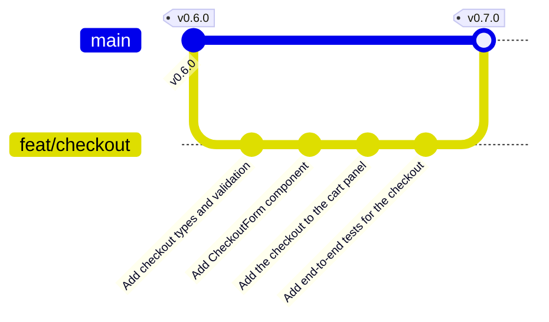
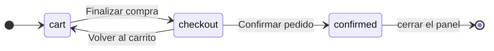

import {
	Aside,
	Card,
	CardGrid,
	FileTree,
	LinkCard,
	Steps,
	TabItem,
	Tabs,
} from "@astrojs/starlight/components";
import { Image } from "astro:assets";
import checkoutErrors from "../../../../assets/react/checkout-errors.png";

<Aside type="caution" title="Material de ampliación">
	Esta página **no forma parte del recorrido de la unidad de React**. Parte de `v0.6.0` y añade un formulario de compra dentro del panel del carrito; el recorrido principal sigue en [Context](/jjcm/di/units/react/06-context/) y [Rutas con React Router](/jjcm/di/units/react/07-router/), y el formulario que se construye después es el de alta de guitarras. Sirve como ejercicio de ampliación cuando llegue la autenticación con Supabase: con usuarios registrados, el pedido tiene sentido y se guarda en la base de datos. Los números de versión y de tests que aparecen corresponden a hacerla justo después de la página del hook.
</Aside>

GuitarLA ya tiene carrito, pero no se puede comprar. En esta página el panel del carrito gana un paso más: un **formulario** con los datos de envío que se valida antes de confirmar el pedido. Es la primera vez que la aplicación recibe texto del usuario, y con él llegan tres preguntas que toda interfaz tiene que resolver: dónde se guarda lo que escribe, cuándo se le dice que algo está mal y cómo se le dice para que lo entienda cualquiera, también quien no ve la pantalla.

<CardGrid stagger>
	<Card title="Campos controlados" icon="pencil">
		El valor de cada campo vive en el estado de React; el `input` solo lo muestra y avisa cuando cambia.
	</Card>
	<Card title="Validación" icon="approve-check">
		Una función pura que recibe los datos y devuelve los errores. Se prueba sola, sin interfaz.
	</Card>
	<Card title="Errores accesibles" icon="warning">
		Cada error va pegado a su campo, se anuncia al llegar a él y el foco salta al primero.
	</Card>
	<Card title="Rama feat/checkout" icon="seti:git">
		Cuatro commits, fusión en `main` y release `v0.7.0`.
	</Card>
</CardGrid>

<Aside type="note" title="Requisitos previos">
	Haber completado [El hook useCart](/jjcm/di/units/react/05-cart-hook/): `v0.6.0` en `main`, 31 tests de Vitest y 3 de Playwright en verde. Conviene repasar los [formularios en Testing Library](/jjcm/di/units/testing/vitest/03-testing-react/#un-formulario-completo) y el apartado de [formularios](/jjcm/di/units/ux/fundamentals/01-introduction/#formularios) de la unidad de usabilidad.
</Aside>

## Qué es un campo controlado

En HTML, un `<input>` guarda su propio valor: escribes y el navegador lo recuerda. En React se hace al revés. El valor vive en el **estado**, y el campo solo lo muestra:

```tsx
const [name, setName] = useState('');

<input value={name} onChange={(event) => setName(event.target.value)} />
```

Cada tecla dispara `onChange`, que actualiza el estado; React vuelve a renderizar y el `input` muestra el valor nuevo. Parece un rodeo, pero a cambio el componente **sabe en todo momento** qué hay escrito: puede validarlo mientras se escribe, limpiarlo, rellenarlo con datos previos o enviarlo. Es un **campo controlado**.

| Tipo de campo | Atributo que se controla | Qué se lee en `onChange` |
| :--- | :--- | :--- |
| Texto, email, número | `value` | `event.target.value` |
| Radio | `checked={valor === 'x'}` | `event.target.value` del radio pulsado |
| Checkbox | `checked` | `event.target.checked` |

<Aside type="caution" title="`value` sin `onChange`">
	Si pones `value` y olvidas `onChange`, el campo queda **congelado**: React lo pinta siempre con el mismo valor y no deja escribir. React avisa en consola: *You provided a `value` prop to a form field without an `onChange` handler*.
</Aside>

## La rama de esta fase

```bash
git switch main
git pull
git switch -c feat/checkout
```



## Los datos y su validación

Antes de dibujar el formulario se decide **qué datos recoge** y **qué es un dato válido**. Las dos cosas son lógica pura: no dependen de React ni de cómo se vea el formulario.

### Los tipos

```diff lang="ts" title="src/types/index.ts"
 export type CartItem = Guitar & {
   /** Units of this guitar in the cart. */
   quantity: number;
 };
+
+/** Shipping methods offered at checkout. */
+export type ShippingMethod = 'standard' | 'express';
+
+/** The data the customer fills in the checkout form. */
+export type CheckoutData = {
+  /** Full name of the customer. */
+  name: string;
+  /** Email where the order confirmation is sent. */
+  email: string;
+  /** Delivery address. */
+  address: string;
+  /** Chosen shipping method. */
+  shipping: ShippingMethod;
+  /** Whether the customer accepted the terms of sale. */
+  terms: boolean;
+};
+
+/** Error message for each field of the checkout form that is not valid. */
+export type CheckoutErrors = Partial<Record<keyof CheckoutData, string>>;
```

| Tipo | Qué expresa |
| :--- | :--- |
| `ShippingMethod` | Una **unión de literales**: solo puede valer `'standard'` o `'express'`. TypeScript rechaza `'urgente'` o cualquier otra cadena |
| `keyof CheckoutData` | La unión de los nombres de las propiedades: `'name' \| 'email' \| 'address' \| 'shipping' \| 'terms'` |
| `Record<K, string>` | Un objeto con una propiedad de tipo `string` por cada clave de `K` |
| `Partial<…>` | Hace opcionales todas las propiedades. Un objeto de errores solo tiene las de los campos que fallan |

Así `CheckoutErrors` es "un mensaje por campo, pero solo para los que tienen error", y si mañana el formulario gana un campo, el tipo de los errores lo sigue solo.

### La función de validación

Crea la carpeta `src/utils/` para las funciones que no son componentes ni hooks:

```ts title="src/utils/validateCheckout.ts"
import type { CheckoutData, CheckoutErrors } from '../types';

const EMAIL_PATTERN = /^[^\s@]+@[^\s@]+\.[^\s@]+$/;

/**
 * Checks the checkout data and returns the error of each invalid field.
 *
 * @param data - The values of the checkout form.
 * @returns An object with one message per invalid field; empty when all
 * fields are valid.
 */
export const validateCheckout = (data: CheckoutData): CheckoutErrors => {
  const errors: CheckoutErrors = {};

  if (data.name.trim().length < 2) {
    errors.name = 'Escribe tu nombre y apellidos.';
  }

  if (data.email.trim() === '') {
    errors.email = 'Escribe tu correo electrónico.';
  } else if (!EMAIL_PATTERN.test(data.email.trim())) {
    errors.email = 'Escribe un correo con el formato nombre@ejemplo.com.';
  }

  if (data.address.trim() === '') {
    errors.address = 'Escribe la dirección de entrega.';
  }

  if (!data.terms) {
    errors.terms = 'Tienes que aceptar las condiciones de venta.';
  }

  return errors;
};
```

```ts title="src/utils/index.ts"
export * from './validateCheckout';
```

- Es una **función pura**: recibe datos, devuelve un resultado, no toca nada más. Por eso se prueba sin renderizar nada.
- `trim()` quita los espacios de los extremos: un nombre de tres espacios no es un nombre.
- El patrón del correo es deliberadamente **sencillo**: algo, una arroba, algo, un punto, algo. Comprobar de verdad un correo solo se consigue enviándole un mensaje; una expresión regular "perfecta" rechaza direcciones válidas y no aporta nada.

<Aside type="note" title="Mensajes que dicen cómo arreglarlo">
	Ningún mensaje dice "Campo inválido" ni "Error en el email". Cada uno dice **qué tiene que hacer** la persona: "Escribe tu correo electrónico", "Escribe un correo con el formato nombre@ejemplo.com". Es la heurística de Nielsen *ayudar a reconocer, diagnosticar y recuperarse de los errores*, y lo que piden las WCAG en el criterio 3.3.3, *sugerencias ante errores*. El correo tiene **dos** mensajes distintos porque son dos problemas distintos: no haberlo escrito y haberlo escrito mal. Lo explica [formularios](/jjcm/di/units/ux/fundamentals/01-introduction/#formularios) en la unidad de usabilidad.
</Aside>

### Probar la validación

```ts title="src/utils/validateCheckout.test.ts"
import { describe, expect, it } from 'vitest';
import type { CheckoutData } from '../types';
import { validateCheckout } from './validateCheckout';

const valid: CheckoutData = {
  name: 'Ana López',
  email: 'ana@example.com',
  address: 'Calle Mayor 1, Oviedo',
  shipping: 'standard',
  terms: true,
};

describe('validateCheckout', () => {
  it('returns no errors for valid data', () => {
    expect(validateCheckout(valid)).toEqual({});
  });

  it('requires every field and the terms', () => {
    const errors = validateCheckout({
      name: '',
      email: '',
      address: '',
      shipping: 'standard',
      terms: false,
    });

    expect(Object.keys(errors)).toEqual(['name', 'email', 'address', 'terms']);
  });

  it('ignores spaces at the start and end of the fields', () => {
    const errors = validateCheckout({ ...valid, name: '   ', address: '  ' });

    expect(errors.name).toBe('Escribe tu nombre y apellidos.');
    expect(errors.address).toBe('Escribe la dirección de entrega.');
  });

  it.each(['ana', 'ana@', 'ana@example', 'ana example@x.com'])(
    'rejects the email "%s"',
    (email) => {
      expect(validateCheckout({ ...valid, email }).email).toBe(
        'Escribe un correo con el formato nombre@ejemplo.com.'
      );
    }
  );
});
```

- Un objeto `valid` de partida y `{ ...valid, campo: otroValor }` en cada test: cada caso cambia **solo** lo que quiere comprobar.
- `it.each` repite el test con cada correo de la lista; `%s` pone el valor en el nombre del test, así el informe dice exactamente cuál falla. Está explicado en [organizar tests](/jjcm/di/units/testing/vitest/02-writing-tests/#organizar-iteach-skip-y-only).
- El segundo test comprueba también el **orden** de las claves: el formulario enfocará el primer campo con error, y ese orden es el de la página.

### Confirmar

```bash
npx tsc -b
npm run lint
npx vitest run
```

```txt
 Test Files  7 passed (7)
      Tests  38 passed (38)
```

```bash
git add .
git commit -m "Add checkout types and validation"
```

## El componente CheckoutForm

### Un subcomponente para los campos de texto

Los tres campos de texto (nombre, correo, dirección) se escriben igual: una etiqueta, un `input` y, si hay error, un mensaje enlazado. En lugar de repetir ese bloque tres veces, va en un **subcomponente** dentro de la carpeta del formulario. Es lo que se previó al decidir [una carpeta por componente](/jjcm/di/units/react/02-components/#una-carpeta-por-componente): `TextField` solo lo usa `CheckoutForm`, así que no se exporta desde `components/`.

<FileTree>
- src/components/CheckoutForm/
	- CheckoutForm.tsx
	- CheckoutForm.test.tsx
	- CheckoutForm.stories.tsx
	- TextField.tsx subcomponente, no se exporta en index.ts
	- index.ts
</FileTree>

```tsx title="src/components/CheckoutForm/TextField.tsx"
import type { ChangeEvent } from 'react';

type TextFieldProps = {
  label: string;
  name: string;
  value: string;
  onChange: (event: ChangeEvent<HTMLInputElement>) => void;
  type?: 'text' | 'email';
  autoComplete?: string;
  error?: string;
};

export const TextField = ({
  label,
  name,
  value,
  onChange,
  type = 'text',
  autoComplete,
  error,
}: TextFieldProps) => {
  const id = `checkout-${name}`;
  const errorId = `${id}-error`;

  return (
    <div>
      <label htmlFor={id} className="block font-bold">
        {label}
      </label>
      <input
        id={id}
        name={name}
        type={type}
        autoComplete={autoComplete}
        required
        value={value}
        onChange={onChange}
        aria-invalid={error ? true : undefined}
        aria-describedby={error ? errorId : undefined}
        className="mt-1 w-full rounded border border-gray-400 px-3 py-2 focus-visible:outline-2 focus-visible:outline-offset-2 focus-visible:outline-blue-600 aria-[invalid=true]:border-2 aria-[invalid=true]:border-red-700"
      />
      {error && (
        <p id={errorId} className="mt-1 text-sm text-red-700">
          {error}
        </p>
      )}
    </div>
  );
};
```

| Pieza | Qué hace |
| :--- | :--- |
| `type?:`, `autoComplete?:`, `error?:` | Props **opcionales** (`?`). `type = 'text'` en la desestructuración es su **valor por defecto**: quien no lo pase obtiene un campo de texto |
| `<label htmlFor={id}>` + `<input id={id}>` | Une la etiqueta al campo. En JSX es `htmlFor`, no `for` (palabra reservada). Al pulsar la etiqueta se enfoca el campo, y el lector de pantalla lee la etiqueta al llegar a él |
| `autoComplete` | Dice al navegador qué dato es (`name`, `email`, `street-address`) para que ofrezca rellenarlo. Ahorra escribir, sobre todo en el móvil, y es un criterio de las WCAG (1.3.5) |
| `required` | Marca el campo como obligatorio. El lector de pantalla anuncia "obligatorio" y jest-dom lo comprueba con `toBeRequired()` |
| `aria-invalid` | Marca el campo como erróneo; el lector anuncia "no válido". Se pone `undefined`, y no `false`, cuando no hay error, para que el atributo **no aparezca** |
| `aria-describedby={errorId}` | Enlaza el campo con el párrafo del error. Al llegar al campo, el lector lee la etiqueta, el estado y **el mensaje**: "Correo electrónico, no válido, obligatorio, Escribe tu correo electrónico" |
| `aria-[invalid=true]:border-red-700` | Una variante de Tailwind que aplica el estilo **cuando el atributo `aria-invalid` vale `true`**. El borde rojo y el anuncio salen del mismo dato: no pueden desincronizarse |

<Aside type="tip" title="El estilo sigue a la accesibilidad">
	Podrías poner el borde rojo con una clase condicional, `error ? 'border-red-700' : 'border-gray-400'`. Funcionaría igual a la vista, pero entonces hay dos fuentes de verdad: la clase y el atributo, y nada impide que alguien cambie una y olvide la otra. Con `aria-[invalid=true]:` el aspecto **se deriva** del estado accesible: si el campo se ve en rojo es porque se anuncia como no válido. La misma idea que `disabled:` en los botones del carrito.
</Aside>

### El formulario

```tsx title="src/components/CheckoutForm/CheckoutForm.tsx"
import { useState, type ChangeEvent, type FormEvent } from 'react';
import type { CheckoutData, CheckoutErrors } from '../../types';
import { validateCheckout } from '../../utils';
import { TextField } from './TextField';

const EMPTY_CHECKOUT: CheckoutData = {
  name: '',
  email: '',
  address: '',
  shipping: 'standard',
  terms: false,
};

type CheckoutFormProps = {
  onSubmit: (data: CheckoutData) => void;
  onCancel: () => void;
  initialValues?: Partial<CheckoutData>;
};

export const CheckoutForm = ({
  onSubmit,
  onCancel,
  initialValues = {},
}: CheckoutFormProps) => {
  const [values, setValues] = useState<CheckoutData>({
    ...EMPTY_CHECKOUT,
    ...initialValues,
  });
  const [errors, setErrors] = useState<CheckoutErrors>({});
  const [submitted, setSubmitted] = useState(false);

  const handleChange = (event: ChangeEvent<HTMLInputElement>) => {
    const { name, type, value, checked } = event.target;
    const next = { ...values, [name]: type === 'checkbox' ? checked : value };

    setValues(next);
    if (submitted) setErrors(validateCheckout(next));
  };

  const handleSubmit = (event: FormEvent<HTMLFormElement>) => {
    event.preventDefault();

    const found = validateCheckout(values);
    setErrors(found);
    setSubmitted(true);

    const firstInvalid = Object.keys(found)[0];
    if (firstInvalid) {
      event.currentTarget
        .querySelector<HTMLInputElement>(`[name="${firstInvalid}"]`)
        ?.focus();
      return;
    }

    onSubmit(values);
  };

  return (
    <form noValidate onSubmit={handleSubmit} className="space-y-4">
      <p className="text-sm text-gray-600">Todos los campos son obligatorios.</p>

      <TextField
        label="Nombre y apellidos"
        name="name"
        autoComplete="name"
        value={values.name}
        onChange={handleChange}
        error={errors.name}
      />
      <TextField
        label="Correo electrónico"
        name="email"
        type="email"
        autoComplete="email"
        value={values.email}
        onChange={handleChange}
        error={errors.email}
      />
      <TextField
        label="Dirección de entrega"
        name="address"
        autoComplete="street-address"
        value={values.address}
        onChange={handleChange}
        error={errors.address}
      />

      <fieldset>
        <legend className="font-bold">Envío</legend>
        <div className="mt-1 space-y-1">
          <label className="flex items-center gap-2">
            <input
              type="radio"
              name="shipping"
              value="standard"
              checked={values.shipping === 'standard'}
              onChange={handleChange}
            />
            Estándar, de 3 a 5 días
          </label>
          <label className="flex items-center gap-2">
            <input
              type="radio"
              name="shipping"
              value="express"
              checked={values.shipping === 'express'}
              onChange={handleChange}
            />
            Urgente, en 24 horas
          </label>
        </div>
      </fieldset>

      <div>
        <label className="flex items-center gap-2">
          <input
            type="checkbox"
            name="terms"
            required
            checked={values.terms}
            onChange={handleChange}
            aria-invalid={errors.terms ? true : undefined}
            aria-describedby={errors.terms ? 'checkout-terms-error' : undefined}
          />
          Acepto las condiciones de venta
        </label>
        {errors.terms && (
          <p id="checkout-terms-error" className="mt-1 text-sm text-red-700">
            {errors.terms}
          </p>
        )}
      </div>

      <div className="flex gap-3">
        <button
          type="button"
          onClick={onCancel}
          className="flex-1 rounded border border-gray-900 p-3 font-bold uppercase transition hover:bg-gray-100 focus-visible:outline-2 focus-visible:outline-offset-2 focus-visible:outline-blue-600"
        >
          Volver al carrito
        </button>
        <button
          type="submit"
          className="flex-1 rounded bg-gray-900 p-3 font-bold text-white uppercase transition hover:bg-gray-700 focus-visible:outline-2 focus-visible:outline-offset-2 focus-visible:outline-blue-600"
        >
          Confirmar pedido
        </button>
      </div>
    </form>
  );
};
```

```ts title="src/components/CheckoutForm/index.ts"
export * from './CheckoutForm';
```

```diff lang="ts" title="src/components/index.ts"
 export * from './Cart';
+export * from './CheckoutForm';
 export * from './Footer';
```

Lo importante, por partes:

<Steps>
	1. **Un solo estado para todo el formulario.** `values` es un objeto `CheckoutData`; se inicializa mezclando `EMPTY_CHECKOUT` con `initialValues`, que por defecto es `{}`. Así el formulario puede llegar vacío o con datos previos (un usuario que ya compró, una story de Storybook) sin cambiar nada más.
	2. **Un solo `handleChange` para todos los campos.** Cada `input` tiene un `name` igual a su clave en `CheckoutData`. `[name]: …` es una **propiedad calculada**: la clave del objeto es el valor de la variable `name`. El checkbox aporta `checked`; el resto, `value`.
	3. **`event.preventDefault()`** en el envío: sin él, el navegador haría lo que hace con cualquier formulario, recargar la página enviando los datos por la URL.
	4. **`noValidate`** desactiva los globos de error del navegador. Son distintos en cada navegador, no se pueden estilar, desaparecen solos y algunos lectores de pantalla no los leen. Los atributos `required` y `type="email"` se mantienen porque aportan **semántica** ("obligatorio", teclado de correo en el móvil); la validación la hace `validateCheckout`.
	5. **El foco al primer error.** Si hay errores, se busca en el formulario el campo cuyo `name` es la primera clave del objeto de errores y se le da el foco. La persona aterriza donde tiene que actuar, y el lector le lee la etiqueta y el mensaje.
	6. **`fieldset` y `legend`** agrupan los dos radios bajo una pregunta común. El lector anuncia "Envío, grupo" y después cada opción; sin ellos oiría "Estándar, de 3 a 5 días, botón de opción" sin saber a qué pregunta responde.
	7. **`type="button"` en "Volver al carrito".** Dentro de un `form`, un `button` sin tipo es `submit`: volver al carrito **enviaría** el formulario.
</Steps>

<Aside type="note" title="Cuándo mostrar los errores">
	El formulario **no valida mientras escribes hasta que intentas enviarlo**. Después, sí: el estado `submitted` hace que cada cambio vuelva a validar, de modo que el mensaje desaparece en cuanto el dato es correcto. Es el punto medio que recomiendan las guías de diseño de servicios públicos: avisar de que el correo "está mal" cuando llevas escritas tres letras es interrumpir, y no avisar hasta el siguiente envío obliga a adivinar si ya está bien. Lo amplía [formularios](/jjcm/di/units/ux/fundamentals/01-introduction/#formularios).
</Aside>

<Aside type="caution" title="`querySelector` en React">
	Normalmente no se busca en el DOM a mano: React lo gestiona. Aquí se hace porque es el **mismo formulario** que acaba de enviarse (`event.currentTarget`), dentro del manejador del evento, y para una sola acción: mover el foco. Con tres campos de texto y un checkbox, un `ref` por campo sería más código para lo mismo. La forma general de acceder a un elemento desde React, `useRef`, aparece en el siguiente apartado, donde sí hace falta.
</Aside>

### Probar el formulario

```tsx title="src/components/CheckoutForm/CheckoutForm.test.tsx"
import { render, screen } from '@testing-library/react';
import userEvent from '@testing-library/user-event';
import { describe, expect, it, vi } from 'vitest';
import { CheckoutForm } from './CheckoutForm';

const renderForm = (initialValues = {}) => {
  const handlers = { onSubmit: vi.fn(), onCancel: vi.fn() };
  render(<CheckoutForm {...handlers} initialValues={initialValues} />);
  return handlers;
};

const submit = () =>
  screen.getByRole('button', { name: 'Confirmar pedido' });

describe('CheckoutForm', () => {
  it('shows every field with its label', () => {
    renderForm();
    expect(screen.getByLabelText('Nombre y apellidos')).toBeRequired();
    expect(screen.getByLabelText('Correo electrónico')).toHaveAttribute(
      'type',
      'email'
    );
    expect(screen.getByLabelText('Dirección de entrega')).toBeRequired();
    expect(screen.getByRole('group', { name: 'Envío' })).toBeInTheDocument();
    expect(
      screen.getByRole('radio', { name: 'Estándar, de 3 a 5 días' })
    ).toBeChecked();
    expect(
      screen.getByRole('checkbox', { name: 'Acepto las condiciones de venta' })
    ).not.toBeChecked();
  });

  it('shows the errors, marks the fields and focuses the first one', async () => {
    const user = userEvent.setup();
    const { onSubmit } = renderForm();

    await user.click(submit());

    const name = screen.getByLabelText('Nombre y apellidos');
    expect(name).toHaveAttribute('aria-invalid', 'true');
    expect(name).toHaveAccessibleDescription('Escribe tu nombre y apellidos.');
    expect(name).toHaveFocus();
    expect(
      screen.getByText('Tienes que aceptar las condiciones de venta.')
    ).toBeInTheDocument();
    expect(onSubmit).not.toHaveBeenCalled();
  });

  it('updates the errors while typing after the first submit', async () => {
    const user = userEvent.setup();
    renderForm();

    await user.click(submit());
    await user.type(screen.getByLabelText('Nombre y apellidos'), 'Ana López');

    expect(screen.getByLabelText('Nombre y apellidos')).not.toHaveAttribute(
      'aria-invalid'
    );
    expect(
      screen.queryByText('Escribe tu nombre y apellidos.')
    ).not.toBeInTheDocument();
  });

  it('does not show errors while typing before the first submit', async () => {
    const user = userEvent.setup();
    renderForm();

    await user.type(screen.getByLabelText('Correo electrónico'), 'ana');

    expect(
      screen.queryByText('Escribe un correo con el formato nombre@ejemplo.com.')
    ).not.toBeInTheDocument();
  });

  it('sends the data when every field is valid', async () => {
    const user = userEvent.setup();
    const { onSubmit } = renderForm();

    await user.type(screen.getByLabelText('Nombre y apellidos'), 'Ana López');
    await user.type(
      screen.getByLabelText('Correo electrónico'),
      'ana@example.com'
    );
    await user.type(
      screen.getByLabelText('Dirección de entrega'),
      'Calle Mayor 1, Oviedo'
    );
    await user.click(screen.getByRole('radio', { name: 'Urgente, en 24 horas' }));
    await user.click(
      screen.getByRole('checkbox', { name: 'Acepto las condiciones de venta' })
    );
    await user.click(submit());

    expect(onSubmit).toHaveBeenCalledWith({
      name: 'Ana López',
      email: 'ana@example.com',
      address: 'Calle Mayor 1, Oviedo',
      shipping: 'express',
      terms: true,
    });
  });

  it('fills the fields with the initial values', () => {
    renderForm({ name: 'Ana López', shipping: 'express' });
    expect(screen.getByLabelText('Nombre y apellidos')).toHaveValue('Ana López');
    expect(
      screen.getByRole('radio', { name: 'Urgente, en 24 horas' })
    ).toBeChecked();
  });

  it('calls onCancel from the back button', async () => {
    const user = userEvent.setup();
    const { onCancel } = renderForm();

    await user.click(screen.getByRole('button', { name: 'Volver al carrito' }));

    expect(onCancel).toHaveBeenCalledTimes(1);
  });
});
```

| Matcher o consulta | Qué comprueba |
| :--- | :--- |
| `getByLabelText('Nombre y apellidos')` | Encuentra el campo **por su etiqueta**. Si la `label` no está enlazada con `htmlFor`, falla: el test detecta una etiqueta mal hecha |
| `getByRole('group', { name: 'Envío' })` | El `fieldset` tiene rol `group` y su nombre es la `legend` |
| `toBeRequired()`, `toBeChecked()`, `toHaveValue()` | Matchers de jest-dom para el estado de un campo |
| `toHaveAccessibleDescription(…)` | Que el texto que el lector lee **después** de la etiqueta sea el mensaje de error. Comprueba que `aria-describedby` apunta al sitio correcto |
| `toHaveFocus()` | Que el foco esté en ese elemento |

El cuarto test comprueba lo que **no** debe pasar: que no salgan errores mientras se escribe por primera vez. Es tan parte del comportamiento como lo contrario.

### Documentar

```tsx title="src/components/CheckoutForm/CheckoutForm.stories.tsx"
import type { Meta, StoryObj } from '@storybook/react-vite';
import { fn } from 'storybook/test';
import { CheckoutForm } from './CheckoutForm';

const meta = {
  component: CheckoutForm,
  args: {
    onSubmit: fn(),
    onCancel: fn(),
  },
  decorators: [
    (Story) => (
      <div className="max-w-md">
        <Story />
      </div>
    ),
  ],
} satisfies Meta<typeof CheckoutForm>;

export default meta;
type Story = StoryObj<typeof meta>;

export const Empty: Story = {};

export const Prefilled: Story = {
  args: {
    initialValues: {
      name: 'Ana López',
      email: 'ana@example.com',
      address: 'Calle Mayor 1, Oviedo',
      shipping: 'express',
    },
  },
};

export const WithErrors: Story = {
  play: async ({ canvas, userEvent }) => {
    await userEvent.click(
      canvas.getByRole('button', { name: 'Confirmar pedido' })
    );
  },
};
```

La story `WithErrors` tiene una **función `play`**: Storybook la ejecuta después de renderizar la story y simula lo que haría una persona, aquí pulsar "Confirmar pedido" con todo vacío. Usa las mismas consultas que Testing Library. Así el **estado de error**, que solo existe después de interactuar, se puede ver, revisar con el panel **Accessibility** y enseñar a quien diseña sin tener que pulsar nada.

<Image src={checkoutErrors} alt="Story WithErrors del formulario: los tres campos de texto con borde rojo y su mensaje debajo, el foco en Nombre y apellidos, y el mensaje de las condiciones de venta bajo la casilla" />

Fíjate en que el error **no depende solo del color**: el borde rojo va acompañado de un texto. Quien no distingue el rojo, o usa el móvil a pleno sol, lee el mensaje igualmente (WCAG 1.4.1, *uso del color*).

### Confirmar

```txt
 Test Files  8 passed (8)
      Tests  45 passed (45)
```

```bash
git add .
git commit -m "Add CheckoutForm component"
```

El formulario todavía no se ve en la aplicación: existe, está probado y documentado, y se conecta en el siguiente commit. Confirmar un componente antes de usarlo es normal; lo que nunca se confirma es una aplicación que no compila.

## El checkout en el panel del carrito

### Tres vistas en el mismo panel

El formulario aparece **dentro del panel del carrito**, sustituyendo a la tabla, en lugar de abrir otra ventana encima. El panel pasa por tres vistas:



Cuál se muestra es estado **local de `Cart`**: solo a él le importa, igual que `isCartOpen` solo le importa a `Header`. Al cerrar el panel, `Cart` se desmonta y la próxima vez empieza otra vez en `'cart'`.

### El foco al cambiar de vista

Al pulsar "Finalizar compra", el botón **desaparece** (la vista cambia) y el elemento que tenía el foco ya no existe. El navegador lo deja en el `body`: el lector de pantalla no anuncia nada y el siguiente `Tab` empieza desde donde decida el navegador, no desde el formulario. Quien navega con teclado o lector de pantalla se pierde justo cuando más falta le hace saber dónde está. Hay que **mover el foco** al título de la vista nueva.

Para eso React tiene `useRef`: una "caja" cuyo `.current` apunta al elemento del DOM después de renderizar.

```diff lang="tsx" title="src/components/Cart/Cart.tsx"
+import { useEffect, useRef, useState } from 'react';
 import { MAX_ITEMS, MIN_ITEMS } from '../../hooks';
-import type { CartItem } from '../../types';
+import type { CartItem, CheckoutData } from '../../types';
+import { CheckoutForm } from '../CheckoutForm';
+
+type CartView = 'cart' | 'checkout' | 'confirmed';
+
+type Order = {
+  name: string;
+  email: string;
+  total: number;
+};

 type CartProps = {
   …
   onClear: () => void;
+  onCheckout: (data: CheckoutData) => void;
 };

 export const Cart = ({
   …
   onClear,
+  onCheckout,
 }: CartProps) => {
+  const [view, setView] = useState<CartView>('cart');
+  const [order, setOrder] = useState<Order | null>(null);
+  const titleRef = useRef<HTMLHeadingElement>(null);
+  const stepTitleRef = useRef<HTMLHeadingElement>(null);
+  const previousView = useRef(view);
+
   const isEmpty = cart.length === 0;
   const total = cart.reduce((sum, item) => sum + item.price * item.quantity, 0);

+  useEffect(() => {
+    if (previousView.current === view) return;
+    previousView.current = view;
+
+    const target = view === 'cart' ? titleRef : stepTitleRef;
+    target.current?.focus();
+  }, [view]);
+
+  const handleCheckout = (data: CheckoutData) => {
+    setOrder({ name: data.name, email: data.email, total });
+    setView('confirmed');
+    onCheckout(data);
+  };
+
   return (
     <aside …>
       <div className="flex items-center justify-between border-b border-gray-200 px-6 py-4">
-        <h2 id="cart-title" className="text-2xl font-black">
+        <h2
+          id="cart-title"
+          ref={titleRef}
+          tabIndex={-1}
+          className="text-2xl font-black focus:outline-none"
+        >
           Tu carrito
         </h2>
```

| Pieza | Qué hace |
| :--- | :--- |
| `useRef<HTMLHeadingElement>(null)` | Crea la caja. `ref={titleRef}` en el JSX hace que React guarde ahí el `<h2>` real |
| `tabIndex={-1}` | Un título no recibe el foco por defecto. `-1` permite **dárselo por código** sin meterlo en el recorrido de `Tab` |
| `focus:outline-none` | El título enfocado no necesita anillo: no es un control, y el lector ya lo anuncia |
| `previousView` | Otro `useRef`, esta vez no para un elemento sino para **recordar un valor** entre renderizados sin provocar uno nuevo. Guarda la vista anterior |
| El efecto | Cuando `view` cambia, enfoca el título de la vista nueva: `Tu carrito` al volver, el `<h3>` del paso en las otras dos |
| `handleCheckout` | Guarda un resumen del pedido (con el total **antes** de vaciar el carrito), cambia a la vista de confirmación y avisa al padre |

<Aside type="note" title="¿Por qué hace falta `previousView`?">
	Al abrir el panel, el foco tiene que ir al botón de cerrar (`autoFocus`, de la página de props), no al título. El efecto se ejecuta siempre al montar el componente, y en desarrollo React lo ejecuta **dos veces** (es el modo estricto, que busca efectos mal escritos). Comparar con la vista anterior hace que el efecto solo actúe cuando la vista **ha cambiado de verdad**, por mucho que se ejecute.
</Aside>

<Aside type="caution" title="`useRef` no es `useState`">
	Cambiar `ref.current` **no** vuelve a renderizar. Por eso sirve para guardar un elemento del DOM o un valor de control como `previousView`, y no sirve para nada que tenga que verse en pantalla. Si un valor se pinta, es estado.
</Aside>

### Las vistas

El cuerpo del panel muestra una vista u otra. La tabla y el mensaje de vacío no cambian: solo se envuelven en `{view === 'cart' && (…)}`. El pie, con el total y los botones, también se muestra solo en esa vista:

```diff lang="tsx" title="src/components/Cart/Cart.tsx"
       <div className="flex-1 overflow-y-auto px-6 py-4">
-        {isEmpty ? (
-          …
-        )}
+        {view === 'cart' && (
+          <>
+            {isEmpty ? (
+              …
+            )}
+          </>
+        )}
+
+        {view === 'checkout' && (
+          <>
+            <h3
+              ref={stepTitleRef}
+              tabIndex={-1}
+              className="mb-1 text-xl font-bold focus:outline-none"
+            >
+              Datos de envío
+            </h3>
+            <p className="mb-4 text-gray-600">
+              Total del pedido: <span className="font-bold">${total}</span>
+            </p>
+            <CheckoutForm
+              onSubmit={handleCheckout}
+              onCancel={() => setView('cart')}
+            />
+          </>
+        )}
+
+        {view === 'confirmed' && order && (
+          <div className="text-center">
+            <h3
+              ref={stepTitleRef}
+              tabIndex={-1}
+              className="text-xl font-bold focus:outline-none"
+            >
+              Pedido confirmado
+            </h3>
+            <p className="mt-3">
+              Gracias, {order.name}. Hemos recibido tu pedido de{' '}
+              <span className="font-bold">${order.total}</span>.
+            </p>
+            <p className="mt-2 text-gray-600">
+              Te enviaremos los detalles a {order.email}.
+            </p>
+          </div>
+        )}
       </div>

-      <div className="border-t border-gray-200 px-6 py-4">
-        <p className="text-right text-lg">
-          Total pagar: <span className="font-black">${total}</span>
-        </p>
-        <button
-          type="button"
-          className="mt-3 w-full rounded bg-gray-900 p-3 font-bold text-white uppercase transition hover:bg-gray-700 focus-visible:outline-2 focus-visible:outline-offset-2 focus-visible:outline-blue-600 disabled:cursor-not-allowed disabled:bg-gray-400"
-          disabled={isEmpty}
-          onClick={onClear}
-        >
-          Vaciar carrito
-        </button>
-      </div>
+      {view === 'cart' && (
+        <div className="border-t border-gray-200 px-6 py-4">
+          <p className="text-right text-lg">
+            Total pagar: <span className="font-black">${total}</span>
+          </p>
+          <button
+            type="button"
+            className="mt-3 w-full rounded bg-gray-900 p-3 font-bold text-white uppercase transition hover:bg-gray-700 focus-visible:outline-2 focus-visible:outline-offset-2 focus-visible:outline-blue-600 disabled:cursor-not-allowed disabled:bg-gray-400"
+            disabled={isEmpty}
+            onClick={() => setView('checkout')}
+          >
+            Finalizar compra
+          </button>
+          <button
+            type="button"
+            className="mt-2 w-full rounded border border-gray-900 p-3 font-bold uppercase transition hover:bg-gray-100 focus-visible:outline-2 focus-visible:outline-offset-2 focus-visible:outline-blue-600 disabled:cursor-not-allowed disabled:border-gray-300 disabled:text-gray-400"
+            disabled={isEmpty}
+            onClick={onClear}
+          >
+            Vaciar carrito
+          </button>
+        </div>
+      )}
     </aside>
```

Los dos `<h3>` comparten `stepTitleRef`: como nunca están en pantalla a la vez, la caja apunta siempre al que se ve.

<Aside type="note" title="Jerarquía de acciones">
	"Finalizar compra" es lo que la tienda quiere que hagas y "Vaciar carrito" es destructivo. Por eso el primero es un botón **relleno**, el más llamativo, y el segundo pasa a ser un botón **con borde**, secundario. Antes "Vaciar carrito" era el único botón y se llevaba toda la atención. Es la jerarquía visual de [captar la atención](/jjcm/di/units/ux/fundamentals/04-ux-patterns/#captar-la-atención-c) en la unidad de usabilidad: una sola acción principal por vista, y la destructiva nunca es la más visible.
</Aside>

### `Header` y `App`

Una función más que atraviesa `Header`:

```diff lang="tsx" title="src/components/Header/Header.tsx"
-import type { CartItem } from '../../types';
+import type { CartItem, CheckoutData } from '../../types';
 …
   onClear: () => void;
+  onCheckout: (data: CheckoutData) => void;
 };
 …
   onClear,
+  onCheckout,
 }: HeaderProps) => {
 …
             onClear={onClear}
+            onCheckout={onCheckout}
           />
```

```diff lang="tsx" title="src/App.tsx"
         onClear={clearCart}
+        onCheckout={clearCart}
       />
```

De momento, confirmar el pedido solo **vacía el carrito**: no hay servidor al que enviarlo. `clearCart` no usa los datos que recibe, y TypeScript lo acepta porque una función que ignora sus argumentos encaja donde se espera una que los recibe. En la página de autenticación y pedidos, `onCheckout` guardará el pedido en Supabase.

Ya son **seis** props que `Header` recibe solo para pasárselas a `Cart`. El problema del *prop drilling* que se anunció en la página del hook ha crecido justo lo suficiente: la página siguiente lo resuelve con Context.

### Probar

<Tabs>
	<TabItem label="Cart">
		`renderCart` añade el mock de `onCheckout`, y cuatro tests nuevos cubren el recorrido por las vistas y el foco:

		```diff lang="tsx" title="src/components/Cart/Cart.test.tsx"
		     onClear: vi.fn(),
		+    onCheckout: vi.fn(),
		   };
		 …
		+
		+  it('disables the checkout button when the cart is empty', () => {
		+    renderCart();
		+    expect(
		+      screen.getByRole('button', { name: 'Finalizar compra' })
		+    ).toBeDisabled();
		+  });
		+
		+  it('shows the checkout form and moves the focus to its title', async () => {
		+    const user = userEvent.setup();
		+    renderCart(items);
		+
		+    await user.click(screen.getByRole('button', { name: 'Finalizar compra' }));
		+
		+    expect(
		+      screen.getByRole('heading', { name: 'Datos de envío' })
		+    ).toHaveFocus();
		+    expect(screen.getByLabelText('Nombre y apellidos')).toBeInTheDocument();
		+    expect(screen.queryByRole('table')).not.toBeInTheDocument();
		+  });
		+
		+  it('goes back to the cart and moves the focus to the cart title', async () => {
		+    const user = userEvent.setup();
		+    renderCart(items);
		+
		+    await user.click(screen.getByRole('button', { name: 'Finalizar compra' }));
		+    await user.click(screen.getByRole('button', { name: 'Volver al carrito' }));
		+
		+    expect(screen.getByRole('heading', { name: 'Tu carrito' })).toHaveFocus();
		+    expect(screen.getByRole('table')).toBeInTheDocument();
		+  });
		+
		+  it('confirms the order and calls onCheckout with the data', async () => {
		+    const user = userEvent.setup();
		+    const { onCheckout } = renderCart(items);
		+
		+    await user.click(screen.getByRole('button', { name: 'Finalizar compra' }));
		+    await user.type(screen.getByLabelText('Nombre y apellidos'), 'Ana López');
		+    await user.type(
		+      screen.getByLabelText('Correo electrónico'),
		+      'ana@example.com'
		+    );
		+    await user.type(
		+      screen.getByLabelText('Dirección de entrega'),
		+      'Calle Mayor 1, Oviedo'
		+    );
		+    await user.click(
		+      screen.getByRole('checkbox', { name: 'Acepto las condiciones de venta' })
		+    );
		+    await user.click(screen.getByRole('button', { name: 'Confirmar pedido' }));
		+
		+    expect(onCheckout).toHaveBeenCalledWith(
		+      expect.objectContaining({ name: 'Ana López', email: 'ana@example.com' })
		+    );
		+    expect(
		+      screen.getByRole('heading', { name: 'Pedido confirmado' })
		+    ).toHaveFocus();
		+    expect(screen.getByText(/Gracias, Ana López/)).toHaveTextContent('$947');
		+  });
		 });
		```

		`expect.objectContaining({ … })` comprueba solo las propiedades que importan en este test; el formulario ya tiene su propio test para el objeto completo. Y `getByText(/Gracias, Ana López/)` usa una **expresión regular** porque el párrafo contiene más texto y un `span` dentro.
	</TabItem>
	<TabItem label="Header">
		```diff lang="tsx" title="src/components/Header/Header.test.tsx"
		       onClear={vi.fn()}
		+      onCheckout={vi.fn()}
		     />
		```
	</TabItem>
	<TabItem label="App">
		El flujo completo, de la tarjeta a la confirmación:

		```diff lang="tsx" title="src/App.test.tsx"
		+
		+  it('places an order and empties the cart', async () => {
		+    const user = userEvent.setup();
		+    render(<App />);
		+
		+    await user.click(
		+      screen.getByRole('button', { name: 'Agregar al carrito Lukather' })
		+    );
		+    await user.click(screen.getByRole('button', { name: 'Abrir carrito' }));
		+    await user.click(screen.getByRole('button', { name: 'Finalizar compra' }));
		+    await user.type(screen.getByLabelText('Nombre y apellidos'), 'Ana López');
		+    await user.type(
		+      screen.getByLabelText('Correo electrónico'),
		+      'ana@example.com'
		+    );
		+    await user.type(
		+      screen.getByLabelText('Dirección de entrega'),
		+      'Calle Mayor 1, Oviedo'
		+    );
		+    await user.click(
		+      screen.getByRole('checkbox', { name: 'Acepto las condiciones de venta' })
		+    );
		+    await user.click(screen.getByRole('button', { name: 'Confirmar pedido' }));
		+
		+    expect(
		+      screen.getByRole('heading', { name: 'Pedido confirmado' })
		+    ).toBeInTheDocument();
		+    expect(screen.getByText('0 artículos en el carrito')).toBeInTheDocument();
		+  });
		 });
		```
	</TabItem>
</Tabs>

### Documentar

Las stories de `Cart` y `Header` reciben la función nueva:

```diff lang="tsx" title="src/components/Cart/Cart.stories.tsx"
     onClear: fn(),
+    onCheckout: fn(),
   },
```

```diff lang="tsx" title="src/components/Header/Header.stories.tsx"
     onClear: fn(),
+    onCheckout: fn(),
   },
```

En `Cart › WithItems` puedes recorrer todo el checkout dentro de Storybook: pulsa "Finalizar compra", rellena y confirma; la pestaña **Actions** registra `onCheckout` con los datos.

### Confirmar

```bash
npx tsc -b
npm run lint
npx vitest run
```

```txt
 Test Files  8 passed (8)
      Tests  50 passed (50)
```

```bash
git add .
git commit -m "Add the checkout to the cart panel"
```

## Probar el checkout de extremo a extremo

Dos flujos en un archivo nuevo. El primero repite en Chromium lo que más importa del formulario, los errores accesibles, y le pasa axe **con los errores en pantalla**: es el estado más delicado de un formulario y el que menos se revisa. El segundo hace la compra **con el teclado**, desde el título del paso, como la haría quien no usa ratón.

```ts title="e2e/checkout.spec.ts"
import AxeBuilder from '@axe-core/playwright';
import { expect, test } from '@playwright/test';

test.describe('Checkout', () => {
  test.beforeEach(async ({ page }) => {
    await page.goto('/');
    await page
      .getByRole('button', { name: 'Agregar al carrito Lukather' })
      .click();
    await page.getByRole('button', { name: 'Abrir carrito' }).click();
    await page.getByRole('button', { name: 'Finalizar compra' }).click();
  });

  test('shows accessible errors and focuses the first invalid field', async ({
    page,
  }) => {
    await page.getByRole('button', { name: 'Confirmar pedido' }).click();

    const name = page.getByLabel('Nombre y apellidos');
    await expect(name).toBeFocused();
    await expect(name).toHaveAttribute('aria-invalid', 'true');
    await expect(name).toHaveAccessibleDescription(
      'Escribe tu nombre y apellidos.'
    );

    const results = await new AxeBuilder({ page }).analyze();
    expect(results.violations).toEqual([]);
  });

  test('places the order with the keyboard and empties the cart', async ({
    page,
  }) => {
    await expect(
      page.getByRole('heading', { name: 'Datos de envío' })
    ).toBeFocused();

    await page.keyboard.press('Tab');
    await page.keyboard.type('Ana López');
    await page.keyboard.press('Tab');
    await page.keyboard.type('ana@example.com');
    await page.keyboard.press('Tab');
    await page.keyboard.type('Calle Mayor 1, Oviedo');
    await page.getByRole('radio', { name: 'Urgente, en 24 horas' }).check();
    await page
      .getByRole('checkbox', { name: 'Acepto las condiciones de venta' })
      .check();
    await page.getByRole('button', { name: 'Confirmar pedido' }).press('Enter');

    await expect(
      page.getByRole('heading', { name: 'Pedido confirmado' })
    ).toBeFocused();
    await expect(page.getByText('Gracias, Ana López')).toBeVisible();

    await page.reload();
    await expect(page.getByText('0 artículos en el carrito')).toBeAttached();
  });
});
```

- **`beforeEach`** deja cada test en el formulario: los dos empiezan igual y solo cambian en lo que prueban.
- **`page.keyboard.press('Tab')`** desde el título enfocado lleva al primer campo. Si el foco no hubiera ido al título, el `Tab` empezaría desde el principio de la página y escribiría en otro sitio: el test comprueba de verdad la gestión del foco.
- **`page.reload()`** al final confirma que el carrito vacío también se ha guardado en `localStorage`. `toBeAttached()` comprueba que el elemento existe aunque esté oculto con `sr-only`.

```bash
npm run test:e2e
```

```txt
  5 passed (5.1s)
```

```bash
npm run lint
npm run format:check
git add .
git commit -m "Add end-to-end tests for the checkout"
```

## Comprobar, fusionar y publicar

```bash
npm run lint
npm run format:check
npx vitest run
npm run test:e2e
npm run build
```

```bash
git push
git switch main
git merge --no-ff feat/checkout -m "Merge feat/checkout"
git push
git tag -a v0.7.0 -m "Checkout form with validation"
git push origin v0.7.0
gh release create v0.7.0 --title "v0.7.0 · Checkout" --notes "Checkout form in the cart panel with controlled fields, validation in a pure function, accessible error messages, focus management between views, and end-to-end tests with an axe audit of the error state."
git branch -d feat/checkout
git push origin --delete feat/checkout
```

## Comprobación final

<Steps>
	1. Con guitarras en el carrito, "Finalizar compra" muestra el formulario dentro del panel y el foco está en "Datos de envío"; con el carrito vacío, el botón está deshabilitado.
	2. Enviar el formulario vacío marca los campos en rojo con su mensaje debajo, y el foco salta a "Nombre y apellidos". Al escribir un nombre válido, su error desaparece sin volver a enviar.
	3. Si el navegador tiene datos guardados, ofrece autocompletar nombre, correo y dirección al enfocar cada campo.
	4. "Volver al carrito" devuelve a la tabla sin enviar nada; "Confirmar pedido" con datos válidos muestra "Pedido confirmado" con el nombre y el total, y el contador de la cabecera vuelve a cero.
	5. En Storybook, `CheckoutForm › WithErrors` muestra los errores sin pulsar nada y el panel **Accessibility** no tiene violaciones.
	6. `npx vitest run` ejecuta 50 tests en 8 archivos; `npm run test:e2e`, 5; `lint`, `format:check` y `build` pasan.
	7. En GitHub existe la release `v0.7.0`.
</Steps>

## 🧩 Aplicación en el proyecto

Todo formulario de la app de informes (filtros por fecha, parámetros de un informe, alta de un usuario) sigue el mismo esquema: tipos para los datos y los errores, una función pura de validación con sus tests, un estado con todos los valores, errores enlazados con `aria-describedby` y el foco al primer campo que falla. Y si una acción cambia lo que hay en pantalla, el foco va a lo nuevo. Es lo que separa un formulario que funciona de uno que se puede usar.

## Resumen rápido

| Concepto | Detalle |
| :--- | :--- |
| **Campo controlado** | `value` (o `checked`) desde el estado y `onChange` que lo actualiza |
| **Un estado, un manejador** | `values` con todos los campos; `[name]: value` con el `name` de cada `input` |
| **Envío** | `onSubmit` en el `form`, `event.preventDefault()`, `noValidate` |
| **Validación** | Función pura `validate(data) → errores`; probada con `it.each` |
| **Cuándo** | Al enviar; después del primer envío, en cada cambio |
| **Error accesible** | `aria-invalid`, `aria-describedby` al mensaje, texto además del color, foco al primero |
| **Estilo del error** | `aria-[invalid=true]:` deriva el aspecto del estado accesible |
| **Agrupar opciones** | `fieldset` + `legend` |
| **Props por defecto** | `type = 'text'`, `initialValues = {}` en la desestructuración |
| **`useRef`** | Para un elemento del DOM (`ref={x}`) o un valor que no se pinta; no provoca renderizado |
| **Foco al cambiar de vista** | `tabIndex={-1}` en el título y `ref.current?.focus()` en un efecto |

## Convención práctica

<Steps>
	1. **Validación fuera del componente**, en `src/utils/`, como función pura con sus tests.
	2. **Mensajes que dicen qué hacer**, uno por problema; nunca "campo inválido".
	3. **Toda `input` con su `label`** enlazada y su `autoComplete` cuando el dato es personal.
	4. **Errores con `aria-invalid` y `aria-describedby`**, visibles como texto y no solo como color.
	5. **No validar mientras se escribe hasta el primer envío**; después, en cada cambio.
	6. **El foco va donde está la acción**: al primer error al enviar, al título de lo nuevo al cambiar de vista.
	7. **`type="button"`** en todo botón de un formulario que no lo envía.
	8. **Una story por estado del formulario**, con `play` para los que necesitan interacción.
</Steps>

## Referencias

<CardGrid stagger>
	<LinkCard
		href="https://react.dev/reference/react-dom/components/input"
		title="&lt;input&gt; (React)"
		description="Campos controlados, value, checked y onChange."
		target="_blank"
		rel="noopener noreferrer"
	/>
	<LinkCard
		href="https://react.dev/learn/manipulating-the-dom-with-refs"
		title="Manipular el DOM con refs (React)"
		description="useRef, ref en JSX y cuándo usarlos."
		target="_blank"
		rel="noopener noreferrer"
	/>
	<LinkCard
		href="https://www.w3.org/WAI/tutorials/forms/"
		title="Tutorial de formularios accesibles (W3C WAI)"
		description="Etiquetas, agrupación, instrucciones, validación y notificaciones."
		target="_blank"
		rel="noopener noreferrer"
	/>
	<LinkCard
		href="https://design-system.service.gov.uk/components/error-message/"
		title="Mensajes de error (GOV.UK Design System)"
		description="Cómo redactar y mostrar errores, con ejemplos de lo que sí y lo que no."
		target="_blank"
		rel="noopener noreferrer"
	/>
	<LinkCard
		href="https://developer.mozilla.org/en-US/docs/Web/HTML/Attributes/autocomplete"
		title="El atributo autocomplete (MDN)"
		description="Los valores que entiende el navegador para rellenar campos."
		target="_blank"
		rel="noopener noreferrer"
	/>
	<LinkCard
		href="https://storybook.js.org/docs/writing-stories/play-function"
		title="Funciones play (Storybook)"
		description="Interactuar con una story después de renderizarla."
		target="_blank"
		rel="noopener noreferrer"
	/>
</CardGrid>

## Siguientes pasos

<CardGrid>
	<LinkCard
		href="/jjcm/di/units/react/06-context/"
		title="Context"
		description="El recorrido principal de la unidad continúa aquí."
	/>
	<LinkCard
		href="/jjcm/di/units/ux/fundamentals/01-introduction/#formularios"
		title="Formularios accesibles"
		description="Etiquetas, cuándo validar, cómo redactar los errores y adónde llevar el foco."
	/>
</CardGrid>
