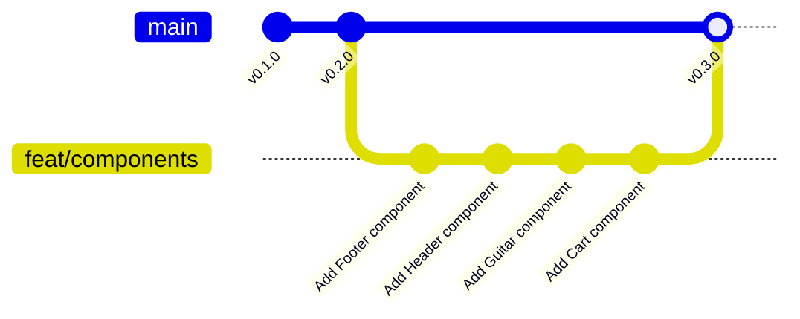

import {
	Aside,
	Card,
	CardGrid,
	FileTree,
	LinkCard,
	Steps,
	TabItem,
	Tabs,
} from "@astrojs/starlight/components";
import { Image } from "astro:assets";
import desktop from "../../../../assets/react/desktop.png";
import desktopCart from "../../../../assets/react/desktop-cart.png";
import storybookA11y from "../../../../assets/react/storybook-a11y-violation.png";

`App.tsx` contiene toda la página en un solo bloque. Funciona, pero no se puede reutilizar nada ni probar nada por separado. En esta página la divides en **cuatro componentes** (`Header`, `Cart`, `Guitar` y `Footer`) y, al extraer cada uno, le das su aspecto con Tailwind mirando el diseño, escribes su test y su story, y lo confirmas en un commit. Es la primera fase de desarrollo, y por tanto la primera que se hace en una **rama**.

<CardGrid stagger>
	<Card title="Componente" icon="puzzle">
		Una función que devuelve JSX. Se usa como una etiqueta: `<Footer />`. Es la unidad de construcción de React.
	</Card>
	<Card title="JSX" icon="seti:react">
		HTML dentro de JavaScript, con cinco reglas que lo diferencian del HTML. Las aplicarás en cada componente.
	</Card>
	<Card title="Rama feat/components" icon="seti:git">
		Todo el trabajo de esta página va en una rama. Al terminar, se fusiona en `main` y se publica la release `v0.3.0`.
	</Card>
</CardGrid>

<Aside type="note" title="Requisitos previos">
	Haber completado [Material de inicio, pruebas y documentación](/jjcm/di/units/react/01-starter-material/): la app muestra todo el contenido sin estilos, `npx vitest run` pasa y `npm run storybook` arranca. Ten a mano las capturas de `design/`; las vas a usar en cada componente.
</Aside>

## Qué es un componente

En React, un componente es una **función** cuyo nombre empieza por **mayúscula** y que **devuelve JSX**, el marcado que verá el usuario. Ya tienes uno: `App`. Se usa escribiéndolo como una etiqueta, `<App />`, que es lo que hace `main.tsx`.

Un componente puede usar otros componentes de la misma forma. Eso permite dividir una página grande en piezas con nombre, cada una en su archivo, cada una con su responsabilidad:

| Zona de la página | Componente | Archivo |
| :--- | :--- | :--- |
| Cabecera con logotipo y botón del carrito | `Header` | `src/components/Header/` |
| Panel lateral del carrito | `Cart` | `src/components/Cart/` |
| Una tarjeta del catálogo | `Guitar` | `src/components/Guitar/` |
| Pie de página | `Footer` | `src/components/Footer/` |
| Composición de todo lo anterior | `App` | `src/App.tsx` |

<Aside type="tip" title="Cuándo extraer un componente">
	Cuando una parte del marcado **se repite** (cada guitarra), cuando tiene **una responsabilidad propia** (el carrito) o cuando `App` empieza a no caber en una pantalla. Un componente con nombre se lee, se prueba y se documenta solo; cien líneas de JSX seguidas, no.
</Aside>

## Una carpeta por componente

Cada componente vive en **su propia carpeta** dentro de `src/components/`, con todo lo que le pertenece al lado: el componente, su test, su story y, cuando los haya, sus subcomponentes o un módulo CSS. Un `index.ts` en la carpeta reexporta el componente, y otro en `src/components/` reexporta todas las carpetas:

<FileTree>

- src/components/
  - Footer/
    - Footer.tsx          el componente
    - Footer.test.tsx     su test
    - Footer.stories.tsx  su story
    - index.ts            `export * from './Footer';`
  - index.ts              reexporta cada carpeta

</FileTree>

Así, desde cualquier sitio se importa `import { Footer } from './components'` sin saber en qué archivo está, y cuando un componente crezca (un `CartItem` dentro de `Cart`, por ejemplo) sus piezas se quedan en su carpeta sin ensuciar las demás. Es la estructura que te encontrarás en la mayoría de proyectos React.

## Las reglas de JSX

JSX parece HTML, pero es JavaScript. Al mover el marcado a componentes te encontrarás con estas diferencias:

<Steps>
	1. **`className` en lugar de `class`.** `class` es palabra reservada de JavaScript. Es la que más veces escribirás hoy.
	2. **Toda etiqueta se cierra.** ``, `<br />`, `<input … />`. En HTML se puede dejar abierta; en JSX es un error.
	3. **Un único elemento raíz.** Un componente devuelve **una** cosa. Si necesitas varias etiquetas al mismo nivel, envuélvelas en un fragmento `<>…</>`, que no genera ningún elemento en la página.
	4. **Atributos en camelCase.** `onclick` pasa a `onClick`, `for` a `htmlFor`, `tabindex` a `tabIndex`. Los atributos `aria-*` y `data-*` conservan el guion.
	5. **Las llaves abren JavaScript.** Dentro de `{}` va cualquier expresión: una variable, una llamada, un cálculo. Un comentario en JSX es `{/* … */}`.
</Steps>

Las reglas 1 y 2 ya las conoces de la página anterior; la 5 llegará con el estado y las props. Hoy, además de la 1, usarás la 3 en `App`.

## La rama de esta fase

A partir de ahora `main` no se edita directamente. Cada fase nace en una rama, se trabaja en ella con commits pequeños y, cuando todo pasa, se fusiona:



<Steps>
	1. Comprueba que estás en `main` y sin cambios pendientes:

		```bash
		git status
		```

	2. Crea la rama y cámbiate a ella en un solo paso:

		```bash
		git switch -c feat/components
		```

	3. Publícala en GitHub para que exista también allí (y para tener copia aunque no esté terminada):

		```bash
		git push -u origin feat/components
		```
</Steps>

`git branch` muestra las ramas que tienes y marca la actual con un asterisco. A partir de aquí, todos los commits de esta página van a `feat/components`.

<Aside type="note" title="`switch` y `checkout`">
	`git switch -c rama` es la forma moderna de `git checkout -b rama`. Verás las dos en tutoriales; hacen lo mismo. Para cambiar a una rama que ya existe, `git switch rama`.
</Aside>

## Footer: el primer componente

Empieza por el más sencillo, para fijar el procedimiento que repetirás con los otros tres: **extraer, dar estilo, probar, documentar, confirmar**.

### Extraer

<Steps>
	1. Crea la carpeta `src/components/Footer/` y dentro `Footer.tsx`. Mueve ahí el `<footer>` de `App.tsx`, devuelto por una función:

		```tsx title="src/components/Footer/Footer.tsx"
		export const Footer = () => {
		  return (
		    <footer>
		      <div>
		        <p>GuitarLA - Todos los derechos reservados</p>
		      </div>
		    </footer>
		  );
		};
		```

	2. Crea los dos **archivos índice** (los viste en [Módulos en JavaScript](/jjcm/di/units/introduction/javascript/06-modules/#re-exportar-desde-un-módulo)): el de la carpeta reexporta el componente, y el de `src/components/` reexporta la carpeta.

		```ts title="src/components/Footer/index.ts"
		export * from './Footer';
		```

		```ts title="src/components/index.ts"
		export * from './Footer';
		```

		Los dos tienen la misma línea, pero no apuntan a lo mismo: el primero a `Footer.tsx` y el segundo a la carpeta `Footer/` (y por tanto a su `index.ts`).

	3. En `App.tsx`, sustituye el `<footer>` por el componente e impórtalo:

		```diff lang="tsx" title="src/App.tsx"
		+import { Footer } from './components';
		+
		 const App = () => {
		   return (
		     <>
		       {/* header, aside y main, sin cambios de momento */}

		-      <footer>
		-        <div>
		-          <p>GuitarLA - Todos los derechos reservados</p>
		-        </div>
		-      </footer>
		+      <Footer />
		     </>
		   );
		 };

		 export default App;
		```

	4. Comprueba en el navegador que el pie sigue ahí. No ha cambiado nada visible: solo dónde vive el código.
</Steps>

<Aside type="tip" title="`export const` y `export default`">
	Los componentes se exportan **con nombre** (`export const Footer`) para que el archivo índice pueda reexportarlos con `export *` y para que el nombre sea el mismo en todos los sitios. `App` es la excepción: usa `export default` porque la plantilla de Vite lo creó así y `main.tsx` lo importa de esa forma.
</Aside>

### Dar estilo

Mira el pie en la captura de escritorio: banda oscura a todo el ancho, texto blanco centrado y grande, separado del catálogo. Con Tailwind:

```diff lang="tsx" title="src/components/Footer/Footer.tsx"
 export const Footer = () => {
   return (
-    <footer>
-      <div>
-        <p>GuitarLA - Todos los derechos reservados</p>
+    <footer className="mt-10 bg-gray-900 py-10">
+      <div className="mx-auto max-w-6xl px-4">
+        <p className="text-center text-2xl text-white">
+          GuitarLA - Todos los derechos reservados
+        </p>
       </div>
     </footer>
   );
 };
```

| Clases | Qué hacen |
| :--- | :--- |
| `mt-10 bg-gray-900 py-10` | Separación respecto al catálogo, fondo casi negro y relleno vertical en el `footer`, que ocupa todo el ancho |
| `mx-auto max-w-6xl px-4` | El contenedor centrado que usarás en todas las zonas, como en [maquetación de páginas](/jjcm/di/units/introduction/tailwind/07-page-layouts/#landing-por-secciones) |
| `text-center text-2xl text-white` | Texto centrado, grande y blanco |

Al guardar, Prettier ordena las clases. Si escribes `text-white text-center`, lo verás reordenado: es el plugin de Tailwind, no un error.

### Probar

Un componente que solo pinta texto necesita poco: comprobar que el texto está. El test va **en la carpeta del componente**, con el mismo nombre más `.test`:

```tsx title="src/components/Footer/Footer.test.tsx"
import { render, screen } from '@testing-library/react';
import { describe, expect, it } from 'vitest';
import { Footer } from './Footer';

describe('Footer', () => {
  it('shows the copyright notice', () => {
    render(<Footer />);
    expect(
      screen.getByText('GuitarLA - Todos los derechos reservados')
    ).toBeInTheDocument();
  });
});
```

Ejecuta `npx vitest run`: dos archivos, dos tests, ambos en verde. El de `App` sigue pasando porque `App` sigue mostrando el título del catálogo.

#### Un test de snapshot

Para un componente **estático** como este hay una segunda comprobación útil: que el HTML que genera no cambie sin que nadie se dé cuenta. Es lo que hace un **snapshot**:

```diff lang="tsx" title="src/components/Footer/Footer.test.tsx"
 import { render, screen } from '@testing-library/react';
 import { describe, expect, it } from 'vitest';
 import { Footer } from './Footer';

 describe('Footer', () => {
   it('shows the copyright notice', () => {
     render(<Footer />);
     expect(
       screen.getByText('GuitarLA - Todos los derechos reservados')
     ).toBeInTheDocument();
   });
+
+  it('matches the snapshot', () => {
+    const { container } = render(<Footer />);
+    expect(container).toMatchSnapshot();
+  });
 });
```

Aquí sí se usa `container` en lugar de `screen` (la diferencia está en [probar componentes React](/jjcm/di/units/testing/vitest/03-testing-react/#screen-o-container)): lo que se guarda es el HTML completo que ha renderizado **este** componente, no toda la página.

La primera vez que se ejecuta, `toMatchSnapshot` no tiene con qué comparar: **escribe** el HTML en `src/components/Footer/__snapshots__/Footer.test.tsx.snap` y el test pasa con el aviso `1 written`. Abre el archivo:

```txt title="src/components/Footer/__snapshots__/Footer.test.tsx.snap"
// Vitest Snapshot v1, https://vitest.dev/guide/snapshot.html

exports[`Footer > matches the snapshot 1`] = `
<div>
  <footer
    class="mt-10 bg-gray-900 py-10"
  >
    <div
      class="mx-auto max-w-6xl px-4"
    >
      <p
        class="text-center text-2xl text-white"
      >
        GuitarLA - Todos los derechos reservados
      </p>
    </div>
  </footer>
</div>
`;
```

En las ejecuciones siguientes compara el HTML actual con el guardado. Cambia `text-2xl` por `text-xl` en `Footer.tsx` y vuelve a ejecutar: el test falla mostrando la diferencia línea a línea.

```txt
Error: Snapshot `Footer > matches the snapshot 1` mismatched
- Expected
+ Received
-         class="text-center text-2xl text-white"
+         class="text-center text-xl text-white"
```

Si el cambio era un error, lo deshaces. Si era intencionado, actualizas el snapshot con `npx vitest run -u` (de *update*) y revisas el `.snap` antes de confirmarlo. **El archivo `.snap` se sube al repositorio**: es parte del test.

<Aside type="caution" title="Cuándo sirve un snapshot y cuándo no">
	Un snapshot avisa de **cualquier** cambio en el HTML, pero no sabe si es bueno o malo: quien lo revisa eres tú al ejecutar `-u`. Es útil en componentes estáticos o de presentación (`Footer`, un `Header` sin estado), donde un cambio accidental de clase o de estructura pasaría desapercibido. En componentes con lógica, un snapshot que se actualiza con `-u` sin mirarlo no prueba nada; ahí lo que vale son los tests de comportamiento con `getByRole` y `userEvent`. Regla: **un snapshot por componente estático, como máximo, y nunca como único test**.
</Aside>

### Documentar

La story también va en la carpeta, con el mismo nombre más `.stories`:

```tsx title="src/components/Footer/Footer.stories.tsx"
import type { Meta, StoryObj } from '@storybook/react-vite';
import { Footer } from './Footer';

const meta = {
  component: Footer,
  parameters: {
    layout: 'fullscreen',
  },
} satisfies Meta<typeof Footer>;

export default meta;
type Story = StoryObj<typeof meta>;

export const Default: Story = {};
```

`layout: 'fullscreen'` porque el pie ocupa todo el ancho; con el relleno que Storybook añade por defecto se vería recortado.

### Confirmar

```bash
git add .
git commit -m "Add Footer component"
```

Un commit por componente, con su carpeta completa: componente, estilo, test, story e índice. Es la unidad de trabajo de toda la unidad.

## Header

### Extraer

Crea la carpeta `src/components/Header/` con `Header.tsx` (el `<header>` de `App.tsx`) y su `index.ts`, y añade `export * from './Header';` al índice general. En `App.tsx`, sustituye el `<header>` por `<Header />` y amplía la importación: `import { Footer, Header } from './components';`.

Dos ajustes al mover el marcado:

- El enlace del logotipo apuntaba a `index.html`, la página del material. En la app, la portada es `/`.
- El botón del carrito ya tiene `aria-label="Abrir carrito"` y su imagen `alt=""`: el nombre accesible del botón es el `aria-label`, y la imagen es decorativa. Así lo encontrará el test, y así lo lee un lector de pantalla.

<Aside type="note" title="Para qué sirve `aria-label`">
	`aria-label` es un atributo de **accesibilidad**: da un nombre en texto a un elemento que no tiene texto visible, para que los **lectores de pantalla** (el software que usan personas ciegas o con baja visión) puedan anunciarlo. El botón del carrito solo contiene una imagen; sin `aria-label`, un lector de pantalla diría "botón" y nada más. Con `aria-label="Abrir carrito"` dice "botón, Abrir carrito", y el usuario sabe qué hace.

	- **No se ve en pantalla**; solo lo usan las tecnologías de asistencia. Para un texto emergente visible se usa `title`.
	- **Sustituye al contenido** como nombre accesible. Si el botón tuviera el texto visible "Carrito", no haría falta.
	- **Cuándo usarlo**: botones con solo icono, enlaces con solo imagen, campos sin `label` visible.
	- **`alt` no es lo mismo**: describe la imagen; `aria-label` en el botón describe la **acción**, que es lo útil. Por eso la imagen lleva `alt=""` (decorativa) y el nombre va en el botón.
	- Cuenta en auditorías como Lighthouse o el panel de accesibilidad de Storybook, y es un criterio de las WCAG. Los fundamentos están en la unidad de [usabilidad y accesibilidad](/jjcm/di/units/ux/fundamentals/01-introduction/).
</Aside>

### Dar estilo

La cabecera es la zona más elaborada: imagen de fondo oscurecida, logotipo a la izquierda y botón a la derecha, apilados en móvil.

<Image src={desktop} alt="Diseño objetivo de GuitarLA en escritorio" />

```tsx title="src/components/Header/Header.tsx"
export const Header = () => {
  return (
    <header className="relative bg-[url(/img/header.jpg)] bg-cover bg-center py-10">
      <div className="absolute inset-0 bg-black/70"></div>

      <div className="relative mx-auto flex max-w-6xl flex-col items-center gap-8 px-4 md:flex-row md:items-start md:justify-between">
        <a href="/" className="w-2/3 md:w-1/4">
          
        </a>

        <nav className="flex justify-end md:mt-10 md:w-1/2">
          <button
            type="button"
            className="w-8 cursor-pointer transition hover:scale-110"
            aria-label="Abrir carrito"
          >
            
          </button>
        </nav>
      </div>
    </header>
  );
};
```

| Clases | Qué hacen |
| :--- | :--- |
| `relative bg-[url(/img/header.jpg)] bg-cover bg-center` | Imagen de fondo que cubre la cabecera, centrada. `relative` la convierte en referencia para el `absolute` de dentro |
| `absolute inset-0 bg-black/70` | Un `div` vacío que cubre toda la cabecera con negro al 70 %: es la **capa oscura** sobre la foto, como en [otras técnicas](/jjcm/di/units/introduction/tailwind/08-other-techniques/#superponer-relative--absolute) |
| `relative … flex flex-col items-center gap-8 md:flex-row md:justify-between` | El contenido vuelve por encima de la capa (`relative`) y pasa de columna en móvil a fila en escritorio |
| `w-2/3 md:w-1/4` | El logotipo ocupa dos tercios en móvil y un cuarto desde tableta |
| `w-8 transition hover:scale-110` | El botón del carrito mide 2rem y crece un poco al pasar el ratón |

<Aside type="caution" title="La ruta de la imagen de fondo">
	`bg-[url(/img/header.jpg)]` empieza por `/` porque la imagen está en `public/img/`. Si escribes `./img/…`, funciona en la portada y falla en cualquier otra ruta de la aplicación.
</Aside>

### Probar

Con Testing Library se busca lo que vería el usuario: la imagen por su texto alternativo, el botón por su nombre accesible.

```tsx title="src/components/Header/Header.test.tsx"
import { render, screen } from '@testing-library/react';
import { describe, expect, it } from 'vitest';
import { Header } from './Header';

describe('Header', () => {
  it('shows the logo linking to the home page', () => {
    render(<Header />);
    const logo = screen.getByRole('img', { name: 'Logotipo de GuitarLA' });
    expect(logo).toBeInTheDocument();
    expect(logo.closest('a')).toHaveAttribute('href', '/');
  });

  it('shows the button to open the cart', () => {
    render(<Header />);
    expect(
      screen.getByRole('button', { name: 'Abrir carrito' })
    ).toBeInTheDocument();
  });
});
```

Fíjate en que la imagen del carrito, con `alt=""`, **no** aparece para `getByRole('img')`: Testing Library la ignora igual que un lector de pantalla. Si quitas el `aria-label` del botón, el segundo test falla con *Unable to find an accessible element with the role "button" and name "Abrir carrito"*. Es el test avisando de un problema de accesibilidad.

### Documentar y confirmar

La story es idéntica a la de `Footer` cambiando el componente (también `fullscreen`). Después:

```bash
git add .
git commit -m "Add Header component"
```

## Guitar

### Extraer

De las doce tarjetas del catálogo, todas tienen la **misma estructura** y solo cambian los datos. Por eso son un componente. De momento `Guitar` muestra siempre la primera guitarra, con sus datos escritos a mano; en la página de props recibirá los de cada una.

Crea la carpeta `src/components/Guitar/` con `Guitar.tsx` (el primer `<article>` de `App.tsx`) y su `index.ts`, añádelo al índice general y, en `App.tsx`, borra los doce `article` y deja tres `<Guitar />` dentro del `div` del catálogo. Tres copias idénticas es lo esperado hoy.

### Dar estilo

Cada tarjeta es una fila: imagen a la izquierda, texto a la derecha. Y el catálogo es una rejilla de una, dos o tres columnas según el ancho.

```tsx title="src/components/Guitar/Guitar.tsx"
export const Guitar = () => {
  return (
    <article className="flex items-center gap-4">
      
      <div className="w-2/3">
        <h3 className="text-2xl font-bold text-black uppercase">Lukather</h3>
        <p className="mt-2 text-gray-600">
          Lorem ipsum, dolor sit amet consectetur adipisicing elit. Sit quae
          labore odit magnam in autem nesciunt, amet deserunt.
        </p>
        <p className="mt-2 text-3xl font-black text-blue-600">$299</p>
        <button
          type="button"
          className="mt-3 w-full rounded bg-gray-900 px-4 py-2 font-bold text-white uppercase transition hover:bg-gray-700"
        >
          Agregar al carrito
        </button>
      </div>
    </article>
  );
};
```

La rejilla y el título del catálogo van en `App.tsx`, porque pertenecen a la página, no a una tarjeta:

```diff lang="tsx" title="src/App.tsx"
-<main>
-  <h2>Nuestra Colección</h2>
+<main className="mx-auto mt-10 max-w-6xl px-4">
+  <h2 className="text-center text-4xl font-black">Nuestra Colección</h2>

-  <div>
+  <div className="mt-10 grid grid-cols-1 gap-8 md:grid-cols-2 lg:grid-cols-3">
     <Guitar />
     <Guitar />
     <Guitar />
   </div>
 </main>
```

| Clases | Qué hacen |
| :--- | :--- |
| `flex items-center gap-4` | La tarjeta es una fila con la imagen y el texto centrados verticalmente |
| `w-1/3 object-contain` y `w-2/3` | Un tercio para la imagen, dos tercios para el texto; la imagen cabe entera sin deformarse |
| `text-2xl font-bold uppercase` | El nombre en mayúsculas, como en la captura |
| `text-3xl font-black text-blue-600` | El precio, lo más destacado de la tarjeta |
| `w-full rounded bg-gray-900 … hover:bg-gray-700` | Botón a todo el ancho de la columna de texto, con transición al pasar el ratón |
| `grid grid-cols-1 gap-8 md:grid-cols-2 lg:grid-cols-3` | En `App`: la rejilla responsive de [grid](/jjcm/di/units/introduction/tailwind/04-grid/) y [responsive](/jjcm/di/units/introduction/tailwind/05-responsive/) |

Redimensiona la ventana: una columna en móvil, dos desde 768 px, tres desde 1024 px.

### Probar

```tsx title="src/components/Guitar/Guitar.test.tsx"
import { render, screen } from '@testing-library/react';
import { describe, expect, it } from 'vitest';
import { Guitar } from './Guitar';

describe('Guitar', () => {
  it('shows the guitar name, image and price', () => {
    render(<Guitar />);
    expect(
      screen.getByRole('heading', { name: 'Lukather' })
    ).toBeInTheDocument();
    expect(
      screen.getByRole('img', { name: 'Guitarra Lukather' })
    ).toBeInTheDocument();
    expect(screen.getByText('$299')).toBeInTheDocument();
  });

  it('shows the add to cart button', () => {
    render(<Guitar />);
    expect(
      screen.getByRole('button', { name: 'Agregar al carrito' })
    ).toBeInTheDocument();
  });
});
```

### Documentar

Una tarjeta suelta en Storybook se estiraría a todo el ancho del lienzo. Un **decorator** la envuelve en un contenedor del ancho de una columna del catálogo (los decorators se explican en [addons y documentación](/jjcm/di/units/documentation/storybook/03-addons-and-docs/#decorators)):

```tsx title="src/components/Guitar/Guitar.stories.tsx"
import type { Meta, StoryObj } from '@storybook/react-vite';
import { Guitar } from './Guitar';

const meta = {
  component: Guitar,
  decorators: [
    (Story) => (
      <div className="max-w-sm">
        <Story />
      </div>
    ),
  ],
} satisfies Meta<typeof Guitar>;

export default meta;
type Story = StoryObj<typeof meta>;

export const Default: Story = {};
```

Y el commit: `git commit -m "Add Guitar component"`.

## Cart

### Extraer

Crea la carpeta `src/components/Cart/` con `Cart.tsx` (el `<aside id="carrito">` de `App.tsx`) y su `index.ts`, añádelo al índice general y colócalo en `App` justo después de `<Header />`. El atributo `id` ya no hace falta: era para enlazarlo desde el HTML, y ahora el componente tiene nombre. Quítalo.

### Dar estilo

El carrito es un **panel fijo** pegado al borde derecho, de toda la altura de la ventana, con tres zonas: cabecera con título y botón de cerrar, contenido con scroll propio, y pie con el total y el botón de vaciar.

<Image src={desktopCart} alt="Diseño objetivo con el panel del carrito abierto" />

```tsx title="src/components/Cart/Cart.tsx"
export const Cart = () => {
  return (
    <aside className="fixed inset-y-0 right-0 z-30 flex w-full max-w-md flex-col bg-white shadow-2xl">
      <div className="flex items-center justify-between border-b border-gray-200 px-6 py-4">
        <h2 className="text-2xl font-black">Tu carrito</h2>
        <button
          type="button"
          className="size-8 rounded-full text-xl font-bold text-gray-500 transition hover:bg-gray-100"
          aria-label="Cerrar carrito"
        >
          ×
        </button>
      </div>

      <div className="flex-1 overflow-y-auto px-6 py-4">
        <p className="text-center text-gray-500">El carrito está vacío</p>

        <table className="w-full text-sm">
          <thead>
            <tr className="border-b border-gray-200 text-left">
              <th className="py-2">Imagen</th>
              <th className="py-2">Nombre</th>
              <th className="py-2">Precio</th>
              <th className="py-2">Cantidad</th>
              <th></th>
            </tr>
          </thead>
          <tbody>
            <tr className="border-b border-gray-100">
              <td className="py-3">
                
              </td>
              <td>SRV</td>
              <td className="font-bold">$299</td>
              <td>
                <div className="flex items-center gap-2">
                  <button
                    type="button"
                    className="size-6 rounded bg-gray-900 text-white"
                  >
                    -
                  </button>
                  1
                  <button
                    type="button"
                    className="size-6 rounded bg-gray-900 text-white"
                  >
                    +
                  </button>
                </div>
              </td>
              <td>
                <button
                  type="button"
                  className="size-6 rounded-full bg-red-600 text-xs font-bold text-white"
                >
                  X
                </button>
              </td>
            </tr>
          </tbody>
        </table>
      </div>

      <div className="border-t border-gray-200 px-6 py-4">
        <p className="text-right text-lg">
          Total pagar: <span className="font-black">$899</span>
        </p>
        <button
          type="button"
          className="mt-3 w-full rounded bg-gray-900 p-3 font-bold text-white uppercase transition hover:bg-gray-700"
        >
          Vaciar carrito
        </button>
      </div>
    </aside>
  );
};
```

| Clases | Qué hacen |
| :--- | :--- |
| `fixed inset-y-0 right-0 z-30` | Panel fijo de arriba abajo, pegado a la derecha, por encima de todo (`z-30`) |
| `w-full max-w-md` | Toda la pantalla en móvil; 28rem como máximo en escritorio |
| `flex flex-col` + `flex-1 overflow-y-auto` | Columna de tres zonas donde la central absorbe el espacio y tiene scroll propio: el patrón de [tarjeta con pie abajo](/jjcm/di/units/introduction/tailwind/03-flexbox/#patrones-que-vas-a-usar) |
| `border-b border-gray-200` / `border-t` | Separadores de cabecera y pie |
| `size-6 rounded bg-gray-900` | Los botones de cantidad, cuadrados y pequeños |

<Aside type="note" title="Siempre visible, de momento">
	El panel tapa parte del catálogo porque todavía no se puede cerrar: eso es **estado**, y llega en la página siguiente, donde el botón de la cabecera lo abrirá y el de la esquina lo cerrará con una transición. Hoy se queda abierto para poder darle estilo y verlo. La tabla con la guitarra SRV y el total de `$899` son datos de ejemplo del material; también se sustituirán por el contenido real del carrito.
</Aside>

### Probar y documentar

```tsx title="src/components/Cart/Cart.test.tsx"
import { render, screen } from '@testing-library/react';
import { describe, expect, it } from 'vitest';
import { Cart } from './Cart';

describe('Cart', () => {
  it('shows the title and the close button', () => {
    render(<Cart />);
    expect(
      screen.getByRole('heading', { name: 'Tu carrito' })
    ).toBeInTheDocument();
    expect(
      screen.getByRole('button', { name: 'Cerrar carrito' })
    ).toBeInTheDocument();
  });

  it('shows the total and the clear button', () => {
    render(<Cart />);
    expect(screen.getByText('Total pagar:')).toBeInTheDocument();
    expect(
      screen.getByRole('button', { name: 'Vaciar carrito' })
    ).toBeInTheDocument();
  });
});
```

La story es como la de `Header` (`fullscreen`). Commit: `git commit -m "Add Cart component"`.

## El resultado

<FileTree>

- di-react/
  - src/
    - components/
      - Cart/
        - Cart.tsx
        - Cart.test.tsx
        - Cart.stories.tsx
        - index.ts
      - Footer/
        - __snapshots__/
          - Footer.test.tsx.snap
        - Footer.tsx
        - Footer.test.tsx
        - Footer.stories.tsx
        - index.ts
      - Guitar/
        - Guitar.tsx
        - Guitar.test.tsx
        - Guitar.stories.tsx
        - index.ts
      - Header/
        - Header.tsx
        - Header.test.tsx
        - Header.stories.tsx
        - index.ts
      - index.ts           reexporta las cuatro carpetas
    - data/
      - db.ts
    - App.tsx              solo composición
    - App.test.tsx
    - App.stories.tsx

</FileTree>

`App.tsx` queda reducido a la composición de la página:

```tsx title="src/App.tsx"
import { Cart, Footer, Guitar, Header } from './components';

const App = () => {
  return (
    <>
      <Header />
      <Cart />

      <main className="mx-auto mt-10 max-w-6xl px-4">
        <h2 className="text-center text-4xl font-black">Nuestra Colección</h2>

        <div className="mt-10 grid grid-cols-1 gap-8 md:grid-cols-2 lg:grid-cols-3">
          <Guitar />
          <Guitar />
          <Guitar />
        </div>
      </main>

      <Footer />
    </>
  );
};

export default App;
```

Arranca `npm run storybook`: en el lateral aparecen **App**, **Cart**, **Footer**, **Guitar** y **Header**, cada uno con su story `Default` y su pestaña **Docs**. Abre `Header` y mira el panel **Accessibility**: no debe haber violaciones.

### Cómo se ve un fallo de accesibilidad

Para ver el panel en acción, quita la línea `aria-label="Abrir carrito"` del botón en `Header.tsx`, guarda y vuelve a la story:

<Image src={storybookA11y} alt="Storybook con la story Header abierta y el panel Accessibility mostrando una violación: Button name, regla button-name, impacto Critical" />

La pestaña **Accessibility** pasa a marcar **1** y la lista **Violations** muestra la regla incumplida, **Button name** (`button-name`), con impacto **Critical**: el botón no tiene ningún texto que un lector de pantalla pueda anunciar. Al desplegarla verás el fragmento de HTML afectado y las formas de arreglarlo que propone [axe](/jjcm/di/units/ux/fundamentals/01-introduction/#qué-es-axe), el motor de reglas que usa el panel (texto visible dentro del botón, `aria-label`, `aria-labelledby` o `title`). Las otras dos listas, **Passes** (10 comprobaciones superadas) e **Inconclusive**, no cambian.

Vuelve a poner el `aria-label`: la violación desaparece. Es la misma comprobación que hace el test `shows the button to open the cart`, desde el otro lado: el test falla porque no encuentra un botón con ese nombre; axe avisa porque el botón no tiene ninguno. Cuando una de las dos cosas ocurra en un componente nuevo, la causa casi siempre es la misma.

## Comprobar que todo pasa

```bash
npm run lint
npm run format:check
npx vitest run
npm run build
```

```txt
 ✓ src/components/Footer/Footer.test.tsx (2 tests)
 ✓ src/components/Header/Header.test.tsx (2 tests)
 ✓ src/components/Guitar/Guitar.test.tsx (2 tests)
 ✓ src/components/Cart/Cart.test.tsx (2 tests)
 ✓ src/App.test.tsx (1 test)

 Test Files  5 passed (5)
      Tests  9 passed (9)
  Snapshots  1 passed
```

## Fusionar en `main` y publicar

La fase está terminada: cuatro commits en `feat/components`, todo en verde. Ahora pasa a `main`.

<Steps>
	1. Sube los últimos commits de la rama:

		```bash
		git push
		```

	2. Vuelve a `main` y fusiona la rama. `--no-ff` crea un commit de fusión aunque no haga falta, para que en el historial se vea dónde empezó y terminó la fase:

		```bash
		git switch main
		git merge --no-ff feat/components -m "Merge feat/components"
		```

	3. Mira el historial. Debes ver la rama saliendo de `v0.2.0` y volviendo a `main`:

		```bash
		git log --oneline --graph
		```

	4. Sube `main`, cierra el hito con su etiqueta y su release, y borra la rama, que ya ha cumplido su función:

		```bash
		git push
		git tag -a v0.3.0 -m "Components with styles, tests and stories"
		git push origin v0.3.0
		gh release create v0.3.0 --title "v0.3.0 · Components" --notes "Header, Cart, Guitar and Footer components styled with Tailwind, each with its test and story."
		git branch -d feat/components
		git push origin --delete feat/components
		```
</Steps>

<Aside type="tip" title="Si la fusión da conflicto">
	No debería: `main` no ha cambiado desde que creaste la rama. Si en el futuro ocurre, Git marca los archivos en conflicto en `git status`, los abres, eliges qué se queda entre las marcas `<<<<<<<` y `>>>>>>>`, y haces `git add` y `git commit`. VS Code muestra botones para elegir cada lado.
</Aside>

## Comprobación final

<Steps>
	1. `src/components/` contiene una carpeta por componente, cada una con el componente, su `.test.tsx`, su `.stories.tsx` y su `index.ts`, más el índice general.
	2. `npm run dev` muestra la cabecera con la foto oscurecida, tres tarjetas en rejilla, el panel del carrito a la derecha y el pie, como en las capturas.
	3. `npx vitest run` ejecuta 9 tests en 5 archivos (uno de ellos de snapshot), todos en verde; `lint`, `format:check` y `build` pasan.
	4. `npm run storybook` lista los cinco componentes sin violaciones de accesibilidad, y has visto cómo aparece una al quitar el `aria-label` del botón del carrito.
	5. `git log --oneline --graph` muestra la rama fusionada en `main`, `git branch` ya no lista `feat/components` y en GitHub existe la release `v0.3.0`.
</Steps>

## 🧩 Aplicación en el proyecto

El procedimiento de esta página, **extraer, dar estilo, probar, documentar, confirmar**, es el que seguirás con cada componente del módulo, aquí y en la app de informes. No es más trabajo que escribir el componente a secas: el test y la story se escriben en dos minutos cuando el componente acaba de nacer, y son los que te avisan cuando otra fase lo rompe. Y las clases de Tailwind que has escrito mirando una captura son exactamente lo que harás con cualquier diseño que te entreguen.

## Resumen rápido

| Concepto | Detalle |
| :--- | :--- |
| **Componente** | Función con nombre en mayúscula que devuelve JSX; `export const Nombre = () => …` |
| **Reglas JSX** | `className`, etiquetas cerradas, una raíz (`<>…</>`), camelCase, `{}` para JavaScript |
| **Carpeta** | `src/components/X/` con `X.tsx`, `X.test.tsx`, `X.stories.tsx` e `index.ts`; `src/components/index.ts` reexporta cada carpeta; `import { X } from './components'` |
| **Estilo** | Clases de Tailwind en `className`, según las capturas de `design/` |
| **Test** | `render(<X />)` + `screen.getByRole` / `getByText` + `toBeInTheDocument()` |
| **Snapshot** | `expect(container).toMatchSnapshot()` en componentes estáticos; el `.snap` se versiona; `vitest run -u` para actualizarlo tras revisar el cambio |
| **Story** | `meta` con `component` (y `layout: 'fullscreen'` o un decorator si hace falta) + `Default` |
| **Rama** | `git switch -c feat/x` → commits → `git switch main` → `git merge --no-ff feat/x` → tag y release → `git branch -d feat/x` |

## Convención práctica

<Steps>
	1. **Una carpeta por componente**, nombre en PascalCase, con todo lo suyo dentro (test, story, subcomponentes, CSS si lo hubiera) y un `index.ts` que lo reexporta.
	2. **Un commit por componente** con su carpeta completa; mensaje en inglés: `Add X component`.
	3. **Nombres accesibles antes que `data-testid`**: `alt` en imágenes informativas, `alt=""` en decorativas, `aria-label` en botones de icono. Los tests y los lectores de pantalla usan lo mismo.
	4. **Los estilos de página van en `App`** (contenedor, rejilla, título); los del componente, en el componente.
	5. **La rama se borra al fusionar**; lo que queda es el commit de fusión y la release.
</Steps>

## Referencias

<CardGrid stagger>
	<LinkCard
		href="https://react.dev/learn/your-first-component"
		title="Tu primer componente (React)"
		description="Qué es un componente, cómo se define y cómo se usa."
		target="_blank"
		rel="noopener noreferrer"
	/>
	<LinkCard
		href="https://react.dev/learn/writing-markup-with-jsx"
		title="Escribir marcado con JSX (React)"
		description="Las reglas de JSX explicadas por el equipo de React."
		target="_blank"
		rel="noopener noreferrer"
	/>
	<LinkCard
		href="https://react.dev/learn/importing-and-exporting-components"
		title="Importar y exportar componentes (React)"
		description="Exportaciones con nombre y por defecto en componentes."
		target="_blank"
		rel="noopener noreferrer"
	/>
	<LinkCard
		href="https://testing-library.com/docs/queries/byrole/"
		title="getByRole (Testing Library)"
		description="Buscar elementos por rol y nombre accesible."
		target="_blank"
		rel="noopener noreferrer"
	/>
	<LinkCard
		href="https://vitest.dev/guide/snapshot.html"
		title="Snapshots (Vitest)"
		description="toMatchSnapshot, archivos .snap, actualización con -u e inline snapshots."
		target="_blank"
		rel="noopener noreferrer"
	/>
	<LinkCard
		href="https://git-scm.com/book/es/v2/Ramificaciones-en-Git-Procedimientos-b%C3%A1sicos-para-ramificar-y-fusionar"
		title="Ramificar y fusionar (Pro Git)"
		description="Crear ramas, fusionarlas y resolver conflictos, en español."
		target="_blank"
		rel="noopener noreferrer"
	/>
</CardGrid>

## Siguientes pasos

<CardGrid>
	<LinkCard
		href="/jjcm/di/units/react/03-state/"
		title="Estado"
		description="Abrir y cerrar el carrito con useState y cargar el catálogo desde db.ts, en la rama feat/state."
	/>
	<LinkCard
		href="/jjcm/di/units/documentation/storybook/02-writing-stories/"
		title="Escribir stories (Storybook)"
		description="Si quieres entender mejor meta, args y decorators."
	/>
</CardGrid>
