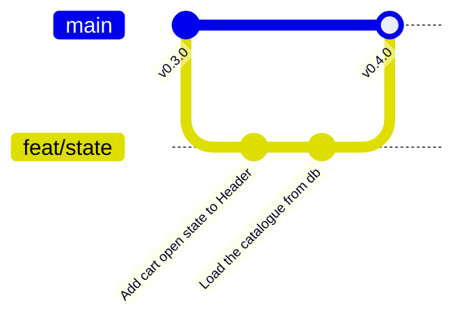

import {
	Aside,
	Card,
	CardGrid,
	FileTree,
	LinkCard,
	Steps,
	TabItem,
	Tabs,
} from "@astrojs/starlight/components";

GuitarLA se ve como el diseño, pero no hace nada: el carrito está siempre abierto y las tres tarjetas son la misma guitarra. En esta página la aplicación empieza a **reaccionar**: el botón de la cabecera abre y cierra el panel, `Escape` lo cierra, y el catálogo muestra las doce guitarras de `db.ts`. Para eso hacen falta las dos piezas centrales de React: el **estado** (`useState`) y los **efectos** (`useEffect`).

<CardGrid stagger>
	<Card title="useState" icon="seti:react">
		Una variable que React vigila. Cuando cambia, el componente se vuelve a renderizar y la interfaz se actualiza sola.
	</Card>
	<Card title="useEffect" icon="setting">
		Código que se ejecuta **después** de renderizar, para hablar con lo que está fuera de React: el documento, el teclado, el título de la pestaña.
	</Card>
	<Card title="Rama feat/state" icon="seti:git">
		Dos commits (el carrito y el catálogo), fusión en `main` y release `v0.4.0`.
	</Card>
</CardGrid>

<Aside type="note" title="Requisitos previos">
	Haber completado [Componentes](/jjcm/di/units/react/02-components/): `v0.3.0` en `main`, cuatro componentes con sus tests y stories, 9 tests en verde. Las secciones de [funciones](/jjcm/di/units/introduction/javascript/03-functions/) y [métodos de arrays](/jjcm/di/units/introduction/javascript/05-array-methods/) de JavaScript (`map`, closures) se usan directamente.
</Aside>

## La rama de esta fase



```bash
git switch main
git switch -c feat/state
git push -u origin feat/state
```

## Qué es el estado

Hasta ahora los componentes son funciones que devuelven siempre lo mismo. El **estado** es información que un componente **recuerda entre renderizados** y que, al cambiar, hace que React vuelva a ejecutar la función y actualice la página. ¿Está abierto el carrito? ¿Qué guitarras hay? ¿Qué ha escrito el usuario? Todo eso es estado.

Se declara con el hook `useState`:

```tsx
const [isCartOpen, setIsCartOpen] = useState(false);
```

- `useState(false)` recibe el **valor inicial** y devuelve un array de dos elementos, que se [desestructura](/jjcm/di/units/introduction/javascript/04-destructuring/#desestructuración-de-arrays).
- `isCartOpen` es el **valor actual**. Se lee como cualquier variable.
- `setIsCartOpen` es la **función para cambiarlo**. Nunca se asigna `isCartOpen = true`: React no se enteraría. Se llama a `setIsCartOpen(true)`, y React vuelve a renderizar el componente con el nuevo valor.

<Aside type="caution" title="Las reglas de los hooks">
	Todo lo que empieza por `use` es un hook, y los hooks tienen dos reglas que ESLint vigila con `eslint-plugin-react-hooks`: se llaman **en el nivel superior** del componente, nunca dentro de un `if`, un bucle o una función anidada, y **solo desde componentes** (o desde otros hooks). React cuenta las llamadas en orden para saber qué estado es cuál; si el orden cambia entre renderizados, se mezcla todo.
</Aside>

## Abrir y cerrar el carrito

### Dónde vive el estado

El botón que abre el carrito está en `Header` y el panel es `Cart`. Para que el botón controle el panel, los dos tienen que ver el mismo estado. La regla de React: **el estado vive en el componente más cercano que contiene a todos los que lo necesitan**. Hoy ese componente es `Header`: el botón es suyo, y `Cart` pasa a renderizarse dentro de él. En la página siguiente, cuando `Guitar` también tenga que hablar con el carrito, el **contenido** del carrito vivirá en `App`; `isCartOpen` seguirá aquí, porque solo lo usan `Header` y `Cart`.

### Extraer, conectar y renderizar

<Steps>
	1. En `App.tsx`, quita `<Cart />` y su importación: ahora lo renderiza `Header`.

		```diff lang="tsx" title="src/App.tsx"
		-import { Cart, Footer, Guitar, Header } from './components';
		+import { Footer, Guitar, Header } from './components';

		 const App = () => {
		   return (
		     <>
		       <Header />
		-      <Cart />

		       <main className="mx-auto mt-10 max-w-6xl px-4">
		         {/* … sin cambios */}
		       </main>

		       <Footer />
		     </>
		   );
		 };

		 export default App;
		```

	2. En `Header.tsx`, declara el estado, conecta el botón y renderiza `Cart` solo cuando está abierto:

		```diff lang="tsx" title="src/components/Header/Header.tsx"
		+import { useState } from 'react';
		+import { Cart } from '../Cart';
		+
		 export const Header = () => {
		+  const [isCartOpen, setIsCartOpen] = useState(false);
		+
		   return (
		     <header className="relative bg-[url(/img/header.jpg)] bg-cover bg-center py-10">
		       <div className="absolute inset-0 bg-black/70"></div>

		       <div className="relative mx-auto flex max-w-6xl flex-col items-center gap-8 px-4 md:flex-row md:items-start md:justify-between">
		         <a href="/" className="w-2/3 md:w-1/4">
		           
		         </a>

		         <nav className="flex justify-end md:mt-10 md:w-1/2">
		           <button
		             type="button"
		-            className="w-8 cursor-pointer transition hover:scale-110"
		+            className="w-8 cursor-pointer transition hover:scale-110 focus-visible:outline-2 focus-visible:outline-offset-4 focus-visible:outline-white"
		             aria-label="Abrir carrito"
		+            aria-expanded={isCartOpen}
		+            aria-controls="cart"
		+            onClick={() => setIsCartOpen(!isCartOpen)}
		           >
		             
		           </button>
		         </nav>
		       </div>
		+
		+      {isCartOpen && (
		+        <>
		+          <div
		+            className="fixed inset-0 z-20 bg-black/50"
		+            onClick={() => setIsCartOpen(false)}
		+          ></div>
		+          <Cart />
		+        </>
		+      )}
		     </header>
		   );
		 };
		```

	3. En `Cart.tsx`, da al panel un `id` y conéctalo con su título:

		```diff lang="tsx" title="src/components/Cart/Cart.tsx"
		-<aside className="fixed inset-y-0 right-0 z-30 flex w-full max-w-md flex-col bg-white shadow-2xl">
		+<aside
		+  id="cart"
		+  aria-labelledby="cart-title"
		+  className="fixed inset-y-0 right-0 z-30 flex w-full max-w-md flex-col bg-white shadow-2xl"
		+>
		   <div className="flex items-center justify-between border-b border-gray-200 px-6 py-4">
		-    <h2 className="text-2xl font-black">Tu carrito</h2>
		+    <h2 id="cart-title" className="text-2xl font-black">
		+      Tu carrito
		+    </h2>
		```

	4. Guarda y prueba: el panel aparece al pulsar el icono y desaparece al pulsar otra vez o al hacer clic en la zona oscura. El botón `×` todavía no hace nada: está en `Cart`, y `Cart` no tiene acceso al estado de `Header`. Se conecta en la página de props.
</Steps>

Tres cosas nuevas en ese código:

| Pieza | Qué hace |
| :--- | :--- |
| `onClick={() => setIsCartOpen(!isCartOpen)}` | Un **evento** en JSX: camelCase y una **función** entre llaves. `!isCartOpen` invierte el valor: abre si está cerrado y cierra si está abierto |
| `{isCartOpen && (…)}` | **Renderizado condicional**: si `isCartOpen` es `false`, la expresión vale `false` y React no pinta nada; si es `true`, pinta lo que hay después del `&&` |
| `<div className="fixed inset-0 …" onClick={…}>` | La **capa oscura** que tapa la página mientras el panel está abierto. Hacer clic fuera del panel lo cierra, que es lo que todo el mundo espera |

<Aside type="caution" title="`onClick={fn}`, no `onClick={fn()}`">
	Entre llaves va la **función**, no su resultado. `onClick={setIsCartOpen(true)}` llamaría a `setIsCartOpen` durante el renderizado, lo que provocaría otro renderizado, que volvería a llamarla… React corta el bucle con un error. La flecha `() => …` crea una función que React guardará y ejecutará cuando ocurra el clic.
</Aside>

<Aside type="note" title="Por qué `aria-expanded`, `aria-controls` y `aria-labelledby`">
	Un lector de pantalla anuncia el botón como "Abrir carrito, botón, contraído" o "expandido" gracias a `aria-expanded`, así que el usuario sabe si el panel está abierto sin verlo. `aria-controls` enlaza el botón con el panel que controla. `aria-labelledby="cart-title"` da nombre al `aside` a partir de su título: el panel se anuncia como "Tu carrito, complementario", y es lo que permitirá al test encontrarlo por rol y nombre. Y `focus-visible:outline-…` hace que el botón **se vea** cuando se llega a él con `Tab`, sin anillo al hacer clic con el ratón. Estos cuatro atributos son el patrón de [paneles desplegables](/jjcm/di/units/ux/fundamentals/01-introduction/#paneles-y-desplegables) de la unidad de usabilidad y accesibilidad.
</Aside>

### Cerrar con `Escape` y bloquear el scroll

Dos detalles de usabilidad que cualquier panel debe cumplir: cerrarse con la tecla `Escape` y no dejar que la página de detrás se desplace mientras está abierto. Ninguno es un evento de un elemento de React: la tecla llega a `document`, y el scroll se bloquea en `body`. Para hablar con el exterior de React existe `useEffect`:

```diff lang="tsx" title="src/components/Header/Header.tsx"
-import { useState } from 'react';
+import { useEffect, useState } from 'react';
 import { Cart } from '../Cart';

 export const Header = () => {
   const [isCartOpen, setIsCartOpen] = useState(false);

+  useEffect(() => {
+    if (!isCartOpen) return;
+
+    const handleKeyDown = (event: KeyboardEvent) => {
+      if (event.key === 'Escape') setIsCartOpen(false);
+    };
+
+    document.addEventListener('keydown', handleKeyDown);
+    document.body.classList.add('overflow-hidden');
+
+    return () => {
+      document.removeEventListener('keydown', handleKeyDown);
+      document.body.classList.remove('overflow-hidden');
+    };
+  }, [isCartOpen]);
+
   return (
     // … sin cambios
   );
 };
```

<Steps>
	1. `useEffect(fn, deps)` ejecuta `fn` **después** de renderizar, y solo cuando alguna de las **dependencias** (`[isCartOpen]`) ha cambiado desde la vez anterior. Al montar el componente se ejecuta siempre.
	2. Si el carrito está cerrado, no hay nada que hacer: `return` y fuera.
	3. Si está abierto, se registra el escuchador de teclado en `document` y se añade `overflow-hidden` (una clase de Tailwind: `overflow: hidden`) al `body`.
	4. La función que **devuelve** el efecto es la **limpieza**: React la ejecuta antes de volver a ejecutar el efecto y al desmontar el componente. Quita el escuchador y la clase. Sin ella, cada apertura añadiría un escuchador más y el scroll se quedaría bloqueado para siempre.
</Steps>

<Aside type="tip" title="Cuándo hace falta un efecto">
	Un efecto es para **sincronizar** React con algo externo: el DOM fuera del componente, un temporizador, una petición, el título de la pestaña. Si lo que quieres es reaccionar a un clic, es un evento (`onClick`); si es calcular algo a partir del estado, es una variable normal en el cuerpo del componente. Un `useEffect` que solo llama a `setState` a partir de otro estado suele ser un error.
</Aside>

### Probar

El estado se prueba como lo usaría una persona: pulsando y comprobando qué aparece. Sustituye el segundo test de `Header` por estos tres:

```diff lang="tsx" title="src/components/Header/Header.test.tsx"
 import { render, screen } from '@testing-library/react';
+import userEvent from '@testing-library/user-event';
 import { describe, expect, it } from 'vitest';
 import { Header } from './Header';

 describe('Header', () => {
   it('shows the logo linking to the home page', () => {
     render(<Header />);
     const logo = screen.getByRole('img', { name: 'Logotipo de GuitarLA' });
     expect(logo).toBeInTheDocument();
     expect(logo.closest('a')).toHaveAttribute('href', '/');
   });

-  it('shows the button to open the cart', () => {
-    render(<Header />);
-    expect(
-      screen.getByRole('button', { name: 'Abrir carrito' })
-    ).toBeInTheDocument();
-  });
+  it('starts with the cart closed', () => {
+    render(<Header />);
+    expect(
+      screen.getByRole('button', { name: 'Abrir carrito' })
+    ).toHaveAttribute('aria-expanded', 'false');
+    expect(
+      screen.queryByRole('complementary', { name: 'Tu carrito' })
+    ).not.toBeInTheDocument();
+  });
+
+  it('opens the cart when the button is clicked', async () => {
+    const user = userEvent.setup();
+    render(<Header />);
+
+    await user.click(screen.getByRole('button', { name: 'Abrir carrito' }));
+
+    expect(
+      screen.getByRole('complementary', { name: 'Tu carrito' })
+    ).toBeInTheDocument();
+    expect(
+      screen.getByRole('button', { name: 'Abrir carrito' })
+    ).toHaveAttribute('aria-expanded', 'true');
+  });
+
+  it('closes the cart with the Escape key', async () => {
+    const user = userEvent.setup();
+    render(<Header />);
+
+    await user.click(screen.getByRole('button', { name: 'Abrir carrito' }));
+    await user.keyboard('{Escape}');
+
+    expect(
+      screen.queryByRole('complementary', { name: 'Tu carrito' })
+    ).not.toBeInTheDocument();
+  });
 });
```

- Un `aside` tiene el rol **`complementary`**, y su nombre accesible es el título al que apunta `aria-labelledby`. Por eso `getByRole('complementary', { name: 'Tu carrito' })` encuentra el panel, y `queryByRole` devuelve `null` cuando no está (la diferencia entre `getBy` y `queryBy` está en [probar componentes](/jjcm/di/units/testing/vitest/03-testing-react/#getby-queryby-y-findby)).
- `userEvent.setup()`, `await user.click` y `await user.keyboard('{Escape}')` simulan a la persona; el efecto que escucha `keydown` recibe el evento igual que en el navegador.
- Fíjate en que ningún test mira `isCartOpen`: comprueban lo que se ve y lo que anuncia `aria-expanded`. Si mañana el estado cambia de nombre, siguen pasando.

La story de `Header` no cambia: en Storybook puedes pulsar el icono y ver el panel abrirse, y el panel **Accessibility** sigue sin violaciones (añade `aria-expanded` a la lista de comprobaciones que supera).

### Confirmar

```bash
git add .
git commit -m "Add cart open state to Header"
```

## El catálogo desde los datos

Las tres copias de `<Guitar />` escritas a mano no sirven: el catálogo tiene que salir de `db.ts`, y si mañana hay trece guitarras, la página debe mostrar trece sin tocar `App`.

### Estado, `map` y `key`

```diff lang="tsx" title="src/App.tsx"
+import { useEffect, useState } from 'react';
 import { Footer, Guitar, Header } from './components';
+import { db } from './data/db';

 const App = () => {
+  const [guitars] = useState(db);
+
+  useEffect(() => {
+    document.title = `GuitarLA · ${guitars.length} guitarras`;
+  }, [guitars]);
+
   return (
     <>
       <Header />

       <main className="mx-auto mt-10 max-w-6xl px-4">
         <h2 className="text-center text-4xl font-black">Nuestra Colección</h2>

         <div className="mt-10 grid grid-cols-1 gap-8 md:grid-cols-2 lg:grid-cols-3">
-          <Guitar />
-          <Guitar />
-          <Guitar />
+          {guitars.map((guitar) => (
+            <Guitar key={guitar.id} />
+          ))}
         </div>
       </main>

       <Footer />
     </>
   );
 };

 export default App;
```

<Steps>
	1. **`const [guitars] = useState(db)`**: el catálogo es estado inicializado con el array de `db.ts`. Solo se desestructura el valor, no la función para cambiarlo, porque de momento nadie lo cambia; cuando el catálogo llegue de una API, aquí estará `setGuitars`.
	2. **`guitars.map((guitar) => <Guitar key={guitar.id} />)`**: `map` convierte el array de datos en un array de elementos, y JSX sabe pintar un array. Es la [regla 5 de JSX](/jjcm/di/units/react/02-components/#las-reglas-de-jsx): dentro de las llaves va JavaScript, y `map` es JavaScript.
	3. **`key={guitar.id}`**: cada elemento de una lista necesita una `key` **única y estable** para que React sepa cuál es cuál cuando la lista cambie (se añade, se borra, se reordena). Sin ella, ESLint avisa y React escribe un aviso en consola. Se usa el `id` de los datos, nunca el índice del array.
	4. **`useEffect` con `[guitars]`**: el título de la pestaña del navegador está fuera de React; el efecto lo sincroniza con el número de guitarras y se repetiría si el catálogo cambiara.
</Steps>

Guarda y mira el resultado: **doce tarjetas, todas Lukather**. Es lo esperado. `Guitar` todavía no recibe datos, solo se repite tantas veces como guitarras hay. Darle a cada tarjeta su guitarra es exactamente lo que hacen las **props**, en la página siguiente.

<Aside type="caution" title="`key` no es una prop">
	`Guitar` no recibe `key` como argumento: React la consume antes y no la pasa al componente. Si un componente necesita el `id`, se le pasa además como prop. Y si ves el aviso *Each child in a list should have a unique "key" prop* en la consola, es esta línea.
</Aside>

### Probar

Dos tests más en `App.test.tsx`: uno cuenta las tarjetas, otro comprueba el efecto.

```diff lang="tsx" title="src/App.test.tsx"
 import { render, screen } from '@testing-library/react';
 import { describe, expect, it } from 'vitest';
 import App from './App';

 describe('App', () => {
   it('shows the collection title', () => {
     render(<App />);
     expect(
       screen.getByRole('heading', { name: 'Nuestra Colección' })
     ).toBeInTheDocument();
   });
+
+  it('shows one card per guitar in the catalogue', () => {
+    render(<App />);
+    expect(screen.getAllByRole('article')).toHaveLength(12);
+  });
+
+  it('updates the document title with the number of guitars', () => {
+    render(<App />);
+    expect(document.title).toBe('GuitarLA · 12 guitarras');
+  });
 });
```

Cada `<article>` tiene el rol `article`; `getAllByRole` devuelve todos. El segundo test comprueba que el efecto ha tocado `document.title`: jsdom tiene un `document` real, así que el efecto se ejecuta igual que en el navegador.

### Confirmar

```bash
git add .
git commit -m "Load the catalogue from db with useState"
```

## Comprobar, fusionar y publicar

```bash
npm run lint
npm run format:check
npx vitest run
npm run build
```

```txt
 Test Files  5 passed (5)
      Tests  13 passed (13)
  Snapshots  1 passed
```

El mismo cierre que en la fase anterior:

```bash
git push
git switch main
git merge --no-ff feat/state -m "Merge feat/state"
git push
git tag -a v0.4.0 -m "Cart open state and catalogue from data"
git push origin v0.4.0
gh release create v0.4.0 --title "v0.4.0 · State" --notes "Cart opens and closes from the header (click, overlay, Escape), catalogue rendered from db.ts, document title synced with useEffect."
git branch -d feat/state
git push origin --delete feat/state
```

## Comprobación final

<Steps>
	1. El icono del carrito abre el panel; el clic en la zona oscura, pulsar el icono otra vez o `Escape` lo cierran; mientras está abierto la página no hace scroll.
	2. Con `Tab` se llega al icono y se ve un contorno blanco; `Enter` o espacio lo abren.
	3. El catálogo muestra doce tarjetas (idénticas, de momento) y la pestaña del navegador dice "GuitarLA · 12 guitarras".
	4. `npx vitest run` ejecuta 13 tests en 5 archivos, todos en verde; `lint`, `format:check` y `build` pasan; Storybook sin violaciones de accesibilidad.
	5. `git log --oneline --graph` muestra `feat/state` fusionada y en GitHub existe la release `v0.4.0`.
</Steps>

## 🧩 Aplicación en el proyecto

Todo lo que una interfaz "hace" es estado que cambia por eventos y, a veces, un efecto que sincroniza algo externo. El panel del carrito reúne las tres cosas en veinte líneas, y la forma de probarlo (pulsar, comprobar qué se ve y qué se anuncia) es la misma para un formulario, un filtro o un menú. En la app de informes, `useState` guardará el informe seleccionado y `useEffect` lanzará la petición al servidor; es el mismo patrón con otros datos.

## Resumen rápido

| Concepto | Detalle |
| :--- | :--- |
| **Estado** | `const [valor, setValor] = useState(inicial)`; cambiarlo con `setValor` vuelve a renderizar |
| **Dónde vive** | En el componente más cercano que contiene a todos los que lo usan; se sube cuando hace falta |
| **Evento** | `onClick={() => …}`: camelCase y una función, nunca una llamada |
| **Condicional** | `{condicion && <Componente />}` |
| **Efecto** | `useEffect(() => { …; return () => limpieza; }, [deps])`: después de renderizar, solo si cambian `deps` |
| **Lista** | `{array.map((item) => <Componente key={item.id} />)}`, `key` única y estable |
| **Panel accesible** | `aria-expanded`, `aria-controls`, `aria-labelledby`, `Escape`, clic fuera, `focus-visible:` |
| **Probar** | `userEvent` + `getByRole('complementary', { name })` + `toHaveAttribute('aria-expanded', …)` |

## Convención práctica

<Steps>
	1. **Estado con nombre booleano claro** (`isCartOpen`, no `cart`) y su función `setIsCartOpen`; valor inicial siempre explícito.
	2. **Un efecto por cosa externa**, con dependencias completas y limpieza siempre que registres algo (escuchador, temporizador, clase en `body`).
	3. **Todo panel que se abre** tiene `aria-expanded` en su botón, se cierra con `Escape` y con clic fuera, y bloquea el scroll de fondo.
	4. **Listas siempre con `key`** estable (el `id`), nunca el índice.
	5. **Los tests no miran el estado**: pulsan y comprueban lo visible y lo accesible.
</Steps>

## Referencias

<CardGrid stagger>
	<LinkCard
		href="https://react.dev/learn/state-a-components-memory"
		title="El estado: la memoria de un componente (React)"
		description="Qué es el estado, useState y por qué una variable normal no sirve."
		target="_blank"
		rel="noopener noreferrer"
	/>
	<LinkCard
		href="https://react.dev/learn/responding-to-events"
		title="Responder a eventos (React)"
		description="onClick y compañía: pasar funciones, no llamarlas."
		target="_blank"
		rel="noopener noreferrer"
	/>
	<LinkCard
		href="https://react.dev/learn/synchronizing-with-effects"
		title="Sincronizar con efectos (React)"
		description="useEffect, dependencias, limpieza y cuándo no usarlo."
		target="_blank"
		rel="noopener noreferrer"
	/>
	<LinkCard
		href="https://react.dev/learn/rendering-lists"
		title="Renderizar listas (React)"
		description="map, key y por qué el índice no sirve como key."
		target="_blank"
		rel="noopener noreferrer"
	/>
	<LinkCard
		href="https://react.dev/reference/rules/rules-of-hooks"
		title="Reglas de los hooks (React)"
		description="Por qué los hooks van en el nivel superior y solo en componentes."
		target="_blank"
		rel="noopener noreferrer"
	/>
	<LinkCard
		href="https://www.w3.org/WAI/ARIA/apg/patterns/disclosure/"
		title="Patrón Disclosure (ARIA APG)"
		description="Botón que muestra y oculta contenido: aria-expanded y aria-controls."
		target="_blank"
		rel="noopener noreferrer"
	/>
</CardGrid>

## Siguientes pasos

<CardGrid>
	<LinkCard
		href="/jjcm/di/units/react/04-props-events/"
		title="Props y eventos"
		description="Cada tarjeta recibe su guitarra, el carrito vive en App y se llena desde el catálogo, el panel se cierra desde su botón, en la rama feat/props-events."
	/>
	<LinkCard
		href="/jjcm/di/units/ux/fundamentals/01-introduction/"
		title="Usabilidad y accesibilidad"
		description="El patrón de paneles desplegables y el resto de fundamentos."
	/>
</CardGrid>
