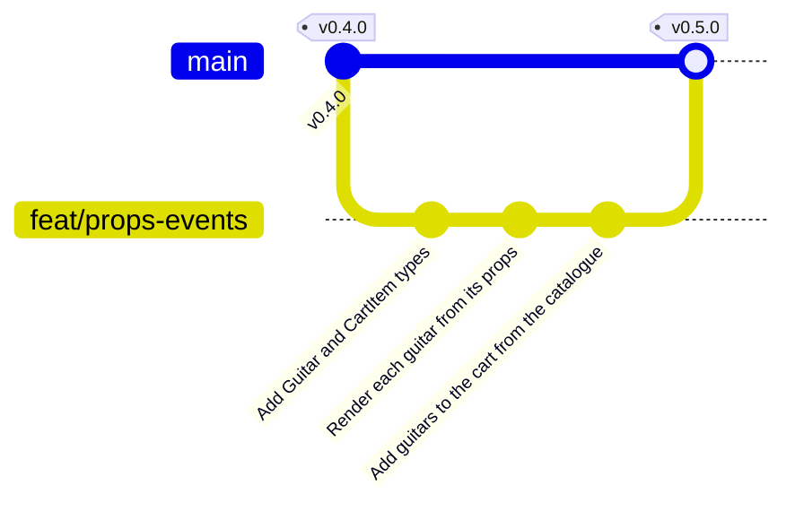
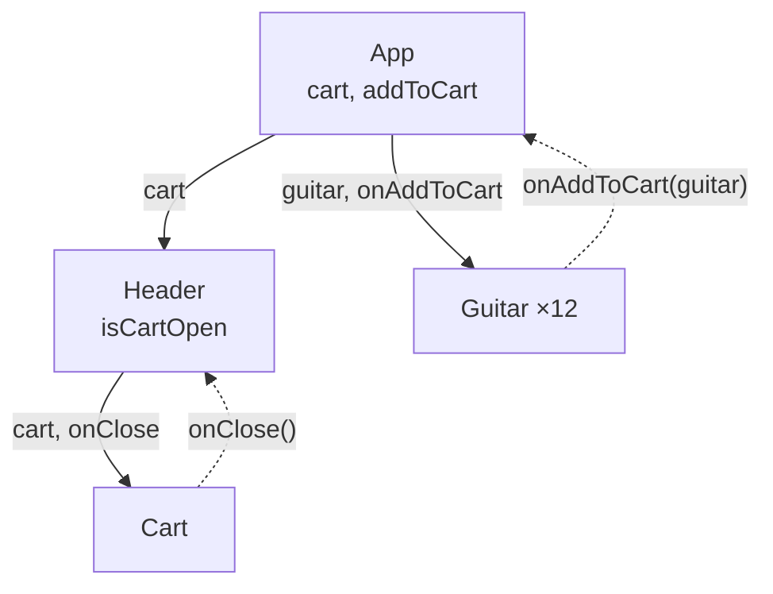

import {
	Aside,
	Card,
	CardGrid,
	FileTree,
	LinkCard,
	Steps,
	TabItem,
	Tabs,
} from "@astrojs/starlight/components";
import { Image } from "astro:assets";
import headerCount from "../../../../assets/react/header-cart-count.png";
import cartWithItems from "../../../../assets/react/cart-with-items.png";

GuitarLA ya reacciona, pero sus componentes siguen cerrados: `Guitar` muestra siempre Lukather, `Cart` tiene una fila escrita a mano y el botón `×` no cierra nada. En esta página los componentes se abren hacia fuera: reciben **datos** y reciben **funciones** para avisar de lo que pasa. Al terminar, el botón "Agregar al carrito" de cada tarjeta mete esa guitarra en el panel, que muestra las líneas, las cantidades y el total.

<CardGrid stagger>
	<Card title="Props" icon="seti:react">
		Los argumentos de un componente. `App` decide qué guitarra pinta cada tarjeta; `Guitar` solo la muestra.
	</Card>
	<Card title="Funciones como props" icon="right-arrow">
		Los datos bajan y los eventos suben: `App` pasa `addToCart` a cada tarjeta y `Header` pasa `onClose` al panel.
	</Card>
	<Card title="Rama feat/props-events" icon="seti:git">
		Tres commits (tipos, tarjeta con props, carrito), fusión en `main` y release `v0.5.0`.
	</Card>
</CardGrid>

<Aside type="note" title="Requisitos previos">
	Haber completado [Estado](/jjcm/di/units/react/03-state/): `v0.4.0` en `main` y 13 tests en verde. De JavaScript se usan la [desestructuración](/jjcm/di/units/introduction/javascript/04-destructuring/), el [spread](/jjcm/di/units/introduction/javascript/04-destructuring/#rest-en-objetos) y `find`, `map` y `reduce` de [métodos de arrays](/jjcm/di/units/introduction/javascript/05-array-methods/). De TypeScript, los [tipos básicos](/jjcm/di/units/introduction/typescript/02-basic-types/) y [alias de tipos](/jjcm/di/units/introduction/typescript/03-interfaces-and-types/).
</Aside>

## Qué es una prop

Un componente es una función, y las **props** son su único argumento: un objeto con todo lo que el padre le pasa como atributos en JSX.

```tsx
<Guitar guitar={guitars[0]} onAddToCart={addToCart} />
```

Dentro de `Guitar`, ese objeto llega como `{ guitar, onAddToCart }`. Tres cosas que no cambian nunca:

- **Las props se leen, no se escriben.** `Guitar` no puede hacer `guitar.price = 0`. Si un componente necesita cambiar algo, pide al padre una función para hacerlo.
- **Los datos bajan, los eventos suben.** El padre pasa datos como props; el hijo avisa llamando a una función que también le ha llegado como prop. Es la misma idea que `onClick`, pero con un nombre que decides tú: `onAddToCart`, `onClose`.
- **Si cambia una prop, el hijo se vuelve a renderizar.** Cuando `App` cambie su estado `cart`, `Header` y `Cart` recibirán el array nuevo y se repintarán solos.

Con TypeScript las props se **tipan**: un `type` por componente que dice qué recibe y de qué tipo. Si `App` olvida una prop o le pasa un número donde iba un objeto, el error aparece en el editor, no en el navegador.

<Aside type="tip" title="Por qué `onAddToCart` y no `addToCart`">
	Las props que son funciones se nombran con el prefijo `on` + lo que ha pasado, como los eventos del DOM (`onClick`, `onChange`). Así, leyendo `<Guitar onAddToCart={…}>`, se sabe que `Guitar` **avisa** de algo y que el padre decide qué hacer. La función del padre que lo resuelve se llama por lo que hace: `addToCart`.
</Aside>

## La rama de esta fase

```bash
git switch main
git pull
git switch -c feat/props-events
```



## Los tipos del dominio

Antes de pasar guitarras de un componente a otro hay que decir **qué es una guitarra**. Hasta ahora TypeScript lo deducía del array de `db.ts`; a partir de ahora el tipo se declara en un sitio y lo importa quien lo necesite.

<Steps>
	1. Crea `src/types/index.ts` con los dos tipos de la aplicación:

		```ts title="src/types/index.ts"
		export type Guitar = {
		  id: number;
		  name: string;
		  image: string;
		  description: string;
		  price: number;
		};

		export type CartItem = Guitar & {
		  quantity: number;
		};
		```

		`CartItem` es una guitarra **más** una cantidad: la intersección `&` toma todas las propiedades de `Guitar` y añade `quantity`. Es lo que guardará el carrito.

	2. Anota el array de datos con el tipo. Si alguna guitarra tuviera una propiedad mal escrita o un precio como texto, el error saldría aquí:

		```diff lang="ts" title="src/data/db.ts"
		+import type { Guitar } from '../types';
		+
		-export const db = [
		+export const db: Guitar[] = [
		   {
		     id: 1,
		     name: 'Lukather',
		```

	3. `npx tsc -b` no debe dar errores. Confirma:

		```bash
		git add .
		git commit -m "Add Guitar and CartItem types"
		```
</Steps>

<Aside type="note" title="`import type`">
	Un tipo no existe en JavaScript: desaparece al compilar. `import type` deja claro que solo se importa para TypeScript y permite a Vite eliminar la importación sin mirar el contenido del archivo. ESLint con `typescript-eslint` lo pedirá cuando importes un tipo sin él.
</Aside>

## Guitar recibe su guitarra

### Las props

`Guitar` deja de tener los datos escritos a mano y los recibe en la prop `guitar`:

```diff lang="tsx" title="src/components/Guitar/Guitar.tsx"
-export const Guitar = () => {
+import type { Guitar as GuitarType } from '../../types';
+
+type GuitarProps = {
+  guitar: GuitarType;
+};
+
+export const Guitar = ({ guitar }: GuitarProps) => {
+  const { name, image, description, price } = guitar;
+
   return (
     <article className="flex items-center gap-4">
       
       <div className="w-2/3">
-        <h3 className="text-2xl font-bold text-black uppercase">Lukather</h3>
-        <p className="mt-2 text-gray-600">
-          Lorem ipsum, dolor sit amet consectetur adipisicing elit. Sit quae
-          labore odit magnam in autem nesciunt, amet deserunt.
-        </p>
-        <p className="mt-2 text-3xl font-black text-blue-600">$299</p>
+        <h3 className="text-2xl font-bold text-black uppercase">{name}</h3>
+        <p className="mt-2 text-gray-600">{description}</p>
+        <p className="mt-2 text-3xl font-black text-blue-600">${price}</p>
         <button
           type="button"
           className="mt-3 w-full rounded bg-gray-900 px-4 py-2 font-bold text-white uppercase transition hover:bg-gray-700"
         >
-          Agregar al carrito
+          Agregar al carrito<span className="sr-only">: {name}</span>
         </button>
       </div>
     </article>
   );
 };
```

| Pieza | Qué hace |
| :--- | :--- |
| `import type { Guitar as GuitarType }` | El tipo y el componente se llaman igual. Al importar el tipo con otro nombre no chocan; `GuitarType` solo se usa en las anotaciones |
| `type GuitarProps = { guitar: GuitarType }` | El **contrato** del componente: quien lo use tiene que pasarle una guitarra completa |
| `({ guitar }: GuitarProps)` | Las props llegan como un objeto y se desestructuran en la firma. Dentro se vuelve a desestructurar `guitar` para no escribir `guitar.name`, `guitar.price`… |
| `` src={`/img/${image}.jpg`} `` | Un atributo calculado: entre llaves, una plantilla de JavaScript. Los datos guardan `guitarra_01` y la ruta se monta aquí |
| `${price}` | Fuera de las llaves, `$` es texto; `{price}` es la expresión. Se ve `$299` |

<Aside type="note" title="Para qué sirve el `span` con `sr-only`">
	Ahora hay doce botones que dicen "Agregar al carrito". Para quien los ve, cada uno está junto a su guitarra; para un lector de pantalla que lista los botones de la página, son doce iguales. El `span` con `sr-only` (una clase de Tailwind que oculta visualmente pero deja el texto en el DOM) completa el nombre accesible: "Agregar al carrito: Lukather". No se usa `aria-label` porque **sustituiría** el texto visible, y las WCAG piden que el nombre accesible **contenga** lo que se ve, para que quien usa control por voz pueda decir "pulsa Agregar al carrito". Está explicado en [nombres que dicen lo que hacen](/jjcm/di/units/ux/fundamentals/01-introduction/#nombres-que-dicen-lo-que-hacen).
</Aside>

### Pasar la prop desde `App`

En cuanto guardas, `App.tsx` se pone en rojo: *Property 'guitar' is missing*. TypeScript está diciendo dónde falta la prop:

```diff lang="tsx" title="src/App.tsx"
           {guitars.map((guitar) => (
-            <Guitar key={guitar.id} />
+            <Guitar key={guitar.id} guitar={guitar} />
           ))}
```

Mira el navegador: **doce guitarras distintas**, cada una con su imagen, su nombre y su precio. `App` recorre los datos y le da a cada tarjeta la suya.

### Probar

El test de `Guitar` ya no puede renderizar `<Guitar />` a secas. Se le pasa una guitarra **de prueba**, escrita en el propio test: así no depende de `db.ts` y, si mañana cambia el catálogo, el test sigue valiendo.

```diff lang="tsx" title="src/components/Guitar/Guitar.test.tsx"
 import { render, screen } from '@testing-library/react';
 import { describe, expect, it } from 'vitest';
+import type { Guitar as GuitarType } from '../../types';
 import { Guitar } from './Guitar';

+const guitar: GuitarType = {
+  id: 1,
+  name: 'Lukather',
+  image: 'guitarra_01',
+  description: 'Una guitarra de prueba',
+  price: 299,
+};
+
 describe('Guitar', () => {
-  it('shows the guitar name, image and price', () => {
-    render(<Guitar />);
+  it('shows the name, image, description and price of the guitar', () => {
+    render(<Guitar guitar={guitar} />);
     expect(
       screen.getByRole('heading', { name: 'Lukather' })
     ).toBeInTheDocument();
     expect(
       screen.getByRole('img', { name: 'Guitarra Lukather' })
-    ).toBeInTheDocument();
+    ).toHaveAttribute('src', '/img/guitarra_01.jpg');
+    expect(screen.getByText('Una guitarra de prueba')).toBeInTheDocument();
     expect(screen.getByText('$299')).toBeInTheDocument();
   });
-
-  it('shows the add to cart button', () => {
-    render(<Guitar />);
-    expect(
-      screen.getByRole('button', { name: 'Agregar al carrito' })
-    ).toBeInTheDocument();
-  });
 });
```

El segundo test se borra porque en el siguiente apartado el botón hará algo, y entonces se probará **lo que hace**, no solo que existe.

### Documentar

Las props de una story se llaman **args** (los viste en [escribir stories](/jjcm/di/units/documentation/storybook/02-writing-stories/#args-las-props-de-cada-story)). Con `args` en el `meta` todas las stories del componente reciben la misma guitarra, y cada una puede cambiar lo que quiera:

```diff lang="tsx" title="src/components/Guitar/Guitar.stories.tsx"
 import type { Meta, StoryObj } from '@storybook/react-vite';
+import { db } from '../../data/db';
 import { Guitar } from './Guitar';

 const meta = {
   component: Guitar,
+  args: {
+    guitar: db[0],
+  },
   decorators: [
     (Story) => (
       <div className="max-w-sm">
         <Story />
       </div>
     ),
   ],
 } satisfies Meta<typeof Guitar>;

 export default meta;
 type Story = StoryObj<typeof meta>;

 export const Default: Story = {};
+
+export const Expensive: Story = {
+  args: {
+    guitar: { ...db[0], name: 'Custom', price: 2499 },
+  },
+};
```

Abre Storybook: en la pestaña **Controls** de `Guitar` aparece el objeto `guitar` y puedes editar el nombre o el precio en vivo. La story `Expensive` comprueba que un precio de cuatro cifras cabe en la tarjeta. Esto es lo que aporta documentar con props: ver el componente con **distintos datos** sin tocar la aplicación.

### Confirmar

Antes del commit, la aplicación tiene que estar **sana**: sin errores de tipos, de linter ni de tests. En este punto todo pasa porque solo ha cambiado `Guitar` y quien lo usa (`App`, su test y su story); `Cart` y `Header` siguen igual que en `v0.4.0`.

```bash
npx tsc -b
npm run lint
npx vitest run
```

```txt
 Test Files  5 passed (5)
      Tests  12 passed (12)
  Snapshots  1 passed
```

Son 12 y no 13 porque se ha borrado el test del botón. Si ves **13 con uno en rojo**, es que sigue ahí: busca `Agregar al carrito` y falla porque el botón ahora se llama `Agregar al carrito: Lukather`. Bórralo y repite.

```bash
git add .
git commit -m "Render each guitar from its props"
```

<Aside type="caution" title="Nunca se confirma con errores">
	Cada commit de `main` y de las ramas de features tiene que **compilar y pasar los tests**. Es lo que permite volver a cualquier punto de la historia (`git checkout`, `git bisect`) y encontrar algo que funciona, y lo que hará posible la integración continua más adelante. Por eso cada fase se parte en commits que dejan la app completa: aquí, primero los tipos, luego la tarjeta con props y por último el carrito, que toca varios componentes a la vez y se confirma cuando todos están conectados. Si a mitad de un paso necesitas guardar, usa una rama o `git stash`, no un commit roto.
</Aside>

## El carrito

### Dónde vive el estado

El carrito lo llenan las tarjetas (`Guitar`) y lo muestra el panel (`Cart`, dentro de `Header`). El componente más cercano que contiene a todos es `App`: ahí vive el array `cart`. Fíjate en que `isCartOpen` **no sube**: solo lo usan `Header` y `Cart`, y `Header` sigue siendo su dueño. Subir el estado más de lo necesario es tan mala idea como dejarlo demasiado abajo.



Las flechas continuas son datos que bajan; las discontinuas, funciones que el hijo llama para avisar.

### El estado y `addToCart` en `App`

```diff lang="tsx" title="src/App.tsx"
 import { useEffect, useState } from 'react';
 import { Footer, Guitar, Header } from './components';
 import { db } from './data/db';
+import type { CartItem, Guitar as GuitarType } from './types';

 const App = () => {
   const [guitars] = useState(db);
+  const [cart, setCart] = useState<CartItem[]>([]);

   useEffect(() => {
     document.title = `GuitarLA · ${guitars.length} guitarras`;
   }, [guitars]);

+  const addToCart = (guitar: GuitarType) => {
+    const exists = cart.find((item) => item.id === guitar.id);
+
+    if (exists) {
+      setCart(
+        cart.map((item) =>
+          item.id === guitar.id
+            ? { ...item, quantity: item.quantity + 1 }
+            : item
+        )
+      );
+    } else {
+      setCart([...cart, { ...guitar, quantity: 1 }]);
+    }
+  };
+
   return (
     <>
-      <Header />
+      <Header cart={cart} />

       <main className="mx-auto mt-10 max-w-6xl px-4">
         <h2 className="text-center text-4xl font-black">Nuestra Colección</h2>

         <div className="mt-10 grid grid-cols-1 gap-8 md:grid-cols-2 lg:grid-cols-3">
           {guitars.map((guitar) => (
-            <Guitar key={guitar.id} guitar={guitar} />
+            <Guitar key={guitar.id} guitar={guitar} onAddToCart={addToCart} />
           ))}
         </div>
       </main>
```

<Steps>
	1. **`useState<CartItem[]>([])`**: el array vacío no dice de qué es, así que el tipo se indica entre `<>`. Sin él, TypeScript deduciría `never[]` y no dejaría añadir nada.
	2. **`cart.find(…)`** busca si la guitarra ya está. Si está, se **incrementa su cantidad**; si no, se **añade** con `quantity: 1`.
	3. **Nunca se modifica `cart`**: ni `cart.push(…)` ni `exists.quantity++`. React compara el array nuevo con el anterior para saber si debe renderizar; si es el mismo objeto mutado, no se entera. Por eso `map` devuelve un array nuevo con un objeto nuevo (`{ ...item, quantity: … }`) y el spread `[...cart, …]` crea otro array con un elemento más.
</Steps>

<Aside type="caution" title="El estado es inmutable">
	La regla para arrays y objetos en el estado: **crear uno nuevo** en lugar de tocar el existente. Añadir es `[...array, nuevo]`; cambiar uno es `array.map(…)` devolviendo una copia modificada; quitar es `array.filter(…)`. La página de [actualizar arrays en el estado](https://react.dev/learn/updating-arrays-in-state) de React tiene la tabla completa.
</Aside>

### `Guitar` avisa

`Guitar` recibe la función y la llama con **su** guitarra cuando se pulsa el botón:

```diff lang="tsx" title="src/components/Guitar/Guitar.tsx"
 type GuitarProps = {
   guitar: GuitarType;
+  onAddToCart: (guitar: GuitarType) => void;
 };

-export const Guitar = ({ guitar }: GuitarProps) => {
+export const Guitar = ({ guitar, onAddToCart }: GuitarProps) => {
   const { name, image, description, price } = guitar;
   …
         <button
           type="button"
-          className="mt-3 w-full rounded bg-gray-900 px-4 py-2 font-bold text-white uppercase transition hover:bg-gray-700"
+          className="mt-3 w-full rounded bg-gray-900 px-4 py-2 font-bold text-white uppercase transition hover:bg-gray-700 focus-visible:outline-2 focus-visible:outline-offset-2 focus-visible:outline-blue-600"
+          onClick={() => onAddToCart(guitar)}
         >
```

El tipo de la prop es el de una **función** que recibe una guitarra y no devuelve nada: `(guitar: GuitarType) => void`. Y `onClick={() => onAddToCart(guitar)}` sigue la regla de la página anterior: una función, no una llamada. `Guitar` no sabe qué hace `App` con la guitarra, y así debe ser: mañana la misma tarjeta podría servir para una lista de favoritos cambiando solo la función que recibe.

Pulsa un botón del catálogo: no se ve nada todavía, porque `Cart` sigue mostrando su fila de ejemplo. Pero el estado ya cambia: abre la pestaña **Components** de [React Developer Tools](/jjcm/di/installations/#instalar-react-developer-tools), selecciona `App` y mira `cart` crecer.

### `Cart` muestra las líneas

`Cart` recibe el array y la función para cerrarse, y sustituye la fila escrita a mano por un `map`:

```diff lang="tsx" title="src/components/Cart/Cart.tsx"
-export const Cart = () => {
+import type { CartItem } from '../../types';
+
+type CartProps = {
+  cart: CartItem[];
+  onClose: () => void;
+};
+
+export const Cart = ({ cart, onClose }: CartProps) => {
+  const isEmpty = cart.length === 0;
+  const total = cart.reduce((sum, item) => sum + item.price * item.quantity, 0);
+
   return (
     <aside
       id="cart"
       aria-labelledby="cart-title"
       className="fixed inset-y-0 right-0 z-30 flex w-full max-w-md flex-col bg-white shadow-2xl"
     >
       <div className="flex items-center justify-between border-b border-gray-200 px-6 py-4">
         <h2 id="cart-title" className="text-2xl font-black">
           Tu carrito
         </h2>
         <button
           type="button"
-          className="size-8 rounded-full text-xl font-bold text-gray-500 transition hover:bg-gray-100"
+          className="size-8 rounded-full text-xl font-bold text-gray-500 transition hover:bg-gray-100 focus-visible:outline-2 focus-visible:outline-offset-2 focus-visible:outline-blue-600"
           aria-label="Cerrar carrito"
+          autoFocus
+          onClick={onClose}
         >
           ×
         </button>
       </div>

       <div className="flex-1 overflow-y-auto px-6 py-4">
-        <p className="text-center text-gray-500">El carrito está vacío</p>
-
-        <table className="w-full text-sm">
-          <thead>
-            <tr className="border-b border-gray-200 text-left">
-              <th className="py-2">Imagen</th>
-              <th className="py-2">Nombre</th>
-              <th className="py-2">Precio</th>
-              <th className="py-2">Cantidad</th>
-              <th></th>
-            </tr>
-          </thead>
-          <tbody>
-            <tr className="border-b border-gray-100">
-              <td className="py-3">
-                
-              </td>
-              <td>SRV</td>
-              <td className="font-bold">$299</td>
-              <td>
-                <div className="flex items-center gap-2">
-                  <button
-                    type="button"
-                    className="size-6 rounded bg-gray-900 text-white"
-                  >
-                    -
-                  </button>
-                  1
-                  <button
-                    type="button"
-                    className="size-6 rounded bg-gray-900 text-white"
-                  >
-                    +
-                  </button>
-                </div>
-              </td>
-              <td>
-                <button
-                  type="button"
-                  className="size-6 rounded-full bg-red-600 text-xs font-bold text-white"
-                >
-                  X
-                </button>
-              </td>
-            </tr>
-          </tbody>
-        </table>
+        {isEmpty ? (
+          <p className="text-center text-gray-500">El carrito está vacío</p>
+        ) : (
+          <table className="w-full text-sm">
+            <thead>
+              <tr className="border-b border-gray-200 text-left">
+                <th className="py-2">Imagen</th>
+                <th className="py-2">Nombre</th>
+                <th className="py-2">Precio</th>
+                <th className="py-2">Cantidad</th>
+                <th></th>
+              </tr>
+            </thead>
+            <tbody>
+              {cart.map((item) => (
+                <tr key={item.id} className="border-b border-gray-100">
+                  <td className="py-3">
+                    
+                  </td>
+                  <td>{item.name}</td>
+                  <td className="font-bold">${item.price}</td>
+                  <td>
+                    <div className="flex items-center gap-2">
+                      <button
+                        type="button"
+                        className="size-6 rounded bg-gray-900 text-white"
+                        aria-label={`Quitar una unidad de ${item.name}`}
+                      >
+                        -
+                      </button>
+                      {item.quantity}
+                      <button
+                        type="button"
+                        className="size-6 rounded bg-gray-900 text-white"
+                        aria-label={`Añadir una unidad de ${item.name}`}
+                      >
+                        +
+                      </button>
+                    </div>
+                  </td>
+                  <td>
+                    <button
+                      type="button"
+                      className="size-6 rounded-full bg-red-600 text-xs font-bold text-white"
+                      aria-label={`Eliminar ${item.name} del carrito`}
+                    >
+                      X
+                    </button>
+                  </td>
+                </tr>
+              ))}
+            </tbody>
+          </table>
+        )}
       </div>

       <div className="border-t border-gray-200 px-6 py-4">
         <p className="text-right text-lg">
-          Total pagar: <span className="font-black">$899</span>
+          Total pagar: <span className="font-black">${total}</span>
         </p>
         <button
           type="button"
-          className="mt-3 w-full rounded bg-gray-900 p-3 font-bold text-white uppercase transition hover:bg-gray-700"
+          className="mt-3 w-full rounded bg-gray-900 p-3 font-bold text-white uppercase transition hover:bg-gray-700 disabled:cursor-not-allowed disabled:bg-gray-400"
+          disabled={isEmpty}
         >
           Vaciar carrito
         </button>
```

| Pieza | Qué hace |
| :--- | :--- |
| `isEmpty` y `total` | **Valores calculados** a partir de las props, en variables normales. No son estado: si `cart` cambia, el componente se renderiza y se recalculan. Un `useState` para el total sería un error (habría que mantenerlo sincronizado a mano) |
| `cart.reduce((sum, item) => sum + item.price * item.quantity, 0)` | Suma precio por cantidad de cada línea, empezando en 0 |
| `{isEmpty ? (…) : (…)}` | Renderizado condicional con **dos ramas**: el mensaje o la tabla. El `&&` de la página anterior sirve cuando solo hay una |
| `cart.map((item) => <tr key={item.id}>…)` | Una fila por línea, con `key` como en toda lista |
| `onClick={onClose}` | Aquí no hace falta flecha: `onClose` ya es una función sin argumentos, se pasa tal cual |
| `disabled={isEmpty}` | El botón de vaciar no tiene sentido con el carrito vacío. Deshabilitarlo evita un clic inútil y lo comunica (gris, cursor prohibido, y el lector de pantalla dice "no disponible") |

Los botones `-`, `+` y `X` de cada fila ya tienen su nombre accesible con la guitarra a la que afectan, aunque todavía no hagan nada: se conectan en la página del hook.

<Aside type="note" title="Por qué `autoFocus` en el botón de cerrar">
	Cuando el panel se abre, el foco del teclado seguía en el icono de la cabecera, **detrás** de la capa oscura. Quien navega con `Tab` o con lector de pantalla no sabría que se ha abierto algo. Al montarse `Cart`, `autoFocus` lleva el foco al primer control del panel: el lector anuncia "Tu carrito, complementario, Cerrar carrito, botón" y `Enter` lo cierra. Es la parte del patrón de [paneles y desplegables](/jjcm/di/units/ux/fundamentals/01-introduction/#paneles-y-desplegables) que faltaba.
</Aside>

### `Header` pasa el carrito y muestra cuántos hay

`Header` recibe `cart` solo para dárselo a `Cart`, y aprovecha para contar las unidades sobre el icono:

```diff lang="tsx" title="src/components/Header/Header.tsx"
 import { useEffect, useState } from 'react';
+import type { CartItem } from '../../types';
 import { Cart } from '../Cart';

-export const Header = () => {
+type HeaderProps = {
+  cart: CartItem[];
+};
+
+export const Header = ({ cart }: HeaderProps) => {
   const [isCartOpen, setIsCartOpen] = useState(false);
+  const itemCount = cart.reduce((sum, item) => sum + item.quantity, 0);

   useEffect(() => {
   …
         <nav className="flex justify-end md:mt-10 md:w-1/2">
           <button
             type="button"
-            className="w-8 cursor-pointer transition hover:scale-110 focus-visible:outline-2 focus-visible:outline-offset-4 focus-visible:outline-white"
+            className="relative w-8 cursor-pointer transition hover:scale-110 focus-visible:outline-2 focus-visible:outline-offset-4 focus-visible:outline-white"
             aria-label="Abrir carrito"
             aria-expanded={isCartOpen}
             aria-controls="cart"
             onClick={() => setIsCartOpen(!isCartOpen)}
           >
             
+            {itemCount > 0 && (
+              <span
+                className="absolute -top-2 -right-2 flex size-5 items-center justify-center rounded-full bg-blue-600 text-xs font-bold text-white"
+                aria-hidden="true"
+              >
+                {itemCount}
+              </span>
+            )}
           </button>
+          <p className="sr-only" aria-live="polite">
+            {itemCount} artículos en el carrito
+          </p>
         </nav>
       </div>

       {isCartOpen && (
         <>
           <div
             className="fixed inset-0 z-20 bg-black/50"
             onClick={() => setIsCartOpen(false)}
           ></div>
-          <Cart />
+          <Cart cart={cart} onClose={() => setIsCartOpen(false)} />
         </>
       )}
```

<Image src={headerCount} alt="Cabecera de GuitarLA con el icono del carrito y un círculo azul con el número 3 en su esquina" />

- **El contador** es una burbuja `absolute` sobre el botón (`relative`), como en [otras técnicas de Tailwind](/jjcm/di/units/introduction/tailwind/08-other-techniques/#superponer-relative--absolute). Solo aparece cuando hay algo.
- **`aria-hidden="true"`** en la burbuja: si no, el nombre del botón pasaría a ser "Abrir carrito 3", y el test que busca `Abrir carrito` seguiría pasando pero el nombre sería confuso.
- **`onClose={() => setIsCartOpen(false)}`**: `Header` sigue siendo el dueño de `isCartOpen`; le da a `Cart` una función para ponerlo a `false`, igual que `App` da `addToCart` a `Guitar`.

<Aside type="note" title="Para qué sirve el párrafo con `aria-live`">
	Al pulsar "Agregar al carrito" quien ve la pantalla ve cambiar la burbuja; quien usa un lector de pantalla no recibe nada, porque el foco sigue en el botón de la tarjeta. Una **región viva** (`aria-live="polite"`) hace que el lector anuncie el texto cada vez que cambia, sin mover el foco: "3 artículos en el carrito". `sr-only` la oculta visualmente porque la burbuja ya cumple esa función para la vista. Es la heurística de **visibilidad del estado del sistema** llevada a quien no ve: lo explica [avisar de lo que cambia](/jjcm/di/units/ux/fundamentals/01-introduction/#avisar-de-lo-que-cambia) en la unidad de usabilidad y accesibilidad.
</Aside>

Guarda y prueba el flujo completo: añade dos veces una guitarra y una vez otra, abre el carrito y verás las dos líneas con sus cantidades y el total. El `×` por fin cierra el panel.

<Image src={cartWithItems} alt="Panel del carrito con dos líneas, Lukather con cantidad 2 y SRV con cantidad 1, total 947 dólares y el botón de cerrar con el foco" />

### Probar

Cada componente se prueba **solo**, dándole props de prueba y funciones falsas; `App` se prueba con el flujo entero.

<Tabs>
	<TabItem label="Guitar">
		Un **mock** (`vi.fn()`) es una función que registra cómo la han llamado. Sirve para comprobar que `Guitar` avisa con la guitarra correcta sin necesitar un carrito de verdad:

		```diff lang="tsx" title="src/components/Guitar/Guitar.test.tsx"
		 import { render, screen } from '@testing-library/react';
		-import { describe, expect, it } from 'vitest';
		+import userEvent from '@testing-library/user-event';
		+import { describe, expect, it, vi } from 'vitest';
		 import type { Guitar as GuitarType } from '../../types';
		 import { Guitar } from './Guitar';
		 …
		   it('shows the name, image, description and price of the guitar', () => {
		-    render(<Guitar guitar={guitar} />);
		+    render(<Guitar guitar={guitar} onAddToCart={vi.fn()} />);
		 …
		   });
		+
		+  it('calls onAddToCart with the guitar when the button is clicked', async () => {
		+    const user = userEvent.setup();
		+    const onAddToCart = vi.fn();
		+    render(<Guitar guitar={guitar} onAddToCart={onAddToCart} />);
		+
		+    await user.click(
		+      screen.getByRole('button', { name: 'Agregar al carrito: Lukather' })
		+    );
		+
		+    expect(onAddToCart).toHaveBeenCalledTimes(1);
		+    expect(onAddToCart).toHaveBeenCalledWith(guitar);
		+  });
		 });
		```

		Fíjate en el nombre del botón: `Agregar al carrito: Lukather`, el texto visible más el `span` oculto. Si en el primer test no te importa la función, `vi.fn()` en línea basta.
	</TabItem>
	<TabItem label="Cart">
		Sustituye el archivo entero: los dos tests antiguos comprobaban la fila de ejemplo, que ya no existe.

		```tsx title="src/components/Cart/Cart.test.tsx"
		import { render, screen } from '@testing-library/react';
		import userEvent from '@testing-library/user-event';
		import { describe, expect, it, vi } from 'vitest';
		import type { CartItem } from '../../types';
		import { Cart } from './Cart';

		const items: CartItem[] = [
		  {
		    id: 1,
		    name: 'Lukather',
		    image: 'guitarra_01',
		    description: 'Una guitarra de prueba',
		    price: 299,
		    quantity: 2,
		  },
		  {
		    id: 2,
		    name: 'SRV',
		    image: 'guitarra_02',
		    description: 'Otra guitarra de prueba',
		    price: 349,
		    quantity: 1,
		  },
		];

		describe('Cart', () => {
		  it('shows the empty message and disables the clear button', () => {
		    render(<Cart cart={[]} onClose={vi.fn()} />);
		    expect(screen.getByText('El carrito está vacío')).toBeInTheDocument();
		    expect(screen.queryByRole('table')).not.toBeInTheDocument();
		    expect(
		      screen.getByRole('button', { name: 'Vaciar carrito' })
		    ).toBeDisabled();
		  });

		  it('shows one row per item and the total', () => {
		    render(<Cart cart={items} onClose={vi.fn()} />);
		    expect(screen.getByRole('cell', { name: 'Lukather' })).toBeInTheDocument();
		    expect(screen.getByRole('cell', { name: 'SRV' })).toBeInTheDocument();
		    expect(screen.getByText('$947')).toBeInTheDocument();
		    expect(
		      screen.getByRole('button', { name: 'Vaciar carrito' })
		    ).toBeEnabled();
		  });

		  it('calls onClose when the close button is clicked', async () => {
		    const user = userEvent.setup();
		    const onClose = vi.fn();
		    render(<Cart cart={[]} onClose={onClose} />);

		    await user.click(screen.getByRole('button', { name: 'Cerrar carrito' }));

		    expect(onClose).toHaveBeenCalledTimes(1);
		  });
		});
		```

		`2 × 299 + 349 = 947`: el test comprueba el cálculo del total con datos que controla. Las celdas de una tabla tienen el rol `cell`; `toBeDisabled` y `toBeEnabled` vienen de jest-dom.
	</TabItem>
	<TabItem label="Header">
		Los tests existentes pasan `cart={[]}` y se añade uno para el contador:

		```diff lang="tsx" title="src/components/Header/Header.test.tsx"
		 import { render, screen } from '@testing-library/react';
		 import userEvent from '@testing-library/user-event';
		 import { describe, expect, it } from 'vitest';
		+import type { CartItem } from '../../types';
		 import { Header } from './Header';

		+const items: CartItem[] = [
		+  {
		+    id: 1,
		+    name: 'Lukather',
		+    image: 'guitarra_01',
		+    description: 'Una guitarra de prueba',
		+    price: 299,
		+    quantity: 2,
		+  },
		+  {
		+    id: 2,
		+    name: 'SRV',
		+    image: 'guitarra_02',
		+    description: 'Otra guitarra de prueba',
		+    price: 349,
		+    quantity: 1,
		+  },
		+];
		+
		 describe('Header', () => {
		   it('shows the logo linking to the home page', () => {
		-    render(<Header />);
		+    render(<Header cart={[]} />);
		 …
		+
		+  it('shows the number of items in the cart', () => {
		+    render(<Header cart={items} />);
		+    expect(screen.getByText('3')).toBeInTheDocument();
		+    expect(screen.getByText('3 artículos en el carrito')).toBeInTheDocument();
		+  });
		 });
		```

		Cambia los cuatro `render(<Header />)` por `render(<Header cart={[]} />)`. El contador suma cantidades, no líneas: dos guitarras con 2 y 1 unidades son 3.
	</TabItem>
	<TabItem label="App">
		El test de integración hace lo que haría una persona: añade, abre y mira.

		```diff lang="tsx" title="src/App.test.tsx"
		-import { render, screen } from '@testing-library/react';
		+import { render, screen, within } from '@testing-library/react';
		+import userEvent from '@testing-library/user-event';
		 import { describe, expect, it } from 'vitest';
		 import App from './App';
		 …
		+
		+  it('adds guitars to the cart and shows them in the panel', async () => {
		+    const user = userEvent.setup();
		+    render(<App />);
		+
		+    await user.click(
		+      screen.getByRole('button', { name: 'Agregar al carrito: Lukather' })
		+    );
		+    await user.click(
		+      screen.getByRole('button', { name: 'Agregar al carrito: Lukather' })
		+    );
		+    await user.click(
		+      screen.getByRole('button', { name: 'Agregar al carrito: SRV' })
		+    );
		+    await user.click(screen.getByRole('button', { name: 'Abrir carrito' }));
		+
		+    const cart = screen.getByRole('complementary', { name: 'Tu carrito' });
		+    expect(within(cart).getAllByRole('row')).toHaveLength(3);
		+    expect(within(cart).getByText('$947')).toBeInTheDocument();
		+    expect(screen.getByText('3 artículos en el carrito')).toBeInTheDocument();
		+  });
		 });
		```

		`within(cart)` limita la búsqueda al panel: así `getAllByRole('row')` no cuenta filas de otras tablas. Son tres filas porque la cabecera de la tabla también es una `row`. Y es el único test que toca `addToCart` de verdad: comprueba que dos clics en la misma guitarra son una línea con cantidad 2, no dos líneas.
	</TabItem>
</Tabs>

```bash
npx vitest run
```

```txt
 Test Files  5 passed (5)
      Tests  16 passed (16)
  Snapshots  1 passed
```

### Documentar

Las funciones también son args. Storybook trae `fn()` (de `storybook/test`): una función falsa que, además, **registra cada llamada en la pestaña Actions** con sus argumentos. Pulsa el botón de la story de `Guitar` y verás aparecer `onAddToCart` con el objeto de la guitarra.

<Tabs>
	<TabItem label="Guitar">
		```diff lang="tsx" title="src/components/Guitar/Guitar.stories.tsx"
		 import type { Meta, StoryObj } from '@storybook/react-vite';
		+import { fn } from 'storybook/test';
		 import { db } from '../../data/db';
		 import { Guitar } from './Guitar';

		 const meta = {
		   component: Guitar,
		   args: {
		     guitar: db[0],
		+    onAddToCart: fn(),
		   },
		```
	</TabItem>
	<TabItem label="Cart">
		Dos stories: vacío y con líneas. Es la ventaja de que `Cart` reciba todo por props: en Storybook se ve cada situación sin pulsar nada.

		```diff lang="tsx" title="src/components/Cart/Cart.stories.tsx"
		 import type { Meta, StoryObj } from '@storybook/react-vite';
		+import { fn } from 'storybook/test';
		+import { db } from '../../data/db';
		 import { Cart } from './Cart';

		 const meta = {
		   component: Cart,
		   parameters: {
		     layout: 'fullscreen',
		   },
		+  args: {
		+    cart: [],
		+    onClose: fn(),
		+  },
		 } satisfies Meta<typeof Cart>;

		 export default meta;
		 type Story = StoryObj<typeof meta>;

		-export const Default: Story = {};
		+export const Empty: Story = {};
		+
		+export const WithItems: Story = {
		+  args: {
		+    cart: [
		+      { ...db[0], quantity: 2 },
		+      { ...db[1], quantity: 1 },
		+    ],
		+  },
		+};
		```
	</TabItem>
	<TabItem label="Header">
		```diff lang="tsx" title="src/components/Header/Header.stories.tsx"
		 import type { Meta, StoryObj } from '@storybook/react-vite';
		+import { db } from '../../data/db';
		 import { Header } from './Header';

		 const meta = {
		   component: Header,
		   parameters: {
		     layout: 'fullscreen',
		   },
		+  args: {
		+    cart: [],
		+  },
		 } satisfies Meta<typeof Header>;

		 export default meta;
		 type Story = StoryObj<typeof meta>;

		 export const Default: Story = {};
		+
		+export const WithItems: Story = {
		+  args: {
		+    cart: [
		+      { ...db[0], quantity: 2 },
		+      { ...db[1], quantity: 1 },
		+    ],
		+  },
		+};
		```
	</TabItem>
</Tabs>

Abre `Cart › WithItems` y mira el panel **Accessibility**: sin violaciones. Los botones `-`, `+` y `X` pasan la regla `button-name` porque llevan `aria-label`; si quitas uno, aparecerán tres violaciones, una por fila, como en la [página de componentes](/jjcm/di/units/react/02-components/#cómo-se-ve-un-fallo-de-accesibilidad). En `Header › WithItems` comprueba que el botón sigue llamándose "Abrir carrito" en la pestaña **Accessibility**, no "Abrir carrito 3".

### Confirmar

```bash
git add .
git commit -m "Add guitars to the cart from the catalogue"
```

## Comprobar, fusionar y publicar

```bash
npm run lint
npm run format:check
npx vitest run
npm run build
```

Y el cierre de la fase:

```bash
git push
git switch main
git merge --no-ff feat/props-events -m "Merge feat/props-events"
git push
git tag -a v0.5.0 -m "Props and events"
git push origin v0.5.0
gh release create v0.5.0 --title "v0.5.0 · Props and events" --notes "Guitar and CartItem types, Guitar rendered from props, cart state in App with addToCart, Cart shows items and total, item counter with live region in Header."
git branch -d feat/props-events
git push origin --delete feat/props-events
```

## Comprobación final

<Steps>
	1. El catálogo muestra doce guitarras distintas con su imagen, nombre, descripción y precio.
	2. "Agregar al carrito" sube el contador del icono; la misma guitarra dos veces es una línea con cantidad 2; el panel muestra las líneas y el total correcto; el `×` lo cierra; con el carrito vacío "Vaciar carrito" está deshabilitado.
	3. Al abrir el panel el foco está en el botón de cerrar (se ve el contorno azul); `Tab` recorre los controles de las filas y cada uno tiene nombre con su guitarra.
	4. `npx vitest run` ejecuta 16 tests en 5 archivos; `lint`, `format:check` y `build` pasan; en Storybook, `Guitar` tiene controles para la guitarra, `Cart` y `Header` tienen la story `WithItems`, la pestaña Actions registra `onAddToCart` y `onClose`, y no hay violaciones de accesibilidad.
	5. `git log --oneline --graph` muestra `feat/props-events` fusionada y en GitHub existe la release `v0.5.0`.
</Steps>

## 🧩 Aplicación en el proyecto

Props hacia abajo y funciones hacia arriba es **la** forma de componer una aplicación React, sea cual sea su tamaño. En la app de informes, la lista de informes recibirá los datos por props y avisará con `onSelect`; el formulario de parámetros recibirá sus valores y avisará con `onSubmit`. Y la decisión de dónde vive cada estado (el carrito en `App`, el panel abierto en `Header`) se repite en cada pantalla: lo más bajo posible, lo más alto necesario. Cuando el estado del carrito tenga que llegar a más sitios, se extraerá a un hook, que es la página siguiente.

## Resumen rápido

| Concepto | Detalle |
| :--- | :--- |
| **Prop** | Atributo en JSX que llega al componente en su único argumento; se lee, nunca se escribe |
| **Tipar props** | `type XProps = { … }` y `({ a, b }: XProps)`; las funciones, `(arg: T) => void` |
| **Tipos del dominio** | En `src/types/`, importados con `import type`; `CartItem = Guitar & { quantity }` |
| **Función como prop** | `onAlgo={fn}` en el padre, `onClick={() => onAlgo(dato)}` en el hijo |
| **Dónde vive el estado** | En el padre común más cercano; `cart` en `App`, `isCartOpen` se queda en `Header` |
| **Actualizar arrays** | Siempre uno nuevo: `[...arr, x]`, `arr.map(…)`, `arr.filter(…)` |
| **Valor calculado** | `const total = cart.reduce(…)` en el cuerpo, no en `useState` |
| **Probar** | Props de prueba en el test, `vi.fn()` para las funciones, `toHaveBeenCalledWith`, `within` para acotar |
| **Documentar** | `args` en el `meta`, `fn()` para las funciones, una story por situación |
| **Accesibilidad** | Nombre que contiene el texto visible (`sr-only`), `aria-live` para avisar, `autoFocus` al abrir, `aria-hidden` en lo decorativo |

## Convención práctica

<Steps>
	1. **Un `type XProps` por componente**, encima del componente; los tipos del dominio en `src/types/`.
	2. **Funciones como props con prefijo `on`** y la implementación del padre con un verbo (`addToCart`, `closeCart`).
	3. **Estado lo más abajo posible**: solo sube cuando dos ramas lo necesitan.
	4. **Nunca mutar el estado**: spread, `map` y `filter`.
	5. **Tests con datos propios y mocks**; `App` prueba el flujo entre componentes.
	6. **Ningún commit con la app rota**: `tsc -b`, `lint` y `vitest run` en verde antes de confirmar; si un cambio obliga a tocar varios componentes, van juntos en el mismo commit.
	7. **Toda acción tiene respuesta visible y anunciable**: contador y `aria-live`, foco donde está la acción, controles sin sentido deshabilitados.
</Steps>

## Referencias

<CardGrid stagger>
	<LinkCard
		href="https://react.dev/learn/passing-props-to-a-component"
		title="Pasar props a un componente (React)"
		description="Props, desestructuración, valores por defecto y por qué son de solo lectura."
		target="_blank"
		rel="noopener noreferrer"
	/>
	<LinkCard
		href="https://react.dev/learn/sharing-state-between-components"
		title="Compartir estado entre componentes (React)"
		description="Elevar el estado al padre común y bajar datos y funciones."
		target="_blank"
		rel="noopener noreferrer"
	/>
	<LinkCard
		href="https://react.dev/learn/updating-arrays-in-state"
		title="Actualizar arrays en el estado (React)"
		description="Añadir, quitar y cambiar elementos sin mutar."
		target="_blank"
		rel="noopener noreferrer"
	/>
	<LinkCard
		href="https://react.dev/learn/typescript"
		title="Usar TypeScript con React"
		description="Tipar props, estado y eventos."
		target="_blank"
		rel="noopener noreferrer"
	/>
	<LinkCard
		href="https://vitest.dev/api/vi.html#vi-fn"
		title="vi.fn (Vitest)"
		description="Funciones mock y las aserciones toHaveBeenCalled."
		target="_blank"
		rel="noopener noreferrer"
	/>
	<LinkCard
		href="https://storybook.js.org/docs/essentials/actions"
		title="Actions (Storybook)"
		description="fn() y la pestaña Actions para ver las llamadas a las props."
		target="_blank"
		rel="noopener noreferrer"
	/>
	<LinkCard
		href="https://www.w3.org/WAI/WCAG22/Understanding/label-in-name.html"
		title="Label in Name (WCAG 2.2)"
		description="Por qué el nombre accesible debe contener el texto visible."
		target="_blank"
		rel="noopener noreferrer"
	/>
	<LinkCard
		href="https://developer.mozilla.org/es/docs/Web/Accessibility/ARIA/ARIA_Live_Regions"
		title="Regiones vivas ARIA (MDN)"
		description="aria-live, polite y assertive: anunciar cambios sin mover el foco."
		target="_blank"
		rel="noopener noreferrer"
	/>
</CardGrid>

## Siguientes pasos

<CardGrid>
	<LinkCard
		href="/jjcm/di/units/react/05-cart-hook/"
		title="El hook useCart y la persistencia"
		description="Toda la lógica del carrito en un hook propio: cantidades, eliminar, vaciar y guardar en localStorage, documentado con TypeDoc, en la rama feat/cart-hook."
	/>
	<LinkCard
		href="/jjcm/di/units/ux/fundamentals/01-introduction/"
		title="Usabilidad y accesibilidad"
		description="Nombres accesibles, regiones vivas y foco: los fundamentos de lo aplicado en esta página."
	/>
</CardGrid>
