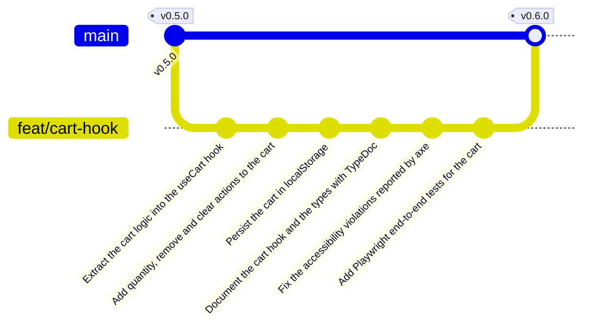

import {
	Aside,
	Card,
	CardGrid,
	FileTree,
	LinkCard,
	Steps,
	TabItem,
	Tabs,
} from "@astrojs/starlight/components";
import { Image } from "astro:assets";
import typedocUseCart from "../../../../assets/react/typedoc-usecart.png";
import playwrightReport from "../../../../assets/react/playwright-report.png";

`App` ha engordado: además de componer la página, guarda el carrito y sabe cómo añadir guitarras. Y los botones `-`, `+`, `X` y "Vaciar carrito" siguen sin hacer nada. En esta página la lógica del carrito se muda a un **hook propio**, `useCart`, que la agrupa, la prueba sola y la documenta; después el carrito se guarda en `localStorage` para que no se pierda al recargar, y por primera vez la aplicación se prueba **entera, en un navegador real**, con Playwright.

<CardGrid stagger>
	<Card title="useCart" icon="seti:react">
		Un hook es una función que usa otros hooks. `useCart` reúne el estado y las seis acciones del carrito, y `App` vuelve a ser solo composición.
	</Card>
	<Card title="localStorage" icon="seti:db">
		Un `useEffect` guarda el carrito cada vez que cambia, y `useState` lo recupera al arrancar.
	</Card>
	<Card title="TypeDoc y Playwright" icon="document">
		El hook se documenta con doc comments y el flujo completo (añadir, cambiar cantidades, recargar, vaciar) se prueba en Chromium, con una auditoría de accesibilidad.
	</Card>
	<Card title="Rama feat/cart-hook" icon="seti:git">
		Seis commits, fusión en `main` y release `v0.6.0`.
	</Card>
</CardGrid>

<Aside type="note" title="Requisitos previos">
	Haber completado [Props y eventos](/jjcm/di/units/react/04-props-events/): `v0.5.0` en `main` y 16 tests en verde. Conviene tener leídas la introducción a [TypeDoc](/jjcm/di/units/documentation/typedoc/01-introduction/) y la de [Playwright](/jjcm/di/units/testing/playwright/01-introduction/): aquí se aplican, no se explican desde cero.
</Aside>

## Qué es un hook personalizado

Un hook personalizado es **una función que empieza por `use` y llama a otros hooks**. Nada más: no es un componente (no devuelve JSX) ni una clase. Sirve para sacar de un componente la lógica que no tiene que ver con pintar, de modo que:

- **`App` se lee de un vistazo**: compone la página y pide el carrito a `useCart`.
- **La lógica se prueba sola**, sin renderizar botones: "si añado dos veces la misma guitarra, hay una línea con cantidad 2".
- **Se reutiliza**: cuando en la página de Context el carrito tenga que llegar a varias pantallas, el hook será el mismo.

Cada componente que llama a `useCart` tiene **su propio** estado; el hook no comparte nada entre llamadas. Hoy solo lo llama `App`, así que hay un único carrito.

## La rama de esta fase

```bash
git switch main
git pull
git switch -c feat/cart-hook
```



## Extraer el hook

### `useCart`

Crea `src/hooks/useCart.ts` y mueve ahí el estado y `addToCart` tal cual estaban en `App`:

```ts title="src/hooks/useCart.ts"
import { useState } from 'react';
import type { CartItem, Guitar } from '../types';

export const useCart = () => {
  const [cart, setCart] = useState<CartItem[]>([]);

  const addToCart = (guitar: Guitar) => {
    const exists = cart.find((item) => item.id === guitar.id);

    if (exists) {
      setCart(
        cart.map((item) =>
          item.id === guitar.id
            ? { ...item, quantity: item.quantity + 1 }
            : item
        )
      );
    } else {
      setCart([...cart, { ...guitar, quantity: 1 }]);
    }
  };

  return { cart, addToCart };
};
```

```ts title="src/hooks/index.ts"
export * from './useCart';
```

El hook devuelve un **objeto** con lo que el componente necesita. Como las props, se desestructura al usarlo, y como las props, es el **contrato** del hook: lo que no se devuelve (`setCart`) no se puede tocar desde fuera. Fíjate en que aquí el tipo `Guitar` no choca con nada, así que se importa con su nombre.

### `App` lo usa

```diff lang="tsx" title="src/App.tsx"
 import { useEffect, useState } from 'react';
 import { Footer, Guitar, Header } from './components';
 import { db } from './data/db';
-import type { CartItem, Guitar as GuitarType } from './types';
+import { useCart } from './hooks';

 const App = () => {
   const [guitars] = useState(db);
-  const [cart, setCart] = useState<CartItem[]>([]);
+  const { cart, addToCart } = useCart();

   useEffect(() => {
     document.title = `GuitarLA · ${guitars.length} guitarras`;
   }, [guitars]);

-  const addToCart = (guitar: GuitarType) => {
-    const exists = cart.find((item) => item.id === guitar.id);
-
-    if (exists) {
-      setCart(
-        cart.map((item) =>
-          item.id === guitar.id
-            ? { ...item, quantity: item.quantity + 1 }
-            : item
-        )
-      );
-    } else {
-      setCart([...cart, { ...guitar, quantity: 1 }]);
-    }
-  };
-
   return (
```

La aplicación hace exactamente lo mismo que antes. Es una **refactorización**: cambia dónde está el código, no lo que hace. Y por eso los tests que ya existen son tan valiosos: dicen que no has roto nada.

### Probar el hook

Un hook no se puede llamar fuera de un componente, así que no vale con `useCart()` dentro de un `it`. Testing Library trae `renderHook`, que lo monta en un componente invisible y expone lo que devuelve. El archivo va junto al hook, como los tests de los componentes:

```ts title="src/hooks/useCart.test.ts"
import { act, renderHook } from '@testing-library/react';
import { describe, expect, it } from 'vitest';
import type { Guitar } from '../types';
import { useCart } from './useCart';

const lukather: Guitar = {
  id: 1,
  name: 'Lukather',
  image: 'guitarra_01',
  description: 'Una guitarra de prueba',
  price: 299,
};

const srv: Guitar = {
  id: 2,
  name: 'SRV',
  image: 'guitarra_02',
  description: 'Otra guitarra de prueba',
  price: 349,
};

describe('useCart', () => {
  it('starts with an empty cart', () => {
    const { result } = renderHook(() => useCart());
    expect(result.current.cart).toEqual([]);
  });

  it('adds a guitar with quantity 1', () => {
    const { result } = renderHook(() => useCart());

    act(() => result.current.addToCart(lukather));

    expect(result.current.cart).toEqual([{ ...lukather, quantity: 1 }]);
  });

  it('increments the quantity when the same guitar is added again', () => {
    const { result } = renderHook(() => useCart());

    act(() => result.current.addToCart(lukather));
    act(() => result.current.addToCart(srv));
    act(() => result.current.addToCart(lukather));

    expect(result.current.cart).toEqual([
      { ...lukather, quantity: 2 },
      { ...srv, quantity: 1 },
    ]);
  });
});
```

Lo nuevo respecto a los tests de componentes:

| Pieza | Qué hace |
| :--- | :--- |
| `renderHook(() => useCart())` | Monta un componente de prueba que llama a `useCart` en cada renderizado, como lo hace `App`. Es el `render` de los hooks |
| `result.current` | El objeto que el hook ha devuelto en el **último** renderizado: `{ cart, addToCart }`. Se lee siempre en el momento de la aserción, nunca se copia antes a una variable, porque esa copia se quedaría con el carrito antiguo |
| `act(() => …)` | Envuelve cada llamada que cambia el estado y espera a que React vuelva a renderizar. Sin él, `result.current.cart` podría no estar actualizado todavía. Con `userEvent` no hacía falta porque lo hace por dentro |


Es `.ts`, no `.tsx`: no hay JSX. La explicación completa, con `rerender`, `unmount` y qué probar en un hook, está en [probar un hook](/jjcm/di/units/testing/vitest/03-testing-react/#probar-un-hook-renderhook-y-act) de la unidad de Vitest.

### Confirmar

```bash
npx tsc -b
npm run lint
npx vitest run
```

```txt
 Test Files  6 passed (6)
      Tests  19 passed (19)
  Snapshots  1 passed
```

```bash
git add .
git commit -m "Extract the cart logic into the useCart hook"
```

## Las acciones del carrito

### Cantidades, eliminar y vaciar

Las cuatro acciones que faltan van en el hook, junto a dos **constantes** que fijan los límites de cantidad por línea:

```diff lang="ts" title="src/hooks/useCart.ts"
 import { useState } from 'react';
 import type { CartItem, Guitar } from '../types';

+export const MIN_ITEMS = 1;
+export const MAX_ITEMS = 5;

 export const useCart = () => {
   const [cart, setCart] = useState<CartItem[]>([]);

   const addToCart = (guitar: Guitar) => {
     const exists = cart.find((item) => item.id === guitar.id);

     if (exists) {
+      if (exists.quantity >= MAX_ITEMS) return;
       setCart(
         cart.map((item) =>
           item.id === guitar.id
             ? { ...item, quantity: item.quantity + 1 }
             : item
         )
       );
     } else {
       setCart([...cart, { ...guitar, quantity: 1 }]);
     }
   };

-  return { cart, addToCart };
+  const increaseQuantity = (id: CartItem['id']) => {
+    setCart(
+      cart.map((item) =>
+        item.id === id && item.quantity < MAX_ITEMS
+          ? { ...item, quantity: item.quantity + 1 }
+          : item
+      )
+    );
+  };
+
+  const decreaseQuantity = (id: CartItem['id']) => {
+    setCart(
+      cart.map((item) =>
+        item.id === id && item.quantity > MIN_ITEMS
+          ? { ...item, quantity: item.quantity - 1 }
+          : item
+      )
+    );
+  };
+
+  const removeFromCart = (id: CartItem['id']) => {
+    setCart(cart.filter((item) => item.id !== id));
+  };
+
+  const clearCart = () => {
+    setCart([]);
+  };
+
+  return {
+    cart,
+    addToCart,
+    increaseQuantity,
+    decreaseQuantity,
+    removeFromCart,
+    clearCart,
+  };
 };
```

| Pieza | Qué hace |
| :--- | :--- |
| `MIN_ITEMS`, `MAX_ITEMS` | Los límites en un solo sitio, exportados: el hook los aplica y `Cart` los usará para deshabilitar botones. Un "número mágico" repetido en tres archivos es un error esperando a ocurrir |
| `CartItem['id']` | El tipo de la propiedad `id` de `CartItem` (**tipo indexado**). Si mañana los ids pasan a ser `string`, las cuatro funciones cambian solas |
| `increaseQuantity` / `decreaseQuantity` | `map` con la condición de límite dentro: si no se cumple, devuelve `item` sin tocar y el carrito queda igual |
| `removeFromCart` | `filter` deja todas las líneas **menos** la del id; es la tercera operación inmutable, junto a spread y `map` |
| `clearCart` | Un array nuevo vacío |

<Aside type="note" title="¿Por qué constantes y no variables de entorno?">
	Podría parecer buena idea leer los límites de un `.env` para cambiarlos sin tocar el código. No lo es, por dos razones:

	- **Son reglas de negocio, no configuración de entorno.** Una variable de entorno guarda lo que cambia entre desarrollo, pruebas y producción, como la URL de una API o una clave. Que no se puedan comprar más de 5 unidades vale igual en tu equipo que en producción.
	- **En Vite no evitaría recompilar.** Vite escribe el valor de `import.meta.env` dentro del JavaScript durante el `build`. Cambiar el `.env` obliga a compilar y desplegar de nuevo, igual que cambiar la constante.

	Para cambiar un valor sin recompilar hace falta **configuración en tiempo de ejecución**: un dato que la app lee al arrancar. En GuitarLA el límite vendrá de Supabase, como el `stock` de cada guitarra, en la página del catálogo desde Supabase. Allí aparecen también las variables de entorno, para la URL y la clave del proyecto, que es su uso correcto. Y una regla de negocio nunca se confía solo al navegador: cualquiera puede editar `localStorage`. El límite en React mejora la usabilidad, pero quien lo garantiza es el servidor al crear el pedido.
</Aside>

### `Cart` conecta sus botones

`Cart` recibe las cuatro funciones y, con las constantes, **deshabilita** el botón que no tiene sentido:

```diff lang="tsx" title="src/components/Cart/Cart.tsx"
+import { MAX_ITEMS, MIN_ITEMS } from '../../hooks';
 import type { CartItem } from '../../types';

 type CartProps = {
   cart: CartItem[];
   onClose: () => void;
+  onIncrease: (id: CartItem['id']) => void;
+  onDecrease: (id: CartItem['id']) => void;
+  onRemove: (id: CartItem['id']) => void;
+  onClear: () => void;
 };

-export const Cart = ({ cart, onClose }: CartProps) => {
+export const Cart = ({
+  cart,
+  onClose,
+  onIncrease,
+  onDecrease,
+  onRemove,
+  onClear,
+}: CartProps) => {
   …
                       <button
                         type="button"
-                        className="size-6 rounded bg-gray-900 text-white"
+                        className="size-6 rounded bg-gray-900 text-white transition hover:bg-gray-700 focus-visible:outline-2 focus-visible:outline-offset-2 focus-visible:outline-blue-600 disabled:cursor-not-allowed disabled:bg-gray-400"
                         aria-label={`Quitar una unidad de ${item.name}`}
+                        disabled={item.quantity <= MIN_ITEMS}
+                        onClick={() => onDecrease(item.id)}
                       >
                         -
                       </button>
                       {item.quantity}
                       <button
                         type="button"
-                        className="size-6 rounded bg-gray-900 text-white"
+                        className="size-6 rounded bg-gray-900 text-white transition hover:bg-gray-700 focus-visible:outline-2 focus-visible:outline-offset-2 focus-visible:outline-blue-600 disabled:cursor-not-allowed disabled:bg-gray-400"
                         aria-label={`Añadir una unidad de ${item.name}`}
+                        disabled={item.quantity >= MAX_ITEMS}
+                        onClick={() => onIncrease(item.id)}
                       >
                         +
                       </button>
   …
                     <button
                       type="button"
-                      className="size-6 rounded-full bg-red-600 text-xs font-bold text-white"
+                      className="size-6 rounded-full bg-red-600 text-xs font-bold text-white transition hover:bg-red-700 focus-visible:outline-2 focus-visible:outline-offset-2 focus-visible:outline-blue-600"
                       aria-label={`Eliminar ${item.name} del carrito`}
+                      onClick={() => onRemove(item.id)}
                     >
   …
         <button
           type="button"
-          className="mt-3 w-full rounded bg-gray-900 p-3 font-bold text-white uppercase transition hover:bg-gray-700 disabled:cursor-not-allowed disabled:bg-gray-400"
+          className="mt-3 w-full rounded bg-gray-900 p-3 font-bold text-white uppercase transition hover:bg-gray-700 focus-visible:outline-2 focus-visible:outline-offset-2 focus-visible:outline-blue-600 disabled:cursor-not-allowed disabled:bg-gray-400"
           disabled={isEmpty}
+          onClick={onClear}
         >
           Vaciar carrito
```

<Aside type="note" title="Por qué se deshabilita en vez de ignorar el clic">
	El hook ya ignora un `increaseQuantity` por encima de `MAX_ITEMS`, así que el botón podría quedarse activo. Pero un botón que se pulsa y no hace nada es un fallo de usabilidad: el usuario no sabe si ha fallado algo o si ha llegado a un límite. `disabled` **comunica** el límite (gris, cursor prohibido, "no disponible" en el lector de pantalla) y además lo saca del orden de tabulación, así que con `Tab` no se pasa por controles inútiles. Las dos defensas, en el hook y en el botón, no sobran: el hook protege los datos, el botón informa a la persona. Todos los botones del panel llevan ahora `focus-visible:` para que se vea dónde está el foco al recorrerlos con el teclado, como pide [la convención](/jjcm/di/units/ux/fundamentals/01-introduction/#convención-práctica) de la unidad de usabilidad.
</Aside>

### `Header` las pasa y `App` las conecta

`Header` no usa ninguna de las cuatro funciones; solo las recibe para dárselas a `Cart`:

```diff lang="tsx" title="src/components/Header/Header.tsx"
 type HeaderProps = {
   cart: CartItem[];
+  onIncrease: (id: CartItem['id']) => void;
+  onDecrease: (id: CartItem['id']) => void;
+  onRemove: (id: CartItem['id']) => void;
+  onClear: () => void;
 };

-export const Header = ({ cart }: HeaderProps) => {
+export const Header = ({
+  cart,
+  onIncrease,
+  onDecrease,
+  onRemove,
+  onClear,
+}: HeaderProps) => {
   …
-          <Cart cart={cart} onClose={() => setIsCartOpen(false)} />
+          <Cart
+            cart={cart}
+            onClose={() => setIsCartOpen(false)}
+            onIncrease={onIncrease}
+            onDecrease={onDecrease}
+            onRemove={onRemove}
+            onClear={onClear}
+          />
```

```diff lang="tsx" title="src/App.tsx"
   const [guitars] = useState(db);
-  const { cart, addToCart } = useCart();
+  const {
+    cart,
+    addToCart,
+    increaseQuantity,
+    decreaseQuantity,
+    removeFromCart,
+    clearCart,
+  } = useCart();
   …
-      <Header cart={cart} />
+      <Header
+        cart={cart}
+        onIncrease={increaseQuantity}
+        onDecrease={decreaseQuantity}
+        onRemove={removeFromCart}
+        onClear={clearCart}
+      />
```

<Aside type="caution" title="Esto tiene nombre: prop drilling">
	Cinco props atraviesan `Header` sin que `Header` las use. Se llama *prop drilling* (perforar con props) y, con dos niveles, es tolerable; con cuatro o cinco, cada cambio en `Cart` obliga a tocar todos los componentes intermedios. Es el problema que resuelve **Context**, y la página de Context empieza exactamente aquí. De momento se deja así, a propósito, para que se vea el problema antes que la solución.
</Aside>

Prueba en el navegador: `+` y `-` cambian la cantidad y el total, `-` se deshabilita en 1 y `+` en 5, `X` quita la línea, "Vaciar carrito" deja el panel vacío y el contador de la cabecera baja a cero.

### Probar

<Tabs>
	<TabItem label="useCart">
		Cuatro tests más, uno por acción, y el de los límites:

		```diff lang="ts" title="src/hooks/useCart.test.ts"
		-import { useCart } from './useCart';
		+import { MAX_ITEMS, useCart } from './useCart';
		 …
		+
		+  it('does not add more than the maximum quantity of a guitar', () => {
		+    const { result } = renderHook(() => useCart());
		+
		+    for (let i = 0; i < MAX_ITEMS + 2; i++) {
		+      act(() => result.current.addToCart(lukather));
		+    }
		+
		+    expect(result.current.cart[0].quantity).toBe(MAX_ITEMS);
		+  });
		+
		+  it('increases and decreases the quantity within the limits', () => {
		+    const { result } = renderHook(() => useCart());
		+    act(() => result.current.addToCart(lukather));
		+
		+    act(() => result.current.increaseQuantity(lukather.id));
		+    expect(result.current.cart[0].quantity).toBe(2);
		+
		+    act(() => result.current.decreaseQuantity(lukather.id));
		+    act(() => result.current.decreaseQuantity(lukather.id));
		+    expect(result.current.cart[0].quantity).toBe(1);
		+  });
		+
		+  it('removes a guitar from the cart', () => {
		+    const { result } = renderHook(() => useCart());
		+    act(() => result.current.addToCart(lukather));
		+    act(() => result.current.addToCart(srv));
		+
		+    act(() => result.current.removeFromCart(lukather.id));
		+
		+    expect(result.current.cart).toEqual([{ ...srv, quantity: 1 }]);
		+  });
		+
		+  it('clears the cart', () => {
		+    const { result } = renderHook(() => useCart());
		+    act(() => result.current.addToCart(lukather));
		+
		+    act(() => result.current.clearCart());
		+
		+    expect(result.current.cart).toEqual([]);
		+  });
		 });
		```

		El test de los límites usa la constante en vez de escribir `5`: si el límite cambia, el test sigue describiendo la regla, no un número.
	</TabItem>
	<TabItem label="Cart">
		Con seis props, repetir `vi.fn()` en cada `render` se hace pesado. Una **función auxiliar** renderiza el componente con todos los mocks y los devuelve para poder comprobarlos. Sustituye el archivo:

		```tsx title="src/components/Cart/Cart.test.tsx"
		import { render, screen } from '@testing-library/react';
		import userEvent from '@testing-library/user-event';
		import { describe, expect, it, vi } from 'vitest';
		import type { CartItem } from '../../types';
		import { Cart } from './Cart';

		const items: CartItem[] = [
		  {
		    id: 1,
		    name: 'Lukather',
		    image: 'guitarra_01',
		    description: 'Una guitarra de prueba',
		    price: 299,
		    quantity: 2,
		  },
		  {
		    id: 2,
		    name: 'SRV',
		    image: 'guitarra_02',
		    description: 'Otra guitarra de prueba',
		    price: 349,
		    quantity: 1,
		  },
		];

		const renderCart = (cart: CartItem[] = []) => {
		  const handlers = {
		    onClose: vi.fn(),
		    onIncrease: vi.fn(),
		    onDecrease: vi.fn(),
		    onRemove: vi.fn(),
		    onClear: vi.fn(),
		  };
		  render(<Cart cart={cart} {...handlers} />);
		  return handlers;
		};

		describe('Cart', () => {
		  it('shows the empty message and disables the clear button', () => {
		    renderCart();
		    expect(screen.getByText('El carrito está vacío')).toBeInTheDocument();
		    expect(screen.queryByRole('table')).not.toBeInTheDocument();
		    expect(
		      screen.getByRole('button', { name: 'Vaciar carrito' })
		    ).toBeDisabled();
		  });

		  it('shows one row per item and the total', () => {
		    renderCart(items);
		    expect(screen.getByRole('cell', { name: 'Lukather' })).toBeInTheDocument();
		    expect(screen.getByRole('cell', { name: 'SRV' })).toBeInTheDocument();
		    expect(screen.getByText('$947')).toBeInTheDocument();
		    expect(
		      screen.getByRole('button', { name: 'Vaciar carrito' })
		    ).toBeEnabled();
		  });

		  it('calls onClose when the close button is clicked', async () => {
		    const user = userEvent.setup();
		    const { onClose } = renderCart();

		    await user.click(screen.getByRole('button', { name: 'Cerrar carrito' }));

		    expect(onClose).toHaveBeenCalledTimes(1);
		  });

		  it('calls the quantity handlers with the id of the item', async () => {
		    const user = userEvent.setup();
		    const { onIncrease, onDecrease, onRemove } = renderCart(items);

		    await user.click(
		      screen.getByRole('button', { name: 'Añadir una unidad de Lukather' })
		    );
		    await user.click(
		      screen.getByRole('button', { name: 'Quitar una unidad de Lukather' })
		    );
		    await user.click(
		      screen.getByRole('button', { name: 'Eliminar SRV del carrito' })
		    );

		    expect(onIncrease).toHaveBeenCalledWith(1);
		    expect(onDecrease).toHaveBeenCalledWith(1);
		    expect(onRemove).toHaveBeenCalledWith(2);
		  });

		  it('disables the decrease button at the minimum quantity', () => {
		    renderCart(items);
		    expect(
		      screen.getByRole('button', { name: 'Quitar una unidad de SRV' })
		    ).toBeDisabled();
		    expect(
		      screen.getByRole('button', { name: 'Quitar una unidad de Lukather' })
		    ).toBeEnabled();
		  });

		  it('disables the increase button at the maximum quantity', () => {
		    renderCart([{ ...items[0], quantity: 5 }]);
		    expect(
		      screen.getByRole('button', { name: 'Añadir una unidad de Lukather' })
		    ).toBeDisabled();
		  });

		  it('calls onClear when the clear button is clicked', async () => {
		    const user = userEvent.setup();
		    const { onClear } = renderCart(items);

		    await user.click(screen.getByRole('button', { name: 'Vaciar carrito' }));

		    expect(onClear).toHaveBeenCalledTimes(1);
		  });
		});
		```

		`{...handlers}` reparte las cinco funciones como props en una línea (spread en JSX). Los tests de los límites comprueban lo que se ve, `toBeDisabled`, no la constante.
	</TabItem>
	<TabItem label="Header">
		Misma idea, con una auxiliar que solo necesita el carrito:

		```diff lang="tsx" title="src/components/Header/Header.test.tsx"
		-import { describe, expect, it } from 'vitest';
		+import { describe, expect, it, vi } from 'vitest';
		 …
		+const renderHeader = (cart: CartItem[] = []) =>
		+  render(
		+    <Header
		+      cart={cart}
		+      onIncrease={vi.fn()}
		+      onDecrease={vi.fn()}
		+      onRemove={vi.fn()}
		+      onClear={vi.fn()}
		+    />
		+  );
		+
		 describe('Header', () => {
		   it('shows the logo linking to the home page', () => {
		-    render(<Header cart={[]} />);
		+    renderHeader();
		 …
		   it('shows the number of items in the cart', () => {
		-    render(<Header cart={items} />);
		+    renderHeader(items);
		```

		Cambia los cuatro `render(<Header cart={[]} />)` por `renderHeader()` y el último por `renderHeader(items)`.
	</TabItem>
	<TabItem label="App">
		El flujo entero desde el panel:

		```diff lang="tsx" title="src/App.test.tsx"
		+
		+  it('changes quantities, removes items and clears the cart from the panel', async () => {
		+    const user = userEvent.setup();
		+    render(<App />);
		+
		+    await user.click(
		+      screen.getByRole('button', { name: 'Agregar al carrito: Lukather' })
		+    );
		+    await user.click(
		+      screen.getByRole('button', { name: 'Agregar al carrito: SRV' })
		+    );
		+    await user.click(screen.getByRole('button', { name: 'Abrir carrito' }));
		+    const cart = screen.getByRole('complementary', { name: 'Tu carrito' });
		+
		+    await user.click(
		+      within(cart).getByRole('button', {
		+        name: 'Añadir una unidad de Lukather',
		+      })
		+    );
		+    expect(within(cart).getByText('$947')).toBeInTheDocument();
		+
		+    await user.click(
		+      within(cart).getByRole('button', { name: 'Eliminar SRV del carrito' })
		+    );
		+    expect(within(cart).getByText('$598')).toBeInTheDocument();
		+
		+    await user.click(
		+      within(cart).getByRole('button', { name: 'Vaciar carrito' })
		+    );
		+    expect(within(cart).getByText('El carrito está vacío')).toBeInTheDocument();
		+    expect(screen.getByText('0 artículos en el carrito')).toBeInTheDocument();
		+  });
		 });
		```
	</TabItem>
</Tabs>

### Documentar

Las stories de `Cart` y `Header` reciben las funciones nuevas con `fn()`, y así la pestaña **Actions** registra cada pulsación en el panel:

```diff lang="tsx" title="src/components/Cart/Cart.stories.tsx"
   args: {
     cart: [],
     onClose: fn(),
+    onIncrease: fn(),
+    onDecrease: fn(),
+    onRemove: fn(),
+    onClear: fn(),
   },
```

```diff lang="tsx" title="src/components/Header/Header.stories.tsx"
 import type { Meta, StoryObj } from '@storybook/react-vite';
+import { fn } from 'storybook/test';
 import { db } from '../../data/db';
 …
   args: {
     cart: [],
+    onIncrease: fn(),
+    onDecrease: fn(),
+    onRemove: fn(),
+    onClear: fn(),
   },
```

### Confirmar

```bash
npx tsc -b
npm run lint
npx vitest run
```

```txt
 Test Files  6 passed (6)
      Tests  28 passed (28)
```

```bash
git add .
git commit -m "Add quantity, remove and clear actions to the cart"
```

## Guardar el carrito

Recarga la página con algo en el carrito: desaparece. El estado de React vive en memoria y muere con la pestaña. Para que sobreviva hay que guardarlo en el navegador, y la forma más simple es **`localStorage`**: un almacén de pares clave-texto por sitio web que no caduca.

### Leer al arrancar y escribir al cambiar

```diff lang="ts" title="src/hooks/useCart.ts"
-import { useState } from 'react';
+import { useEffect, useState } from 'react';
 import type { CartItem, Guitar } from '../types';

 export const MIN_ITEMS = 1;
 export const MAX_ITEMS = 5;
+export const CART_STORAGE_KEY = 'guitarla-cart';
+
+const loadCart = (): CartItem[] => {
+  const stored = localStorage.getItem(CART_STORAGE_KEY);
+  return stored ? JSON.parse(stored) : [];
+};

 export const useCart = () => {
-  const [cart, setCart] = useState<CartItem[]>([]);
+  const [cart, setCart] = useState<CartItem[]>(loadCart);
+
+  useEffect(() => {
+    localStorage.setItem(CART_STORAGE_KEY, JSON.stringify(cart));
+  }, [cart]);
```

<Steps>
	1. **`localStorage` solo guarda texto**, así que el array se convierte con `JSON.stringify` al guardar y se recupera con `JSON.parse` al leer. Si no hay nada guardado (`getItem` devuelve `null`), el carrito empieza vacío.
	2. **`useState(loadCart)`**, sin paréntesis: se pasa la **función**, no su resultado. React la ejecuta **solo en el primer renderizado** (es un *inicializador perezoso*). Con `useState(loadCart())` se leería y parsearía el almacén en **cada** renderizado, para tirar el resultado.
	3. **El efecto escribe** cada vez que `cart` cambia, y nada más: un efecto para una cosa externa, con su dependencia. No hace falta limpieza porque no registra nada.
	4. La clave es una constante exportada: los tests y, más adelante, cualquier otra parte de la app la usan sin escribir la cadena a mano.
</Steps>

<Aside type="caution" title="Lo que `localStorage` no es">
	No es una base de datos: guarda unos 5 MB por sitio, solo texto, sin fechas de caducidad, visible para cualquier script de la página y para quien abra las herramientas de desarrollo. Vale para un carrito de invitado o unas preferencias de interfaz; nunca para datos sensibles ni para nada que tenga que compartirse entre dispositivos. Cuando el carrito pertenezca a un usuario con sesión, se guardará en Supabase.
</Aside>

Prueba: añade guitarras, recarga, abre el carrito. Siguen ahí. En las herramientas de desarrollo, pestaña **Application › Local storage**, verás la clave `guitarla-cart` con el JSON.

### Probar

Los tests comparten el mismo `localStorage` de jsdom, así que uno dejaría su carrito al siguiente. Se limpia después de cada test, en el mismo sitio donde ya se limpia el DOM:

```diff lang="ts" title="src/setupTests.ts"
 afterEach(() => {
   cleanup();
+  localStorage.clear();
 });
```

<Tabs>
	<TabItem label="useCart">
		```diff lang="ts" title="src/hooks/useCart.test.ts"
		-import { MAX_ITEMS, useCart } from './useCart';
		+import { CART_STORAGE_KEY, MAX_ITEMS, useCart } from './useCart';
		 …
		+
		+  it('restores the cart from localStorage', () => {
		+    localStorage.setItem(
		+      CART_STORAGE_KEY,
		+      JSON.stringify([{ ...srv, quantity: 3 }])
		+    );
		+
		+    const { result } = renderHook(() => useCart());
		+
		+    expect(result.current.cart).toEqual([{ ...srv, quantity: 3 }]);
		+  });
		+
		+  it('saves the cart in localStorage when it changes', () => {
		+    const { result } = renderHook(() => useCart());
		+
		+    act(() => result.current.addToCart(lukather));
		+
		+    expect(JSON.parse(localStorage.getItem(CART_STORAGE_KEY)!)).toEqual([
		+      { ...lukather, quantity: 1 },
		+    ]);
		+  });
		 });
		```

		El `!` después de `getItem(…)` le dice a TypeScript que ahí no habrá `null`: en un test, donde acabas de escribir la clave, es aceptable; en código de la aplicación, no.
	</TabItem>
	<TabItem label="App">
		```diff lang="tsx" title="src/App.test.tsx"
		 import App from './App';
		+import { CART_STORAGE_KEY } from './hooks';
		+import { db } from './data/db';
		 …
		+
		+  it('restores the cart from localStorage on load', async () => {
		+    const user = userEvent.setup();
		+    localStorage.setItem(
		+      CART_STORAGE_KEY,
		+      JSON.stringify([{ ...db[0], quantity: 2 }])
		+    );
		+
		+    render(<App />);
		+    await user.click(screen.getByRole('button', { name: 'Abrir carrito' }));
		+
		+    expect(screen.getByText('2 artículos en el carrito')).toBeInTheDocument();
		+    expect(
		+      screen.getByRole('complementary', { name: 'Tu carrito' })
		+    ).toHaveTextContent('Lukather');
		+  });
		 });
		```
	</TabItem>
</Tabs>

### Confirmar

```txt
 Test Files  6 passed (6)
      Tests  31 passed (31)
```

```bash
git add .
git commit -m "Persist the cart in localStorage"
```

## Documentar el hook con TypeDoc

Storybook documenta lo que se ve. Un hook no se ve, y quien lo use (otro compañero, o tú dentro de tres meses) necesita saber qué devuelve, qué hace cada función y qué límites aplica. Eso es un **doc comment** y TypeDoc lo convierte en un sitio navegable (la [introducción a TypeDoc](/jjcm/di/units/documentation/typedoc/01-introduction/) y los [doc comments](/jjcm/di/units/documentation/typedoc/02-use-typedoc/) explican la sintaxis).

### Los comentarios

Documenta el hook, sus constantes y los dos tipos. El archivo completo queda así:

````ts title="src/hooks/useCart.ts"
import { useEffect, useState } from 'react';
import type { CartItem, Guitar } from '../types';

/** Minimum quantity of a guitar in the cart. Below it, the line is removed. */
export const MIN_ITEMS = 1;

/** Maximum quantity of the same guitar in the cart. */
export const MAX_ITEMS = 5;

/** Key used to persist the cart in `localStorage`. */
export const CART_STORAGE_KEY = 'guitarla-cart';

/**
 * Reads the cart saved in `localStorage`.
 *
 * @returns The saved items, or an empty array when there is nothing saved.
 */
const loadCart = (): CartItem[] => {
  const stored = localStorage.getItem(CART_STORAGE_KEY);
  return stored ? JSON.parse(stored) : [];
};

/**
 * Manages the shopping cart of GuitarLA.
 *
 * The cart is restored from `localStorage` on the first render and saved
 * again every time it changes, so it survives a page reload.
 *
 * @example
 * ```tsx
 * const { cart, addToCart, clearCart } = useCart();
 *
 * <Guitar guitar={guitar} onAddToCart={addToCart} />
 * ```
 *
 * @returns The cart items and the functions to modify them.
 */
export const useCart = () => {
  const [cart, setCart] = useState<CartItem[]>(loadCart);

  useEffect(() => {
    localStorage.setItem(CART_STORAGE_KEY, JSON.stringify(cart));
  }, [cart]);

  /**
   * Adds a guitar to the cart. If it is already there, its quantity is
   * incremented up to {@link MAX_ITEMS}.
   *
   * @param guitar - The guitar to add.
   */
  const addToCart = (guitar: Guitar) => {
    // … sin cambios
  };

  /**
   * Increments the quantity of a line, up to {@link MAX_ITEMS}.
   *
   * @param id - The id of the guitar.
   */
  const increaseQuantity = (id: CartItem['id']) => {
    // … sin cambios
  };

  /**
   * Decrements the quantity of a line, down to {@link MIN_ITEMS}.
   *
   * @param id - The id of the guitar.
   */
  const decreaseQuantity = (id: CartItem['id']) => {
    // … sin cambios
  };

  /**
   * Removes a line from the cart, whatever its quantity.
   *
   * @param id - The id of the guitar.
   */
  const removeFromCart = (id: CartItem['id']) => {
    // … sin cambios
  };

  /** Removes every line from the cart. */
  const clearCart = () => {
    setCart([]);
  };

  return {
    /** The lines of the cart, each guitar with its quantity. */
    cart,
    addToCart,
    increaseQuantity,
    decreaseQuantity,
    removeFromCart,
    clearCart,
  };
};
````

```ts title="src/types/index.ts"
/** A guitar of the catalogue, as stored in `src/data/db.ts`. */
export type Guitar = {
  /** Unique identifier. */
  id: number;
  /** Name shown on the card. */
  name: string;
  /** File name of the image in `public/img/`, without extension. */
  image: string;
  /** Short description shown on the card. */
  description: string;
  /** Price in dollars. */
  price: number;
};

/** A line of the cart: a guitar plus how many units of it. */
export type CartItem = Guitar & {
  /** Units of this guitar in the cart. */
  quantity: number;
};
```

- Los comentarios van **en inglés**, como los commits: la documentación generada es parte del repositorio.
- `{@link MAX_ITEMS}` crea un enlace a la constante en la documentación generada.
- `@example` con un bloque de código es lo primero que mira quien llega a un hook nuevo.
- Las funciones internas del hook también se documentan: TypeDoc las muestra como propiedades del objeto devuelto.

### Generar la documentación

<Steps>
	1. Instala TypeDoc y crea su configuración. Los **puntos de entrada** son los índices de `hooks` y `types`: es la API pública del proyecto, no los componentes (esos los documenta Storybook). `tsconfig` apunta a `tsconfig.app.json` porque el `tsconfig.json` raíz solo tiene referencias:

		```bash
		npm i -D typedoc
		```

		```json title="typedoc.json"
		{
		  "entryPoints": ["src/hooks/index.ts", "src/types/index.ts"],
		  "tsconfig": "tsconfig.app.json",
		  "out": "docs/api",
		  "readme": "none"
		}
		```

	2. Añade el script y genera:

		```diff lang="json" title="package.json"
		     "build-storybook": "storybook build",
		+    "docs:api": "typedoc"
		   },
		```

		```bash
		npm run docs:api
		```

	3. La salida es un sitio estático: no se versiona, igual que `storybook-static`. Añádela a los tres archivos de exclusión:

		```diff title=".gitignore"
		 storybook-static
		+
		+# TypeDoc output
		+docs/api
		```

		```diff title=".prettierignore"
		 storybook-static
		+docs/api
		```

		```diff lang="js" title="eslint.config.js"
		-  globalIgnores(['dist', 'storybook-static']),
		+  globalIgnores(['dist', 'storybook-static', 'docs/api']),
		```

	4. Abre `docs/api/index.html` en el navegador (con Live Server o `npx serve docs/api`):
</Steps>

<Image src={typedocUseCart} alt="Documentación generada por TypeDoc para useCart: firma del hook con el objeto que devuelve, descripción, ejemplo y lista de funciones con su explicación" />

En el lateral aparecen los dos módulos, `hooks` y `types`, y dentro cada constante, función y tipo con su comentario. Cada vez que cambies un comentario, `npm run docs:api` regenera el sitio.

### Confirmar

```bash
npm run lint
npm run format:check
npx vitest run
git add .
git commit -m "Document the cart hook and the types with TypeDoc"
```

## Dos violaciones de accesibilidad

Antes de probar en el navegador, abre Storybook y mira el panel **Accessibility** de `Cart › WithItems` y de `Header › WithItems`. Ese panel funciona con **axe**, un motor que revisa el HTML con unas cien reglas de accesibilidad y lista lo que incumple; es el mismo que usaremos enseguida en Playwright (lo explica [qué es axe](/jjcm/di/units/ux/fundamentals/01-introduction/#qué-es-axe) en la unidad de usabilidad). Hay una violación en cada story, y las dos las introdujo la página anterior.

**En `Cart › WithItems`: `empty-table-header`, impacto *minor*.** La última columna de la tabla, la de los botones `X`, tiene una cabecera vacía, `<th></th>`. Quien ve la tabla entiende que es la columna de acciones; un lector de pantalla, al llegar a esa celda, anuncia la cabecera de su columna y aquí no tiene nada que decir.

**En `Header › WithItems`: `label-content-name-mismatch`, impacto *serious*.** Hay que mirar dos cosas del botón del carrito:

- **Lo que se ve dentro**: el icono del carrito, que no tiene texto (`alt=""`), y la burbuja con el número "3".
- **Su nombre accesible**: "Abrir carrito", que le da el `aria-label`.

La regla comprueba el criterio [Label in Name](/jjcm/di/units/ux/fundamentals/01-introduction/#nombres-que-dicen-lo-que-hacen), el mismo que obligó a cambiar el botón de las tarjetas: **el texto que se ve dentro de un control tiene que formar parte de su nombre**. Aquí se ve "3" y el nombre no lo incluye. A una persona que maneja el ordenador por voz, que dice en voz alta lo que lee en pantalla, el botón no le responde a lo que ve.

¿Y el `aria-hidden="true"` de la burbuja? Oculta el "3" a los lectores de pantalla, pero el número **sigue viéndose** en pantalla. Label in Name trata justo de lo que se ve, así que axe sigue contando ese texto como contenido visible del botón y la violación no desaparece.

Las dos se arreglan con poco código:

- **La cabecera vacía** recibe un texto solo para lectores de pantalla, "Acciones".
- **La burbuja sale del botón** y se coloca encima como elemento hermano. El botón vuelve a contener solo la imagen, sin texto visible, y su nombre "Abrir carrito" ya no contradice nada.

```diff lang="tsx" title="src/components/Cart/Cart.tsx"
                 <th className="py-2">Cantidad</th>
-                <th></th>
+                <th className="py-2">
+                  <span className="sr-only">Acciones</span>
+                </th>
```

```diff lang="tsx" title="src/components/Header/Header.tsx"
         <nav className="flex justify-end md:mt-10 md:w-1/2">
-          <button
-            type="button"
-            className="relative w-8 cursor-pointer transition hover:scale-110 focus-visible:outline-2 focus-visible:outline-offset-4 focus-visible:outline-white"
-            aria-label="Abrir carrito"
-            aria-expanded={isCartOpen}
-            aria-controls="cart"
-            onClick={() => setIsCartOpen(!isCartOpen)}
-          >
-            
-            {itemCount > 0 && (
-              <span
-                className="absolute -top-2 -right-2 flex size-5 items-center justify-center rounded-full bg-blue-600 text-xs font-bold text-white"
-                aria-hidden="true"
-              >
-                {itemCount}
-              </span>
-            )}
-          </button>
+          <div className="relative">
+            <button
+              type="button"
+              className="block w-8 cursor-pointer transition hover:scale-110 focus-visible:outline-2 focus-visible:outline-offset-4 focus-visible:outline-white"
+              aria-label="Abrir carrito"
+              aria-expanded={isCartOpen}
+              aria-controls="cart"
+              onClick={() => setIsCartOpen(!isCartOpen)}
+            >
+              
+            </button>
+            {itemCount > 0 && (
+              <span
+                className="pointer-events-none absolute -top-2 -right-2 flex size-5 items-center justify-center rounded-full bg-blue-600 text-xs font-bold text-white"
+                aria-hidden="true"
+              >
+                {itemCount}
+              </span>
+            )}
+          </div>
           <p className="sr-only" aria-live="polite">
```

| Pieza | Qué hace |
| :--- | :--- |
| `<div className="relative">` | Un contenedor **del tamaño del botón** que envuelve al botón y a la burbuja. Es la referencia del `absolute` de la burbuja, así que `-top-2 -right-2` la coloca en la esquina del icono |
| `block` en el botón | Sin él, el botón es un elemento en línea y el `div` le añade un pequeño hueco por debajo; con `block` el contenedor mide exactamente lo mismo que el icono |
| La burbuja, hermana del botón | Ya no está **dentro** del botón, así que no cuenta como texto visible del botón y su nombre "Abrir carrito" deja de contradecir lo que se ve |
| `pointer-events-none` | La burbuja tapa una esquina del icono; con esta clase, un clic sobre ella atraviesa hasta el botón de debajo |

<Aside type="caution" title="¿Por qué no poner `relative` en el `nav`?">
	Es lo primero que se ocurre: la burbuja sale del botón y su padre, el `nav`, pasa a ser la referencia. Pero el `nav` ocupa media cabecera en escritorio (`md:w-1/2`) y tiene margen superior (`md:mt-10`), así que la burbuja acaba en la esquina del `nav`, lejos del icono. Un `absolute` se coloca respecto al **ancestro `relative` más cercano**, y ese ancestro tiene que tener el tamaño de lo que quieres decorar. Por eso se añade el `div`.
</Aside>

La burbuja sigue con `aria-hidden` porque es decorativa: la región viva ya anuncia el número.

Vuelve a Storybook: las dos stories en verde. Los 31 tests siguen pasando, porque ninguno dependía de dónde estaba la burbuja ni de la cabecera vacía.

```bash
git add .
git commit -m "Fix the accessibility violations reported by axe"
```

<Aside type="tip" title="Un panel que no se mira no sirve">
	Las violaciones estaban desde la página anterior y nadie las vio porque las stories `WithItems` se añadieron al final y no se volvió a mirar el panel. La convención a partir de ahora: **antes de cada commit que toque un componente, su story con datos pasa por Accessibility**. Y en el siguiente apartado la auditoría se automatiza para que no dependa de acordarse.
</Aside>

## Probar de extremo a extremo con Playwright

Los 31 tests de Vitest prueban componentes y hook en jsdom, un DOM simulado en Node. Falta lo que ve el usuario: la aplicación servida por Vite, en un navegador de verdad, con `localStorage` real y una recarga real. Para eso está Playwright (la [unidad de pruebas](/jjcm/di/units/testing/playwright/01-introduction/) lo explica a fondo).

### Instalar y configurar

<Steps>
	1. Instala Playwright, su integración con axe y el navegador Chromium:

		```bash
		npm i -D @playwright/test @axe-core/playwright
		npx playwright install chromium
		```

		Aquí no se usa `npm init playwright` porque instalaría los tres navegadores y archivos de ejemplo que habría que borrar; la configuración se escribe a mano y es la misma de [configurar Playwright](/jjcm/di/units/testing/playwright/04-steps-example/#paso-2--configura-playwright), con la carpeta `e2e/`:

		```ts title="playwright.config.ts"
		import { defineConfig, devices } from '@playwright/test';

		export default defineConfig({
		  testDir: './e2e',
		  fullyParallel: true,
		  forbidOnly: !!process.env.CI,
		  retries: process.env.CI ? 2 : 0,
		  reporter: 'html',
		  use: {
		    baseURL: 'http://localhost:5173',
		    trace: 'on-first-retry',
		    screenshot: 'only-on-failure',
		  },
		  webServer: {
		    command: 'npm run dev',
		    url: 'http://localhost:5173',
		    reuseExistingServer: !process.env.CI,
		  },
		  projects: [{ name: 'chromium', use: { ...devices['Desktop Chrome'] } }],
		});
		```

	2. Scripts, y que Vitest **no** intente ejecutar los tests de Playwright:

		```diff lang="json" title="package.json"
		     "docs:api": "typedoc",
		+    "test:e2e": "playwright test",
		+    "test:e2e:ui": "playwright test --ui"
		   },
		```

		```diff lang="ts" title="vite.config.ts"
		   test: {
		     environment: 'jsdom',
		     setupFiles: './src/setupTests.ts',
		+    exclude: ['e2e/**', 'node_modules/**'],
		   },
		```

	3. Incluye la configuración y la carpeta `e2e/` en TypeScript. Igual que pasó con `.storybook/` en el [material de inicio](/jjcm/di/units/react/01-starter-material/), ningún `tsconfig` cubre estos archivos: VS Code los trata como sueltos y los llena de errores falsos (no encuentra `process` ni los tipos de Playwright). Van en `tsconfig.node.json`, no en `tsconfig.app.json`, porque se ejecutan en Node, no en el navegador:

		```diff lang="json" title="tsconfig.node.json"
		-  "include": ["vite.config.ts"]
		+  "include": ["vite.config.ts", "playwright.config.ts", "e2e"]
		```

		Así `npx tsc -b` también comprueba los tipos de los tests de Playwright.

	4. Playwright genera un informe y, al fallar, capturas y trazas. Nada de eso se versiona, se formatea ni se revisa con ESLint:

		```diff title=".gitignore"
		 docs/api
		+
		+# Playwright
		+playwright-report
		+test-results
		```

		```diff title=".prettierignore"
		 docs/api
		+playwright-report
		+test-results
		```

		```diff lang="js" title="eslint.config.js"
		-  globalIgnores(['dist', 'storybook-static', 'docs/api']),
		+  globalIgnores([
		+    'dist',
		+    'storybook-static',
		+    'docs/api',
		+    'playwright-report',
		+    'test-results',
		+  ]),
		```
</Steps>

### Los tests

Tres flujos en `e2e/cart.spec.ts`. Los **locators** son los mismos nombres accesibles que han usado todos los tests de Testing Library: si un botón tiene buen nombre, se encuentra igual en jsdom y en Chromium.

```ts title="e2e/cart.spec.ts"
import AxeBuilder from '@axe-core/playwright';
import { expect, test } from '@playwright/test';

test.describe('Cart', () => {
  test.beforeEach(async ({ page }) => {
    await page.goto('/');
  });

  test('adds guitars, changes quantities and keeps the cart after a reload', async ({
    page,
  }) => {
    await page
      .getByRole('button', { name: 'Agregar al carrito Lukather' })
      .click();
    await page.getByRole('button', { name: 'Agregar al carrito SRV' }).click();
    await page.getByRole('button', { name: 'Abrir carrito' }).click();

    const cart = page.getByRole('complementary', { name: 'Tu carrito' });
    await expect(cart.getByRole('row')).toHaveCount(3);
    await expect(cart.getByText('$648')).toBeVisible();

    await cart
      .getByRole('button', { name: 'Añadir una unidad de Lukather' })
      .click();
    await expect(cart.getByText('$947')).toBeVisible();

    await page.reload();
    await page.getByRole('button', { name: 'Abrir carrito' }).click();
    await expect(cart.getByText('$947')).toBeVisible();

    await cart.getByRole('button', { name: 'Vaciar carrito' }).click();
    await expect(cart.getByText('El carrito está vacío')).toBeVisible();
  });

  test('closes the panel with the close button and with Escape', async ({
    page,
  }) => {
    const openButton = page.getByRole('button', { name: 'Abrir carrito' });
    const cart = page.getByRole('complementary', { name: 'Tu carrito' });

    await openButton.click();
    await expect(cart).toBeVisible();
    await expect(
      page.getByRole('button', { name: 'Cerrar carrito' })
    ).toBeFocused();

    await page.getByRole('button', { name: 'Cerrar carrito' }).click();
    await expect(cart).toBeHidden();

    await openButton.click();
    await page.keyboard.press('Escape');
    await expect(cart).toBeHidden();
  });

  test('has no accessibility violations with the cart open', async ({
    page,
  }) => {
    await page
      .getByRole('button', { name: 'Agregar al carrito Lukather' })
      .click();
    await page.getByRole('button', { name: 'Abrir carrito' }).click();

    const results = await new AxeBuilder({ page }).analyze();

    expect(results.violations).toEqual([]);
  });
});
```

- **`page.reload()`** es lo que ningún test de Vitest podía hacer: recarga de verdad y comprueba que `localStorage` ha devuelto el carrito.
- **`toBeFocused()`** verifica el `autoFocus` del botón de cerrar en un navegador real, donde el foco se comporta como para el usuario.
- **`AxeBuilder({ page }).analyze()`** pasa axe (el mismo motor del panel de Storybook) por **toda la página** con el panel abierto, y el test exige cero violaciones. Es la auditoría de accesibilidad automatizada de la [unidad de usabilidad](/jjcm/di/units/ux/fundamentals/01-introduction/#cómo-se-evalúa), integrada en la suite: si alguien quita un `aria-label`, el test falla.
- Cada test arranca con un **contexto de navegador nuevo**, con `localStorage` vacío. No hay que limpiarlo.

### El nombre del botón, en jsdom y en Chromium

Ejecuta `npm run test:e2e`. El primer test se queda esperando y falla:

```txt
Error: locator.click: Test timeout of 30000ms exceeded.
  - waiting for getByRole('button', { name: 'Agregar al carrito Lukather' })
```

Fíjate en que el test busca `Agregar al carrito Lukather` y la aplicación, hasta ahora, tiene `Agregar al carrito: Lukather`. No es un despiste: el archivo `test-results/…/error-context.md` que Playwright deja al fallar muestra el árbol de accesibilidad **tal como lo calcula Chromium**, y ahí el botón se llama `Agregar al carrito : Lukather`, con un espacio antes de los dos puntos. El navegador separa el texto de cada elemento en línea con un espacio al calcular el nombre; jsdom no. El mismo botón tiene dos nombres según quién lo mire.

La solución es escribir el nombre de forma que **los dos coincidan**: un espacio real antes del `span` y el nombre dentro, sin dos puntos:

```diff lang="tsx" title="src/components/Guitar/Guitar.tsx"
-          Agregar al carrito<span className="sr-only">: {name}</span>
+          Agregar al carrito <span className="sr-only">{name}</span>
```

Y en los tests de Vitest, `Agregar al carrito: Lukather` pasa a `Agregar al carrito Lukather` (busca y reemplaza en `src/`: dos en `Guitar.test.tsx` y cinco en `App.test.tsx`). El nombre accesible sigue conteniendo el texto visible, "Agregar al carrito", así que Label in Name se cumple igual.

### Ejecutar

```bash
npx vitest run
npm run test:e2e
```

Playwright arranca `npm run dev`, abre Chromium, ejecuta los tres tests y lo para.

```txt
  3 passed (3.5s)
```

<Aside type="caution" title="Si los tests fallan sin motivo aparente">
	Con `reuseExistingServer`, si **ya hay algo** escuchando en `http://localhost:5173`, Playwright lo usa en lugar de arrancar el servidor. Si ese algo es **otro proyecto** (otro `npm run dev` que dejaste abierto en otra carpeta), los tests se ejecutan contra la aplicación equivocada y fallan buscando botones que no existen. Cierra los servidores de otros proyectos antes de `npm run test:e2e`, o mira la captura de `test-results/`: enseguida se ve qué aplicación había delante.
</Aside>

`npx playwright show-report` abre el informe:

<Image src={playwrightReport} alt="Informe HTML de Playwright con los tres tests del carrito en verde: añadir y recargar, cerrar el panel, y sin violaciones de accesibilidad" />

Si uno falla, el informe guarda la captura del momento del fallo y, al reintentar, la traza completa para reproducirlo paso a paso ([ejecutar y depurar](/jjcm/di/units/testing/playwright/03-running-and-debugging/)). Y `npm run test:e2e:ui` abre el modo interactivo para verlos ejecutarse.

### Confirmar

```bash
npm run lint
npm run format:check
git add .
git commit -m "Add Playwright end-to-end tests for the cart"
```

## Comprobar, fusionar y publicar

```bash
npm run lint
npm run format:check
npx vitest run
npm run test:e2e
npm run build
```

```bash
git push
git switch main
git merge --no-ff feat/cart-hook -m "Merge feat/cart-hook"
git push
git tag -a v0.6.0 -m "Cart hook, persistence, TypeDoc and Playwright"
git push origin v0.6.0
gh release create v0.6.0 --title "v0.6.0 · Cart hook" --notes "useCart hook with quantity limits, remove and clear, cart persisted in localStorage, API docs with TypeDoc, accessibility fixes, Playwright end-to-end tests with an axe audit."
git branch -d feat/cart-hook
git push origin --delete feat/cart-hook
```

## Comprobación final

<Steps>
	1. `App.tsx` no contiene ninguna lógica del carrito: solo `useCart()` y la composición de la página.
	2. En el panel, `+` y `-` cambian la cantidad y el total, se deshabilitan en 5 y en 1, `X` elimina la línea y "Vaciar carrito" deja el panel vacío y el contador a cero.
	3. Con guitarras en el carrito, recargar la página las conserva; en **Application › Local storage** está la clave `guitarla-cart`.
	4. `npm run docs:api` genera `docs/api/` con `useCart`, sus constantes y los tipos documentados; la carpeta no aparece en `git status`.
	5. En Storybook, `Cart › WithItems` y `Header › WithItems` no tienen violaciones de accesibilidad.
	6. `npx vitest run` ejecuta 31 tests en 6 archivos; `npm run test:e2e` ejecuta 3 en Chromium, incluida la auditoría de axe; `lint`, `format:check` y `build` pasan.
	7. `git log --oneline --graph` muestra `feat/cart-hook` fusionada con seis commits y en GitHub existe la release `v0.6.0`.
</Steps>

## 🧩 Aplicación en el proyecto

Un hook por cada pieza de lógica con estado es la forma de que los componentes se queden en lo suyo: pintar y avisar. En la app de informes habrá un `useReports` que cargue la lista y gestione el seleccionado, y un `useFilters` que guarde los parámetros (y los persista en `localStorage`, igual que el carrito). Cada uno con sus tests de `renderHook`, sus doc comments y una prueba de extremo a extremo del flujo principal. Y la auditoría con axe en Playwright va en todos los proyectos a partir de ahora: es la forma más barata de que la accesibilidad no se pierda a la tercera semana.

## Resumen rápido

| Concepto | Detalle |
| :--- | :--- |
| **Hook personalizado** | Función `useX` que usa otros hooks y devuelve un objeto; cada llamada tiene su propio estado |
| **Constantes de dominio** | `MIN_ITEMS`, `MAX_ITEMS`, `CART_STORAGE_KEY` exportadas desde el hook; nunca números o cadenas repetidos |
| **Inmutable** | Añadir `[...a, x]`, cambiar `a.map(…)`, quitar `a.filter(…)`, vaciar `[]` |
| **Persistir** | `useState(loadCart)` con inicializador perezoso + `useEffect` que escribe con `[cart]` |
| **Probar un hook** | `renderHook(() => useCart())`, `act(() => …)`, `result.current` |
| **Auxiliares de test** | `renderCart(items)` devuelve los mocks; menos repetición y tests que se leen |
| **TypeDoc** | Doc comments en inglés, `@example`, `{@link}`, `typedoc.json` con `entryPoints` y `tsconfig`; salida no versionada |
| **Playwright** | `getByRole` con el nombre accesible, `page.reload()`, `toBeFocused()`, `webServer` en la configuración |
| **Auditoría** | `new AxeBuilder({ page }).analyze()` y `violations` vacío |
| **Nombre accesible** | Los navegadores separan elementos en línea con espacio; escribe el nombre de forma que jsdom y Chromium coincidan |

## Convención práctica

<Steps>
	1. **Un hook por lógica con estado**, en `src/hooks/useX.ts` con su `useX.test.ts` al lado y exportado desde `src/hooks/index.ts`.
	2. **El hook devuelve un objeto** con solo lo que los componentes necesitan; `setState` nunca sale del hook.
	3. **Límites y claves en constantes exportadas**; los tests las importan en lugar de repetir el valor.
	4. **Persistencia con inicializador perezoso y un efecto**; limpiar `localStorage` en `setupTests.ts`.
	5. **Doc comments en todo lo exportado desde `hooks` y `types`**, y `npm run docs:api` antes de cerrar una fase.
	6. **Una suite de Playwright por flujo principal**, con `page.reload()` donde haya persistencia y la auditoría de axe con la interfaz en su estado más complejo.
	7. **Storybook › Accessibility en cada story con datos antes del commit**, y el test de axe como red de seguridad.
</Steps>

## Referencias

<CardGrid stagger>
	<LinkCard
		href="https://react.dev/learn/reusing-logic-with-custom-hooks"
		title="Reutilizar lógica con hooks personalizados (React)"
		description="Qué es un hook personalizado, cómo se nombra y qué comparte y qué no."
		target="_blank"
		rel="noopener noreferrer"
	/>
	<LinkCard
		href="https://react.dev/reference/react/useState#avoiding-recreating-the-initial-state"
		title="Inicializador perezoso de useState (React)"
		description="Por qué pasar la función y no su resultado."
		target="_blank"
		rel="noopener noreferrer"
	/>
	<LinkCard
		href="https://developer.mozilla.org/es/docs/Web/API/Window/localStorage"
		title="localStorage (MDN)"
		description="getItem, setItem, límites y diferencias con sessionStorage."
		target="_blank"
		rel="noopener noreferrer"
	/>
	<LinkCard
		href="https://testing-library.com/docs/react-testing-library/api/#renderhook"
		title="renderHook (Testing Library)"
		description="Probar hooks sin componente."
		target="_blank"
		rel="noopener noreferrer"
	/>
	<LinkCard
		href="https://typedoc.org/documents/Doc_Comments.html"
		title="Doc comments (TypeDoc)"
		description="Sintaxis de los comentarios, tags y enlaces."
		target="_blank"
		rel="noopener noreferrer"
	/>
	<LinkCard
		href="https://playwright.dev/docs/locators"
		title="Locators (Playwright)"
		description="getByRole y los demás selectores centrados en el usuario."
		target="_blank"
		rel="noopener noreferrer"
	/>
	<LinkCard
		href="https://playwright.dev/docs/accessibility-testing"
		title="Pruebas de accesibilidad (Playwright)"
		description="AxeBuilder: auditar una página o una parte con axe-core."
		target="_blank"
		rel="noopener noreferrer"
	/>
	<LinkCard
		href="https://www.w3.org/TR/accname-1.2/"
		title="Accessible Name and Description Computation (W3C)"
		description="Cómo calcula un navegador el nombre accesible de un elemento."
		target="_blank"
		rel="noopener noreferrer"
	/>
</CardGrid>

## Siguientes pasos

<CardGrid>
	<LinkCard
		href="/jjcm/di/units/react/06-forms/"
		title="Formularios y validación"
		description="Inputs controlados, validación y mensajes de error accesibles, en la rama feat/checkout."
	/>
	<LinkCard
		href="/jjcm/di/units/testing/playwright/01-introduction/"
		title="Pruebas con Playwright"
		description="La unidad completa: locators, aserciones, depuración y CI."
	/>
</CardGrid>
