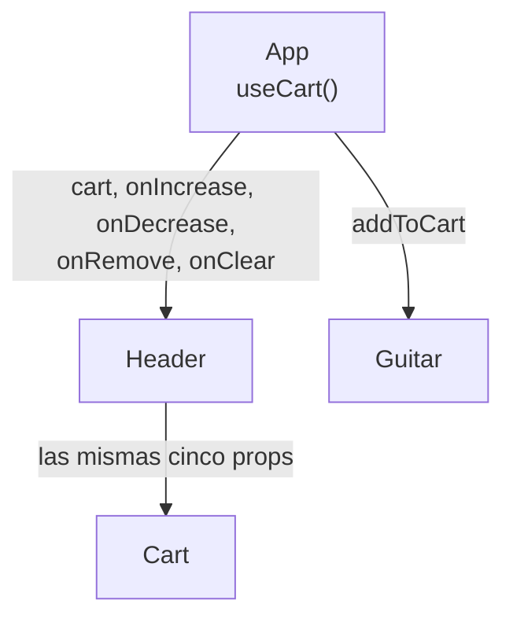
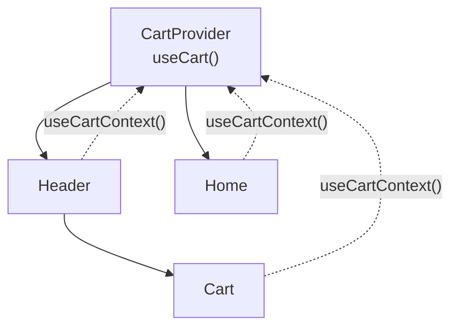
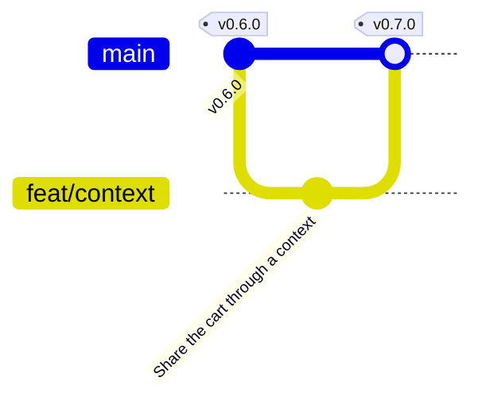

import {
	Aside,
	Card,
	CardGrid,
	FileTree,
	LinkCard,
	Steps,
	TabItem,
	Tabs,
} from "@astrojs/starlight/components";

GuitarLA va a necesitar más páginas, y el carrito tiene que verse en **todas**. Hoy `App` se lo pasa a `Header` a mano, con cinco props que `Header` ni siquiera usa, solo para que lleguen a `Cart`. En esta página el carrito pasa a un **Context**: un dato que cualquier componente lee directamente, sin que nadie se lo pase. Es una fase corta, de un solo commit, pero cambia cómo se prueban y documentan los componentes que dependen del carrito.

<CardGrid stagger>
	<Card title="Context" icon="seti:react">
		Un dato que cualquier componente puede leer sin que se lo pasen por props. El carrito entra en un `CartProvider` y sale con `useCartContext()`.
	</Card>
	<Card title="Proveedores en tests y stories" icon="seti:config">
		Una función `renderWithProviders` para los tests y un decorator global para Storybook: los mismos proveedores que la aplicación, escritos una sola vez.
	</Card>
	<Card title="Rama feat/context" icon="seti:git">
		Un commit, fusión en `main` y release `v0.7.0`.
	</Card>
</CardGrid>

<Aside type="note" title="Requisitos previos">
	Haber completado [El hook useCart](/jjcm/di/units/react/05-cart-hook/): `v0.6.0` en `main`, 31 tests de Vitest y 3 de Playwright en verde. La fase equivalente del repositorio de referencia es [10-project-05](https://github.com/gach24/DID/tree/main/10-project-05).
</Aside>

## Prop drilling y Context

Mira cómo llega hoy el carrito al panel:



`Header` recibe cinco props solo para dárselas a `Cart`. Es **prop drilling**: perforar componentes intermedios con datos que no son suyos. Con un nivel se tolera; con una página de alta que también quiere el carrito en su cabecera, cada componente nuevo entre `App` y `Cart` tendría que repetir las cinco props.

**Context** es la solución de React para datos que necesitan **muchos componentes a distintas profundidades**: el tema, el idioma, el usuario con sesión, el carrito. Tiene tres piezas:

| Pieza | Qué es | En GuitarLA |
| :--- | :--- | :--- |
| `createContext(valorPorDefecto)` | Crea el "canal" por el que viaja el dato | `CartContext` |
| El **proveedor** | Un componente que pone un valor en el canal para todo lo que tenga dentro | `CartProvider`, que llama a `useCart()` y comparte el resultado |
| `useContext(canal)` | Lee el valor del proveedor más cercano por encima | `useCartContext()`, que además comprueba que el proveedor existe |

Con esto `Header` y `Cart` leen el carrito **directamente** y `App` deja de repartirlo:



<Aside type="caution" title="Context no sustituye a las props">
	`Guitar` sigue recibiendo `guitar` y `onAddToCart` por props, y es lo correcto: son datos de **esa** tarjeta, y el componente se puede probar y documentar sin ningún proveedor. Context es para lo que es **global** de verdad. Si cada componente leyera todo de un contexto, ninguno se podría reutilizar fuera de la aplicación.
</Aside>

## La rama de esta fase

```bash
git switch main
git pull
git switch -c feat/context
```



## El carrito en un Context

### El contexto y el proveedor

Van en una carpeta nueva, `src/context/`, en **dos archivos**:

```ts title="src/context/CartContext.ts"
import { createContext, useContext } from 'react';
import type { useCart } from '../hooks';

/** Everything `useCart` returns, shared with the whole app through context. */
export type CartContextValue = ReturnType<typeof useCart>;

export const CartContext = createContext<CartContextValue | null>(null);

/**
 * Reads the cart from the nearest {@link CartProvider}.
 *
 * @throws If there is no `CartProvider` above the component.
 */
export const useCartContext = () => {
  const context = useContext(CartContext);

  if (!context) {
    throw new Error('useCartContext must be used inside a CartProvider');
  }

  return context;
};
```

```tsx title="src/context/CartProvider.tsx"
import type { ReactNode } from 'react';
import { useCart } from '../hooks';
import { CartContext } from './CartContext';

type CartProviderProps = {
  children: ReactNode;
};

/** Creates the single cart of the app and makes it available to its children. */
export const CartProvider = ({ children }: CartProviderProps) => {
  const cart = useCart();

  return <CartContext value={cart}>{children}</CartContext>;
};
```

```ts title="src/context/index.ts"
export * from './CartContext';
export * from './CartProvider';
```

| Pieza | Qué hace |
| :--- | :--- |
| `ReturnType<typeof useCart>` | El tipo de lo que devuelve el hook, sin escribirlo dos veces. Si `useCart` gana una función, el contexto la tiene automáticamente |
| `createContext<… \| null>(null)` | El valor por defecto es `null`: fuera de un proveedor no hay carrito. Es a propósito, para detectar el error |
| `useCartContext` lanza un error | Si alguien usa `Header` sin `CartProvider`, el fallo es inmediato y dice qué falta. Sin esta comprobación, `cart` sería `null` y el error saltaría tres líneas más abajo, con un mensaje peor |
| `<CartContext value={cart}>` | En React 19 el propio contexto es el proveedor. En código anterior verás `<CartContext.Provider value={…}>`; es lo mismo |
| `children` | La prop con **lo que el proveedor envuelve**. Su tipo es `ReactNode`: cualquier cosa que React pueda pintar |
| `useCart()` **una sola vez** | El proveedor es el único que llama al hook. Como cada llamada a `useCart` tiene su propio estado, si `Header` y `Cart` lo llamaran cada uno habría dos carritos distintos |

<Aside type="note" title="Por qué dos archivos">
	Vite recarga en caliente (*Fast Refresh*) los archivos que exportan **solo componentes**. Si un archivo exporta un componente y un hook, ESLint avisa con `react-refresh/only-export-components` y cada cambio en ese archivo recarga la página entera, perdiendo el estado. Por eso el hook y el contexto van en `CartContext.ts` y el componente en `CartProvider.tsx`.
</Aside>

### `Header` y `Cart` leen el contexto

Las props desaparecen y cada componente coge lo que necesita:

```diff lang="tsx" title="src/components/Header/Header.tsx"
 import { useEffect, useState } from 'react';
-import type { CartItem } from '../../types';
+import { useCartContext } from '../../context';
 import { Cart } from '../Cart';

-type HeaderProps = {
-  cart: CartItem[];
-  onIncrease: (id: CartItem['id']) => void;
-  onDecrease: (id: CartItem['id']) => void;
-  onRemove: (id: CartItem['id']) => void;
-  onClear: () => void;
-};
-
-export const Header = ({
-  cart,
-  onIncrease,
-  onDecrease,
-  onRemove,
-  onClear,
-}: HeaderProps) => {
+export const Header = () => {
+  const { cart } = useCartContext();
   const [isCartOpen, setIsCartOpen] = useState(false);
   …
-          <Cart
-            cart={cart}
-            onClose={() => setIsCartOpen(false)}
-            onIncrease={onIncrease}
-            onDecrease={onDecrease}
-            onRemove={onRemove}
-            onClear={onClear}
-          />
+          <Cart onClose={() => setIsCartOpen(false)} />
```

```diff lang="tsx" title="src/components/Cart/Cart.tsx"
+import { useCartContext } from '../../context';
 import { MAX_ITEMS, MIN_ITEMS } from '../../hooks';
-import type { CartItem } from '../../types';

 type CartProps = {
-  cart: CartItem[];
   onClose: () => void;
-  onIncrease: (id: CartItem['id']) => void;
-  onDecrease: (id: CartItem['id']) => void;
-  onRemove: (id: CartItem['id']) => void;
-  onClear: () => void;
 };

-export const Cart = ({
-  cart,
-  onClose,
-  onIncrease,
-  onDecrease,
-  onRemove,
-  onClear,
-}: CartProps) => {
+export const Cart = ({ onClose }: CartProps) => {
+  const {
+    cart,
+    increaseQuantity,
+    decreaseQuantity,
+    removeFromCart,
+    clearCart,
+  } = useCartContext();
   const isEmpty = cart.length === 0;
   …
-                        onClick={() => onDecrease(item.id)}
+                        onClick={() => decreaseQuantity(item.id)}
   …
-                        onClick={() => onIncrease(item.id)}
+                        onClick={() => increaseQuantity(item.id)}
   …
-                      onClick={() => onRemove(item.id)}
+                      onClick={() => removeFromCart(item.id)}
   …
-          onClick={onClear}
+          onClick={clearCart}
```

`onClose` **se queda como prop**: cerrar el panel es cosa de `Header`, que es quien sabe si está abierto. No todo lo que `Cart` recibe pertenece al carrito.

### `App` provee

```tsx title="src/App.tsx"
import { useEffect, useState } from 'react';
import { Footer, Guitar, Header } from './components';
import { db } from './data/db';
import { CartProvider, useCartContext } from './context';

const Catalogue = () => {
  const [guitars] = useState(db);
  const { addToCart } = useCartContext();

  useEffect(() => {
    document.title = `GuitarLA · ${guitars.length} guitarras`;
  }, [guitars]);

  return (
    <main className="mx-auto mt-10 max-w-6xl px-4">
      <h2 className="text-center text-4xl font-black">Nuestra Colección</h2>

      <div className="mt-10 grid grid-cols-1 gap-8 md:grid-cols-2 lg:grid-cols-3">
        {guitars.map((guitar) => (
          <Guitar key={guitar.id} guitar={guitar} onAddToCart={addToCart} />
        ))}
      </div>
    </main>
  );
};

const App = () => {
  return (
    <CartProvider>
      <Header />
      <Catalogue />
      <Footer />
    </CartProvider>
  );
};

export default App;
```

El catálogo pasa a un componente propio, `Catalogue`, por una razón concreta: **`useCartContext` solo funciona dentro del proveedor**, y `App` es quien lo pone. Un componente no puede leer un contexto que él mismo acaba de crear; lo leen sus hijos. En la página siguiente `Catalogue` se convertirá en la página de inicio de la aplicación.

### Probar con proveedores

`Header` y `Cart` ya no se pueden renderizar solos: sin `CartProvider`, `useCartContext` lanza el error. Y los tests de `Cart` ya no pueden comprobar que "se llama a `onIncrease`", porque no hay `onIncrease`: tienen que comprobar **lo que pasa de verdad** al pulsar, que es mejor test.

Para no repetir el proveedor en cada test, una función auxiliar en `src/test/`, junto con los datos de prueba que hasta ahora cada archivo copiaba:

```ts title="src/test/fixtures.ts"
import type { CartItem } from '../types';

/** Two lines of cart used across the tests: 2 × 299 + 1 × 349 = 947. */
export const cartItems: CartItem[] = [
  {
    id: 1,
    name: 'Lukather',
    image: 'guitarra_01',
    description: 'Una guitarra de prueba',
    price: 299,
    quantity: 2,
  },
  {
    id: 2,
    name: 'SRV',
    image: 'guitarra_02',
    description: 'Otra guitarra de prueba',
    price: 349,
    quantity: 1,
  },
];
```

```tsx title="src/test/render.tsx"
import { render, type RenderOptions } from '@testing-library/react';
import type { ReactElement, ReactNode } from 'react';
import { CartProvider } from '../context';
import { CART_STORAGE_KEY } from '../hooks';
import type { CartItem } from '../types';

type Options = RenderOptions & {
  /** Lines the cart starts with; they are written to localStorage first. */
  cart?: CartItem[];
};

/** Renders a component inside the providers of the app, like `App` does. */
export const renderWithProviders = (
  ui: ReactElement,
  { cart = [], ...options }: Options = {}
) => {
  localStorage.setItem(CART_STORAGE_KEY, JSON.stringify(cart));

  const Wrapper = ({ children }: { children: ReactNode }) => (
    <CartProvider>{children}</CartProvider>
  );

  return render(ui, { wrapper: Wrapper, ...options });
};
```

```ts title="src/test/index.ts"
export * from './fixtures';
export * from './render';
```

- **`wrapper`** es una opción de `render`: un componente que envuelve lo que se renderiza. Es la forma oficial de meter proveedores en un test.
- **El carrito inicial se siembra en `localStorage`**: `useCart` lo lee al arrancar, así que es la manera de empezar un test con líneas sin tocar el hook. El `afterEach` de `setupTests.ts` lo limpia después.
- La carpeta `src/test/` no es un componente ni un hook: es **código de apoyo a los tests**, y por eso va aparte.

<Tabs>
	<TabItem label="Cart">
		Sustituye el archivo. Los tests de los botones comprueban ahora cantidades, totales y filas:

		```tsx title="src/components/Cart/Cart.test.tsx"
		import { screen } from '@testing-library/react';
		import userEvent from '@testing-library/user-event';
		import { describe, expect, it, vi } from 'vitest';
		import { cartItems, renderWithProviders } from '../../test';
		import type { CartItem } from '../../types';
		import { Cart } from './Cart';

		const renderCart = (cart: CartItem[] = []) => {
		  const onClose = vi.fn();
		  renderWithProviders(<Cart onClose={onClose} />, { cart });
		  return { onClose };
		};

		const row = (name: string) =>
		  screen.getByRole('cell', { name }).closest('tr')!;

		describe('Cart', () => {
		  it('shows the empty message and disables the clear button', () => {
		    renderCart();
		    expect(screen.getByText('El carrito está vacío')).toBeInTheDocument();
		    expect(screen.queryByRole('table')).not.toBeInTheDocument();
		    expect(
		      screen.getByRole('button', { name: 'Vaciar carrito' })
		    ).toBeDisabled();
		  });

		  it('shows one row per item and the total', () => {
		    renderCart(cartItems);
		    expect(screen.getByRole('cell', { name: 'Lukather' })).toBeInTheDocument();
		    expect(screen.getByRole('cell', { name: 'SRV' })).toBeInTheDocument();
		    expect(screen.getByText('$947')).toBeInTheDocument();
		    expect(
		      screen.getByRole('button', { name: 'Vaciar carrito' })
		    ).toBeEnabled();
		  });

		  it('calls onClose when the close button is clicked', async () => {
		    const user = userEvent.setup();
		    const { onClose } = renderCart();

		    await user.click(screen.getByRole('button', { name: 'Cerrar carrito' }));

		    expect(onClose).toHaveBeenCalledTimes(1);
		  });

		  it('changes the quantity of a line and the total', async () => {
		    const user = userEvent.setup();
		    renderCart(cartItems);

		    await user.click(
		      screen.getByRole('button', { name: 'Añadir una unidad de Lukather' })
		    );
		    expect(row('Lukather')).toHaveTextContent('3');
		    expect(screen.getByText('$1246')).toBeInTheDocument();

		    await user.click(
		      screen.getByRole('button', { name: 'Quitar una unidad de Lukather' })
		    );
		    expect(row('Lukather')).toHaveTextContent('2');
		    expect(screen.getByText('$947')).toBeInTheDocument();
		  });

		  it('disables the decrease button at the minimum quantity', () => {
		    renderCart(cartItems);
		    expect(
		      screen.getByRole('button', { name: 'Quitar una unidad de SRV' })
		    ).toBeDisabled();
		    expect(
		      screen.getByRole('button', { name: 'Quitar una unidad de Lukather' })
		    ).toBeEnabled();
		  });

		  it('disables the increase button at the maximum quantity', () => {
		    renderCart([{ ...cartItems[0], quantity: 5 }]);
		    expect(
		      screen.getByRole('button', { name: 'Añadir una unidad de Lukather' })
		    ).toBeDisabled();
		  });

		  it('removes a line', async () => {
		    const user = userEvent.setup();
		    renderCart(cartItems);

		    await user.click(
		      screen.getByRole('button', { name: 'Eliminar SRV del carrito' })
		    );

		    expect(screen.queryByRole('cell', { name: 'SRV' })).not.toBeInTheDocument();
		    expect(screen.getByText('$598')).toBeInTheDocument();
		  });

		  it('clears the cart', async () => {
		    const user = userEvent.setup();
		    renderCart(cartItems);

		    await user.click(screen.getByRole('button', { name: 'Vaciar carrito' }));

		    expect(screen.getByText('El carrito está vacío')).toBeInTheDocument();
		  });
		});
		```

		`row('Lukather')` busca la celda con ese nombre y sube hasta su fila (`closest('tr')`), para comprobar la cantidad **de esa línea** y no un "3" perdido en otra parte. Es el mismo `within` de la página de props, con otra forma.
	</TabItem>
	<TabItem label="Header">
		```diff lang="tsx" title="src/components/Header/Header.test.tsx"
		-import { render, screen } from '@testing-library/react';
		+import { screen } from '@testing-library/react';
		 import userEvent from '@testing-library/user-event';
		-import { describe, expect, it, vi } from 'vitest';
		+import { describe, expect, it } from 'vitest';
		+import { cartItems, renderWithProviders } from '../../test';
		 import type { CartItem } from '../../types';
		 import { Header } from './Header';

		-const items: CartItem[] = [
		-  …
		-];
		-
		 const renderHeader = (cart: CartItem[] = []) =>
		-  render(
		-    <Header
		-      cart={cart}
		-      onIncrease={vi.fn()}
		-      onDecrease={vi.fn()}
		-      onRemove={vi.fn()}
		-      onClear={vi.fn()}
		-    />
		-  );
		+  renderWithProviders(<Header />, { cart });
		 …
		   it('shows the number of items in the cart', () => {
		-    renderHeader(items);
		+    renderHeader(cartItems);
		```

		Los tests de `App` no cambian: `App` ya lleva el proveedor dentro.
	</TabItem>
</Tabs>

### Documentar con proveedores

Storybook tiene el mismo problema que los tests: `Header` y `Cart` necesitan el proveedor. En lugar de repetirlo en cada archivo de stories, un **decorator global** en `preview.tsx` envuelve **todas** las stories, y lee de `parameters.cart` las líneas con las que debe empezar el carrito:

```diff lang="tsx" title=".storybook/preview.tsx"
 import type { Preview } from '@storybook/react-vite';
+import { CartProvider } from '../src/context';
+import { CART_STORAGE_KEY } from '../src/hooks';

 import '../src/index.css';

 const preview: Preview = {
   tags: ['autodocs'],
+  decorators: [
+    (Story, { parameters }) => {
+      localStorage.setItem(
+        CART_STORAGE_KEY,
+        JSON.stringify(parameters.cart ?? [])
+      );
+      return (
+        <CartProvider>
+          <Story />
+        </CartProvider>
+      );
+    },
+  ],
   parameters: {
```

Las stories de `Cart` y `Header` pierden las props que ya no existen, y `WithItems` pasa sus líneas por `parameters` en vez de por `args`:

```diff lang="tsx" title="src/components/Cart/Cart.stories.tsx"
   args: {
-    cart: [],
     onClose: fn(),
-    onIncrease: fn(),
-    onDecrease: fn(),
-    onRemove: fn(),
-    onClear: fn(),
   },
 …
 export const WithItems: Story = {
-  args: {
+  parameters: {
     cart: [
```

```diff lang="tsx" title="src/components/Header/Header.stories.tsx"
 import type { Meta, StoryObj } from '@storybook/react-vite';
-import { fn } from 'storybook/test';
 import { db } from '../../data/db';
 …
-  args: {
-    cart: [],
-    onIncrease: fn(),
-    onDecrease: fn(),
-    onRemove: fn(),
-    onClear: fn(),
-  },
 } satisfies Meta<typeof Header>;
 …
 export const WithItems: Story = {
-  args: {
+  parameters: {
     cart: [
```

Abre `Cart › WithItems`: ahora los botones `+`, `-` y `X` **funcionan** dentro de Storybook, porque hay un carrito real detrás. Antes solo registraban una llamada en Actions.

### Confirmar

```bash
npx tsc -b
npm run lint
npx vitest run
```

```txt
 Test Files  6 passed (6)
      Tests  32 passed (32)
```

```bash
git add .
git commit -m "Share the cart through a context"
```

## Comprobar, fusionar y publicar

```bash
npm run lint
npm run format:check
npx vitest run
npm run test:e2e
npm run build
```

Los tres tests de Playwright siguen pasando sin tocarlos: prueban la aplicación desde fuera, y por fuera no ha cambiado nada. Es la ventaja de tener tests de extremo a extremo cuando se refactoriza.

```bash
git push
git switch main
git merge --no-ff feat/context -m "Merge feat/context"
git push
git tag -a v0.7.0 -m "Cart shared through a context"
git push origin v0.7.0
gh release create v0.7.0 --title "v0.7.0 · Context" --notes "Cart shared through CartProvider and useCartContext, Header and Cart without cart props, providers in tests and Storybook."
git branch -d feat/context
git push origin --delete feat/context
```

## Comprobación final

<Steps>
	1. `Header` y `Cart` no reciben ninguna prop del carrito; `App` tiene el proveedor y el catálogo, y la aplicación se ve y funciona exactamente igual que en `v0.6.0`.
	2. `src/context/` tiene el contexto con su hook en un archivo y el proveedor en otro; `src/test/` tiene la función de render y los datos de prueba.
	3. En Storybook, `Cart › WithItems` y `Header › WithItems` muestran el carrito con líneas y los botones del panel funcionan de verdad.
	4. `npx vitest run` ejecuta 32 tests en 6 archivos; `npm run test:e2e`, 3; `lint`, `format:check` y `build` pasan.
	5. En GitHub existe la release `v0.7.0`.
</Steps>

## 🧩 Aplicación en el proyecto

Proveedor arriba y hooks de contexto abajo es el patrón para todo dato global de una aplicación React: el usuario con sesión, el tema, el idioma, los filtros de un panel. En la app de informes habrá un `AuthProvider` para el usuario y un `ReportsProvider` o un hook con los datos, con la misma estructura de dos archivos y el mismo hook que lanza error sin proveedor. Y el par `renderWithProviders` en los tests y decorator global en Storybook se copia tal cual en cada proyecto.

## Resumen rápido

| Concepto | Detalle |
| :--- | :--- |
| **Prop drilling** | Pasar props por componentes que no las usan; tolerable un nivel, no más |
| **Context** | `createContext(null)` + proveedor que llama al hook una vez + `useXContext()` que comprueba el proveedor |
| **Dos archivos** | Contexto y hook en `.ts`, proveedor en `.tsx`, por Fast Refresh |
| **Qué va en Context** | Lo global (carrito, usuario, tema); lo de cada componente sigue en props |
| **Leer el contexto** | Solo los hijos del proveedor; por eso el catálogo sale de `App` a `Catalogue` |
| **Probar** | `renderWithProviders(ui, { cart })` con `wrapper`; el carrito inicial se siembra en `localStorage` |
| **Documentar** | Decorator global en `preview.tsx` que lee `parameters.cart` |

## Convención práctica

<Steps>
	1. **Un contexto por dato global**, en `src/context/`, con su proveedor en archivo aparte y un hook `useXContext` que lanza error sin proveedor.
	2. **El proveedor es el único que llama al hook de estado**; los componentes leen el contexto.
	3. **Lo que es de un componente sigue en props** (`guitar`, `onAddToCart`, `onClose`); Context es para lo que necesitan muchos componentes a distintas profundidades.
	4. **Los tests comprueban lo que pasa, no a quién se llama**: con el contexto real detrás, un clic cambia cantidades y totales.
	5. **Una función `renderWithProviders`** y un decorator global con los mismos proveedores que `App`.
</Steps>

## Referencias

<CardGrid stagger>
	<LinkCard
		href="https://react.dev/learn/passing-data-deeply-with-context"
		title="Pasar datos en profundidad con Context (React)"
		description="Cuándo usar Context, cuándo no, y cómo combinarlo con un reducer."
		target="_blank"
		rel="noopener noreferrer"
	/>
	<LinkCard
		href="https://react.dev/reference/react/createContext"
		title="createContext (React)"
		description="La referencia: valor por defecto, proveedor y lectura con useContext."
		target="_blank"
		rel="noopener noreferrer"
	/>
	<LinkCard
		href="https://testing-library.com/docs/react-testing-library/setup#custom-render"
		title="Custom render (Testing Library)"
		description="Una función render propia con los proveedores de la aplicación."
		target="_blank"
		rel="noopener noreferrer"
	/>
	<LinkCard
		href="https://storybook.js.org/docs/writing-stories/decorators#global-decorators"
		title="Decorators globales (Storybook)"
		description="Envolver todas las stories con proveedores desde preview."
		target="_blank"
		rel="noopener noreferrer"
	/>
</CardGrid>

## Siguientes pasos

<CardGrid>
	<LinkCard
		href="/jjcm/di/units/react/07-router/"
		title="Rutas con React Router"
		description="La aplicación dividida en páginas, con el detalle de cada guitarra cargado por un loader, en la rama feat/router."
	/>
	<LinkCard
		href="/jjcm/di/units/documentation/storybook/03-addons-and-docs/#decorators"
		title="Decorators (Storybook)"
		description="Más sobre los decorators, por story y globales."
	/>
</CardGrid>
