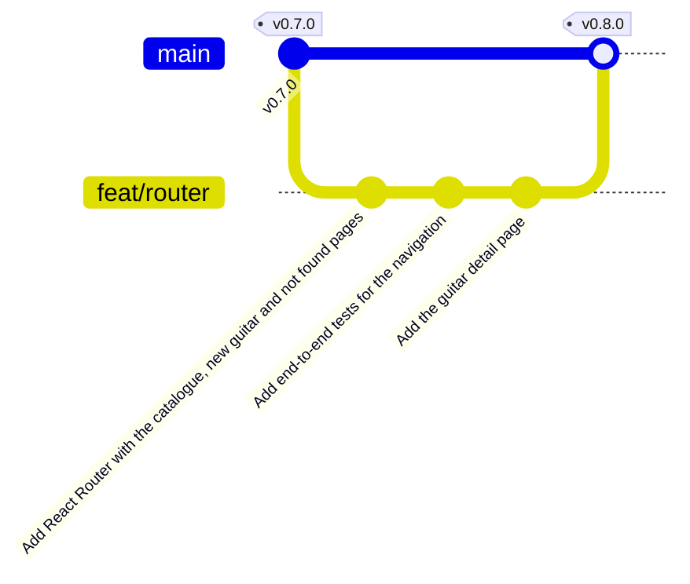

import {
	Aside,
	Card,
	CardGrid,
	FileTree,
	LinkCard,
	Steps,
	TabItem,
	Tabs,
} from "@astrojs/starlight/components";
import { Image } from "astro:assets";
import newGuitar from "../../../../assets/react/router-new-guitar.png";
import notFound from "../../../../assets/react/router-not-found.png";
import guitarDetail from "../../../../assets/react/router-guitar-detail.png";

GuitarLA necesita más páginas: el detalle de cada guitarra, con su descripción completa, y la de alta, con su formulario. Pero una aplicación React tiene **un solo HTML**: para que `/guitars/3` muestre otra cosa que `/` hace falta un **router** que decida qué componente pintar según la URL. En esta página la aplicación se divide en páginas con React Router, y la primera que carga datos lo hace con un `loader`, que es lo que el catálogo usará para hablar con Supabase.

<CardGrid stagger>
	<Card title="React Router" icon="seti:config">
		Rutas que eligen qué componente se muestra según la URL, sin recargar la página. En **modo data**, el que después cargará las guitarras y recibirá el formulario de alta.
	</Card>
	<Card title="Loader" icon="seti:db">
		Una función que carga los datos de una ruta antes de pintarla. El detalle de cada guitarra es el primero.
	</Card>
	<Card title="Una página es una página" icon="approve-check">
		Cada ruta tiene su `h1` y su título de pestaña, para que un cambio de ruta sea un cambio de página también para quien no ve la pantalla.
	</Card>
	<Card title="Rama feat/router" icon="seti:git">
		Tres commits, fusión en `main` y release `v0.8.0`.
	</Card>
</CardGrid>

<Aside type="note" title="Requisitos previos">
	Haber completado [Context](/jjcm/di/units/react/06-context/): `v0.7.0` en `main`, 32 tests de Vitest y 3 de Playwright en verde. El carrito ya se lee con `useCartContext` y existen `renderWithProviders` y el decorator global de Storybook, que aquí ganan el router. La fase equivalente del repositorio de referencia es [11-project-06](https://github.com/gach24/DID/tree/main/11-project-06).
</Aside>

## La rama de esta fase

```bash
git switch main
git pull
git switch -c feat/router
```



## Un router en el cliente

### Qué hace y qué modos tiene

Vite sirve un único `index.html`. Cuando el usuario escribe `/guitars/new`, el servidor de desarrollo devuelve ese mismo HTML y React arranca igual que en `/`. Un **router en el cliente** mira la URL y decide qué componente pintar; al pulsar un enlace, cambia la URL **sin recargar** (con la API `history` del navegador) y vuelve a decidir. Para el usuario es una web normal: tiene direcciones, botón atrás y marcadores; para React es un estado más.

```bash
npm i react-router
```

El paquete se llama `react-router` a secas (hasta la versión 6 era `react-router-dom`). Se puede usar de tres formas, y conviene saber cuál se elige y por qué:

| Modo | Cómo se declaran las rutas | Qué aporta |
| :--- | :--- | :--- |
| **Declarativo** | Componentes `<Routes>` y `<Route>` dentro de la app | Solo enrutado: qué componente va en cada URL |
| **Data** | Objetos de ruta en `createBrowserRouter`, fuera del árbol de React | Además, **cargar datos** antes de pintar (`loader`), **recibir formularios** (`action`), estados de carga y errores por ruta |
| **Framework** | Archivos en `app/routes/` con Vite y el plugin de React Router | Todo lo anterior más renderizado en servidor, división de código y tipos generados |

GuitarLA usa el **modo data**. Hoy solo se nota en cómo se escriben las rutas, pero es lo que permitirá que la página del catálogo pida las guitarras a Supabase en su `loader`, que la de alta reciba el formulario en su `action`, y que un fallo al cargar llegue a una página de error en vez de a una pantalla en blanco. Es el modo que usa el [proyecto de referencia](https://github.com/gach24/DID/tree/main/11-project-06/frontend-guitars-app).

### El layout y las páginas

Las tres páginas comparten cabecera y pie. En React Router eso es una **ruta de layout**: un componente que pinta lo común y un `<Outlet />` donde va la página activa. El layout no es una página, así que tiene su propia carpeta, `src/layouts/`; las páginas van en `src/pages/`. Y la regla de los componentes se aplica también a las páginas: **una carpeta por página**, con su `index.ts`, y un índice en cada carpeta padre que las reexporta. Los loaders se agrupan **por entidad**: todos los que cargan guitarras viven en `src/loaders/guitarLoaders/`, cada uno en su archivo, con su `index.ts`. El layout y los hooks son archivos sueltos en su carpeta. En los bloques siguientes solo se muestra el archivo principal de cada una; los `index.ts` son todos de una línea:

<FileTree>
- src/
	- layouts/
		- Layout.tsx proveedor del carrito, cabecera, main con Outlet, pie
		- index.ts
	- pages/
		- Home/
			- Home.tsx el catálogo, antes Catalogue en App
			- index.ts
		- NewGuitar/ de momento, un título
		- NotFound/ la página 404
		- RouteError/ la página de error de una ruta, con su test
		- index.ts reexporta cada carpeta
	- hooks/
		- useDocumentTitle.ts nuevo
		- …
	- loaders/
		- guitarLoaders/ llega con la página de detalle
	- router.tsx las rutas y el router; sustituye a App.tsx
	- router.test.tsx antes App.test.tsx
	- router.stories.tsx antes App.stories.tsx
</FileTree>

```ts title="src/hooks/useDocumentTitle.ts"
import { useEffect } from 'react';

/**
 * Keeps the title of the browser tab in sync with the page being shown.
 *
 * @param title - The full title, including the name of the app.
 */
export const useDocumentTitle = (title: string) => {
  useEffect(() => {
    document.title = title;
  }, [title]);
};
```

```diff lang="ts" title="src/hooks/index.ts"
 export * from './useCart';
+export * from './useDocumentTitle';
```

El efecto que ponía el título estaba en `App`; ahora cada página tiene el suyo, así que se convierte en un hook de una línea que todas reutilizan.

```tsx title="src/layouts/Layout.tsx"
import { Outlet } from 'react-router';
import { Footer, Header } from '../components';
import { CartProvider } from '../context';

export const Layout = () => {
  return (
    <CartProvider>
      <Header />
      <main className="mx-auto mt-10 max-w-6xl px-4">
        <Outlet />
      </main>
      <Footer />
    </CartProvider>
  );
};
```

| Pieza | Qué hace |
| :--- | :--- |
| `<CartProvider>` | El proveedor se muda de `App` al layout: todas las páginas cuelgan de él, así que todas tienen carrito. `App.tsx` desaparece en este commit |
| `<Outlet />` | El hueco donde React Router pinta la ruta hija activa: `Home`, `NewGuitar` o `NotFound` |
| `<main>` en el layout | Las clases del contenedor suben aquí desde `App`; cada página devuelve solo su contenido |

<Aside type="note" title="Un cambio de ruta tiene que parecer un cambio de página">
	En una web tradicional, cada enlace carga una página nueva: el navegador lo anuncia, cambia el título de la pestaña y el lector de pantalla empieza por el título. En una aplicación React el enlace solo cambia unos componentes dentro del mismo documento, y nada de eso ocurre solo. Por eso cada página se ocupa de **su título de pestaña** (`useDocumentTitle`) y de **su `h1`**: son lo mínimo para que quien usa lector de pantalla sepa dónde está. Queda un detalle para más adelante, mover el foco al contenido nuevo al cambiar de ruta; lo explica [cambiar de página en una aplicación](/jjcm/di/units/ux/fundamentals/01-introduction/#cambiar-de-página-en-una-aplicación) en la unidad de usabilidad.
</Aside>

```tsx title="src/pages/Home/Home.tsx"
import { useState } from 'react';
import { Guitar } from '../../components';
import { useCartContext } from '../../context';
import { db } from '../../data/db';
import { useDocumentTitle } from '../../hooks';

export const Home = () => {
  const [guitars] = useState(db);
  const { addToCart } = useCartContext();

  useDocumentTitle(`GuitarLA · ${guitars.length} guitarras`);

  return (
    <>
      <h1 className="text-center text-4xl font-black">Nuestra Colección</h1>

      <div className="mt-10 grid grid-cols-1 gap-8 md:grid-cols-2 lg:grid-cols-3">
        {guitars.map((guitar) => (
          <Guitar key={guitar.id} guitar={guitar} onAddToCart={addToCart} />
        ))}
      </div>
    </>
  );
};
```

```tsx title="src/pages/NewGuitar/NewGuitar.tsx"
import { useDocumentTitle } from '../../hooks';

export const NewGuitar = () => {
  useDocumentTitle('Nueva guitarra · GuitarLA');

  return (
    <>
      <h1 className="text-center text-4xl font-black">Nueva guitarra</h1>
      <p className="mt-6 text-center text-gray-600">
        El formulario de alta llegará en la página siguiente.
      </p>
    </>
  );
};
```

```tsx title="src/pages/NotFound/NotFound.tsx"
import { Link } from 'react-router';
import { useDocumentTitle } from '../../hooks';

export const NotFound = () => {
  useDocumentTitle('Página no encontrada · GuitarLA');

  return (
    <div className="text-center">
      <h1 className="text-4xl font-black">Página no encontrada</h1>
      <p className="mt-6 text-gray-600">
        La dirección que has escrito no existe en GuitarLA.
      </p>
      <Link
        to="/"
        className="mt-6 inline-block rounded bg-gray-900 px-6 py-3 font-bold text-white uppercase transition hover:bg-gray-700 focus-visible:outline-2 focus-visible:outline-offset-2 focus-visible:outline-blue-600"
      >
        Volver al catálogo
      </Link>
    </div>
  );
};
```

Y una página más, para cuando algo falle **dentro** de una ruta: un `loader` que no consigue los datos (llegará con Supabase) o un componente que lanza un error. Sin ella, React Router muestra su propia pantalla de error, en inglés y sin estilo.

```tsx title="src/pages/RouteError/RouteError.tsx"
import { isRouteErrorResponse, Link, useRouteError } from 'react-router';
import { useDocumentTitle } from '../../hooks';

export const RouteError = () => {
  const error = useRouteError();
  useDocumentTitle('Algo ha fallado · GuitarLA');

  const message = isRouteErrorResponse(error)
    ? `${error.status} ${error.statusText}`
    : error instanceof Error
      ? error.message
      : 'Error desconocido';

  return (
    <div className="text-center">
      <h1 className="text-4xl font-black">Algo ha fallado</h1>
      <p className="mt-6 text-gray-600">{message}</p>
      <Link
        to="/"
        className="mt-6 inline-block rounded bg-gray-900 px-6 py-3 font-bold text-white uppercase transition hover:bg-gray-700 focus-visible:outline-2 focus-visible:outline-offset-2 focus-visible:outline-blue-600"
      >
        Volver al catálogo
      </Link>
    </div>
  );
};
```

`useRouteError()` devuelve lo que se lanzó, de tipo `unknown` porque puede ser cualquier cosa: una respuesta HTTP (`isRouteErrorResponse`), un `Error` normal o algo raro. Las tres ramas lo convierten en un texto que la persona pueda leer.

```ts title="src/layouts/index.ts"
export * from './Layout';
```

Cada carpeta de `src/pages/` tiene su `index.ts` de una línea (`export * from './Home';`, etcétera), y el índice general las reexporta:

```ts title="src/pages/index.ts"
export * from './Home';
export * from './NewGuitar';
export * from './NotFound';
export * from './RouteError';
```

- El `<main>` con sus clases ha subido al layout; cada página devuelve solo su contenido.
- **Cada página tiene un `<h1>`**. El título del catálogo era un `h2` porque la cabecera no tiene ningún `h1` visible; ahora que hay varias páginas, cada una empieza por su `h1`, y el lector de pantalla puede saltar a él. Eso obliga a un cambio en `Guitar`: el nombre de cada tarjeta pasa de `h3` a `h2`, porque no puede haber un salto de `h1` a `h3`.
- `NotFound` y `RouteError` ofrecen una **salida**: un enlace al catálogo. Una página de error sin salida deja al usuario atascado.

```diff lang="tsx" title="src/components/Guitar/Guitar.tsx"
-        <h3 className="text-2xl font-bold text-black uppercase">{name}</h3>
+        <h2 className="text-2xl font-bold text-black uppercase">{name}</h2>
```

### Las rutas

En modo data las rutas son **objetos**, y viven fuera de los componentes. `App.tsx` se borra y en su lugar hay un `router.tsx`:

```tsx title="src/router.tsx"
import { createBrowserRouter, type RouteObject } from 'react-router';
import { Layout } from './layouts';
import { Home, NewGuitar, NotFound, RouteError } from './pages';

/** The routes of GuitarLA: a layout with the header and footer, and its pages. */
export const routes: RouteObject[] = [
  {
    Component: Layout,
    ErrorBoundary: RouteError,
    children: [
      { index: true, Component: Home },
      { path: 'guitars/new', Component: NewGuitar },
      { path: '*', Component: NotFound },
    ],
  },
];

export const router = createBrowserRouter(routes);
```

| Pieza | Qué hace |
| :--- | :--- |
| `RouteObject[]` | El tipo de una lista de rutas. Cada objeto puede tener `path`, `Component`, `loader`, `action`, `ErrorBoundary`, `children`… |
| La ruta sin `path` | Una **ruta de layout**: no añade nada a la URL, solo envuelve a sus hijas con `Layout` |
| `index: true` | La hija que se muestra en la URL del padre, aquí `/` |
| `path: 'guitars/new'` | Relativa al padre; como el padre no tiene `path`, equivale a `/guitars/new` |
| `path: '*'` | Comodín: cualquier URL que no haya coincidido antes. Siempre la última |
| `ErrorBoundary: RouteError` | Si cualquier ruta de dentro lanza un error, se pinta `RouteError` **en el hueco del `Outlet`**, con la cabecera y el pie intactos |
| `routes` y `router` separados | `routes` es la descripción, y la reutilizarán los tests y Storybook con un router de memoria; `router` es el de verdad, el que lee la URL del navegador |

<Aside type="note" title="`Component` y `element`">
	Un objeto de ruta admite `Component: Home` o `element: <Home />`. Son equivalentes; `Component` es más corto cuando no hay que pasar props. En el proyecto de referencia verás `element`.
</Aside>

El router se monta con `RouterProvider` en `main.tsx`, que deja de conocer `App`:

```diff lang="tsx" title="src/main.tsx"
 import { StrictMode } from 'react';
 import { createRoot } from 'react-dom/client';
+import { RouterProvider } from 'react-router';
 import './index.css';
-import App from './App.tsx';
+import { router } from './router';

 createRoot(document.getElementById('root')!).render(
   <StrictMode>
-    <App />
+    <RouterProvider router={router} />
   </StrictMode>
 );
```

Borra `src/App.tsx`, `src/App.test.tsx` y `src/App.stories.tsx`: sus sustitutos aparecen en los apartados de probar y documentar.

### Enlaces en la cabecera

```diff lang="tsx" title="src/components/Header/Header.tsx"
 import { useEffect, useState } from 'react';
+import { Link, NavLink } from 'react-router';
 import { useCartContext } from '../../context';
 …
-        <a href="/" className="w-2/3 md:w-1/4">
+        <Link to="/" className="w-2/3 md:w-1/4">
           
-        </a>
+        </Link>

-        <nav className="flex justify-end md:mt-10 md:w-1/2">
+        <nav className="flex items-center justify-end gap-6 md:mt-10 md:w-1/2">
+          <NavLink
+            to="/guitars/new"
+            className="font-bold text-white uppercase underline-offset-4 transition hover:underline focus-visible:outline-2 focus-visible:outline-offset-4 focus-visible:outline-white aria-[current=page]:underline"
+          >
+            Añadir guitarra
+          </NavLink>
           <div className="relative">
```

| Pieza | Qué hace |
| :--- | :--- |
| `<Link to="/">` | Un `<a href="/">` que navega sin recargar. Renderiza un `<a>` de verdad: se puede abrir en otra pestaña, copiar la dirección y encontrar con `getByRole('link')` |
| `<NavLink>` | Un `Link` que sabe si **su ruta es la activa**. Cuando lo es, añade `aria-current="page"` al enlace |
| `aria-[current=page]:underline` | El subrayado del enlace activo se deriva del atributo accesible, como el borde rojo de los campos con `aria-invalid` en los formularios. El lector anuncia "página actual" y la vista ve el subrayado, desde el mismo dato |

<Image src={newGuitar} alt="GuitarLA en /guitars/new: la cabecera con el enlace Añadir guitarra subrayado y el icono del carrito, y debajo el título Nueva guitarra con un texto provisional" />

<Image src={notFound} alt="GuitarLA en una dirección inexistente: título Página no encontrada, un texto y el botón Volver al catálogo" />

Prueba en el navegador: pulsa "Añadir guitarra", mira la URL y el título de la pestaña, pulsa atrás, escribe una dirección inventada.

### Probar

Los tests necesitan un router, igual que en la página anterior necesitaban el proveedor. `createMemoryRouter` crea un router **que no toca la URL del navegador**: empieza en la ruta que le digas y guarda el historial en memoria. La auxiliar cambia, y gana una segunda función para la aplicación entera:

```tsx title="src/test/render.tsx"
import { render } from '@testing-library/react';
import type { ReactElement } from 'react';
import { createMemoryRouter, RouterProvider } from 'react-router';
import { CartProvider } from '../context';
import { CART_STORAGE_KEY } from '../hooks';
import { routes } from '../router';
import type { CartItem } from '../types';

type Options = {
  /** Lines the cart starts with; they are written to localStorage first. */
  cart?: CartItem[];
  /** The URL the router starts at. */
  route?: string;
};

/**
 * Renders a component inside the providers of the app: a router in memory
 * and the cart, like `Layout` does for every page.
 */
export const renderWithProviders = (
  ui: ReactElement,
  { cart = [], route = '/' }: Options = {}
) => {
  localStorage.setItem(CART_STORAGE_KEY, JSON.stringify(cart));

  const router = createMemoryRouter(
    [{ path: '*', element: <CartProvider>{ui}</CartProvider> }],
    { initialEntries: [route] }
  );

  return render(<RouterProvider router={router} />);
};

/** Renders the whole app, with its real routes, starting at `route`. */
export const renderApp = (route = '/') => {
  const router = createMemoryRouter(routes, { initialEntries: [route] });

  return render(<RouterProvider router={router} />);
};
```

- **`renderWithProviders`** mete el componente en una única ruta comodín, dentro del proveedor: es lo que `Header` y `Cart` necesitan para sus `Link`. Sus tests no cambian.
- **`renderApp`** monta **las rutas reales** en un router de memoria. Es el sustituto de `render(<App />)`.
- Importar `routes` desde `router.tsx` no crea ningún router de navegador: `createBrowserRouter` se ejecuta al importar, pero jsdom lo tolera y no se usa.

`App.test.tsx` pasa a llamarse `router.test.tsx`; cambia la cabecera, los `render(<App />)` por `renderApp()`, y añade los dos tests de navegación:

```diff lang="tsx" title="src/router.test.tsx"
-import { render, screen, within } from '@testing-library/react';
+import { screen, within } from '@testing-library/react';
 import userEvent from '@testing-library/user-event';
 import { describe, expect, it } from 'vitest';
-import App from './App';
+import { renderApp } from './test';

-describe('App', () => {
+describe('Routes', () => {
   it('shows the collection title', () => {
-    render(<App />);
+    renderApp();
 …
+
+  it('navigates to the new guitar page from the header', async () => {
+    const user = userEvent.setup();
+    renderApp();
+
+    await user.click(screen.getByRole('link', { name: 'Añadir guitarra' }));
+
+    expect(
+      screen.getByRole('heading', { name: 'Nueva guitarra' })
+    ).toBeInTheDocument();
+    expect(
+      screen.getByRole('link', { name: 'Añadir guitarra' })
+    ).toHaveAttribute('aria-current', 'page');
+    expect(document.title).toBe('Nueva guitarra · GuitarLA');
+  });
+
+  it('shows the not found page for an unknown route', () => {
+    renderApp('/no-existe');
+
+    expect(
+      screen.getByRole('heading', { name: 'Página no encontrada' })
+    ).toBeInTheDocument();
+    expect(
+      screen.getByRole('link', { name: 'Volver al catálogo' })
+    ).toHaveAttribute('href', '/');
+  });
 });
```

El test de navegación comprueba las tres cosas que convierten un cambio de ruta en un cambio de página: el contenido nuevo, el enlace marcado como actual y el título de la pestaña.

La página de error tiene un problema distinto: ninguna ruta real de la aplicación falla todavía, así que `renderApp` no sirve para llegar hasta `RouteError`. En vez de forzar un fallo en el código de producción, el test **se construye su propio router** con `createMemoryRouter`, igual que hace `renderApp` por dentro, pero con una única ruta hecha a medida que falla a propósito.

Para que falle usa un `loader`, que es la primera vez que aparece en la unidad. Un `loader` es una función que se asocia a una ruta y que React Router ejecuta **antes de pintar su componente**; su objetivo normal es cargar los datos que la página necesita (en la página de detalle cargará una guitarra por su `id`, y en el siguiente apartado los pedirá a Supabase). Si el `loader` lanza un error, React Router no pinta el componente de la ruta: busca el `ErrorBoundary` más cercano hacia arriba y pinta ese en su lugar. Aquí el más cercano es el del layout, así que lo que aparece es `RouteError` dentro del `Outlet`, con cabecera y pie intactos.

El test, por tanto, no necesita que exista un componente para la ruta (fíjate en que la ruta hija solo tiene `index` y `loader`): lanza desde el `loader`, y comprueba que `RouteError` muestra el mensaje del error y un enlace de vuelta al catálogo.

```tsx title="src/pages/RouteError/RouteError.test.tsx"
import { render, screen } from '@testing-library/react';
import { createMemoryRouter, RouterProvider } from 'react-router';
import { describe, expect, it } from 'vitest';
import { Layout } from '../../layouts';
import { RouteError } from './RouteError';

describe('RouteError', () => {
  it('shows the error of a loader and a way back to the catalogue', async () => {
    const router = createMemoryRouter([
      {
        Component: Layout,
        ErrorBoundary: RouteError,
        children: [
          {
            index: true,
            loader: () => {
              throw new Error('No se ha podido cargar el catálogo');
            },
          },
        ],
      },
    ]);

    render(<RouterProvider router={router} />);

    expect(
      await screen.findByRole('heading', { name: 'Algo ha fallado' })
    ).toBeInTheDocument();
    expect(
      screen.getByText('No se ha podido cargar el catálogo')
    ).toBeInTheDocument();
    expect(
      screen.getByRole('link', { name: 'Volver al catálogo' })
    ).toHaveAttribute('href', '/');
  });
});
```

`findByRole` en vez de `getByRole`: un router con `loader` pinta **de forma asíncrona**, cuando el loader termina (o falla), así que hay que esperar. Es lo que harán todos los tests del catálogo cuando los datos vengan de Supabase.

### Documentar

El decorator global de la página anterior gana el router, para que `Header` pueda pintar sus enlaces en Storybook. Como en los tests, cada story va dentro de una ruta comodín:

```diff lang="tsx" title=".storybook/preview.tsx"
 import type { Preview } from '@storybook/react-vite';
+import { createMemoryRouter, RouterProvider } from 'react-router';
 import { CartProvider } from '../src/context';
 …
     (Story, { parameters }) => {
       localStorage.setItem(
         CART_STORAGE_KEY,
         JSON.stringify(parameters.cart ?? [])
       );
-      return (
-        <CartProvider>
-          <Story />
-        </CartProvider>
-      );
+
+      if (parameters.router === false) return <Story />;
+
+      const router = createMemoryRouter([
+        {
+          path: '*',
+          element: (
+            <CartProvider>
+              <Story />
+            </CartProvider>
+          ),
+        },
+      ]);
+      return <RouterProvider router={router} />;
     },
```

`parameters.router === false` es para la única story que trae **su propio** router: la de la aplicación completa, que sustituye a `App.stories.tsx`. Dos routers anidados son un error, así que esa story pide que el decorator no la envuelva:

```tsx title="src/router.stories.tsx"
import type { Meta, StoryObj } from '@storybook/react-vite';
import { createMemoryRouter, RouterProvider } from 'react-router';
import { routes } from './router';

const App = ({ route }: { route: string }) => (
  <RouterProvider
    router={createMemoryRouter(routes, { initialEntries: [route] })}
  />
);

const meta = {
  title: 'App',
  component: App,
  parameters: {
    layout: 'fullscreen',
    router: false,
  },
  args: {
    route: '/',
  },
} satisfies Meta<typeof App>;

export default meta;
type Story = StoryObj<typeof meta>;

export const Catalogue: Story = {};

export const NewGuitar: Story = {
  args: { route: '/guitars/new' },
};

export const NotFound: Story = {
  args: { route: '/no-existe' },
};
```

Una story por página: `App › Catalogue`, `App › NewGuitar` y `App › NotFound`, y en cualquiera de ellas se puede navegar pulsando los enlaces. `title: 'App'` mantiene el nombre que tenía en el lateral.

### Confirmar

```txt
 Test Files  7 passed (7)
      Tests  35 passed (35)
```

```bash
git add .
git commit -m "Add React Router with the catalogue, new guitar and not found pages"
```

## Probar la navegación de extremo a extremo

Tres cosas que solo se pueden comprobar en un navegador real: que la URL cambia, que una página **se abre directamente** por su dirección, y que la 404 pasa la auditoría de axe.

```ts title="e2e/navigation.spec.ts"
import AxeBuilder from '@axe-core/playwright';
import { expect, test } from '@playwright/test';

test.describe('Navigation', () => {
  test('goes to the new guitar page from the header and back', async ({
    page,
  }) => {
    await page.goto('/');

    const link = page.getByRole('link', { name: 'Añadir guitarra' });
    await link.click();

    await expect(page).toHaveURL('/guitars/new');
    await expect(page).toHaveTitle('Nueva guitarra · GuitarLA');
    await expect(
      page.getByRole('heading', { name: 'Nueva guitarra' })
    ).toBeVisible();
    await expect(link).toHaveAttribute('aria-current', 'page');

    await page.getByRole('link', { name: 'Logotipo de GuitarLA' }).click();
    await expect(page).toHaveURL('/');
    await expect(
      page.getByRole('heading', { name: 'Nuestra Colección' })
    ).toBeVisible();
  });

  test('opens a page directly from its URL and keeps the cart', async ({
    page,
  }) => {
    await page.goto('/');
    await page
      .getByRole('button', { name: 'Agregar al carrito Lukather' })
      .click();

    await page.goto('/guitars/new');

    await expect(
      page.getByRole('heading', { name: 'Nueva guitarra' })
    ).toBeVisible();
    await expect(page.getByText('1 artículos en el carrito')).toBeAttached();
  });

  test('shows the not found page for an unknown URL', async ({ page }) => {
    await page.goto('/esta-pagina-no-existe');

    await expect(
      page.getByRole('heading', { name: 'Página no encontrada' })
    ).toBeVisible();

    const results = await new AxeBuilder({ page }).analyze();
    expect(results.violations).toEqual([]);

    await page.getByRole('link', { name: 'Volver al catálogo' }).click();
    await expect(page).toHaveURL('/');
  });
});
```

- **`toHaveURL` y `toHaveTitle`** son aserciones sobre la página, no sobre un elemento.
- **`page.goto('/guitars/new')`** carga la dirección desde cero, como quien la escribe o llega desde un marcador. Funciona porque el servidor de Vite devuelve `index.html` para cualquier ruta; cuando la aplicación se despliegue habrá que decirle lo mismo al servidor de producción, y es uno de los pasos de la página de despliegue.
- El test comprueba de paso que **el carrito sobrevive** al cambio de página: vive en `localStorage` y en el proveedor, no en la página.

```bash
npm run test:e2e
```

Al ejecutarlo, el test de accesibilidad del carrito, que ya existía, **falla**: axe encuentra `heading-order` en las tarjetas. Es el salto de `h1` a `h3` del que hablaba el apartado de las páginas; si hiciste el cambio a `h2` en `Guitar`, pasa. Si no, es el momento. Es la tercera vez que una auditoría automática encuentra algo que a la vista no se nota, y por eso está en la suite.

```txt
  6 passed (4.7s)
```

```bash
npm run lint
npm run format:check
git add .
git commit -m "Add end-to-end tests for the navigation"
```

## La página de detalle

Cada guitarra merece su propia dirección, `/guitars/3`, con la descripción completa y el botón de comprar. Es la primera ruta **con un dato en la URL** y la primera que carga sus datos con un `loader` de verdad: lo que en la página siguiente hará una consulta a Supabase, hoy lo hace una búsqueda en `db.ts`.

### El loader

Un `loader` es una función que React Router ejecuta **antes de pintar la ruta**. Recibe los parámetros de la URL y devuelve los datos; el componente los lee con `useLoaderData`. Van en una carpeta propia, `src/loaders/`, porque no son componentes ni hooks, agrupados por la entidad que cargan: este es el primero de los loaders de guitarras, y en la página siguiente llegará el del catálogo a la misma carpeta:

```ts title="src/loaders/guitarLoaders/guitarLoader.ts"
import { data, type LoaderFunctionArgs } from 'react-router';
import { db } from '../../data/db';
import type { Guitar } from '../../types';

/**
 * Finds the guitar whose id is in the URL (`/guitars/:id`).
 *
 * @throws A 404 response when there is no guitar with that id, so the
 * route shows the not found page.
 */
export const guitarLoader = ({ params }: LoaderFunctionArgs): Guitar => {
  const guitar = db.find((item) => item.id === Number(params.id));

  if (!guitar) {
    throw data(`No existe ninguna guitarra con el id ${params.id}.`, {
      status: 404,
    });
  }

  return guitar;
};
```

```ts title="src/loaders/guitarLoaders/index.ts"
export * from './guitarLoader';
```

```ts title="src/loaders/index.ts"
export * from './guitarLoaders';
```

| Pieza | Qué hace |
| :--- | :--- |
| `params.id` | El trozo de la URL que ocupa `:id` en la ruta. Llega como **texto**, por eso `Number(params.id)` |
| `LoaderFunctionArgs` | El tipo del argumento que React Router pasa a todo loader: `params`, `request` y `context` |
| `throw data(mensaje, { status: 404 })` | Un loader puede **lanzar** una respuesta. React Router la captura y pinta el `ErrorBoundary` más cercano, con el mensaje y el código dentro |

### La ruta y el componente

```diff lang="tsx" title="src/router.tsx"
 import { createBrowserRouter, type RouteObject } from 'react-router';
 import { Layout } from './layouts';
-import { Home, NewGuitar, NotFound, RouteError } from './pages';
+import { guitarLoader } from './loaders';
+import { GuitarDetail, Home, NewGuitar, NotFound, RouteError } from './pages';
 …
       { path: 'guitars/new', Component: NewGuitar },
+      { path: 'guitars/:id', Component: GuitarDetail, loader: guitarLoader },
       { path: '*', Component: NotFound },
```

`guitars/new` y `guitars/:id` podrían parecer ambiguas: `new` también es un texto que encaja en `:id`. No hace falta ordenarlas con cuidado: React Router **puntúa** las rutas y un segmento fijo gana siempre a uno dinámico. La página de alta seguirá en `/guitars/new` aunque hubiera una guitarra llamada "new".

```tsx title="src/pages/GuitarDetail/GuitarDetail.tsx"
import { Link, useLoaderData } from 'react-router';
import { useCartContext } from '../../context';
import { useDocumentTitle } from '../../hooks';
import type { guitarLoader } from '../../loaders';

export const GuitarDetail = () => {
  const guitar = useLoaderData<typeof guitarLoader>();
  const { addToCart } = useCartContext();

  useDocumentTitle(`${guitar.name} · GuitarLA`);

  return (
    <article className="flex flex-col items-center gap-8 md:flex-row md:items-start">
      
      <div className="md:w-2/3">
        <h1 className="text-4xl font-black uppercase">{guitar.name}</h1>
        <p className="mt-4 text-lg text-gray-600">{guitar.description}</p>
        <p className="mt-4 text-4xl font-black text-blue-600">
          ${guitar.price}
        </p>
        <button
          type="button"
          className="mt-6 w-full rounded bg-gray-900 px-4 py-3 font-bold text-white uppercase transition hover:bg-gray-700 focus-visible:outline-2 focus-visible:outline-offset-2 focus-visible:outline-blue-600 md:w-auto md:px-8"
          onClick={() => addToCart(guitar)}
        >
          Agregar al carrito
        </button>
        <p className="mt-6">
          <Link
            to="/"
            className="font-bold underline-offset-4 hover:underline focus-visible:outline-2 focus-visible:outline-offset-2 focus-visible:outline-blue-600"
          >
            Volver al catálogo
          </Link>
        </p>
      </div>
    </article>
  );
};
```

```diff lang="ts" title="src/pages/index.ts"
+export * from './GuitarDetail';
 export * from './Home';
```

- **`useLoaderData<typeof guitarLoader>()`** devuelve lo que devolvió el loader, ya tipado como `Guitar`: el componente no sabe de dónde salen los datos, solo que están. Cuando el loader consulte Supabase, `GuitarDetail` no cambiará ni una línea.
- El botón "Agregar al carrito" no necesita `aria-label` adicional: en esta página solo hay una guitarra, así que el nombre visible ya es único.
- No hay estado de carga porque el loader es síncrono. Con Supabase será asíncrono, y React Router esperará a que termine antes de pintar: lo verás en la página siguiente.

<Image src={guitarDetail} alt="Página de detalle de la guitarra Borland: imagen a la izquierda, nombre, descripción, precio, botón Agregar al carrito y enlace Volver al catálogo" />

### Un 404 que parece un 404

Con la página de error actual, `/guitars/999` mostraría "Algo ha fallado" con el texto `404`. Pero una guitarra que no existe no es un fallo: es una dirección que no existe, exactamente lo mismo que `/no-existe`. `RouteError` distingue el caso y reutiliza `NotFound`, que gana una prop opcional para el mensaje:

```diff lang="tsx" title="src/pages/NotFound/NotFound.tsx"
-export const NotFound = () => {
+type NotFoundProps = {
+  message?: string;
+};
+
+export const NotFound = ({
+  message = 'La dirección que has escrito no existe en GuitarLA.',
+}: NotFoundProps) => {
   useDocumentTitle('Página no encontrada · GuitarLA');
   …
-      <p className="mt-6 text-gray-600">
-        La dirección que has escrito no existe en GuitarLA.
-      </p>
+      <p className="mt-6 text-gray-600">{message}</p>
```

```tsx title="src/pages/RouteError/RouteError.tsx"
import { isRouteErrorResponse, Link, useRouteError } from 'react-router';
import { useDocumentTitle } from '../../hooks';
import { NotFound } from '../NotFound';

const describeError = (error: unknown) => {
  if (isRouteErrorResponse(error)) {
    return typeof error.data === 'string'
      ? error.data
      : `${error.status} ${error.statusText}`;
  }
  return error instanceof Error ? error.message : 'Error desconocido';
};

export const RouteError = () => {
  const error = useRouteError();
  const isNotFound = isRouteErrorResponse(error) && error.status === 404;

  if (isNotFound) return <NotFound message={describeError(error)} />;

  return <ErrorPage message={describeError(error)} />;
};

const ErrorPage = ({ message }: { message: string }) => {
  useDocumentTitle('Algo ha fallado · GuitarLA');

  return (
    <div className="text-center">
      <h1 className="text-4xl font-black">Algo ha fallado</h1>
      <p className="mt-6 text-gray-600">{message}</p>
      <Link
        to="/"
        className="mt-6 inline-block rounded bg-gray-900 px-6 py-3 font-bold text-white uppercase transition hover:bg-gray-700 focus-visible:outline-2 focus-visible:outline-offset-2 focus-visible:outline-blue-600"
      >
        Volver al catálogo
      </Link>
    </div>
  );
};
```

`ErrorPage` es un componente aparte dentro del mismo archivo porque los hooks no pueden ir después de un `return` condicional: `useDocumentTitle` del error solo debe ejecutarse cuando se muestra el error. Es la regla de los hooks de la [página de estado](/jjcm/di/units/react/03-state/#qué-es-el-estado) en la práctica.

### El enlace desde la tarjeta

El nombre de cada tarjeta pasa a ser un enlace al detalle. Es el sitio natural: el usuario pulsa en lo que quiere ver más de cerca.

```diff lang="tsx" title="src/components/Guitar/Guitar.tsx"
+import { Link } from 'react-router';
 import type { Guitar as GuitarType } from '../../types';
 …
-  const { name, image, description, price } = guitar;
+  const { id, name, image, description, price } = guitar;
 …
-        <h2 className="text-2xl font-bold text-black uppercase">{name}</h2>
+        <h2 className="text-2xl font-bold text-black uppercase">
+          <Link
+            to={`/guitars/${id}`}
+            className="underline-offset-4 hover:underline focus-visible:outline-2 focus-visible:outline-offset-2 focus-visible:outline-blue-600"
+          >
+            {name}
+          </Link>
+        </h2>
```

El enlace va **dentro** del `h2`, no alrededor: el título sigue siendo un título para quien navega por encabezados, y el enlace tiene el nombre de la guitarra como texto. Un `Link` alrededor de toda la tarjeta tendría como nombre accesible toda la tarjeta leída de seguido, descripción y precio incluidos.

### Probar el detalle

`Guitar` ahora contiene un `Link`, así que su test necesita el router: cambia los dos `render(…)` por `renderWithProviders(…)` y comprueba el enlace:

```diff lang="tsx" title="src/components/Guitar/Guitar.test.tsx"
-import { render, screen } from '@testing-library/react';
+import { screen } from '@testing-library/react';
 import userEvent from '@testing-library/user-event';
 import { describe, expect, it, vi } from 'vitest';
+import { renderWithProviders } from '../../test';
 import type { Guitar as GuitarType } from '../../types';
 …
-    render(<Guitar guitar={guitar} onAddToCart={vi.fn()} />);
+    renderWithProviders(<Guitar guitar={guitar} onAddToCart={vi.fn()} />);
     expect(
       screen.getByRole('heading', { name: 'Lukather' })
     ).toBeInTheDocument();
+    expect(screen.getByRole('link', { name: 'Lukather' })).toHaveAttribute(
+      'href',
+      '/guitars/1'
+    );
```

Y dos tests más de rutas, con `findBy` porque ahora hay un loader por medio:

```diff lang="tsx" title="src/router.test.tsx"
+
+  it('shows the detail of a guitar and adds it to the cart from there', async () => {
+    const user = userEvent.setup();
+    renderApp();
+
+    await user.click(screen.getByRole('link', { name: 'SRV' }));
+
+    expect(
+      await screen.findByRole('heading', { level: 1, name: 'SRV' })
+    ).toBeInTheDocument();
+    expect(document.title).toBe('SRV · GuitarLA');
+    expect(screen.getByText('$349')).toBeInTheDocument();
+
+    await user.click(screen.getByRole('button', { name: 'Agregar al carrito' }));
+
+    expect(screen.getByText('1 artículos en el carrito')).toBeInTheDocument();
+  });
+
+  it('shows the not found page for a guitar that does not exist', async () => {
+    renderApp('/guitars/999');
+
+    expect(
+      await screen.findByRole('heading', { name: 'Página no encontrada' })
+    ).toBeInTheDocument();
+    expect(
+      screen.getByText('No existe ninguna guitarra con el id 999.')
+    ).toBeInTheDocument();
+  });
 });
```

`{ level: 1, name: 'SRV' }`: en el detalle hay un `h1` con el nombre y, si el carrito se abriera, un `h2`; el nivel evita ambigüedades. En Storybook, una story más en `router.stories.tsx`:

```diff lang="tsx" title="src/router.stories.tsx"
 export const Catalogue: Story = {};

+export const GuitarDetail: Story = {
+  args: { route: '/guitars/3' },
+};
+
 export const NewGuitar: Story = {
```

Y en Playwright, el recorrido completo desde la tarjeta, con la auditoría de axe en la página nueva, y el 404 de una guitarra inexistente:

```diff lang="ts" title="e2e/navigation.spec.ts"
+
+  test('opens the detail of a guitar from its card', async ({ page }) => {
+    await page.goto('/');
+    await page.getByRole('link', { name: 'Borland' }).click();
+
+    await expect(page).toHaveURL('/guitars/3');
+    await expect(page).toHaveTitle('Borland · GuitarLA');
+    await expect(
+      page.getByRole('heading', { level: 1, name: 'Borland' })
+    ).toBeVisible();
+
+    const results = await new AxeBuilder({ page }).analyze();
+    expect(results.violations).toEqual([]);
+
+    await page.getByRole('button', { name: 'Agregar al carrito' }).click();
+    await expect(page.getByText('1 artículos en el carrito')).toBeAttached();
+  });
+
+  test('shows the not found page for a guitar that does not exist', async ({
+    page,
+  }) => {
+    await page.goto('/guitars/999');
+
+    await expect(
+      page.getByRole('heading', { name: 'Página no encontrada' })
+    ).toBeVisible();
+    await expect(
+      page.getByText('No existe ninguna guitarra con el id 999.')
+    ).toBeVisible();
+  });
 });
```

### Confirmar

```bash
npx tsc -b
npm run lint
npx vitest run
npm run test:e2e
```

```txt
 Test Files  7 passed (7)
      Tests  37 passed (37)

  8 passed (6.1s)
```

```bash
git add .
git commit -m "Add the guitar detail page"
```

## Comprobar, fusionar y publicar

```bash
npm run lint
npm run format:check
npx vitest run
npm run test:e2e
npm run build
```

```bash
git push
git switch main
git merge --no-ff feat/router -m "Merge feat/router"
git push
git tag -a v0.8.0 -m "React Router in data mode"
git push origin v0.8.0
gh release create v0.8.0 --title "v0.8.0 · Routes" --notes "React Router in data mode with a layout route, catalogue, guitar detail loaded by a loader, new guitar and not found pages, focus and title managed on navigation, memory routers in tests and Storybook."
git branch -d feat/router
git push origin --delete feat/router
```

## Comprobación final

<Steps>
	1. `App.tsx` ya no existe: `router.tsx` describe las rutas con un layout, cuatro páginas y una página de error, y `main.tsx` monta `RouterProvider`.
	2. "Añadir guitarra" lleva a `/guitars/new` sin recargar, el enlace queda subrayado y la pestaña dice "Nueva guitarra · GuitarLA". El botón atrás del navegador vuelve al catálogo.
	3. Escribir `/guitars/new` directamente en la barra de direcciones abre la página, y una dirección inventada muestra "Página no encontrada" con su enlace de vuelta.
	4. El nombre de cada tarjeta lleva a `/guitars/:id`, con la descripción completa y el botón de comprar; `/guitars/999` muestra "Página no encontrada" con el mensaje del loader.
	5. El carrito se conserva al cambiar de página y en Storybook los botones del panel funcionan de verdad.
	6. `npx vitest run` ejecuta 37 tests en 7 archivos; `npm run test:e2e`, 8; `lint`, `format:check` y `build` pasan; Storybook sin violaciones.
	7. En GitHub existe la release `v0.8.0`.
</Steps>

## 🧩 Aplicación en el proyecto

Un router en modo data con una ruta de layout, un `loader` por página con datos y una página de error es el esqueleto de cualquier aplicación React de más de una pantalla: la app de informes tendrá rutas para la lista, el detalle y la configuración, cada una con su `h1` y su título de pestaña, y cada una pedirá sus datos en su `loader`. Los routers de memoria en tests y Storybook se copian tal cual.

## Resumen rápido

| Concepto | Detalle |
| :--- | :--- |
| **Modo data** | Rutas como objetos en `router.tsx`; `createBrowserRouter` en producción, `createMemoryRouter` en tests y Storybook; `RouterProvider` las monta |
| **Layout** | Ruta sin `path` con `Component: Layout` y `<Outlet />`; `index: true` para la raíz; `path: '*'` para la 404; `ErrorBoundary` para los errores |
| **Enlaces** | `Link` navega sin recargar; `NavLink` añade `aria-current="page"` al activo |
| **Loader** | `({ params }) => datos` en `src/loaders/`, antes de pintar; `useLoaderData<typeof loader>()` en la página; `throw data(msg, { status: 404 })` para lo que no existe |
| **Cambio de página accesible** | `h1` por página y `useDocumentTitle` |
| **Probar** | `renderWithProviders(ui, { cart, route })` y `renderApp(route)`; `findBy` cuando hay `loader`; `toHaveURL`, `toHaveTitle`, `goto` directo en Playwright |

## Convención práctica

<Steps>
	1. **Páginas en `src/pages/`, cada una en su carpeta con su `index.ts`, y layouts en `src/layouts/`**: una página por ruta, con su `h1` y `useDocumentTitle`; los componentes reutilizables siguen en `src/components/`.
	2. **Rutas como objetos en `router.tsx`**: layout con `Outlet` y `ErrorBoundary`, `index` para la raíz y `*` al final para la 404; las páginas de error siempre ofrecen una salida.
	3. **`Link` y `NavLink`** para navegar, nunca `<a href>` interno ni `window.location`.
	4. **Un `h1` y un título de pestaña por página**, sin saltos de nivel en los encabezados.
	5. **Los datos de una ruta se cargan en su `loader`**, en la carpeta de su entidad dentro de `src/loaders/` (`guitarLoaders/`); la página los lee con `useLoaderData` y no sabe de dónde vienen.
	6. **`renderWithProviders` y `renderApp`** en los tests y un decorator global en Storybook, siempre con routers de memoria sobre las mismas `routes`.
</Steps>

## Referencias

<CardGrid stagger>
	<LinkCard
		href="https://reactrouter.com/start/modes"
		title="Modos de React Router"
		description="Declarativo, data y framework: qué aporta cada uno y cómo elegir."
		target="_blank"
		rel="noopener noreferrer"
	/>
	<LinkCard
		href="https://reactrouter.com/start/data/routing"
		title="Routing en modo data (React Router)"
		description="Objetos de ruta, rutas anidadas, layout, index, comodín y errores."
		target="_blank"
		rel="noopener noreferrer"
	/>
	<LinkCard
		href="https://reactrouter.com/start/data/data-loading"
		title="Cargar datos (React Router)"
		description="loader, useLoaderData y params en modo data."
		target="_blank"
		rel="noopener noreferrer"
	/>
	<LinkCard
		href="https://www.gatsbyjs.com/blog/2019-07-11-user-testing-accessible-client-routing/"
		title="Pruebas con usuarios de rutas accesibles en el cliente (Gatsby)"
		description="Qué esperan las personas con lector de pantalla al cambiar de página en una SPA, probado con ellas."
		target="_blank"
		rel="noopener noreferrer"
	/>
</CardGrid>

## Siguientes pasos

<CardGrid>
	<LinkCard
		href="/jjcm/di/units/react/08-supabase/"
		title="Catálogo desde Supabase"
		description="Las guitarras y sus imágenes salen de una base de datos y de Storage, con estados de carga y error, en la rama feat/supabase."
	/>
	<LinkCard
		href="/jjcm/di/units/ux/fundamentals/01-introduction/#cambiar-de-página-en-una-aplicación"
		title="Cambiar de página en una aplicación"
		description="Por qué una SPA tiene que anunciar sus cambios de página y cómo."
	/>
</CardGrid>
