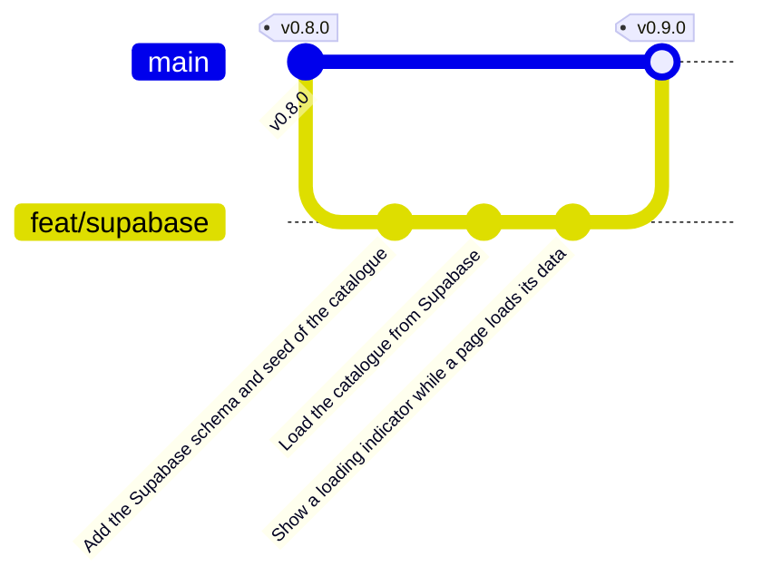

import {
	Aside,
	Card,
	CardGrid,
	FileTree,
	LinkCard,
	Steps,
	TabItem,
	Tabs,
} from "@astrojs/starlight/components";
import { Image } from "astro:assets";
import supabaseTable from "../../../../assets/react/supabase-table.png";
import supabaseBucket from "../../../../assets/react/supabase-bucket.png";
import supabaseKeys from "../../../../assets/react/supabase-keys.png";
import supabasePolicies from "../../../../assets/react/supabase-policies.png";

Hasta ahora las guitarras viven en `src/data/db.ts`: un array que se compila junto con la aplicación. Cambiar un precio exige volver a desplegar, y la página de alta que viene después no tendría dónde guardar nada. En esta página el catálogo pasa a una **base de datos real** en Supabase, con las imágenes en su almacenamiento de archivos, y la aplicación lo pide desde los `loader` del router. Los tests y Storybook no tocan la red: usan un catálogo falso que comparten.

<CardGrid stagger>
	<Card title="Supabase" icon="seti:db">
		Un Postgres con API REST automática, almacenamiento de archivos y panel web. Una tabla `guitars`, un bucket `guitars` y una clave pública.
	</Card>
	<Card title="Capa de API" icon="seti:typescript">
		`getGuitars` y `getGuitar` en `src/api/`: la única parte de la aplicación que sabe que existe Supabase. Los loaders la llaman; las páginas no.
	</Card>
	<Card title="Un mock para todos" icon="seti:config">
		`src/api/guitars/__mocks__/guitars.ts` sustituye a la API en Vitest con `vi.mock` y en Storybook con `sb.mock`. Mismo archivo, misma convención.
	</Card>
	<Card title="Rama feat/supabase" icon="seti:git">
		Tres commits, fusión en `main` y release `v0.9.0`.
	</Card>
</CardGrid>

<Aside type="note" title="Requisitos previos">
	Haber completado [Rutas con React Router](/jjcm/di/units/react/07-router/): `v0.8.0` en `main`, 37 tests de Vitest y 8 de Playwright en verde. El detalle ya se carga con un `loader` y los tests esperan con `findBy`. Hace falta además una **cuenta en Supabase** (gratuita, vale con la de GitHub). La fase equivalente del repositorio de referencia es [11-project-06](https://github.com/gach24/DID/tree/main/11-project-06), que usa una API propia en vez de Supabase; la estructura `api/`, `pages/` y `loader` es la misma.
</Aside>

## La rama de esta fase

```bash
git switch main
git pull
git switch -c feat/supabase
```



## Qué es Supabase

Supabase es un **backend como servicio** construido sobre PostgreSQL. Creas un proyecto y obtienes, sin escribir servidor:

| Pieza | Qué es | Qué usa GuitarLA |
| :--- | :--- | :--- |
| **Database** | Un Postgres completo, con editor de tablas y editor SQL en el panel | La tabla `guitars` |
| **Data API** | Una API REST generada a partir de las tablas; `supabase-js` la llama por ti | `select` del catálogo y de una guitarra |
| **Storage** | Buckets de archivos con URL pública o firmada | El bucket `guitars` con las fotos |
| **Row Level Security (RLS)** | Reglas de Postgres que deciden qué filas puede leer o escribir cada quien | Lectura pública; escritura prohibida hasta la página siguiente |
| **API Keys** | La clave **publicable**, que va en el navegador, y la **secreta**, que nunca | Solo la publicable |
| **Auth** | Usuarios, sesiones y proveedores sociales | Más adelante, en la ampliación |

La idea que lo sostiene: la clave publicable **puede verla cualquiera**, porque viaja en el JavaScript de la aplicación. Lo que protege los datos no es la clave, sino **RLS**: cada tabla tiene políticas que dicen qué puede hacer un visitante anónimo. Si no hay política, no puede hacer nada. Por eso el primer paso es escribir las políticas, no esconder la clave.

## El proyecto en Supabase

### Crear el proyecto

<Steps>
	1. Entra en [supabase.com](https://supabase.com) y crea una cuenta, o entra con GitHub.
	2. **New project**: nombre `guitarla`, una contraseña para la base de datos (guárdala, aunque no la vas a usar desde la aplicación) y la región más cercana (`West EU`).
	3. Espera un minuto a que el proyecto arranque. Llegas al panel, con el menú de la izquierda: Table Editor, SQL Editor, Database, Storage, Settings…
</Steps>

<Aside type="tip" title="Las capturas">
	Las capturas de esta página son de **Supabase Studio** ejecutado en local con la CLI, que es el mismo panel que el de supabase.com. Los menús y las pantallas coinciden; solo cambian la URL y las claves.
</Aside>

### La tabla y el bucket

Todo lo que necesita la base de datos cabe en un archivo SQL, y conviene guardarlo **en el repositorio**: es la definición de la base de datos, igual que `package.json` es la de las dependencias, y cualquiera puede reconstruir el proyecto desde cero.

```sql title="supabase/schema.sql"
-- GuitarLA: catalogue table and image bucket.
-- Run it once in the SQL Editor of the Supabase project.

create table public.guitars (
  id bigint generated always as identity primary key,
  name text not null,
  description text not null,
  price numeric(10, 2) not null check (price >= 0),
  image text not null,
  created_at timestamptz not null default now()
);

-- Anyone can read the catalogue; nobody can write it from the browser (yet).
alter table public.guitars enable row level security;

create policy "Anyone can read the guitars"
  on public.guitars for select
  to anon, authenticated
  using (true);

-- Public bucket for the guitar images: every file is readable by its URL,
-- so it needs no policy for reading. Nobody can upload from the browser (yet).
insert into storage.buckets (id, name, public)
values ('guitars', 'guitars', true);
```

| Línea | Qué hace |
| :--- | :--- |
| `generated always as identity` | El `id` lo pone Postgres, correlativo. No se envía al insertar |
| `numeric(10, 2)` y `check (price >= 0)` | Precio con dos decimales que no puede ser negativo. La base de datos rechaza lo que no cumple, pase lo que pase en el formulario |
| `image text` | No es la URL completa, sino la **ruta del archivo dentro del bucket**: `guitarra_01.jpg`. La URL se construye en la aplicación |
| `enable row level security` | Sin esto, la clave publicable podría leer y escribir todo. Con esto y sin políticas, nada |
| `create policy … for select to anon, authenticated using (true)` | Cualquiera puede **leer** cualquier fila. No hay política de `insert`, así que nadie puede escribir desde el navegador |
| `insert into storage.buckets … public = true` | Un bucket público sirve sus archivos por URL sin clave ni política. Basta para mostrar fotos |

<Steps>
	1. Crea la carpeta `supabase/` en el proyecto y guarda el archivo anterior como `supabase/schema.sql`.
	2. En el panel, **SQL Editor → New query**, pega el contenido y pulsa **Run**. Debe responder "Success. No rows returned".
	3. En **Database → Policies** aparece la tabla `guitars` con RLS activado y una única política de `SELECT`:
</Steps>

<Image src={supabasePolicies} alt="Pantalla Policies del panel de Supabase: la tabla guitars con RLS habilitado y una política llamada Anyone can read the guitars, de tipo SELECT, aplicada a anon y authenticated" />

### Las guitarras

El segundo archivo SQL mete las doce guitarras. Es el contenido de `db.ts` del material de inicio traducido a `insert`, con la única diferencia de que `image` apunta al archivo del bucket, con su extensión:

```sql title="supabase/seed.sql"
-- GuitarLA: the twelve guitars of the catalogue.
-- The image column is the path of the file inside the `guitars` bucket.

insert into public.guitars (name, description, price, image) values
  ('Lukather', 'Morbi ornare augue nisl, vel elementum dui mollis vel. Curabitur non ex id eros fermentum hendrerit.', 299, 'guitarra_01.jpg'),
  ('SRV', 'Morbi ornare augue nisl, vel elementum dui mollis vel. Curabitur non ex id eros fermentum hendrerit.', 349, 'guitarra_02.jpg'),
  ('Borland', 'Morbi ornare augue nisl, vel elementum dui mollis vel. Curabitur non ex id eros fermentum hendrerit.', 329, 'guitarra_03.jpg'),
  ('VAI', 'Morbi ornare augue nisl, vel elementum dui mollis vel. Curabitur non ex id eros fermentum hendrerit.', 299, 'guitarra_04.jpg'),
  ('Thompson', 'Morbi ornare augue nisl, vel elementum dui mollis vel. Curabitur non ex id eros fermentum hendrerit.', 399, 'guitarra_05.jpg'),
  ('White', 'Morbi ornare augue nisl, vel elementum dui mollis vel. Curabitur non ex id eros fermentum hendrerit.', 329, 'guitarra_06.jpg'),
  ('Cobain', 'Morbi ornare augue nisl, vel elementum dui mollis vel. Curabitur non ex id eros fermentum hendrerit.', 349, 'guitarra_07.jpg'),
  ('Dale', 'Morbi ornare augue nisl, vel elementum dui mollis vel. Curabitur non ex id eros fermentum hendrerit.', 379, 'guitarra_08.jpg'),
  ('Krieger', 'Morbi ornare augue nisl, vel elementum dui mollis vel. Curabitur non ex id eros fermentum hendrerit.', 289, 'guitarra_09.jpg'),
  ('Campbell', 'Morbi ornare augue nisl, vel elementum dui mollis vel. Curabitur non ex id eros fermentum hendrerit.', 349, 'guitarra_10.jpg'),
  ('Reed', 'Morbi ornare augue nisl, vel elementum dui mollis vel. Curabitur non ex id eros fermentum hendrerit.', 399, 'guitarra_11.jpg'),
  ('Hazel', 'Morbi ornare augue nisl, vel elementum dui mollis vel. Curabitur non ex id eros fermentum hendrerit.', 379, 'guitarra_12.jpg');
```

Guárdalo como `supabase/seed.sql`, pégalo en una nueva consulta del SQL Editor y ejecútalo. En **Table Editor → guitars** deben verse las doce filas:

<Image src={supabaseTable} alt="Table Editor de Supabase con la tabla guitars: doce filas con id, name, description, price, image y created_at" />

### Las imágenes

<Steps>
	1. **Storage → guitars**. El bucket existe porque lo creó el SQL, con la etiqueta `PUBLIC`.
	2. **Upload files** y selecciona los doce `guitarra_XX.jpg` de `public/img/` del proyecto. Los nombres tienen que coincidir con la columna `image`.
	3. Abre uno de ellos y copia su URL. Tiene esta forma, y se abre en cualquier navegador sin clave: `https://xyzcompany.supabase.co/storage/v1/object/public/guitars/guitarra_01.jpg`.
</Steps>

<Image src={supabaseBucket} alt="Bucket guitars en Storage de Supabase, marcado como público, con los doce archivos guitarra_01.jpg a guitarra_12.jpg" />

El panel puede mostrar un aviso amarillo, "Clients can list all files in this bucket", si existe una política de `SELECT` sobre `storage.objects`. Un bucket público **no la necesita** para servir archivos por URL, y además permitiría listar todo el contenido; por eso el `schema.sql` no la crea.

### Las claves

En **Settings → API Keys** están la URL del proyecto y las dos claves. La aplicación solo usa la **publicable** (`sb_publishable_…`):

<Image src={supabaseKeys} alt="Pantalla API Keys de Supabase: la clave publicable, descrita como segura para usar en un navegador si RLS está activado, y debajo las claves secretas para servidores" />

<Aside type="caution" title="Publicable sí, secreta nunca">
	La clave publicable acaba en el JavaScript que descarga cualquier visitante, y está pensada para ello: solo puede hacer lo que permitan las políticas RLS. La **secreta** (`sb_secret_…`) se salta RLS por completo, y no debe aparecer jamás en el frontend ni en el repositorio. Si alguna vez se filtra, se regenera desde ese mismo panel. En proyectos antiguos verás en su lugar `anon` y `service_role`: son las versiones anteriores de las mismas dos claves.
</Aside>

Antes de escribir una línea de React puedes comprobar la API desde la terminal, sustituyendo la URL y la clave por las tuyas:

```bash
curl "https://xyzcompany.supabase.co/rest/v1/guitars?select=id,name,price&order=id&limit=2" \
  -H "apikey: sb_publishable_..."
```

```json
[{"id":1,"name":"Lukather","price":299.00},
 {"id":2,"name":"SRV","price":349.00}]
```

Es exactamente lo que hará `supabase-js`: una petición HTTP a `/rest/v1/guitars` con la clave en una cabecera. Y si pruebas a insertar con esa clave, Postgres responde con "new row violates row-level security policy": la política hace su trabajo.

### Confirmar

El primer commit solo lleva los dos archivos SQL. La aplicación no ha cambiado y los 37 tests siguen igual:

```bash
git add .
git commit -m "Add the Supabase schema and seed of the catalogue"
```

## El catálogo desde Supabase

### Instalar y configurar

```bash
npm install @supabase/supabase-js
```

La URL y la clave no van en el código: cambian entre el proyecto de cada alumno, el del profesor y el de producción. Vite lee las **variables de entorno** de un archivo `.env` y expone al navegador las que empiezan por `VITE_`, sustituyéndolas por su valor al compilar.

```bash title=".env.example"
# Copy this file to .env and fill it with the values of your Supabase project
# (Project Settings → API Keys). Both values are public: they end up in the browser.
VITE_SUPABASE_URL=https://xyzcompany.supabase.co
VITE_SUPABASE_PUBLISHABLE_KEY=sb_publishable_...
```

```bash
cp .env.example .env
```

Rellena `.env` con tus valores, y añádelo al `.gitignore`: el **ejemplo** se versiona, para que quien clone el proyecto sepa qué variables necesita; el archivo con los **valores reales**, no.

```diff lang="bash" title=".gitignore"
 # Playwright
 playwright-report
 test-results
+
+# Environment variables with the Supabase keys
+.env
```

TypeScript no sabe qué variables existen. Se le dice ampliando `ImportMetaEnv` en el archivo de tipos de Vite, y así `import.meta.env.VITE_SUPABASE_URL` tiene tipo `string` y el editor lo autocompleta:

```ts title="src/vite-env.d.ts"
/// <reference types="vite/client" />

interface ImportMetaEnv {
  /** URL of the Supabase project, e.g. `https://xyzcompany.supabase.co`. */
  readonly VITE_SUPABASE_URL: string;
  /** Publishable key of the project; it is safe to ship it to the browser. */
  readonly VITE_SUPABASE_PUBLISHABLE_KEY: string;
}
```

<Aside type="note" title="Variables de entorno, no secretos">
	En [el hook del carrito](/jjcm/di/units/react/05-cart-hook/) quedó dicho que `MIN_ITEMS` y `MAX_ITEMS` son constantes y no variables de entorno porque son reglas de la aplicación, no de su despliegue. La URL y la clave de Supabase sí **dependen del entorno**: cada proyecto tiene las suyas, y es el caso para el que `.env` existe. Pero que estén fuera del código no las hace secretas: Vite las incrusta en el JavaScript final, y cualquiera puede leerlas. Para lo que debe permanecer oculto, como la clave secreta, no hay sitio en un frontend.
</Aside>

### El cliente

Un único cliente para toda la aplicación, creado una vez y exportado. Si falta una variable, mejor fallar al arrancar con un mensaje claro que con doce peticiones a `undefined/rest/v1/guitars`:

```ts title="src/lib/supabase.ts"
import { createClient } from '@supabase/supabase-js';

const url = import.meta.env.VITE_SUPABASE_URL;
const key = import.meta.env.VITE_SUPABASE_PUBLISHABLE_KEY;

if (!url || !key) {
  throw new Error(
    'Faltan VITE_SUPABASE_URL y VITE_SUPABASE_PUBLISHABLE_KEY: copia .env.example a .env y rellénalo.'
  );
}

/** The Supabase client of the app. Every query goes through it. */
export const supabase = createClient(url, key);
```

### La capa de API

Las páginas no deben saber que los datos vienen de Supabase, ni los loaders tampoco: si mañana el catálogo cambia de sitio, solo debería cambiar un archivo. Esa es la **capa de API**, en `src/api/`, con una carpeta por recurso igual que los componentes:

<FileTree>
- src
  - api
    - guitars
      - guitars.ts
      - index.ts
      - \_\_mocks\_\_
        - guitars.ts el catálogo falso, más abajo
    - index.ts
  - lib
    - supabase.ts
</FileTree>

```ts title="src/api/guitars/guitars.ts"
import { supabase } from '../../lib/supabase';
import type { Guitar } from '../../types';

/** A row of the `guitars` table, as Supabase returns it. */
type GuitarRow = {
  id: number;
  name: string;
  description: string;
  price: number;
  /** Path of the image inside the `guitars` bucket, e.g. `guitarra_01.jpg`. */
  image: string;
};

const TABLE = 'guitars';
const BUCKET = 'guitars';
const COLUMNS = 'id, name, description, price, image';

/** Turns a row into a guitar of the app, with the public URL of its image. */
const toGuitar = (row: GuitarRow): Guitar => ({
  ...row,
  image: supabase.storage.from(BUCKET).getPublicUrl(row.image).data.publicUrl,
});

/**
 * Loads the whole catalogue, ordered by id.
 *
 * @throws An error with the message from Supabase when the query fails.
 */
export const getGuitars = async (): Promise<Guitar[]> => {
  const { data, error } = await supabase
    .from(TABLE)
    .select(COLUMNS)
    .order('id')
    .overrideTypes<GuitarRow[]>();

  if (error) throw new Error(error.message);

  return data.map(toGuitar);
};

/**
 * Loads one guitar by its id.
 *
 * @returns The guitar, or `null` when there is none with that id.
 * @throws An error with the message from Supabase when the query fails.
 */
export const getGuitar = async (id: number): Promise<Guitar | null> => {
  const { data, error } = await supabase
    .from(TABLE)
    .select(COLUMNS)
    .eq('id', id)
    .maybeSingle()
    .overrideTypes<GuitarRow>();

  if (error) throw new Error(error.message);

  return data ? toGuitar(data) : null;
};
```

```ts title="src/api/guitars/index.ts"
export * from './guitars';
```

```ts title="src/api/index.ts"
export * from './guitars';
```

| Pieza | Qué hace |
| :--- | :--- |
| `supabase.from(TABLE).select(COLUMNS)` | `SELECT id, name, … FROM guitars`. Se encadenan filtros y se termina con `await` |
| `.order('id')` | `ORDER BY id`. Sin él, Postgres no garantiza ningún orden |
| `.eq('id', id)` | `WHERE id = …` |
| `.maybeSingle()` | Devuelve **un objeto o `null`** en vez de un array. Con `.single()` la ausencia sería un error; aquí "no existe" es un resultado válido que el loader convierte en 404 |
| `.overrideTypes<GuitarRow[]>()` | Le dice a TypeScript qué forma tienen las filas. Sin tipos generados, `data` sería `any` |
| `{ data, error }` | `supabase-js` **no lanza**: devuelve el error en la respuesta. La capa de API lo convierte en una excepción para que el `ErrorBoundary` lo recoja |
| `storage.from(BUCKET).getPublicUrl(path)` | Construye la URL pública del archivo. No hace ninguna petición: es la URL del bucket más la ruta |
| `GuitarRow` frente a `Guitar` | La fila tiene `image` como ruta; la guitarra de la aplicación la tiene como URL. `toGuitar` traduce, y el resto de la aplicación no cambia |

<Aside type="tip" title="Tipos generados">
	`GuitarRow` está escrito a mano porque es una tabla. Para proyectos con muchas, la CLI de Supabase genera los tipos de todas (`supabase gen types typescript`) y `createClient<Database>()` tipa cada consulta sin `overrideTypes`. Es el siguiente paso natural cuando la base de datos crezca.
</Aside>

El tipo `Guitar` no cambia de forma, pero su `image` cambia de significado:

```diff lang="ts" title="src/types/index.ts"
-/** A guitar of the catalogue, as stored in `src/data/db.ts`. */
+/** A guitar of the catalogue, as the app uses it. */
 export type Guitar = {
   /** Unique identifier. */
   id: number;
   /** Name shown on the card. */
   name: string;
-  /** File name of the image in `public/img/`, without extension. */
+  /** Public URL of the image. */
   image: string;
   /** Short description shown on the card. */
   description: string;
   /** Price in dollars. */
   price: number;
 };
```

### El catálogo falso

Los tests y Storybook no pueden depender de la red ni de los datos de cada proyecto: tienen que dar siempre el mismo resultado, sin `.env` y sin conexión. Vitest y Storybook comparten una convención: si junto a un módulo hay una carpeta `__mocks__` con un archivo **del mismo nombre**, ese archivo puede sustituir al módulo real. Exporta las mismas funciones, pero devuelven un catálogo de tres guitarras:

```ts title="src/api/guitars/__mocks__/guitars.ts"
import type { Guitar } from '../../../types';

/**
 * Fake catalogue for the tests and Storybook: three guitars, no network.
 *
 * It only imports types: Storybook pastes this file in place of the real
 * module, so a relative import of a value would be resolved from there.
 */
export const guitars: Guitar[] = [
  {
    id: 1,
    name: 'Lukather',
    image: '/img/guitarra_01.jpg',
    description: 'Una guitarra de prueba',
    price: 299,
  },
  {
    id: 2,
    name: 'SRV',
    image: '/img/guitarra_02.jpg',
    description: 'Otra guitarra de prueba',
    price: 349,
  },
  {
    id: 3,
    name: 'Borland',
    image: '/img/guitarra_03.jpg',
    description: 'Una tercera guitarra de prueba',
    price: 329,
  },
];

export const getGuitars = async (): Promise<Guitar[]> => guitars;

export const getGuitar = async (id: number): Promise<Guitar | null> =>
  guitars.find((guitar) => guitar.id === id) ?? null;
```

Las imágenes apuntan a `/img/`, que sigue en `public/` precisamente para esto: Storybook enseña fotos reales sin pedirlas a Supabase.

Los fixtures de los tests reutilizan ese mismo array, en vez de tener el suyo:

```diff lang="ts" title="src/test/fixtures.ts"
-import type { CartItem } from '../types';
+import { guitars } from '../api/guitars/__mocks__/guitars';
+import type { CartItem } from '../types';
+
+export { guitars };

 /** Two lines of cart used across the tests: 2 × 299 + 1 × 349 = 947. */
 export const cartItems: CartItem[] = [
-  {
-    id: 1,
-    name: 'Lukather',
-    image: 'guitarra_01',
-    description: 'Una guitarra de prueba',
-    price: 299,
-    quantity: 2,
-  },
-  {
-    id: 2,
-    name: 'SRV',
-    image: 'guitarra_02',
-    description: 'Otra guitarra de prueba',
-    price: 349,
-    quantity: 1,
-  },
+  { ...guitars[0], quantity: 2 },
+  { ...guitars[1], quantity: 1 },
 ];
```

### Los loaders

El catálogo gana su loader, en la misma carpeta que el del detalle porque carga la misma entidad:

```ts title="src/loaders/guitarLoaders/guitarsLoader.ts"
import { getGuitars } from '../../api';

/** Loads the catalogue for the home page. */
export const guitarsLoader = () => getGuitars();
```

```diff lang="ts" title="src/loaders/guitarLoaders/index.ts"
 export * from './guitarLoader';
+export * from './guitarsLoader';
```

`src/loaders/index.ts` no cambia: ya reexporta la carpeta entera.

Y el del detalle deja de buscar en `db.ts`. Pasa a ser `async`, porque la respuesta tarda, y el `null` de `getGuitar` se convierte en el mismo 404 de antes:

```diff lang="ts" title="src/loaders/guitarLoaders/guitarLoader.ts"
 import { data, type LoaderFunctionArgs } from 'react-router';
-import { db } from '../../data/db';
-import type { Guitar } from '../../types';
+import { getGuitar } from '../../api';

 /**
- * Finds the guitar whose id is in the URL (`/guitars/:id`).
+ * Loads the guitar whose id is in the URL (`/guitars/:id`).
  *
  * @throws A 404 response when there is no guitar with that id, so the
  * route shows the not found page.
  */
-export const guitarLoader = ({ params }: LoaderFunctionArgs): Guitar => {
-  const guitar = db.find((item) => item.id === Number(params.id));
+export const guitarLoader = async ({ params }: LoaderFunctionArgs) => {
+  const guitar = await getGuitar(Number(params.id));

   if (!guitar) {
     throw data(`No existe ninguna guitarra con el id ${params.id}.`, {
```

La página del catálogo lee del loader, como ya hacía el detalle. El `useState(db)` del principio de la unidad desaparece: la página **no tiene estado**, recibe los datos ya cargados.

```diff lang="tsx" title="src/pages/Home/Home.tsx"
-import { useState } from 'react';
+import { useLoaderData } from 'react-router';
 import { Guitar } from '../../components';
 import { useCartContext } from '../../context';
-import { db } from '../../data/db';
 import { useDocumentTitle } from '../../hooks';
+import type { guitarsLoader } from '../../loaders';

 export const Home = () => {
-  const [guitars] = useState(db);
+  const guitars = useLoaderData<typeof guitarsLoader>();
   const { addToCart } = useCartContext();
```

Como `image` ya es una URL, la tarjeta y el detalle dejan de montarla:

```diff lang="tsx" title="src/components/Guitar/Guitar.tsx"
       
```

```diff lang="tsx" title="src/pages/GuitarDetail/GuitarDetail.tsx"
       
```

### Mientras cargan los datos

En modo data, React Router **no pinta una ruta hasta que su loader termina**. En la carga inicial eso significa pantalla en blanco durante la petición a Supabase, y un aviso en consola pidiendo un `HydrateFallback`: el componente que se muestra **en el lugar de la ruta** mientras llegan sus datos. Como `Layout` no tiene loader, se pinta de inmediato con la cabecera y el pie, y el fallback ocupa el hueco del `Outlet`.

Un componente nuevo, con su carpeta:

```tsx title="src/components/Loading/Loading.tsx"
/**
 * Placeholder shown while a page loads its data.
 *
 * `role="status"` makes screen readers announce the text when it appears,
 * so they know the page is working and not stuck.
 */
export const Loading = () => {
  return (
    <p role="status" className="py-10 text-center text-xl text-gray-600">
      Cargando…
    </p>
  );
};
```

```tsx title="src/components/Loading/Loading.test.tsx"
import { render, screen } from '@testing-library/react';
import { describe, expect, it } from 'vitest';
import { Loading } from './Loading';

describe('Loading', () => {
  it('announces that the page is loading', () => {
    render(<Loading />);
    expect(screen.getByRole('status')).toHaveTextContent('Cargando…');
  });
});
```

```tsx title="src/components/Loading/Loading.stories.tsx"
import type { Meta, StoryObj } from '@storybook/react-vite';
import { Loading } from './Loading';

const meta = {
  component: Loading,
} satisfies Meta<typeof Loading>;

export default meta;
type Story = StoryObj<typeof meta>;

export const Default: Story = {};
```

```ts title="src/components/Loading/index.ts"
export * from './Loading';
```

```diff lang="ts" title="src/components/index.ts"
 export * from './Cart';
 export * from './Footer';
 export * from './Guitar';
 export * from './Header';
+export * from './Loading';
```

`role="status"` es una **región viva** educada: el lector de pantalla anuncia "Cargando…" cuando aparece, sin interrumpir lo que estuviera leyendo. Es el mismo criterio que el contador del carrito, en [Avisar de lo que cambia](/jjcm/di/units/ux/fundamentals/01-introduction/#avisar-de-lo-que-cambia).

Las dos rutas con loader lo declaran:

```diff lang="tsx" title="src/router.tsx"
 import { createBrowserRouter, type RouteObject } from 'react-router';
+import { Loading } from './components';
 import { Layout } from './layouts';
-import { guitarLoader } from './loaders';
+import { guitarLoader, guitarsLoader } from './loaders';
 import { GuitarDetail, Home, NewGuitar, NotFound, RouteError } from './pages';
 …
     children: [
-      { index: true, Component: Home },
+      {
+        index: true,
+        Component: Home,
+        loader: guitarsLoader,
+        HydrateFallback: Loading,
+      },
       { path: 'guitars/new', Component: NewGuitar },
-      { path: 'guitars/:id', Component: GuitarDetail, loader: guitarLoader },
+      {
+        path: 'guitars/:id',
+        Component: GuitarDetail,
+        loader: guitarLoader,
+        HydrateFallback: Loading,
+      },
       { path: '*', Component: NotFound },
     ],
```

### Borrar db.ts

Ya nadie lo importa en la aplicación. Quedan las stories y dos tests, que pasan a usar los fixtures:

```bash
git rm src/data/db.ts
```

```diff lang="tsx" title="src/components/Guitar/Guitar.stories.tsx"
 import { fn } from 'storybook/test';
-import { db } from '../../data/db';
+import { guitars } from '../../test/fixtures';
 import { Guitar } from './Guitar';

 const meta = {
   component: Guitar,
   args: {
-    guitar: db[0],
+    guitar: guitars[0],
     onAddToCart: fn(),
   },
 …
 export const Expensive: Story = {
   args: {
-    guitar: { ...db[0], name: 'Custom', price: 2499 },
+    guitar: { ...guitars[0], name: 'Custom', price: 2499 },
   },
 };
```

```diff lang="tsx" title="src/components/Cart/Cart.stories.tsx"
-import { db } from '../../data/db';
+import { guitars } from '../../test/fixtures';
 import { Cart } from './Cart';
 …
     cart: [
-      { ...db[0], quantity: 2 },
-      { ...db[1], quantity: 1 },
+      { ...guitars[0], quantity: 2 },
+      { ...guitars[1], quantity: 1 },
     ],
```

```diff lang="tsx" title="src/components/Header/Header.stories.tsx"
-import { db } from '../../data/db';
+import { guitars } from '../../test/fixtures';
 import { Header } from './Header';
 …
     cart: [
-      { ...db[0], quantity: 2 },
-      { ...db[1], quantity: 1 },
+      { ...guitars[0], quantity: 2 },
+      { ...guitars[1], quantity: 1 },
     ],
```

```diff lang="ts" title="src/hooks/useCart.test.ts"
-import type { Guitar } from '../types';
+import { guitars } from '../test/fixtures';
 import { CART_STORAGE_KEY, MAX_ITEMS, useCart } from './useCart';

-const lukather: Guitar = {
-  id: 1,
-  name: 'Lukather',
-  image: 'guitarra_01',
-  description: 'Una guitarra de prueba',
-  price: 299,
-};
-
-const srv: Guitar = {
-  id: 2,
-  name: 'SRV',
-  image: 'guitarra_02',
-  description: 'Otra guitarra de prueba',
-  price: 349,
-};
+const [lukather, srv] = guitars;
```

```diff lang="tsx" title="src/components/Guitar/Guitar.test.tsx"
 import { renderWithProviders } from '../../test';
-import type { Guitar as GuitarType } from '../../types';
+import { guitars } from '../../test/fixtures';
 import { Guitar } from './Guitar';

-const guitar: GuitarType = {
-  id: 1,
-  name: 'Lukather',
-  image: 'guitarra_01',
-  description: 'Una guitarra de prueba',
-  price: 299,
-};
+const guitar = guitars[0];
```

El test de la tarjeta ya esperaba `src="/img/guitarra_01.jpg"`, que es justo lo que trae el fixture. Y el de `useCart` sigue sumando 947: los precios no han cambiado.

### Probar

Falta decirle a Vitest que use el catálogo falso. Un `vi.mock` **sin segundo argumento** busca la carpeta `__mocks__` junto al módulo; en `setupTests.ts` vale para todos los archivos de test a la vez:

```diff lang="ts" title="src/setupTests.ts"
 import '@testing-library/jest-dom/vitest';
 import { cleanup } from '@testing-library/react';
-import { afterEach } from 'vitest';
+import { afterEach, vi } from 'vitest';
+
+// Every test talks to the fake catalogue in src/api/guitars/__mocks__, not to Supabase.
+vi.mock('./api/guitars/guitars');

 afterEach(() => {
```

La ruta es la del **módulo real**, relativa a `setupTests.ts`; Vitest deduce la del mock. A partir de aquí cualquier `import { getGuitars } from './api'` recibe la versión falsa, aunque pase por dos `index.ts`.

Los tests de rutas cambian por dos motivos. El catálogo ahora tiene **tres** guitarras, no doce. Y el catálogo es **asíncrono**: aunque el mock responda al instante, lo hace en una promesa, así que la primera consulta de cada test tiene que ser un `findBy` que espere a que la página se pinte. Es lo que la página anterior anticipaba al probar el detalle.

```diff lang="tsx" title="src/router.test.tsx"
 import { CART_STORAGE_KEY } from './hooks';
-import { db } from './data/db';
 import { renderApp } from './test';
+import { guitars } from './test/fixtures';

 describe('Routes', () => {
-  it('shows the collection title', () => {
+  it('shows a loading message and then the collection title', async () => {
     renderApp();
+    expect(screen.getByRole('status')).toHaveTextContent('Cargando…');
     expect(
-      screen.getByRole('heading', { name: 'Nuestra Colección' })
+      await screen.findByRole('heading', { name: 'Nuestra Colección' })
     ).toBeInTheDocument();
+    expect(screen.queryByRole('status')).not.toBeInTheDocument();
   });

-  it('shows one card per guitar in the catalogue', () => {
+  it('shows one card per guitar in the catalogue', async () => {
     renderApp();
-    expect(screen.getAllByRole('article')).toHaveLength(12);
+    expect(await screen.findAllByRole('article')).toHaveLength(3);
   });

-  it('updates the document title with the number of guitars', () => {
+  it('updates the document title with the number of guitars', async () => {
     renderApp();
-    expect(document.title).toBe('GuitarLA · 12 guitarras');
+    await screen.findByRole('heading', { name: 'Nuestra Colección' });
+    expect(document.title).toBe('GuitarLA · 3 guitarras');
   });

   it('adds guitars to the cart and shows them in the panel', async () => {
     const user = userEvent.setup();
     renderApp();

     await user.click(
-      screen.getByRole('button', { name: 'Agregar al carrito Lukather' })
+      await screen.findByRole('button', { name: 'Agregar al carrito Lukather' })
     );
 …
   it('changes quantities, removes items and clears the cart from the panel', async () => {
     const user = userEvent.setup();
     renderApp();

     await user.click(
-      screen.getByRole('button', { name: 'Agregar al carrito Lukather' })
+      await screen.findByRole('button', { name: 'Agregar al carrito Lukather' })
     );
 …
   it('restores the cart from localStorage on load', async () => {
     const user = userEvent.setup();
     localStorage.setItem(
       CART_STORAGE_KEY,
-      JSON.stringify([{ ...db[0], quantity: 2 }])
+      JSON.stringify([{ ...guitars[0], quantity: 2 }])
     );

     renderApp();
-    await user.click(screen.getByRole('button', { name: 'Abrir carrito' }));
+    await user.click(
+      await screen.findByRole('button', { name: 'Abrir carrito' })
+    );
 …
   it('navigates to the new guitar page from the header', async () => {
     const user = userEvent.setup();
     renderApp();

-    await user.click(screen.getByRole('link', { name: 'Añadir guitarra' }));
+    await user.click(
+      await screen.findByRole('link', { name: 'Añadir guitarra' })
+    );
 …
-  it('shows the not found page for an unknown route', () => {
+  it('shows the not found page for an unknown route', async () => {
     renderApp('/no-existe');

     expect(
-      screen.getByRole('heading', { name: 'Página no encontrada' })
+      await screen.findByRole('heading', { name: 'Página no encontrada' })
     ).toBeInTheDocument();
 …
   it('shows the detail of a guitar and adds it to the cart from there', async () => {
     const user = userEvent.setup();
     renderApp();

-    await user.click(screen.getByRole('link', { name: 'SRV' }));
+    await user.click(await screen.findByRole('link', { name: 'SRV' }));
```

El primer test es nuevo en espíritu: comprueba el **estado de carga**. Nada más montar, hay un `status` con "Cargando…"; cuando el catálogo llega, el título aparece y el aviso desaparece. Las dos cosas son observables con roles, sin mirar clases ni implementación.

```bash
npx vitest run
```

```txt
 Test Files  8 passed (8)
      Tests  38 passed (38)
```

### Documentar

Storybook tiene su propia manera de sustituir módulos, `sb.mock`, que sigue la misma convención `__mocks__`. Se registra una vez en `preview.tsx`, con la ruta **relativa a ese archivo y con extensión**:

```diff lang="tsx" title=".storybook/preview.tsx"
 import type { Preview } from '@storybook/react-vite';
 import { createMemoryRouter, RouterProvider } from 'react-router';
+import { sb } from 'storybook/test';
 import { CartProvider } from '../src/context';
 import { CART_STORAGE_KEY } from '../src/hooks';

 import '../src/index.css';

+// Stories use the fake catalogue in src/api/guitars/__mocks__, not Supabase.
+sb.mock(import('../src/api/guitars/guitars.ts'));
+
 const preview: Preview = {
```

Hay una diferencia con Vitest que explica el comentario del mock: Storybook **copia el contenido** del archivo de `__mocks__` en el lugar del módulo real, así que cualquier `import` relativo de un valor se resolvería desde `src/api/guitars/` y fallaría. Por eso el mock solo importa tipos, que desaparecen al compilar, y define sus guitarras dentro.

Abre Storybook y comprueba la story **App → Catalogue**: tres guitarras con fotos locales. Si abres las herramientas de desarrollo del navegador (`F12`) y miras la pestaña **Network**, no hay ninguna petición a `supabase.co` ni a `/rest/v1/guitars`: las imágenes vienen de `/img/` del propio Storybook. Las stories de `Guitar`, `Cart` y `Header` siguen igual que antes.

Queda contarle al README cómo arrancar el proyecto ahora que necesita configuración. El README sigue siendo el de la plantilla de Vite, y se reescribirá entero en la página de despliegue; de momento, una sección al principio:

```md title="README.md"
# GuitarLA

## Getting started

The catalogue lives in a [Supabase](https://supabase.com) project. To run the app:

1. Create a Supabase project and run `supabase/schema.sql` and then `supabase/seed.sql` in its SQL Editor.
2. Upload the images of `public/img/guitarra_*.jpg` to the `guitars` bucket.
3. Copy `.env.example` to `.env` and fill it with the URL and the publishable key of the project (Project Settings → API Keys).
4. `npm install` and `npm run dev`.

Tests and Storybook do not need Supabase: they use the fake catalogue in `src/api/guitars/__mocks__`.
```

### Confirmar

```bash
npm run dev
```

El catálogo se ve igual que antes, pero ahora viene de Supabase. Abre las herramientas de desarrollo: en **Network** hay una petición a `/rest/v1/guitars` y las imágenes vienen de `/storage/v1/object/public/guitars/…`. Cambia un precio en el Table Editor, recarga, y el precio cambia **sin tocar el código**. Eso es lo que `db.ts` no podía hacer.

**De extremo a extremo.** Los tests de Playwright **sí hablan con Supabase**: usan el `.env` del proyecto y los datos del `seed.sql`. Es el sitio para comprobar lo que ningún mock puede: que el catálogo completo llega y que las imágenes vienen **de Storage**.

```ts title="e2e/catalogue.spec.ts"
import { expect, test } from '@playwright/test';

test.describe('Catalogue', () => {
  test('loads the guitars and their images from Supabase', async ({
    page,
  }) => {
    await page.goto('/');

    await expect(page.getByRole('article')).toHaveCount(12);
    await expect(
      page.getByRole('img', { name: 'Guitarra Lukather' })
    ).toHaveAttribute('src', /\/storage\/v1\/object\/public\/guitars\//);
  });
});
```

Los tests de la navegación y del carrito siguen pasando sin cambios: Lukather, SRV y Borland existen en el `seed.sql` con los mismos ids que tenían en `db.ts`. Si en tu tabla has cambiado algo, ajusta los tests o los datos.

```bash
npm run test:e2e
```

```txt
  9 passed (6.1s)
```

```bash
npm run lint
npm run format:check
npx vitest run
git add .
git commit -m "Load the catalogue from Supabase"
```

## Avisar de que se está cargando

`HydrateFallback` cubre la **carga inicial**. Pero al navegar del catálogo al detalle, React Router mantiene la página actual en pantalla hasta que el loader de la siguiente termina, y durante ese tiempo nada indica que el clic ha funcionado. Con Supabase en otro continente o una conexión móvil pueden ser segundos en los que el usuario vuelve a pulsar, o cree que la aplicación se ha colgado.

`useNavigation` dice en qué estado está el router: `idle`, `loading` mientras corren los loaders de la siguiente ruta, o `submitting` mientras se envía un formulario. El layout lo usa para dos cosas: mostrar el mismo `Loading` y marcar el `main` con `aria-busy`:

```diff lang="tsx" title="src/layouts/Layout.tsx"
-import { Outlet } from 'react-router';
-import { Footer, Header } from '../components';
+import { Outlet, useNavigation } from 'react-router';
+import { Footer, Header, Loading } from '../components';
 import { CartProvider } from '../context';

 export const Layout = () => {
+  const navigation = useNavigation();
+  const isLoading = navigation.state === 'loading';
+
   return (
     <CartProvider>
       <Header />
-      <main className="mx-auto mt-10 max-w-6xl px-4">
-        <Outlet />
+      {/* aria-busy tells assistive tech the region is being updated, and
+          the current page stays visible, dimmed, until the next one is ready. */}
+      <main className="mx-auto mt-10 max-w-6xl px-4" aria-busy={isLoading}>
+        {isLoading && <Loading />}
+        <div className={isLoading ? 'opacity-50 transition-opacity' : ''}>
+          <Outlet />
+        </div>
       </main>
       <Footer />
     </CartProvider>
```

- **La página actual no desaparece**: se atenúa. Quitarla dejaría un hueco en blanco y un salto de contenido; atenuarla dice "esto sigue aquí, pero está cambiando".
- **`aria-busy="true"`** marca la región como "en actualización" para las tecnologías de asistencia, que pueden esperar a que termine antes de anunciar cambios parciales. Es el atributo pensado exactamente para esto.
- **`Loading` reaparece** con su `role="status"`, así que el lector de pantalla oye "Cargando…" también al navegar, no solo al entrar.

El test monta un router propio con un loader que **nunca termina**, para dejar la navegación congelada en `loading` y poder mirar:

```tsx title="src/layouts/Layout.test.tsx"
import { render, screen } from '@testing-library/react';
import userEvent from '@testing-library/user-event';
import { createMemoryRouter, Link, RouterProvider } from 'react-router';
import { describe, expect, it } from 'vitest';
import { Layout } from './Layout';

describe('Layout', () => {
  it('marks the main region as busy while the next page loads', async () => {
    const user = userEvent.setup();
    const router = createMemoryRouter([
      {
        Component: Layout,
        children: [
          {
            index: true,
            element: <Link to="/slow">Ir a la página lenta</Link>,
          },
          {
            path: 'slow',
            // A loader that never resolves keeps the navigation in "loading".
            loader: () => new Promise(() => {}),
            element: <p>Nunca se pinta</p>,
          },
        ],
      },
    ]);
    render(<RouterProvider router={router} />);

    const main = screen.getByRole('main');
    expect(main).toHaveAttribute('aria-busy', 'false');
    expect(screen.queryByRole('status')).not.toBeInTheDocument();

    await user.click(
      screen.getByRole('link', { name: 'Ir a la página lenta' })
    );

    expect(main).toHaveAttribute('aria-busy', 'true');
    expect(screen.getByRole('status')).toHaveTextContent('Cargando…');
    expect(
      screen.getByRole('link', { name: 'Ir a la página lenta' })
    ).toBeInTheDocument();
  });
});
```

La última aserción es la importante: tras el clic, **el enlace de la página anterior sigue ahí**. La página vieja no se ha ido.

### Confirmar

```txt
 Test Files  9 passed (9)
      Tests  39 passed (39)
```

```bash
npm run lint
npm run format:check
git add .
git commit -m "Show a loading indicator while a page loads its data"
```

## Comprobar, fusionar y publicar

```bash
npm run lint
npm run format:check
npx vitest run
npm run test:e2e
npm run build
npm run build-storybook
```

```bash
git push
git switch main
git merge --no-ff feat/supabase -m "Merge feat/supabase"
git push
git tag -a v0.9.0 -m "Catalogue loaded from Supabase"
git push origin v0.9.0
gh release create v0.9.0 --title "v0.9.0 · Supabase" --notes "Catalogue and images served by Supabase: guitars table with RLS, public storage bucket, supabase-js client configured with environment variables, API layer queried by the loaders, fake catalogue shared by Vitest and Storybook, accessible loading state."
git branch -d feat/supabase
git push origin --delete feat/supabase
```

## Comprobación final

<Steps>
	1. En Supabase existe la tabla `guitars` con RLS y una política de lectura, el bucket público `guitars` con doce imágenes, y `supabase/schema.sql` y `supabase/seed.sql` están en el repositorio.
	2. `.env.example` está versionado y `.env` no; `git status` nunca lo muestra.
	3. `src/data/db.ts` no existe. Las páginas leen de sus loaders, los loaders de `src/api/`, y solo `src/api/guitars/guitars.ts` y `src/lib/supabase.ts` importan `supabase`.
	4. Al cargar, aparece "Cargando…" y después el catálogo; en Network, las imágenes vienen de `/storage/v1/object/public/guitars/`. Un cambio en el Table Editor se ve al recargar.
	5. Al pasar del catálogo al detalle, el catálogo se atenúa y `main` lleva `aria-busy="true"` hasta que el detalle se pinta.
	6. `npx vitest run` ejecuta 39 tests en 9 archivos sin tocar la red; `npm run test:e2e`, 9; Storybook muestra la story **App → Catalogue** con tres guitarras y fotos locales, sin violaciones.
	7. En GitHub existe la release `v0.9.0`.
</Steps>

## 🧩 Aplicación en el proyecto

Una tabla con RLS, un bucket, una capa de API con sus `__mocks__` y loaders que la llaman es la plantilla para cualquier aplicación con datos: la app de informes tendrá su tabla `reports`, su `src/api/reports/`, su mock de tres informes para tests y stories, y páginas que no saben de dónde salen. El estado de carga con `HydrateFallback`, `useNavigation` y `aria-busy` se copia tal cual.

## Resumen rápido

| Concepto | Detalle |
| :--- | :--- |
| **Supabase** | Postgres con API REST, Storage y panel; la clave publicable va al navegador y **RLS** decide qué puede hacer |
| **SQL en el repositorio** | `supabase/schema.sql` (tabla, RLS, política, bucket) y `supabase/seed.sql` (datos), ejecutados en el SQL Editor |
| **Variables de entorno** | `VITE_SUPABASE_URL` y `VITE_SUPABASE_PUBLISHABLE_KEY` en `.env` (ignorado) y `.env.example` (versionado); tipadas en `vite-env.d.ts`; `import.meta.env.VITE_…` |
| **Cliente y API** | `createClient` una vez en `src/lib/supabase.ts`; `from().select().order()`, `.eq().maybeSingle()`, `{ data, error }`, `storage.from().getPublicUrl()` en `src/api/` |
| **Mock compartido** | `src/api/guitars/__mocks__/guitars.ts`; `vi.mock('./api/guitars/guitars')` en `setupTests.ts`; `sb.mock(import('../src/api/guitars/guitars.ts'))` en `preview.tsx`; solo importa tipos |
| **Estados de carga** | `HydrateFallback: Loading` en las rutas con loader; `useNavigation().state === 'loading'` en el layout, con `aria-busy` y `role="status"` |

## Convención práctica

<Steps>
	1. **La definición de la base de datos vive en `supabase/*.sql`** y se ejecuta en el SQL Editor. RLS activado en toda tabla, con una política por operación y rol.
	2. **Solo la clave publicable, siempre en `.env`**, con un `.env.example` versionado y los tipos en `vite-env.d.ts`.
	3. **Un cliente en `src/lib/` y una capa de API en `src/api/<recurso>/`**: convierte `{ data, error }` en valores o excepciones y traduce filas a tipos de la aplicación. Nadie más importa `supabase`.
	4. **Cada módulo de API tiene su `__mocks__`** con los mismos exports, datos fijos y solo imports de tipos. Vitest lo activa en `setupTests.ts` y Storybook en `preview.tsx`.
	5. **Los loaders llaman a la API** y traducen "no existe" en `throw data(…, { status: 404 })`; las páginas solo leen `useLoaderData`.
	6. **Toda espera se anuncia**: `HydrateFallback` en las rutas con datos, `aria-busy` y un `role="status"` al navegar, y la página anterior visible hasta que llega la nueva.
</Steps>

## Referencias

<CardGrid stagger>
	<LinkCard
		href="https://supabase.com/docs/guides/getting-started/quickstarts/reactjs"
		title="Supabase con React (Supabase)"
		description="Crear el proyecto, el cliente y la primera consulta desde React con Vite."
		target="_blank"
		rel="noopener noreferrer"
	/>
	<LinkCard
		href="https://supabase.com/docs/guides/database/postgres/row-level-security"
		title="Row Level Security (Supabase)"
		description="Qué es RLS, por qué la clave publicable es pública y cómo escribir políticas."
		target="_blank"
		rel="noopener noreferrer"
	/>
	<LinkCard
		href="https://supabase.com/docs/guides/storage/buckets/fundamentals"
		title="Buckets de Storage (Supabase)"
		description="Buckets públicos y privados, URLs públicas y firmadas."
		target="_blank"
		rel="noopener noreferrer"
	/>
	<LinkCard
		href="https://supabase.com/docs/reference/javascript/select"
		title="Referencia de supabase-js"
		description="select, filtros, maybeSingle, overrideTypes y el resto de la API de consultas."
		target="_blank"
		rel="noopener noreferrer"
	/>
	<LinkCard
		href="https://vite.dev/guide/env-and-mode"
		title="Variables de entorno (Vite)"
		description="Archivos .env, el prefijo VITE_, import.meta.env y su tipado."
		target="_blank"
		rel="noopener noreferrer"
	/>
	<LinkCard
		href="https://vitest.dev/guide/mocking/modules"
		title="Mocks de módulos (Vitest)"
		description="vi.mock, la carpeta __mocks__ y los mocks en setupFiles."
		target="_blank"
		rel="noopener noreferrer"
	/>
	<LinkCard
		href="https://storybook.js.org/docs/writing-stories/mocking-data-and-modules/mocking-modules"
		title="Mocks de módulos (Storybook)"
		description="sb.mock en preview, archivos __mocks__ y módulos espiados."
		target="_blank"
		rel="noopener noreferrer"
	/>
	<LinkCard
		href="https://reactrouter.com/start/data/data-loading"
		title="Cargar datos (React Router)"
		description="loader, HydrateFallback y useNavigation para la interfaz pendiente."
		target="_blank"
		rel="noopener noreferrer"
	/>
</CardGrid>

## Siguientes pasos

<CardGrid>
	<LinkCard
		href="/jjcm/di/units/react/09-new-guitar/"
		title="Alta de guitarra con imagen"
		description="Un formulario en /guitars/new que sube la foto a Storage e inserta la fila con una action de React Router, en la rama feat/new-guitar."
	/>
	<LinkCard
		href="/jjcm/di/units/ux/fundamentals/01-introduction/#avisar-de-lo-que-cambia"
		title="Avisar de lo que cambia"
		description="Regiones vivas, aria-busy y por qué una espera sin aviso es un fallo de accesibilidad."
	/>
</CardGrid>
