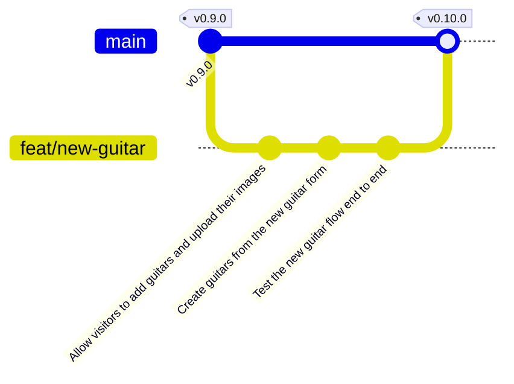

import {
	Aside,
	Card,
	CardGrid,
	FileTree,
	LinkCard,
	Steps,
	TabItem,
	Tabs,
} from "@astrojs/starlight/components";
import { Image } from "astro:assets";
import formErrors from "../../../../assets/react/new-guitar-errors.png";
import formPreview from "../../../../assets/react/new-guitar-preview.png";

La página `/guitars/new` lleva tres apartados prometiendo un formulario. Es el momento: el visitante elige una foto, escribe nombre, descripción y precio, y la guitarra aparece en el catálogo. Por el camino se cierran las dos mitades que faltaban de React Router en modo data (`<Form>` y `action`, la pareja de escritura de `loader`) y de Supabase (subir un archivo a Storage e insertar una fila).

<CardGrid stagger>
	<Card title="Escribir en Supabase" icon="seti:db">
		Dos políticas de inserción, `storage.upload` para la foto e `insert` para la fila. La imagen se guarda por su ruta y la fila la referencia.
	</Card>
	<Card title="Form y action" icon="seti:config">
		El formulario se envía con `<Form method="post">`; la ruta lo recibe en su `action`, valida, crea y redirige. Sin `useState` ni `onSubmit`.
	</Card>
	<Card title="Formulario accesible" icon="approve-check">
		Un mensaje por campo enlazado con `aria-describedby`, foco al primer error, vista previa y aviso de "guardando". Las reglas de la unidad de UX, aplicadas.
	</Card>
	<Card title="Rama feat/new-guitar" icon="seti:git">
		Tres commits, fusión en `main` y release `v0.10.0`.
	</Card>
</CardGrid>

<Aside type="note" title="Requisitos previos">
	Haber completado [Catálogo desde Supabase](/jjcm/di/units/react/08-supabase/): `v0.9.0` en `main`, 39 tests de Vitest y 9 de Playwright en verde, y el proyecto de Supabase con la tabla, el bucket y el `.env`. Conviene tener a mano [Formularios](/jjcm/di/units/ux/fundamentals/01-introduction/#formularios) de la unidad de UX: las cinco reglas que allí se enuncian son las que aquí se programan.
</Aside>

## La rama de esta fase

```bash
git switch main
git pull
git switch -c feat/new-guitar
```



## Permiso para escribir

Hasta ahora la clave publicable solo puede **leer**: la única política de la tabla es de `select`, y el bucket no tiene ninguna. Insertar una fila o subir un archivo desde el navegador exige dos políticas más. Van en un tercer archivo SQL, porque son una decisión distinta del schema y conviene que se vea:

```sql title="supabase/insert-policies.sql"
-- GuitarLA: let visitors add guitars from the browser.
-- Run it in the SQL Editor after schema.sql.
--
-- WARNING: these policies let ANYONE with the publishable key insert rows
-- and upload files. They are fine for a classroom project; a real shop
-- would restrict them to authenticated users (see the extension on Auth).

create policy "Anyone can add a guitar"
  on public.guitars for insert
  to anon, authenticated
  with check (true);

create policy "Anyone can upload a guitar image"
  on storage.objects for insert
  to anon, authenticated
  with check (bucket_id = 'guitars');
```

| Línea | Qué hace |
| :--- | :--- |
| `for insert … with check (true)` | En las políticas de escritura la condición se llama `with check` y se evalúa sobre la fila **que se intenta escribir**. `true` acepta cualquiera |
| `on storage.objects` | Los archivos de Storage son filas de esa tabla: un bucket público permite **leer** sin política, pero **escribir** la necesita igual que cualquier tabla |
| `with check (bucket_id = 'guitars')` | Solo en ese bucket. Sin esta condición, la clave publicable podría subir archivos a cualquier bucket del proyecto |

<Aside type="caution" title="Cualquiera puede escribir">
	Con estas políticas, quien tenga la clave publicable (es decir, cualquiera que abra la aplicación) puede meter filas y archivos. Para una tienda de verdad sería inaceptable: la condición debería ser `auth.uid() is not null` o un rol concreto, y eso requiere usuarios. Llegará en la ampliación de Auth. Aquí se acepta a sabiendas, y por eso el archivo lo dice en mayúsculas: una política permisiva que no se documenta es un agujero; documentada, es una decisión.
</Aside>

<Steps>
	1. Guarda el archivo como `supabase/insert-policies.sql` y ejecútalo en el **SQL Editor**. En **Database → Policies**, la tabla `guitars` muestra ahora dos políticas, y en **Storage → Policies** aparece la del bucket.
	2. Comprueba desde la terminal que un `insert` anónimo ya funciona, y borra la fila de prueba desde el Table Editor:
</Steps>

```bash
curl -X POST "https://xyzcompany.supabase.co/rest/v1/guitars" \
  -H "apikey: sb_publishable_..." \
  -H "Content-Type: application/json" \
  -H "Prefer: return=representation" \
  -d '{"name":"Prueba","description":"x","price":1,"image":"x.jpg"}'
```

```json
[{"id":13,"name":"Prueba","description":"x","price":1.00,"image":"x.jpg","created_at":"…"}]
```

### Confirmar

```bash
git add .
git commit -m "Allow visitors to add guitars and upload their images"
```

## El formulario

### El tipo y la API

Lo que el formulario produce, ya validado, es un `NewGuitar`: lo mismo que una `Guitar` sin `id` y con la imagen como **archivo**, no como URL. Y los errores de validación son un mensaje por campo:

```diff lang="ts" title="src/types/index.ts"
   /** Units of this guitar in the cart. */
   quantity: number;
 };
+
+/** The data of the new guitar form, already validated. */
+export type NewGuitar = {
+  name: string;
+  description: string;
+  price: number;
+  /** The image chosen in the form; it is uploaded to Storage. */
+  image: File;
+};
+
+/** One message per field that failed the validation of the new guitar form. */
+export type NewGuitarErrors = Partial<Record<keyof NewGuitar, string>>;
```

La capa de API gana `createGuitar`, en dos pasos que tienen que ir en ese orden: primero el archivo, porque la fila necesita su ruta; después la fila.

```diff lang="ts" title="src/api/guitars/guitars.ts"
 import { supabase } from '../../lib/supabase';
-import type { Guitar } from '../../types';
+import type { Guitar, NewGuitar } from '../../types';
 …
   return data ? toGuitar(data) : null;
 };
+
+/** Builds a unique path for an uploaded image: `1730000000000-foto.jpg`. */
+const toImagePath = (file: File) =>
+  `${Date.now()}-${file.name.toLowerCase().replace(/[^a-z0-9._-]+/g, '-')}`;
+
+/**
+ * Uploads the image to the bucket and inserts the guitar.
+ *
+ * The two steps are not a transaction: Storage and Postgres cannot be
+ * grouped from the client. The image goes first so that, if the insert
+ * fails, the worst case is an unused file in the bucket and never a row
+ * whose image does not exist.
+ *
+ * @returns The guitar as stored, with its new id and the URL of its image.
+ * @throws An error with the message from Supabase when the upload or the
+ * insert fails.
+ */
+export const createGuitar = async (input: NewGuitar): Promise<Guitar> => {
+  const path = toImagePath(input.image);
+
+  const upload = await supabase.storage.from(BUCKET).upload(path, input.image);
+  if (upload.error) throw new Error(upload.error.message);
+
+  const { data, error } = await supabase
+    .from(TABLE)
+    .insert({
+      name: input.name,
+      description: input.description,
+      price: input.price,
+      image: path,
+    })
+    .select(COLUMNS)
+    .single()
+    .overrideTypes<GuitarRow>();
+
+  if (error) throw new Error(error.message);
+
+  return toGuitar(data);
+};
```

| Pieza | Qué hace |
| :--- | :--- |
| `toImagePath` | Dos personas pueden subir `foto.jpg`: el prefijo con `Date.now()` evita que la segunda pise a la primera, y la limpieza del nombre quita espacios y acentos, que dan problemas en una URL |
| `storage.from(BUCKET).upload(path, file)` | Sube el `File` tal cual lo da el `<input type="file">`; `supabase-js` pone el `Content-Type` a partir del archivo. Devuelve `{ data, error }` como las consultas |
| `.insert({...})` | Un `POST` a `/rest/v1/guitars`. No se envía `id` ni `created_at`: los pone Postgres |
| `.select(COLUMNS).single()` | Sin `select`, `insert` no devuelve la fila. Con él, devuelve la fila **tal como ha quedado**, con el `id` nuevo; `single` porque es una |
| `toGuitar(data)` | La misma traducción que al leer: la ruta se convierte en URL pública. El detalle recibe una `Guitar` igual que las demás |
| El comentario sobre la transacción | Avisa de que los dos pasos no son atómicos. El porqué y las soluciones, en el apartado siguiente |

### Dos escrituras sin transacción

`createGuitar` hace dos escrituras, y entre la primera y la segunda puede pasar cualquier cosa: la red se corta, una política lo impide, la base de datos rechaza la fila. Si fueran dos `insert` en la misma base de datos, la respuesta sería una **transacción**: o se hacen las dos o no se hace ninguna. Aquí no es posible, por dos motivos.

- **Son dos servicios distintos.** El archivo va al almacenamiento de Storage y la fila a Postgres. `storage.objects` guarda los metadatos del archivo en la base de datos, pero los bytes viven fuera, y ninguna transacción SQL puede cubrir una subida HTTP a otro servicio.
- **Desde el cliente no hay transacciones.** `supabase-js` habla con la API REST, y cada llamada es una petición independiente que se confirma sola. No existe un `BEGIN … COMMIT` desde el navegador; para agrupar varias escrituras en una transacción hace falta código en el servidor: una función de Postgres (`rpc`) o una Edge Function.

Así que la pregunta no es cómo hacerlo atómico, sino **qué estado queda si falla a medias**, y elegir el menos malo. Por eso la imagen va primero:

| Orden | Si falla el segundo paso | Qué ve el usuario |
| :--- | :--- | :--- |
| **Imagen y luego fila** (el elegido) | Un archivo en el bucket que ninguna fila referencia | Nada: el catálogo no lo muestra. Solo ocupa espacio |
| Fila y luego imagen | Una fila cuya imagen no existe | Una guitarra en el catálogo con la foto rota |

Y además la validación se ejecuta **antes** de llamar a `createGuitar`: casi todo lo que podría hacer fallar el `insert` (precio negativo, campos vacíos) se descarta sin haber subido nada. Lo que queda son fallos de red o de permisos, poco frecuentes.

Para cerrar del todo el hueco hay tres caminos, de menos a más esfuerzo. Ninguno está en GuitarLA; son el tipo de decisión que se toma al pasar de un proyecto de aula a uno real:

1. **Compensar.** Si el `insert` falla, borrar el archivo que se acaba de subir con `storage.from(BUCKET).remove([path])` dentro de un `catch`. No es atómico, porque el borrado también puede fallar, pero cubre casi todos los casos con tres líneas. Exige una política de `delete` sobre `storage.objects`, que hoy no existe, y que habría que limitar para que nadie pueda borrar las fotos de los demás.
2. **Limpiar después.** Un trabajo programado en el servidor (la extensión `pg_cron` de Postgres o una Edge Function con un cron) que cada noche borre los archivos del bucket que ninguna fila referencia. Tolera cualquier fallo intermedio, porque no intenta evitar el huérfano sino recogerlo.
3. **Mover la escritura al servidor.** Una Edge Function recibe el formulario, sube el archivo, inserta la fila y compensa si algo falla, todo con la clave secreta. Es la solución completa, y tiene una ventaja añadida: las políticas de inserción para anónimos que se han creado en esta página dejarían de hacer falta, porque el navegador ya no escribiría directamente.

El comentario de la función deja constancia del problema para quien lea el código; esta sección es la discusión que conviene tener en clase.

El catálogo falso aprende lo mismo, para que tests y Storybook puedan "crear" sin red. Guarda lo creado en una lista aparte, así `guitars` sigue siendo el mismo array fijo que usan las stories:

```diff lang="ts" title="src/api/guitars/__mocks__/guitars.ts"
-import type { Guitar } from '../../../types';
+import type { Guitar, NewGuitar } from '../../../types';
 …
-export const getGuitars = async (): Promise<Guitar[]> => guitars;
+/** Guitars created during the current test or story. */
+const created: Guitar[] = [];
+
+export const getGuitars = async (): Promise<Guitar[]> => [
+  ...guitars,
+  ...created,
+];

 export const getGuitar = async (id: number): Promise<Guitar | null> =>
-  guitars.find((guitar) => guitar.id === id) ?? null;
+  [...guitars, ...created].find((guitar) => guitar.id === id) ?? null;
+
+export const createGuitar = async (input: NewGuitar): Promise<Guitar> => {
+  const guitar: Guitar = {
+    id: guitars.length + created.length + 1,
+    name: input.name,
+    description: input.description,
+    price: input.price,
+    image: '/img/guitarra_04.jpg',
+  };
+  created.push(guitar);
+  return guitar;
+};
```

### La validación

La validación es una **función pura** que recibe el `FormData` y devuelve o los datos tipados o los errores. Separada del componente y del action se prueba sola, con `it.each`, sin montar nada. Los mensajes siguen la regla 3 de la unidad de UX: dicen **qué hacer**, no qué ha fallado.

```ts title="src/utils/validateNewGuitar.ts"
import type { NewGuitar, NewGuitarErrors } from '../types';

/** Largest image accepted, in bytes (2 MB). */
export const MAX_IMAGE_SIZE = 2 * 1024 * 1024;

type Result = { data: NewGuitar; errors?: never } | { errors: NewGuitarErrors };

/**
 * Validates the fields of the new guitar form.
 *
 * @param formData - The submitted form, as the route action receives it.
 * @returns The typed data when everything is valid, or one message per
 * field that fails, written as what the user has to do.
 */
export const validateNewGuitar = (formData: FormData): Result => {
  const name = String(formData.get('name') ?? '').trim();
  const description = String(formData.get('description') ?? '').trim();
  const price = Number(formData.get('price'));
  const image = formData.get('image');

  const errors: NewGuitarErrors = {};

  if (!name) errors.name = 'Escribe el nombre de la guitarra.';
  if (!description) errors.description = 'Escribe una descripción.';
  if (!formData.get('price') || Number.isNaN(price) || price <= 0) {
    errors.price = 'Escribe un precio mayor que cero.';
  }

  if (!(image instanceof File) || image.size === 0) {
    errors.image = 'Elige una imagen de la guitarra.';
  } else if (!image.type.startsWith('image/')) {
    errors.image = 'El archivo tiene que ser una imagen (JPG, PNG o WebP).';
  } else if (image.size > MAX_IMAGE_SIZE) {
    errors.image = 'La imagen no puede pesar más de 2 MB.';
  }

  if (Object.keys(errors).length > 0) return { errors };

  return { data: { name, description, price, image: image as File } };
};
```

```ts title="src/utils/index.ts"
export * from './validateNewGuitar';
```

- **`FormData.get` devuelve `string | File | null`**: por eso cada campo se convierte (`String`, `Number`) y la imagen se comprueba con `instanceof File`. Un `<input type="file">` vacío llega como un `File` de tamaño 0, no como `null`.
- **El tipo `Result`** obliga a quien lo use a mirar `errors` antes de tocar `data`: TypeScript no deja leer `result.data` sin descartar antes el caso de error.

```ts title="src/utils/validateNewGuitar.test.ts"
import { describe, expect, it } from 'vitest';
import { MAX_IMAGE_SIZE, validateNewGuitar } from './validateNewGuitar';

const image = new File(['x'], 'foto.jpg', { type: 'image/jpeg' });
const emptyImage = new File([], 'vacio.jpg', { type: 'image/jpeg' });
const pdf = new File(['x'], 'doc.pdf', { type: 'application/pdf' });
const hugeImage = new File([new Uint8Array(MAX_IMAGE_SIZE + 1)], 'grande.jpg', {
  type: 'image/jpeg',
});

/** A valid form; each test breaks one field of it. */
const valid = {
  name: 'Gibson',
  description: 'Una guitarra',
  price: '999',
  image,
};

const form = (fields: Record<string, string | File>) => {
  const formData = new FormData();
  for (const [name, value] of Object.entries(fields)) {
    formData.append(name, value);
  }
  return formData;
};

describe('validateNewGuitar', () => {
  it('returns the typed data when every field is valid', () => {
    const result = validateNewGuitar(form(valid));
    expect(result).toEqual({
      data: { name: 'Gibson', description: 'Una guitarra', price: 999, image },
    });
  });

  // One row per rule: the field that fails, the value that makes it fail
  // and the message the user should read.
  it.each([
    {
      field: 'name',
      value: '  ',
      message: 'Escribe el nombre de la guitarra.',
    },
    { field: 'description', value: '', message: 'Escribe una descripción.' },
    { field: 'price', value: '', message: 'Escribe un precio mayor que cero.' },
    {
      field: 'price',
      value: '-5',
      message: 'Escribe un precio mayor que cero.',
    },
    {
      field: 'price',
      value: 'gratis',
      message: 'Escribe un precio mayor que cero.',
    },
    {
      field: 'image',
      value: emptyImage,
      message: 'Elige una imagen de la guitarra.',
    },
    {
      field: 'image',
      value: pdf,
      message: 'El archivo tiene que ser una imagen (JPG, PNG o WebP).',
    },
    {
      field: 'image',
      value: hugeImage,
      message: 'La imagen no puede pesar más de 2 MB.',
    },
  ])('rejects $field = $value with "$message"', ({ field, value, message }) => {
    const result = validateNewGuitar(form({ ...valid, [field]: value }));
    expect(result.errors).toEqual({ [field]: message });
  });

  it('reports every empty field at once', () => {
    const result = validateNewGuitar(form({}));
    expect(Object.keys(result.errors ?? {})).toEqual([
      'name',
      'description',
      'price',
      'image',
    ]);
  });
});
```

Ocho reglas, ocho tests casi iguales: solo cambian el campo, el valor que lo rompe y el mensaje. En vez de copiar ocho `it`, **`it.each`** recibe una tabla y genera un test por fila:

- **Cada fila es un objeto** con `field`, `value` y `message`. Se leen sin tener que recordar posiciones, y en el título del test se pueden usar como `$field` o `$message`: Vitest lo rellena y muestra, por ejemplo, `rejects price = -5 with "Escribe un precio mayor que cero."`.
- **La función recibe la fila** y hace siempre lo mismo: parte del formulario válido, le cambia ese único campo (`{ ...valid, [field]: value }`), valida y comprueba que el **único** error es el esperado. Si una regla disparase dos mensajes, `toEqual` lo detectaría.
- **Los archivos problemáticos son constantes con nombre** (`emptyImage`, `pdf`, `hugeImage`), definidas arriba: la tabla dice qué prueba cada fila sin que haya que leer cómo se construye un `File`.

Añadir una regla de validación es añadir una fila. Y si un mensaje cambia, cambia en un sitio.

### El action

Un `action` es al escribir lo que el `loader` es al leer: una función que React Router ejecuta cuando un `<Form>` de la ruta se envía, con la petición en `request`. Vive junto a los loaders de la misma entidad:

```ts title="src/loaders/guitarLoaders/createGuitarAction.ts"
import { data, redirect, type ActionFunctionArgs } from 'react-router';
import { createGuitar } from '../../api';
import { validateNewGuitar } from '../../utils';

/**
 * Receives the new guitar form (`POST /guitars/new`).
 *
 * @returns The validation errors with a 400 status, so the page can show
 * them next to each field.
 * @throws A redirect to the detail of the new guitar when it is created.
 */
export const createGuitarAction = async ({ request }: ActionFunctionArgs) => {
  const result = validateNewGuitar(await request.formData());

  if (result.errors) {
    return data({ errors: result.errors }, { status: 400 });
  }

  const guitar = await createGuitar(result.data);

  return redirect(`/guitars/${guitar.id}`);
};
```

```diff lang="ts" title="src/loaders/guitarLoaders/index.ts"
+export * from './createGuitarAction';
 export * from './guitarLoader';
 export * from './guitarsLoader';
```

| Pieza | Qué hace |
| :--- | :--- |
| `request.formData()` | El `<Form>` se envía como `multipart/form-data`, y React Router lo entrega como un `Request` estándar. `formData()` lo convierte en el mismo `FormData` que recibiría un servidor |
| `data({ errors }, { status: 400 })` | Devuelve los errores a la página **con código 400**. El código importa: tras un action que responde 2xx, React Router vuelve a ejecutar los loaders de la página (por si los datos han cambiado); con 400 no lo hace, porque no ha cambiado nada |
| `redirect(url)` | Una respuesta de redirección. React Router navega al detalle de la guitarra recién creada, cuyo `loader` la pide a Supabase y la encuentra |
| Si `createGuitar` lanza | El error sube al `ErrorBoundary` del layout y aparece `RouteError` con el mensaje de Supabase. Un fallo de red o una política que falta no se queda en silencio |

La ruta declara su `action` igual que las otras declaran su `loader`:

```diff lang="tsx" title="src/router.tsx"
-import { guitarLoader, guitarsLoader } from './loaders';
+import { createGuitarAction, guitarLoader, guitarsLoader } from './loaders';
 …
-      { path: 'guitars/new', Component: NewGuitar },
+      {
+        path: 'guitars/new',
+        Component: NewGuitar,
+        action: createGuitarAction,
+      },
```

### La página

El formulario no tiene `useState` para los campos ni `onSubmit`: el navegador recoge los valores y `<Form>` los envía al action. Lo que la página necesita de React es lo que el HTML no da: los errores que devuelve el action, el estado de envío, la vista previa y el foco.

```tsx title="src/pages/NewGuitar/NewGuitar.tsx"
import { useEffect, useRef, useState, type ChangeEvent } from 'react';
import { Form, useActionData, useNavigation } from 'react-router';
import { useDocumentTitle } from '../../hooks';
import type { createGuitarAction } from '../../loaders';
import type { NewGuitarErrors } from '../../types';

const inputClass =
  'mt-1 w-full rounded border border-gray-300 px-3 py-2 focus-visible:outline-2 focus-visible:outline-offset-2 focus-visible:outline-blue-600 aria-[invalid=true]:border-red-700';

export const NewGuitar = () => {
  const actionData = useActionData<typeof createGuitarAction>();
  const errors: NewGuitarErrors = actionData?.errors ?? {};
  const navigation = useNavigation();
  const isSubmitting = navigation.state === 'submitting';
  const formRef = useRef<HTMLFormElement>(null);
  const [preview, setPreview] = useState<string | null>(null);

  useDocumentTitle('Nueva guitarra · GuitarLA');

  // After a failed submit, focus goes to the first field with an error so
  // the user lands where they have to act and hears its label and message.
  useEffect(() => {
    if (!actionData?.errors) return;
    formRef.current
      ?.querySelector<HTMLElement>('[aria-invalid="true"]')
      ?.focus();
  }, [actionData]);

  // Object URLs keep the file in memory until they are revoked.
  useEffect(() => {
    return () => {
      if (preview) URL.revokeObjectURL(preview);
    };
  }, [preview]);

  const handleImageChange = (event: ChangeEvent<HTMLInputElement>) => {
    const file = event.target.files?.[0];
    setPreview(file ? URL.createObjectURL(file) : null);
  };

  /** aria-invalid and aria-describedby for a field, only when it has an error. */
  const fieldProps = (name: keyof NewGuitarErrors) => ({
    'aria-invalid': name in errors,
    'aria-describedby': name in errors ? `${name}-error` : undefined,
  });

  return (
    <>
      <h1 className="text-center text-4xl font-black">Nueva guitarra</h1>

      <Form
        ref={formRef}
        method="post"
        encType="multipart/form-data"
        noValidate
        className="mx-auto mt-10 flex max-w-xl flex-col gap-5"
      >
        <div>
          <label htmlFor="name" className="font-bold">
            Nombre
          </label>
          <input
            id="name"
            name="name"
            type="text"
            required
            className={inputClass}
            {...fieldProps('name')}
          />
          {errors.name && (
            <p id="name-error" className="mt-1 text-sm text-red-700">
              {errors.name}
            </p>
          )}
        </div>

        <div>
          <label htmlFor="description" className="font-bold">
            Descripción
          </label>
          <textarea
            id="description"
            name="description"
            rows={3}
            required
            className={inputClass}
            {...fieldProps('description')}
          />
          {errors.description && (
            <p id="description-error" className="mt-1 text-sm text-red-700">
              {errors.description}
            </p>
          )}
        </div>

        <div>
          <label htmlFor="price" className="font-bold">
            Precio (dólares)
          </label>
          <input
            id="price"
            name="price"
            type="number"
            min={1}
            step={1}
            required
            className={inputClass}
            {...fieldProps('price')}
          />
          {errors.price && (
            <p id="price-error" className="mt-1 text-sm text-red-700">
              {errors.price}
            </p>
          )}
        </div>

        <div>
          <label htmlFor="image" className="font-bold">
            Imagen
          </label>
          <input
            id="image"
            name="image"
            type="file"
            accept="image/*"
            required
            className={inputClass}
            onChange={handleImageChange}
            {...fieldProps('image')}
          />
          {errors.image && (
            <p id="image-error" className="mt-1 text-sm text-red-700">
              {errors.image}
            </p>
          )}
          {preview && (
            
          )}
        </div>

        <button
          type="submit"
          disabled={isSubmitting}
          className="rounded bg-gray-900 px-4 py-3 font-bold text-white uppercase transition hover:bg-gray-700 focus-visible:outline-2 focus-visible:outline-offset-2 focus-visible:outline-blue-600 disabled:cursor-wait disabled:bg-gray-500"
        >
          {isSubmitting ? 'Guardando…' : 'Guardar guitarra'}
        </button>

        {/* Announced by screen readers when the upload starts. */}
        <p role="status" className="sr-only">
          {isSubmitting ? 'Guardando la guitarra…' : ''}
        </p>
      </Form>
    </>
  );
};
```

| Pieza | Qué hace | Regla de UX |
| :--- | :--- | :--- |
| `<Form method="post" encType="multipart/form-data">` | El `Form` de React Router intercepta el envío y llama al `action` sin recargar. `encType` es obligatorio para que viaje el archivo: sin él solo iría su nombre | |
| `noValidate` | Sin él, el navegador valida por su cuenta al enviar: si un campo `required` está vacío, bloquea el envío y muestra su propio aviso flotante junto al campo. Ese aviso tiene tres problemas: cada navegador lo pinta y lo redacta a su manera, desaparece a los pocos segundos y no se puede enlazar al campo con `aria-describedby`. `noValidate` le dice al navegador que **no intervenga**: el formulario se envía siempre, y es el `action` quien valida y devuelve mensajes propios. Los atributos `required`, `min` y `accept` **no se quitan**: aunque ya no bloqueen nada, siguen diciendo a las tecnologías de asistencia que el campo es obligatorio, al móvil que abra el teclado numérico y al diálogo de archivos que filtre por imágenes | 4 |
| `useActionData<typeof createGuitarAction>()` | Lo que devolvió el action, tipado a partir de él: `{ errors }` o `undefined` si aún no se ha enviado | |
| `fieldProps(name)` | `aria-invalid` y `aria-describedby` apuntando al `<p id="…-error">`, solo cuando hay error. El borde rojo sale de `aria-[invalid=true]:`, el aspecto sigue al estado accesible | 2 |
| `useEffect` con `actionData` | Tras un envío con errores, enfoca el primer campo inválido. Depende de `actionData`, que cambia con cada respuesta del action, y no del objeto `errors` derivado, que cambiaría en cada render | 4 |
| `URL.createObjectURL(file)` | Una URL `blob:` que apunta al archivo en memoria, suficiente para un ``. Se revoca al desmontar o al cambiar de archivo para liberar la memoria | |
| `useNavigation().state === 'submitting'` | Mientras el action corre. El botón se deshabilita y cambia su texto, y una región `role="status"` lo anuncia | 5 |
| `<label htmlFor>` en cada campo | Etiqueta visible y enlazada; es por lo que los tests encuentran los campos con `getByLabelText` | 1 |

<Image src={formErrors} alt="Formulario Nueva guitarra tras enviarlo vacío: cada campo tiene el borde rojo y debajo un mensaje que indica qué escribir, y el campo Nombre tiene el foco" />

<Image src={formPreview} alt="El mismo formulario relleno, con una guitarra roja mostrada debajo del campo Imagen como vista previa" />

### Probar

Lo que se puede probar de este formulario en jsdom es poco, y conviene saber por qué. Enviar el formulario (los mensajes de validación, el foco y la redirección al detalle) **no funciona en jsdom**: el `<input type="file">` y el `FormData` de jsdom no son los de Node, y el `request.formData()` del action, que es código de Node, no sabe leer un archivo de jsdom; la petición se queda colgada. Es un límite conocido de probar subidas de archivos sin navegador, y la respuesta sensata no es un parche, sino **probar eso donde hay navegador**: en los tests de Playwright del siguiente commit. Aquí queda el único comportamiento que no pasa por el envío, la vista previa:

```tsx title="src/pages/NewGuitar/NewGuitar.test.tsx"
import { screen } from '@testing-library/react';
import userEvent from '@testing-library/user-event';
import { describe, expect, it } from 'vitest';
import { renderApp } from '../../test';

const image = new File(['x'], 'foto.jpg', { type: 'image/jpeg' });

// Submitting the form (validation messages, focus and the redirect to the new
// guitar) cannot run under jsdom, whose FormData the Node Request does not
// read; the e2e tests cover it.
describe('NewGuitar', () => {
  it('previews the chosen image', async () => {
    const user = userEvent.setup();
    renderApp('/guitars/new');

    await user.upload(await screen.findByLabelText('Imagen'), image);

    expect(
      screen.getByRole('img', { name: 'Vista previa de la imagen elegida' })
    ).toBeInTheDocument();
  });
});
```

- **`user.upload(input, file)`** simula elegir un archivo en el diálogo del sistema; `new File(['x'], 'foto.jpg', …)` crea uno de un byte, suficiente.
- **El comentario de cabecera** explica por qué el archivo tiene un solo test. Un test que falta sin explicación parece un olvido; con la explicación es una decisión.
- **La validación ya está probada** en `validateNewGuitar.test.ts`, regla por regla, y el `action` solo la llama: lo que falta por cubrir es el recorrido completo, que es justo lo que Playwright hace mejor.


```bash
npx vitest run
```

```txt
 Test Files  11 passed (11)
      Tests  50 passed (50)
```

### Documentar

Una story más en `App`, con un `play` que envía el formulario vacío: Storybook muestra los errores y el addon de accesibilidad audita ese estado. Como el mock se usa también aquí, el action corre sin red.

```diff lang="tsx" title="src/router.stories.tsx"
 export const NewGuitar: Story = {
   args: { route: '/guitars/new' },
 };
+
+export const NewGuitarWithErrors: Story = {
+  args: { route: '/guitars/new' },
+  play: async ({ canvas, userEvent }) => {
+    await userEvent.click(
+      await canvas.findByRole('button', { name: 'Guardar guitarra' })
+    );
+  },
+};
```

El README tiene que mencionar el tercer SQL. En la sección "Getting started", el paso 1 pasa a ser:

```md title="README.md"
1. Create a Supabase project and run `supabase/schema.sql`, `supabase/seed.sql` and `supabase/insert-policies.sql` in its SQL Editor.
```

### Confirmar

```bash
npm run dev
```

Abre `/guitars/new`, pulsa "Guardar guitarra" sin rellenar nada: los cuatro mensajes, el foco en Nombre. Elige una foto y aparece la vista previa. Rellena el resto y guarda: la aplicación va al detalle de la guitarra nueva, con la foto servida por Storage. En **Storage → guitars** del panel está el archivo con su prefijo numérico, y en **Table Editor** la fila. Vuelve al catálogo: la guitarra está al final.

```bash
npm run lint
npm run format:check
npx vitest run
git add .
git commit -m "Create guitars from the new guitar form"
```

## De extremo a extremo

Dos pruebas en Chromium contra el Supabase real, que cubren lo que jsdom no pudo: los mensajes de validación con su accesibilidad y el foco, y el alta completa con un archivo de verdad hasta el detalle y el catálogo.

```ts title="e2e/new-guitar.spec.ts"
import AxeBuilder from '@axe-core/playwright';
import { expect, test } from '@playwright/test';

test.describe('New guitar', () => {
  test('shows accessible errors when the form is empty', async ({ page }) => {
    await page.goto('/guitars/new');
    await page.getByRole('button', { name: 'Guardar guitarra' }).click();

    const name = page.getByLabel('Nombre');
    await expect(name).toBeFocused();
    await expect(name).toHaveAttribute('aria-invalid', 'true');
    await expect(name).toHaveAccessibleDescription(
      'Escribe el nombre de la guitarra.'
    );

    const results = await new AxeBuilder({ page }).analyze();
    expect(results.violations).toEqual([]);
  });

  test('creates a guitar with its image and shows it in the catalogue', async ({
    page,
  }) => {
    const name = `Playwright ${Date.now()}`;

    await page.goto('/guitars/new');
    await page.getByLabel('Nombre').fill(name);
    await page
      .getByLabel('Descripción')
      .fill('Creada por un test de extremo a extremo.');
    await page.getByLabel('Precio (dólares)').fill('499');
    await page.getByLabel('Imagen').setInputFiles('public/img/guitarra_05.jpg');
    await expect(
      page.getByRole('img', { name: 'Vista previa de la imagen elegida' })
    ).toBeVisible();

    await page.getByRole('button', { name: 'Guardar guitarra' }).click();

    await expect(page).toHaveURL(/\/guitars\/\d+$/);
    await expect(page.getByRole('heading', { level: 1, name })).toBeVisible();
    await expect(
      page.getByRole('img', { name: `Guitarra ${name}` })
    ).toHaveAttribute(
      'src',
      /\/storage\/v1\/object\/public\/guitars\/\d+-guitarra_05\.jpg$/
    );

    await page.getByRole('link', { name: 'Volver al catálogo' }).click();
    await expect(page.getByRole('link', { name })).toBeVisible();
  });
});
```

- **`setInputFiles(ruta)`** mete un archivo real del disco en el `<input type="file">`, como haría el usuario en el diálogo del sistema.
- **El nombre lleva `Date.now()`** porque cada ejecución crea una guitarra de verdad en tu proyecto, y así se distinguen y no chocan entre sí.
- **`toHaveURL(/\/guitars\/\d+$/)`**: no se sabe qué `id` dará Postgres, solo que es un número.

Eso tiene una consecuencia: tras cada ejecución hay **una guitarra más** en la tabla y un archivo más en el bucket. El test del catálogo, que esperaba exactamente doce, pasa a esperar **al menos** doce:

```diff lang="ts" title="e2e/catalogue.spec.ts"
     await page.goto('/');

-    await expect(page.getByRole('article')).toHaveCount(12);
+    // At least the twelve of the seed: the new guitar test adds more.
+    await expect
+      .poll(() => page.getByRole('article').count())
+      .toBeGreaterThanOrEqual(12);
```

`expect.poll` repite la función hasta que la aserción pasa o se agota el tiempo: es la forma de esperar a algo que no es un locator.

```bash
npm run test:e2e
```

```txt
  11 passed (7.7s)
```

Las guitarras de prueba se borran desde el Table Editor cuando molesten; el archivo del bucket, desde Storage. Es el precio de probar contra datos reales, y en la ampliación de Auth se verá cómo limitarlo con un proyecto de pruebas aparte.

### Confirmar

```bash
npm run lint
npm run format:check
git add .
git commit -m "Test the new guitar flow end to end"
```

## Comprobar, fusionar y publicar

```bash
npm run lint
npm run format:check
npx vitest run
npm run test:e2e
npm run build
npm run build-storybook
```

```bash
git push
git switch main
git merge --no-ff feat/new-guitar -m "Merge feat/new-guitar"
git push
git tag -a v0.10.0 -m "New guitar form with image upload"
git push origin v0.10.0
gh release create v0.10.0 --title "v0.10.0 · New guitar" --notes "Visitors can add a guitar with its image: insert policies for the table and the bucket, createGuitar in the API layer (upload to Storage + insert), a route action that validates and redirects, an accessible form with linked errors, focus management, image preview and submitting state, tested with the fake catalogue and end to end."
git branch -d feat/new-guitar
git push origin --delete feat/new-guitar
```

## Comprobación final

<Steps>
	1. En Supabase hay dos políticas en `guitars` (lectura e inserción) y una de inserción en Storage limitada al bucket `guitars`; `supabase/insert-policies.sql` está en el repositorio con su aviso.
	2. `createGuitar` vive en `src/api/guitars/guitars.ts` y el mock tiene su versión; nadie fuera de `src/api/` importa `supabase`.
	3. `/guitars/new` enviado vacío muestra un mensaje bajo cada campo, con `aria-invalid` y `aria-describedby`, y el foco va al primero. Los mensajes dicen qué hacer.
	4. Elegir una imagen muestra su vista previa; durante el envío el botón dice "Guardando…" y está deshabilitado.
	5. Al guardar, la aplicación va al detalle de la nueva guitarra, con la foto servida desde `/storage/v1/object/public/guitars/`, y la guitarra aparece en el catálogo y en el Table Editor.
	6. `npx vitest run` ejecuta 50 tests en 11 archivos; `npm run test:e2e`, 11; la story **App → NewGuitarWithErrors** muestra los errores sin violaciones de accesibilidad.
	7. En GitHub existe la release `v0.10.0`.
</Steps>

## 🧩 Aplicación en el proyecto

Cualquier formulario que escriba datos sigue este mismo esquema: una función de validación pura con sus `it.each`, un `action` que la llama y responde con `data(…, 400)` o con `redirect`, una página sin estado propio que lee `useActionData` y `useNavigation`, y la capa de API que hace la escritura. En la app de informes, el formulario de alta de un informe es este archivo con otros campos. La subida de archivos a Storage se copia tal cual, y el reparto de pruebas también: la validación en Vitest, el envío con archivo en Playwright.

## Resumen rápido

| Concepto | Detalle |
| :--- | :--- |
| **Políticas de escritura** | `for insert … with check (…)` en la tabla y en `storage.objects` limitada por `bucket_id`; documentadas y conscientes de que son permisivas |
| **Escribir con supabase-js** | `storage.from(bucket).upload(path, file)` y luego `.insert({...}).select(cols).single()`; ruta única con `Date.now()` |
| **Form y action** | `<Form method="post" encType="multipart/form-data" noValidate>`; `action: createGuitarAction` en la ruta; `request.formData()`; `data({ errors }, { status: 400 })` o `redirect(url)` |
| **En la página** | `useActionData<typeof action>()`, `useNavigation().state === 'submitting'`, `aria-invalid` + `aria-describedby`, foco al primer error en un efecto que depende de `actionData`, `URL.createObjectURL` con `revokeObjectURL` |
| **Probar** | La validación con `it.each`; la vista previa con `user.upload`; el envío con archivo solo en Playwright (`setInputFiles`, `toHaveAccessibleDescription`, `toBeFocused`, `expect.poll`), porque `request.formData()` no lee archivos de jsdom |

## Convención práctica

<Steps>
	1. **Las políticas de escritura van en su propio SQL**, con un comentario que diga a quién dejan escribir y por qué.
	2. **La validación es una función pura en `src/utils/`** que devuelve `{ data }` o `{ errors }`, con mensajes que dicen qué hacer y un test `it.each` por regla.
	3. **El `action` vive con los loaders de su entidad**, solo orquesta: valida, llama a la API, responde `400` o redirige. La API escribe; la página pinta.
	4. **Un formulario de React Router no tiene estado de campos**: `<Form>` + `useActionData` + `useNavigation`. El estado de React se reserva para lo que el HTML no da (vista previa).
	5. **Todo error apunta a su campo** (`aria-invalid`, `aria-describedby`) y el foco va al primero; todo envío se anuncia (`disabled` + `role="status"`).
	6. **Lo que jsdom no puede probar se prueba en Playwright**, y se deja dicho en un comentario del test unitario; los e2e crean datos reales con un nombre único.
</Steps>

## Referencias

<CardGrid stagger>
	<LinkCard
		href="https://reactrouter.com/start/data/actions"
		title="Actions (React Router)"
		description="Form, action, useActionData y redirect en modo data."
		target="_blank"
		rel="noopener noreferrer"
	/>
	<LinkCard
		href="https://reactrouter.com/how-to/form-validation"
		title="Validación de formularios (React Router)"
		description="Devolver errores desde el action con data() y status 400."
		target="_blank"
		rel="noopener noreferrer"
	/>
	<LinkCard
		href="https://supabase.com/docs/guides/storage/uploads/standard-uploads"
		title="Subir archivos a Storage (Supabase)"
		description="upload, opciones de contentType y upsert, límites de tamaño."
		target="_blank"
		rel="noopener noreferrer"
	/>
	<LinkCard
		href="https://supabase.com/docs/guides/storage/security/access-control"
		title="Control de acceso en Storage (Supabase)"
		description="Políticas sobre storage.objects: leer, subir, actualizar y borrar."
		target="_blank"
		rel="noopener noreferrer"
	/>
	<LinkCard
		href="https://developer.mozilla.org/es/docs/Web/API/URL/createObjectURL_static"
		title="URL.createObjectURL (MDN)"
		description="Qué es una URL blob:, para qué sirve y por qué hay que revocarla."
		target="_blank"
		rel="noopener noreferrer"
	/>
	<LinkCard
		href="https://playwright.dev/docs/input#upload-files"
		title="Subir archivos (Playwright)"
		description="setInputFiles con rutas, buffers y varios archivos."
		target="_blank"
		rel="noopener noreferrer"
	/>
</CardGrid>

## Siguientes pasos

<CardGrid>
	<LinkCard
		href="/jjcm/di/units/react/10-release/"
		title="Build, documentación y despliegue"
		description="README definitivo, integración continua, TypeDoc y Storybook publicados y la aplicación desplegada con sus variables de entorno: v1.0.0."
	/>
	<LinkCard
		href="/jjcm/di/units/ux/fundamentals/01-introduction/#formularios"
		title="Formularios (UX)"
		description="Las cinco reglas que este formulario aplica, con sus criterios WCAG."
	/>
</CardGrid>
