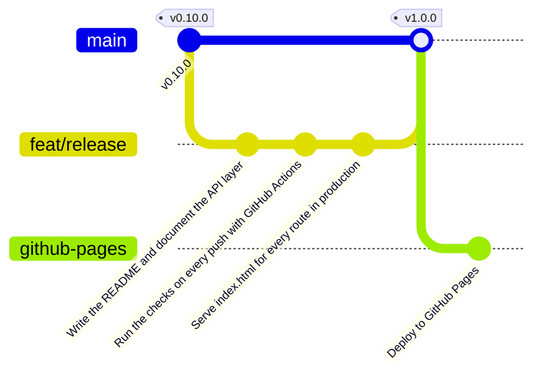
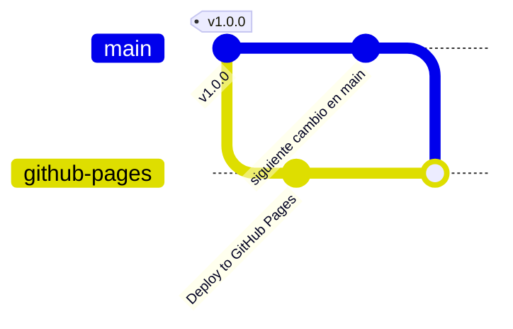

import {
	Aside,
	Card,
	CardGrid,
	FileTree,
	LinkCard,
	Steps,
	TabItem,
	Tabs,
} from "@astrojs/starlight/components";
import { Image } from "astro:assets";
import typedoc from "../../../../assets/react/release-typedoc.png";

GuitarLA funciona, pero solo en tu máquina. La última fase convierte el proyecto en algo que otra persona puede **instalar, entender y usar**: un README que es el manual, la documentación de la API generada del código, una integración continua que ejecuta las comprobaciones en cada push, y la aplicación publicada en Internet con Storybook y TypeDoc al lado. Al final, la versión `1.0.0`.

<CardGrid stagger>
	<Card title="Manual" icon="document">
		El README deja de ser la plantilla de Vite: qué es, cómo se instala y configura, qué scripts hay, cómo está organizado y qué convenciones sigue.
	</Card>
	<Card title="Integración continua" icon="github">
		Un workflow de GitHub Actions que pasa lint, formato, tests y build en cada push. La regla "ningún commit rompe la app" deja de depender de la disciplina.
	</Card>
	<Card title="Build y fallback" icon="rocket">
		`npm run build` genera `dist/`; un archivo de una línea hace que `/guitars/3` abierto directamente llegue al router.
	</Card>
	<Card title="Rama feat/release" icon="seti:git">
		Tres commits, fusión en `main` y release `v1.0.0`. Después, una rama aparte que nunca se fusiona, `github-pages`, para el segundo canal de distribución.
	</Card>
</CardGrid>

<Aside type="note" title="Requisitos previos">
	Haber completado [Alta de guitarra con imagen](/jjcm/di/units/react/09-new-guitar/): `v0.10.0` en `main`, 50 tests de Vitest y 11 de Playwright en verde, y el repositorio en GitHub. Para el despliegue hace falta una cuenta en [Netlify](https://www.netlify.com) (gratuita, vale con la de GitHub). Las unidades de [TypeDoc](/jjcm/di/units/documentation/typedoc/01-introduction/) y [Storybook](/jjcm/di/units/documentation/storybook/03-addons-and-docs/) explican las herramientas que aquí solo se configuran.
</Aside>

## La rama de esta fase

```bash
git switch main
git pull
git switch -c feat/release
```



## El README como manual

El README es lo primero que ve quien llega al repositorio, y en un proyecto pequeño es a la vez el **manual de instalación**, el de **configuración** y la **guía de referencia** rápida. Lo que tiene que responder, en este orden: qué es esto, cómo lo arranco, qué puedo ejecutar, cómo está organizado y qué reglas sigue. Sustituye el contenido entero:

````md title="README.md"
# GuitarLA

A small guitar shop built with React to learn how a front-end application is
made: components, state, a cart that survives reloads, routes, a catalogue
served by Supabase and a form that uploads images. It is the project of the
React unit of the **Desarrollo de Interfaces** module.

- **Live app**: https://guitarla-<your-name>.netlify.app
- **Storybook**: https://guitarla-<your-name>-storybook.netlify.app
- **API docs** (TypeDoc): https://guitarla-<your-name>-docs.netlify.app

## Stack

| Area          | Tools                                                              |
| ------------- | ------------------------------------------------------------------ |
| UI            | React 19, TypeScript, Tailwind CSS 4, React Router 8 (data mode)   |
| Backend       | Supabase (Postgres, Storage) through `@supabase/supabase-js`       |
| Tooling       | Vite 8, ESLint, Prettier                                           |
| Tests         | Vitest + Testing Library (unit), Playwright + axe (end to end)     |
| Documentation | Storybook 10 (components), TypeDoc (API), this README              |

## Getting started

The catalogue lives in a [Supabase](https://supabase.com) project. To run the app:

1. Create a Supabase project and run `supabase/schema.sql`, `supabase/seed.sql`
   and `supabase/insert-policies.sql` in its SQL Editor.
2. Upload the images of `public/img/guitarra_*.jpg` to the `guitars` bucket.
3. Copy `.env.example` to `.env` and fill it with the URL and the publishable
   key of the project (Project Settings → API Keys).
4. `npm install` and `npm run dev`.

Tests and Storybook do not need Supabase: they use the fake catalogue in
`src/api/guitars/__mocks__`. The end-to-end tests do: they run against the
project of your `.env`, and every run of the new guitar test adds a guitar.

## Scripts

| Script                    | What it does                                        |
| ------------------------- | --------------------------------------------------- |
| `npm run dev`             | Development server on http://localhost:5173         |
| `npm run build`           | Type-checks and builds the app into `dist/`         |
| `npm run preview`         | Serves `dist/` to check the production build        |
| `npm run lint`            | ESLint                                              |
| `npm run format`          | Prettier, writing the changes                       |
| `npm run format:check`    | Prettier, failing if something is not formatted     |
| `npm test`                | Vitest in watch mode (`npx vitest run` for one run) |
| `npm run test:e2e`        | Playwright (`test:e2e:ui` opens its UI)             |
| `npm run storybook`       | Storybook on http://localhost:6006                  |
| `npm run build-storybook` | Static Storybook into `storybook-static/`           |
| `npm run docs:api`        | TypeDoc into `docs/api/`                            |

## Project structure

```text
src/
  api/          one folder per resource; the only code that talks to Supabase
    guitars/    getGuitars, getGuitar, createGuitar and their __mocks__
  components/   one folder per component: X.tsx, X.test.tsx, X.stories.tsx, index.ts
  context/      CartContext and CartProvider
  hooks/        useCart, useDocumentTitle
  layouts/      Layout: header, main with the Outlet, footer
  lib/          the Supabase client
  loaders/      loaders and actions of the routes, grouped by entity
  pages/        one folder per route
  test/         fixtures and helpers for the tests
  types/        Guitar, CartItem, NewGuitar…
  utils/        pure functions such as validateNewGuitar
  router.tsx    the routes
e2e/            Playwright tests
supabase/       SQL to create the table, the bucket, the data and the policies
```

## Conventions

- One branch per feature (`feat/<name>`), merged into `main` with `--no-ff`
  and tagged (`v0.3.0` … `v1.0.0`) with a GitHub release.
- No commit leaves the app broken: `tsc`, ESLint, Prettier and Vitest pass on
  every commit; CI runs them on every push and pull request.
- Every component has a test and a story; every route with data has a loader
  or an action; everything that talks to Supabase lives in `src/api/`.
- Accessibility is part of the definition of done: accessible names, live
  regions, linked errors and focus management, checked with axe in Storybook
  and in Playwright.

## Deployment

The app is a static site: `npm run build` produces `dist/`, which any static
host can serve. Two things to configure in the host:

- the environment variables `VITE_SUPABASE_URL` and
  `VITE_SUPABASE_PUBLISHABLE_KEY`, read at build time;
- a fallback from every path to `index.html`, so that `/guitars/3` opened
  directly reaches the React Router (`public/_redirects` does it on Netlify).
````

Las tres URL de arriba se rellenan al final de la página, cuando existan. Lo que conviene notar del texto:

- **"Getting started" es el manual de instalación y configuración**: cualquiera con el repositorio y una cuenta de Supabase llega a `npm run dev` sin preguntar. Incluye el aviso sobre los e2e, porque crean datos.
- **La tabla de scripts es la guía de referencia** de lo que se puede ejecutar. Cada fila existe en `package.json`; si un día cambia uno, cambia aquí.
- **"Project structure" documenta la información persistente** y dónde está cada cosa: la carpeta `supabase/` describe la base de datos, `src/api/` es el único sitio que la toca.
- **"Conventions"** recoge las reglas que has seguido en diez páginas. Escritas, se pueden exigir en una revisión de código.

### TypeDoc sobre toda la API

TypeDoc se configuró en [el hook del carrito](/jjcm/di/units/react/05-cart-hook/) con dos entradas. Desde entonces la aplicación tiene una capa de API, loaders y utilidades con sus doc comments, y la documentación debería cubrirlos:

```diff lang="json" title="typedoc.json"
 {
-  "entryPoints": ["src/hooks/index.ts", "src/types/index.ts"],
+  "entryPoints": [
+    "src/api/index.ts",
+    "src/hooks/index.ts",
+    "src/loaders/index.ts",
+    "src/types/index.ts",
+    "src/utils/index.ts"
+  ],
   "tsconfig": "tsconfig.app.json",
   "out": "docs/api",
   "readme": "none"
 }
```

```bash
npm run docs:api
```

TypeDoc avisa de una cosa: el tipo `Result` de `validateNewGuitar` se usa en una firma pública pero **no está exportado**, así que no puede enlazarlo. Es un aviso útil: la documentación encuentra lo que el código esconde. Se exporta con un nombre que diga qué es:

```diff lang="ts" title="src/utils/validateNewGuitar.ts"
-type Result = { data: NewGuitar; errors?: never } | { errors: NewGuitarErrors };
+/** Either the typed data of a valid form, or the errors of an invalid one. */
+export type NewGuitarValidation =
+  | { data: NewGuitar; errors?: never }
+  | { errors: NewGuitarErrors };
 …
-export const validateNewGuitar = (formData: FormData): Result => {
+export const validateNewGuitar = (formData: FormData): NewGuitarValidation => {
```

Vuelve a generar y abre `docs/api/index.html`: cinco módulos, con cada función, su descripción, sus parámetros y sus `@throws`.

<Image src={typedoc} alt="Portada de la documentación generada por TypeDoc para GuitarLA, con los módulos api, hooks, loaders, types y utils en el índice" />

<Aside type="tip" title="Enlaces al código">
	Si el repositorio tiene remoto en GitHub, TypeDoc añade a cada símbolo un enlace a su línea en el código. En el proyecto de referencia no lo tiene y avisa de ello; en el tuyo los enlaces saldrán solos.
</Aside>

### Confirmar

`docs/api/` sigue en el `.gitignore`: se genera, no se versiona.

```bash
npm run lint
npm run format:check
npx vitest run
git add .
git commit -m "Write the README and document the API layer"
```

## Integración continua

"Ningún commit deja la aplicación rota" ha sido una regla que cumplías tú, a mano, antes de cada commit. La **integración continua** la convierte en algo que comprueba una máquina en cada push y en cada pull request, y que GitHub muestra con un tick verde o una cruz roja junto al commit.

GitHub Actions lee los **workflows** de `.github/workflows/`. Uno basta:

```yaml title=".github/workflows/ci.yml"
name: CI

on:
  push:
    branches: [main]
  pull_request:

jobs:
  checks:
    runs-on: ubuntu-latest
    steps:
      - uses: actions/checkout@v7
      - uses: actions/setup-node@v7
        with:
          node-version: 24
          cache: npm
      - run: npm ci
      - run: npm run lint
      - run: npm run format:check
      - run: npx vitest run
      - run: npm run build
        env:
          VITE_SUPABASE_URL: ${{ secrets.VITE_SUPABASE_URL }}
          VITE_SUPABASE_PUBLISHABLE_KEY: ${{ secrets.VITE_SUPABASE_PUBLISHABLE_KEY }}
      - run: npm run build-storybook
```

| Línea | Qué hace |
| :--- | :--- |
| `on: push / pull_request` | Se ejecuta en cada push a `main` y en cada pull request, venga de la rama que venga |
| `actions/checkout@v7` y `actions/setup-node@v7` | Clona el repositorio y prepara Node 24 con la caché de npm, para que `npm ci` tarde segundos. El número tras la `@` es la versión mayor de la acción: las antiguas (`v4`) siguen funcionando, pero GitHub avisa de que corren sobre un Node.js obsoleto |
| `npm ci` | Instala **exactamente** lo que dice `package-lock.json`, sin resolver versiones. Es lo que se usa en máquinas que no son la tuya |
| Los cuatro `run` | Los mismos comandos que ejecutas antes de cada commit. Si uno falla, el workflow falla y GitHub lo marca |
| `env` con `secrets.*` | El build necesita las variables de Supabase, pero el workflow no debe llevarlas escritas: se guardan como **secretos** del repositorio y se leen con `${{ secrets.NOMBRE }}` |
| `npm run build-storybook` | Storybook también compila; una story rota se detecta aquí |

Los tests de Playwright no están en el workflow a propósito: necesitarían un navegador en la máquina de GitHub y escribirían guitarras en tu Supabase con cada push. Son los que se ejecutan a mano antes de fusionar, y la ampliación de Auth verá cómo darles un proyecto de pruebas propio.

<Steps>
	1. En GitHub, **Settings → Secrets and variables → Actions → New repository secret**: crea `VITE_SUPABASE_URL` y `VITE_SUPABASE_PUBLISHABLE_KEY` con los valores de tu `.env`.
	2. Guarda el workflow y confírmalo:
</Steps>

```bash
npm run format:check
git add .
git commit -m "Run the checks on every push with GitHub Actions"
git push -u origin feat/release
```

En la pestaña **Actions** del repositorio aparece la ejecución. La primera tarda un par de minutos; si todo va bien, tick verde. Si prefieres verlo fallar antes de fiarte, rompe un test a propósito en un commit aparte, haz push y mira cómo lo señala; después revierte el commit.

## Build y despliegue

### Qué produce el build

```bash
npm run build
```

`tsc -b` comprueba los tipos y Vite deja en `dist/` un `index.html`, un CSS y un JavaScript con nombres que llevan un hash, para que los navegadores puedan cachearlos sin miedo. Es un **sitio estático**: no hay servidor de Node ni nada que ejecutar, solo archivos que servir. Y las variables de entorno **ya van dentro**: Vite sustituyó `import.meta.env.VITE_SUPABASE_URL` por su valor al compilar, por eso el hosting tiene que conocerlas antes del build, no después.

```bash
npm run preview
```

Sirve `dist/` en `http://localhost:4173`, para comprobar la versión de producción antes de subirla. Abre `/guitars/3` directamente: funciona, porque el servidor de `preview` devuelve `index.html` para cualquier ruta. Es justo lo que hay que conseguir en el hosting real.

<Aside type="note" title="El aviso del tamaño">
	Vite avisa de que el JavaScript pasa de 500 kB sin comprimir (unos 160 kB comprimido). La mayor parte es `supabase-js`, que carga también los módulos de autenticación y tiempo real que GuitarLA no usa todavía. Para una aplicación de este tamaño es aceptable; la mejora habitual, cargar cada página con `React.lazy` para que el catálogo no descargue el código del formulario, es un buen ejercicio de ampliación.
</Aside>

### El fallback de rutas

Un hosting estático, ante `GET /guitars/3`, busca un archivo `guitars/3` y, como no existe, responde 404. Hay que decirle que para **cualquier ruta** sirva `index.html`, y que React Router se encargue del resto. En Netlify eso es un archivo en `public/`, que Vite copia tal cual a `dist/`:

```txt title="public/_redirects"
/*    /index.html   200
```

Tres columnas: la ruta que llega, la que se sirve y el código de respuesta. El `200` (y no un `301`) es lo que lo convierte en una **reescritura**: la URL del navegador no cambia, solo cambia qué archivo se devuelve.

```bash
npm run build
ls dist/_redirects
git add .
git commit -m "Serve index.html for every route in production"
git push
```

<Aside type="tip" title="En otros hostings">
	Cada hosting tiene su manera de decir lo mismo. En Vercel es un `vercel.json` con `"rewrites": [{ "source": "/(.*)", "destination": "/index.html" }]`. GitHub Pages no tiene reescrituras y además sirve el sitio desde una subcarpeta, así que pide algo más de trabajo: se hace después de la release, en una rama que solo sirve para publicar, al final de esta página.
</Aside>

### Desplegar en Netlify

<Steps>
	1. Entra en [app.netlify.com](https://app.netlify.com) con tu cuenta de GitHub y pulsa **Add new site → Import an existing project → GitHub**. Autoriza el acceso al repositorio `di-react`.
	2. Configuración del build: rama `main`, **build command** `npm run build`, **publish directory** `dist`. Netlify los detecta solo al ver Vite.
	3. Antes de desplegar, **Add environment variables**: `VITE_SUPABASE_URL` y `VITE_SUPABASE_PUBLISHABLE_KEY` con los valores de tu `.env`. Sin ellas el build falla con el mensaje de `src/lib/supabase.ts`, que para eso está.
	4. **Deploy**. En un minuto hay una URL del tipo `https://nombre-aleatorio.netlify.app`; en **Site configuration → Site details → Change site name** puedes ponerle `guitarla-tunombre`.
	5. Comprueba la aplicación desplegada: el catálogo carga desde Supabase, `/guitars/3` abierto directamente funciona gracias a `_redirects`, el carrito sobrevive a una recarga y el alta de guitarra sube la imagen.
</Steps>

A partir de aquí, cada push a `main` vuelve a desplegar. Y como la fusión de una rama solo se hace cuando la integración continua está en verde, lo que se publica ha pasado todas las comprobaciones.

### Storybook y TypeDoc, publicados

Storybook y la documentación de la API también son sitios estáticos, y la forma más sencilla de publicarlos es como **dos sitios más** de Netlify sobre el mismo repositorio, cambiando solo el comando y la carpeta:

| Sitio | Build command | Publish directory |
| :--- | :--- | :--- |
| Storybook | `npm run build-storybook` | `storybook-static` |
| TypeDoc | `npm run docs:api` | `docs/api` |

Ninguno necesita las variables de Supabase: Storybook usa el mock y TypeDoc solo lee el código. Cuando existan las tres URL, escríbelas en la cabecera del README, en el commit de la release.

## Comprobar, fusionar y publicar

```bash
npm run lint
npm run format:check
npx vitest run
npm run test:e2e
npm run build
npm run build-storybook
npm run docs:api
```

```bash
git switch main
git merge --no-ff feat/release -m "Merge feat/release"
git push
git tag -a v1.0.0 -m "GuitarLA 1.0.0"
git push origin v1.0.0
gh release create v1.0.0 --title "v1.0.0 · GuitarLA" --notes "First complete version: catalogue and guitar detail from Supabase, cart with persistence, new guitar form with image upload, accessible throughout. README as the manual, API docs with TypeDoc, Storybook, CI with GitHub Actions and deployed on Netlify."
git branch -d feat/release
git push origin --delete feat/release
```

## Una rama para GitHub Pages

Con `v1.0.0` publicada en Netlify, queda una alternativa que no necesita ninguna cuenta fuera de GitHub: servir el sitio desde el propio repositorio en `https://<usuario>.github.io/di-react/`. Es la forma natural de que cualquier proyecto del módulo tenga una URL pública sin más que su repositorio, pero tiene dos diferencias con Netlify que obligan a tocar código:

- **El sitio cuelga de una subcarpeta**, `/di-react/`, no de la raíz. Todo lo que empiece por `/` (los scripts que genera Vite, las rutas del router, las imágenes de `public/`) tiene que llevar ese prefijo.
- **No hay reescrituras**. Lo único que ofrece es servir un `404.html` cuando una ruta no existe, así que el fallback consiste en que ese archivo sea una copia de `index.html`.

Esos cambios **no van a `main`**: son particulares de un hosting, y `main` sigue siendo la aplicación tal como se despliega en Netlify. Viven en una rama que existe solo para publicar, `github-pages`, que nunca se fusiona y que se actualiza trayendo `main` a ella cada vez que hay una versión nueva:

```bash
git switch main
git pull
git switch -c github-pages
```



### El prefijo

Vite tiene la opción `base` para esto, y la lee de una variable de entorno para que en desarrollo siga siendo `/`:

```diff lang="ts" title="vite.config.ts"
 // https://vite.dev/config/
+// The path the site hangs from: '/' in development, '/<repo>/' on GitHub Pages.
 export default defineConfig({
+  base: process.env.BASE_PATH ?? '/',
   plugins: [tailwindcss(), react()],
```

Vite expone ese valor a la aplicación como `import.meta.env.BASE_URL`, y React Router lo necesita como `basename`: con él, la ruta `/guitars/3` se corresponde con la URL `/di-react/guitars/3` y todos los `<Link to="/…">` siguen funcionando sin cambios.

```diff lang="tsx" title="src/router.tsx"
-export const router = createBrowserRouter(routes);
+// basename follows Vite's base, so every route and <Link> works under /<repo>/.
+export const router = createBrowserRouter(routes, {
+  basename: import.meta.env.BASE_URL,
+});
```

Las imágenes de la cabecera estaban escritas como `/img/…`, una ruta absoluta que Vite no puede reescribir porque va dentro de un texto. La solución es la que Vite recomienda para cualquier imagen propia de la aplicación: moverlas a `src/assets/` e **importarlas**. Vite les pone el prefijo, el hash y las optimiza.

```bash
mkdir -p src/assets
git mv public/img/header.jpg public/img/logo.svg public/img/carrito.png src/assets/
```

```diff lang="tsx" title="src/components/Header/Header.tsx"
 import { useCartContext } from '../../context';
+import cartIcon from '../../assets/carrito.png';
+import headerImage from '../../assets/header.jpg';
+import logo from '../../assets/logo.svg';
 import { Cart } from '../Cart';
 …
-    <header className="relative bg-[url(/img/header.jpg)] bg-cover bg-center py-10">
+    <header
+      className="relative bg-cover bg-center py-10"
+      style={{ backgroundImage: `url(${headerImage})` }}
+    >
 …
-          
+          
 …
-              
+              
```

Las fotos de las guitarras no tienen este problema en la aplicación, porque vienen de Supabase. Sí lo tienen en el catálogo falso de Storybook, que también va a publicarse en una subcarpeta: sus rutas pasan a ser **relativas**, sin la barra inicial, y se resuelven respecto a la página de Storybook que las muestra.

```diff lang="ts" title="src/api/guitars/__mocks__/guitars.ts"
-    image: '/img/guitarra_01.jpg',
+    image: 'img/guitarra_01.jpg',
 …
-    image: '/img/guitarra_02.jpg',
+    image: 'img/guitarra_02.jpg',
 …
-    image: '/img/guitarra_03.jpg',
+    image: 'img/guitarra_03.jpg',
 …
-    image: '/img/guitarra_04.jpg',
+    image: 'img/guitarra_04.jpg',
```

Dos tests comprobaban el `src` exacto y cambian con él:

```diff lang="tsx" title="src/components/Guitar/Guitar.test.tsx"
     expect(
       screen.getByRole('img', { name: 'Guitarra Lukather' })
-    ).toHaveAttribute('src', '/img/guitarra_01.jpg');
+    ).toHaveAttribute('src', 'img/guitarra_01.jpg');
```

```diff lang="tsx" title="src/components/Cart/Cart.test.tsx"
     expect(
       screen.getByRole('img', { name: 'Guitarra Lukather' })
-    ).toHaveAttribute('src', '/img/guitarra_01.jpg');
+    ).toHaveAttribute('src', 'img/guitarra_01.jpg');
```

Comprueba que en desarrollo nada ha cambiado (`npm run dev`, cabecera con sus imágenes) y que el build con prefijo lo lleva a todas partes:

```bash
BASE_PATH=/di-react/ npm run build
grep -o 'src="[^"]*"' dist/index.html
```

```txt
src="/di-react/assets/index-BDWwWXwi.js"
```

### El workflow de despliegue

Un segundo workflow, separado del de CI, que se ejecuta en cada push **a esta rama**: construye la aplicación con el prefijo, Storybook y TypeDoc, los junta en una carpeta, añade el `404.html` y lo publica.

```yaml title=".github/workflows/deploy.yml"
name: Deploy to GitHub Pages

# This workflow lives in the github-pages branch, which is never merged into
# main: it carries the base path changes and is updated with `git merge main`.
on:
  push:
    branches: [github-pages]
  workflow_dispatch:

permissions:
  contents: read
  pages: write
  id-token: write

concurrency:
  group: pages
  cancel-in-progress: true

jobs:
  build:
    runs-on: ubuntu-latest
    steps:
      - uses: actions/checkout@v7
      - uses: actions/setup-node@v7
        with:
          node-version: 24
          cache: npm
      - run: npm ci
      - run: npm run build
        env:
          # The site hangs from https://<user>.github.io/<repo>/
          BASE_PATH: /${{ github.event.repository.name }}/
          VITE_SUPABASE_URL: ${{ secrets.VITE_SUPABASE_URL }}
          VITE_SUPABASE_PUBLISHABLE_KEY: ${{ secrets.VITE_SUPABASE_PUBLISHABLE_KEY }}
      - run: npm run build-storybook
      - run: npm run docs:api
      - name: Assemble the site
        run: |
          mkdir site
          cp -r dist/. site/
          cp -r storybook-static site/storybook
          cp -r docs/api site/docs
          # GitHub Pages serves 404.html for unknown paths: the SPA fallback.
          cp dist/index.html site/404.html
      - uses: actions/upload-pages-artifact@v5
        with:
          path: site

  deploy:
    needs: build
    runs-on: ubuntu-latest
    environment:
      name: github-pages
      url: ${{ steps.deployment.outputs.page_url }}
    steps:
      - id: deployment
        uses: actions/deploy-pages@v5
```

| Línea | Qué hace |
| :--- | :--- |
| `permissions: pages: write, id-token: write` | Los permisos mínimos para publicar en Pages desde un workflow. Sin ellos, el `deploy` falla con un 403 |
| `on: push: branches: [github-pages]` | Se dispara con los push a la rama de publicación, no a `main`. Como el archivo solo existe en esta rama, `main` nunca lo ejecuta |
| `concurrency: group: pages` | Si llegan dos push seguidos, se cancela el despliegue del primero: solo importa el último |
| `BASE_PATH: /${{ github.event.repository.name }}/` | El nombre del repositorio, sacado del evento, para que el mismo workflow sirva aunque el repo se llame distinto |
| `Assemble the site` | Una sola carpeta con la aplicación en la raíz, Storybook en `/storybook/` y TypeDoc en `/docs/`. `404.html` es la copia de `index.html` que hace de fallback |
| `upload-pages-artifact` y `deploy-pages` | El primero empaqueta la carpeta; el segundo, en un job aparte con el entorno `github-pages`, la publica y devuelve la URL. Ese entorno tiene **reglas de protección**: por defecto solo acepta despliegues desde la rama principal, y hay que añadir `github-pages` a mano |

<Steps>
	1. En GitHub, **Settings → Pages → Build and deployment → Source**: elige **GitHub Actions**. Sin este paso el workflow publica, pero Pages no sirve nada.
	2. **Settings → Environments → github-pages → Deployment branches and tags**: añade la rama `github-pages`. GitHub crea ese entorno con una regla que solo deja desplegar desde la rama por defecto; sin este paso el job `deploy` falla con "Branch github-pages is not allowed to deploy to github-pages due to environment protection rules".
	3. Los secretos `VITE_SUPABASE_URL` y `VITE_SUPABASE_PUBLISHABLE_KEY` ya existen desde la integración continua; el workflow los reutiliza.
	4. Tras el push de la rama (los comandos están más abajo), en **Actions** aparece "Deploy to GitHub Pages"; al terminar, el job `deploy` muestra la URL.
	5. Si algo falla y tienes que repetirlo, lanza una **ejecución nueva** (botón **Run workflow**, que existe gracias a `workflow_dispatch`, o un push a la rama), no "Re-run jobs": al repetir, `build` sube otro artefacto `github-pages` junto al de la vez anterior y `deploy` falla con "Multiple artifacts named github-pages were unexpectedly found".
	6. Abre `https://<usuario>.github.io/di-react/`: catálogo desde Supabase, imágenes de la cabecera, y `/di-react/guitars/3` escrito a mano funciona gracias a `404.html`. En `/di-react/storybook/` las stories muestran sus fotos y en `/di-react/docs/` está TypeDoc.
	7. Si Pages va a ser tu canal principal, cambia en esta rama las tres URL de la cabecera del README por las suyas.
</Steps>

El README de esta rama explica qué es la rama y cómo se actualiza, para quien la encuentre en el repositorio:

```diff lang="md" title="README.md"
 - a fallback from every path to `index.html`, so that `/guitars/3` opened
   directly reaches the React Router (`public/_redirects` does it on Netlify).
+
+This branch, `github-pages`, publishes the app, Storybook and the API docs on
+GitHub Pages at `https://<your-user>.github.io/di-react/`, `/storybook/` and
+`/docs/`, through `.github/workflows/deploy.yml` on every push to it. It is
+never merged into `main`: it carries the changes Pages needs (the site hangs
+from a subfolder, so the build receives `BASE_PATH` for Vite's `base` and the
+router's `basename`, and `404.html` is a copy of `index.html`). To publish a
+new version: `git switch github-pages`, `git merge main`, `git push`.
```

### Confirmar y publicar

```bash
npm run lint
npm run format:check
npx vitest run
BASE_PATH=/di-react/ npm run build
git add .
git commit -m "Deploy to GitHub Pages"
git push -u origin github-pages
```

El push dispara "Deploy to GitHub Pages". No hay fusión, etiqueta ni release: `main` y `v1.0.0` no cambian, y Netlify sigue sirviendo lo suyo. La rama se queda en el repositorio, y cada vez que `main` avance, publicar la versión nueva en Pages son tres comandos:

```bash
git switch github-pages
git merge main
git push
```

Si algún día la fusión da conflicto será en los archivos que esta rama cambia (`Header.tsx`, `router.tsx`, `vite.config.ts`, el mock): se resuelve conservando la versión con prefijo y se sigue.

## Comprobación final

<Steps>
	1. El README responde, en este orden, qué es el proyecto, cómo se instala y configura, qué scripts tiene, cómo está organizado, qué convenciones sigue y cómo se despliega; las tres URL de la cabecera funcionan.
	2. `npm run docs:api` genera cinco módulos sin avisos (salvo el del remoto si no lo hay) y `docs/api/` no está versionado.
	3. En la pestaña Actions de GitHub, el último push a `main` tiene el tick verde, con lint, formato, 50 tests, build y Storybook.
	4. La aplicación desplegada carga el catálogo, abre `/guitars/3` directamente, conserva el carrito al recargar y da de alta una guitarra con su imagen.
	5. Storybook y TypeDoc están publicados en sus propias URL.
	6. En GitHub existen la etiqueta y la release `v1.0.0`, y el historial va de `v0.3.0` a `v1.0.0` con una rama fusionada por fase.
	7. Existe la rama `github-pages`, sin fusionar en `main`, con el workflow "Deploy to GitHub Pages" en verde y la aplicación, Storybook y TypeDoc en `https://<usuario>.github.io/di-react/` y sus subcarpetas.
</Steps>

## 🧩 Aplicación en el proyecto

Esta página es la plantilla de entrega de cualquier proyecto del módulo: un README que sirve de manual de instalación, configuración y referencia; documentación generada del código; un workflow de CI que ejecuta las mismas comprobaciones que haces en local; y un despliegue con las variables de entorno en el hosting y el fallback de rutas. La app de informes se entrega exactamente así, con sus propias URL en la cabecera del README.

## Resumen rápido

| Concepto | Detalle |
| :--- | :--- |
| **README** | Qué es, Getting started (instalación y configuración), Scripts, Project structure, Conventions, Deployment; las URL de app, Storybook y docs arriba |
| **TypeDoc** | `entryPoints` con los `index.ts` de `api`, `hooks`, `loaders`, `types` y `utils`; exportar los tipos que aparecen en firmas públicas; `docs/api` ignorado |
| **CI** | `.github/workflows/ci.yml`: `npm ci`, lint, `format:check`, `vitest run`, `build` (con secretos) y `build-storybook`; los e2e, a mano |
| **Build** | `npm run build` → `dist/`; las variables `VITE_*` se incrustan al compilar; `npm run preview` para probarlo |
| **Fallback** | `public/_redirects` con `/* /index.html 200` (Netlify); `vercel.json` en Vercel; copia de `index.html` como `404.html` en GitHub Pages |
| **GitHub Pages** | Rama `github-pages`, nunca fusionada, que se actualiza con `git merge main`: `base` desde `BASE_PATH`, `basename: import.meta.env.BASE_URL`, imágenes importadas desde `src/assets/`, rutas relativas en el mock, workflow con `upload-pages-artifact` + `deploy-pages` y Source = GitHub Actions |
| **Despliegue** | Netlify importando el repositorio, `npm run build` + `dist`, variables de entorno antes del primer deploy; Storybook y TypeDoc como dos sitios más |

## Convención práctica

<Steps>
	1. **El README es el manual**, y se actualiza en el mismo commit que cambia lo que describe.
	2. **Lo generado no se versiona**: `dist/`, `storybook-static/` y `docs/api/` salen de un comando y están en `.gitignore`.
	3. **CI ejecuta lo mismo que tú**, ni más ni menos: si un paso no se puede ejecutar en local, no va en el workflow.
	4. **Los secretos nunca van en el código ni en el workflow**: `.env` en local, secretos en GitHub, variables de entorno en el hosting.
	5. **Toda SPA desplegada lleva su fallback** a `index.html`, y se comprueba abriendo una ruta interna directamente.
	6. **Una release por versión**, con etiqueta y notas que digan qué cambia; `1.0.0` cuando la aplicación hace todo lo que se prometió.
</Steps>

## Referencias

<CardGrid stagger>
	<LinkCard
		href="https://vite.dev/guide/static-deploy"
		title="Desplegar un sitio estático (Vite)"
		description="Build, preview y la receta de despliegue para Netlify, Vercel, GitHub Pages y otros."
		target="_blank"
		rel="noopener noreferrer"
	/>
	<LinkCard
		href="https://vite.dev/guide/env-and-mode"
		title="Variables de entorno y modos (Vite)"
		description="Por qué las variables se incrustan al compilar y qué archivos .env lee cada modo."
		target="_blank"
		rel="noopener noreferrer"
	/>
	<LinkCard
		href="https://docs.netlify.com/routing/redirects/rewrites-proxies/#history-pushstate-and-single-page-apps"
		title="Reescrituras para SPA (Netlify)"
		description="El archivo _redirects y por qué el código es 200 y no 301."
		target="_blank"
		rel="noopener noreferrer"
	/>
	<LinkCard
		href="https://docs.github.com/en/actions/writing-workflows/quickstart"
		title="Inicio rápido de GitHub Actions"
		description="Anatomía de un workflow: eventos, jobs, steps y secretos."
		target="_blank"
		rel="noopener noreferrer"
	/>
	<LinkCard
		href="https://typedoc.org/documents/Options.html"
		title="Opciones de TypeDoc"
		description="entryPoints, out, readme y el resto de la configuración."
		target="_blank"
		rel="noopener noreferrer"
	/>
	<LinkCard
		href="https://www.makeareadme.com/"
		title="Make a README"
		description="Qué secciones espera quien abre un repositorio y por qué."
		target="_blank"
		rel="noopener noreferrer"
	/>
</CardGrid>

## Siguientes pasos

<CardGrid>
	<LinkCard
		href="/jjcm/di/units/extensions/checkout/"
		title="Ampliación: el formulario de compra"
		description="Material de ampliación para el segundo trimestre, junto con Supabase Auth y los pedidos."
	/>
	<LinkCard
		href="/jjcm/di/units/documentation/typedoc/01-introduction/"
		title="Unidad de documentación"
		description="TypeDoc y Storybook a fondo: doc comments, tags, addons y publicación."
	/>
</CardGrid>
